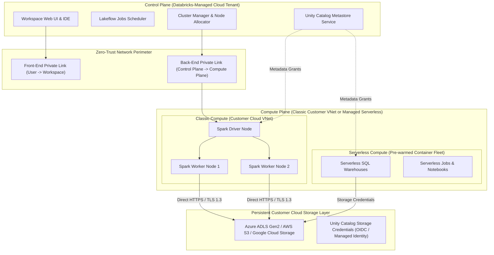
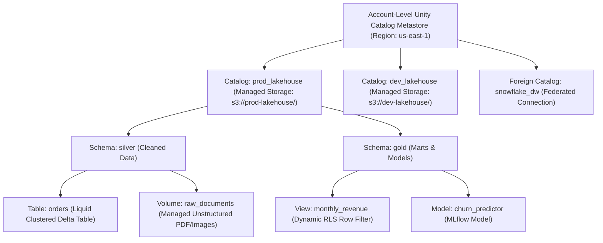
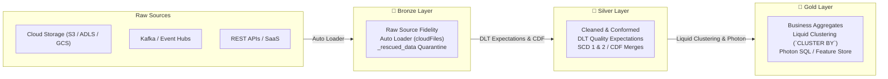
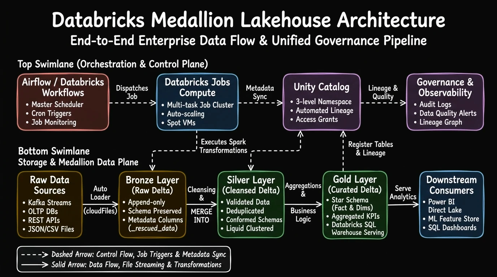
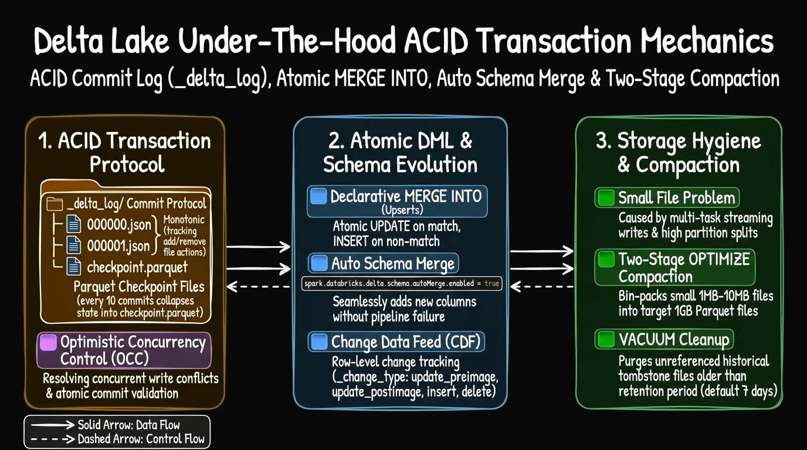
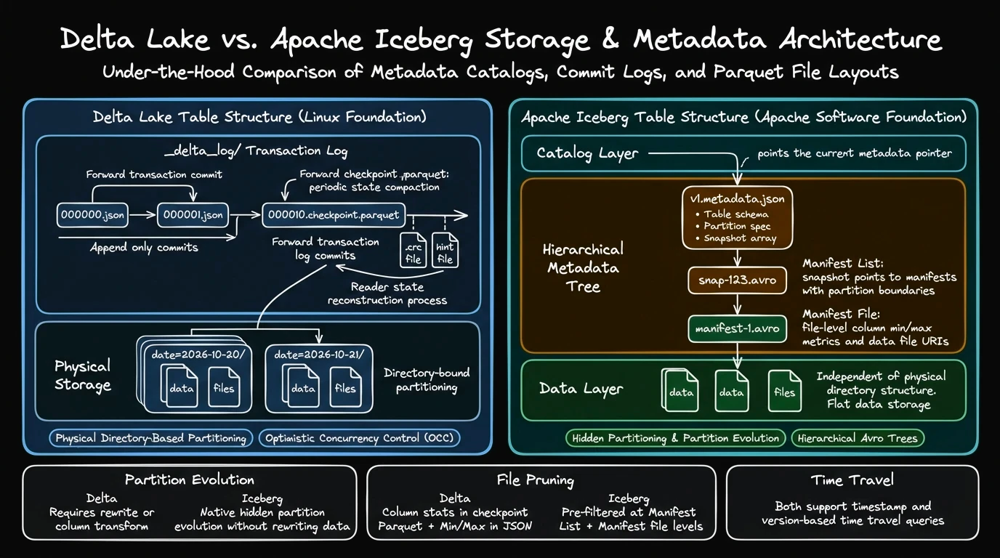
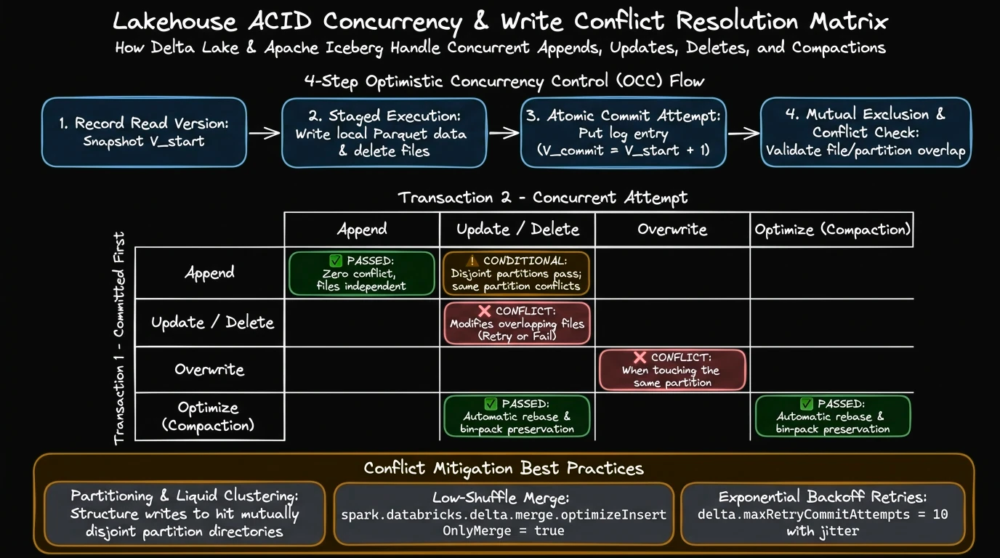
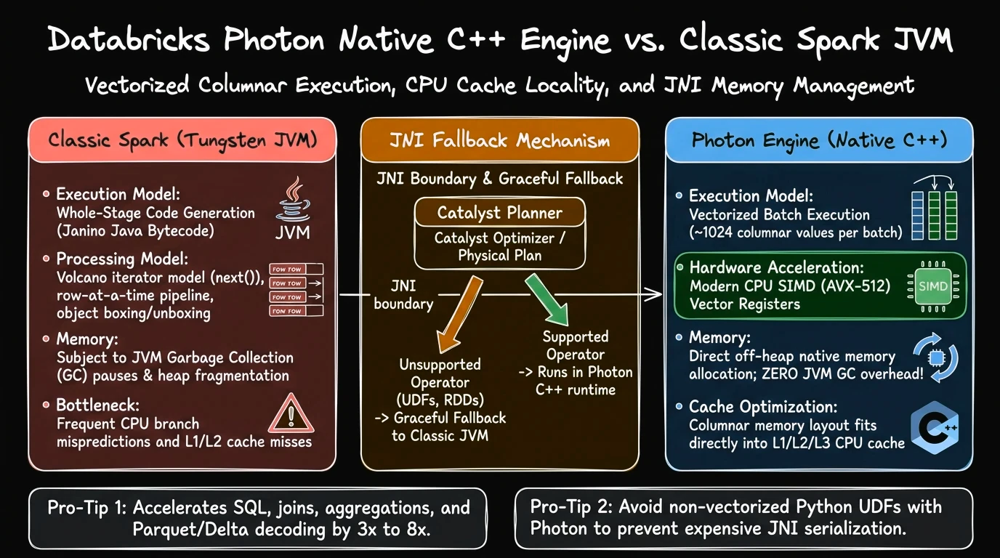

# ⚡ The Databricks Handbook

**105 Production Coding Recipes, Unity Catalog Governance, Delta Lake 3.x, Lakeflow, Photon & Incident Runbooks**

[](https://github.com/santoshjammi29/databricks-handbook/actions) • [Core Concepts (132 Topics)](#core-concepts)
[](https://www.databricks.com/)
[](https://spark.apache.org/)
[](https://delta.io/)
[](https://www.databricks.com/product/unity-catalog)
[](https://www.databricks.com/product/photon)
[](https://www.python.org/)
[](databricks.yml)
[](LICENSE)

*The definitive enterprise reference repository of 105 battle-tested Databricks Data Intelligence Platform recipes, architectural blueprints, and disaster recovery incident runbooks.*  
*Structured in the official **Databricks Source Notebook format (`.py`)** for seamless 1-click sync with **Databricks Repos / Git Folders**, **Databricks Asset Bundles (DABs)**, **VS Code / Databricks Connect v2**, and CI/CD pipelines.*

[Curriculum Overview](#curriculum-overview) • [Platform Architecture](#platform-architecture) • [Whiteboard Blueprints](#whiteboard-blueprints) • [Quickstart](#quickstart) • [DAB Deployment](#dabs) • [Architecture Deep Dives](#architectures) • [Runbooks](#runbooks) • [Interview Matrix](#interview-matrix) • [FinOps Telemetry](#finops)

---

<a id="core-concepts"></a>
## 🧠 Core Curriculum Concepts & Topics (132 Topics Covered)

> 💡 **Enterprise Knowledge Base Integration**: This repository implements **132 production topics** from the [Modern Data Engineering Systems Encyclopedia (921 Topics)](https://moderndataengineer.uk/concepts).

### 📑 Topics Directory at a Glance

| Pillar / Module | Topic Count | Key Core Primitives Covered | Status |
|:---|:---:|:---|:---:|
| ⚡ **Databricks Platform, Unity Catalog & Delta Lake 3.x** | **132** | Databricks Workspace, All-Purpose Cluster, Job Cluster, Databricks Notebook, and 128 more | ✅ Fully Documented |

<details open>
<summary><b>⚡ Databricks Platform, Unity Catalog & Delta Lake 3.x (132 Topics)</b> — <i>Click to collapse/expand</i></summary>

| # | Topic / Concept | Level | Architectural Definition & Core Principle |
|---|---|---|---|
| 1 | **Databricks Workspace** | 🟢 Easy | A Databricks Workspace is a software-as-a-service (SaaS) environment that provides a unified collaborative interface for data engineers, data scientists, and analysts to access compute, notebooks, and storage. |
| 2 | **All-Purpose Cluster** | 🟢 Easy | An All-Purpose Cluster is a shared interactive compute cluster designed for collaborative exploratory data analysis, interactive notebook development, and ad-hoc querying. |
| 3 | **Job Cluster** | 🟢 Easy | A Job Cluster is an ephemeral, dedicated compute cluster automatically provisioned by Databricks to execute a specific automated workload and terminated immediately upon completion. |
| 4 | **Databricks Notebook** | 🟢 Easy | A Databricks Notebook is a web-based interactive development document combining live executable code cells, interactive visualizations, and narrative markdown documentation. |
| 5 | **DBFS (Databricks File System)** | 🟢 Easy | DBFS (Databricks File System) is a distributed file system abstraction layer mounted over cloud object storage (S3 bucket, Azure container, GCS bucket) accessible across the workspace. |
| 6 | **Delta Lake (Databricks)** | 🟢 Easy | Delta Lake is an open-source storage framework that brings ACID transactions, scalable metadata handling, and unified streaming and batch data processing to Apache Spark and data lakes. |
| 7 | **Unity Catalog** | 🟢 Easy | Unity Catalog is Databricks' centralized, multi-cloud governance solution providing unified access control, data auditing, lineage tracking, and discovery across all workspace assets. |
| 8 | **Metastore** | 🟢 Easy | A Metastore is the central metadata repository that catalogs schema definitions, table partition locations, data types, and access privileges for data stored in the lakehouse. |
| 9 | **Data Explorer** | 🟢 Easy | Data Explorer is the visual UI tool in the Databricks Workspace used to discover, manage, inspect, and grant permissions on Unity Catalog data assets. |
| 10 | **dbutils** | 🟢 Easy | Databricks Utilities (dbutils) is a built-in Python and Scala library that provides programmatic helper methods for file system operations, secret management, notebook workflows, and UI widgets. |
| 11 | **Magic Commands** | 🟢 Easy | Magic Commands are special prefix directives (%python, %sql, %scala, %r, %sh, %fs) entered at the beginning of a notebook cell to alter the execution runtime or execute system utilities. |
| 12 | **Databricks Job** | 🟢 Easy | A Databricks Job is a scheduled or triggered execution unit that runs non-interactive code (notebooks, JARs, Python scripts, dbt models) on automated compute clusters. |
| 13 | **Databricks Workflow** | 🟢 Easy | Databricks Workflows is the fully managed, native orchestration service within Databricks that designs, schedules, and monitors multi-task Directed Acyclic Graphs (DAGs). |
| 14 | **Databricks Repos** | 🟢 Easy | Databricks Repos (now known as Git Folders) provides visual and programmatic Git version control integration directly inside the Databricks Workspace. |
| 15 | **Cluster Policy** | 🟢 Easy | A Cluster Policy is an administrative governance rule set that restricts the configuration options available to users when provisioning compute clusters. |
| 16 | **Delta Live Tables (DLT)** | 🟡 Intermediate | Delta Live Tables (DLT) is a declarative ETL framework in Databricks that simplifies data pipeline development by managing dependencies, infrastructure scaling, and data quality enforcement. |
| 17 | **Auto Loader** | 🟡 Intermediate | Auto Loader is an optimized ingestion engine in Databricks that incrementally and efficiently ingests raw data files from cloud storage as they arrive without state tracking overhead. |
| 18 | **Change Data Feed (CDF)** | 🟡 Intermediate | Change Data Feed (CDF) is a Delta Lake feature that captures and exposes row-level change events (inserts, updates, deletes) committed to a Delta table. |
| 19 | **Z-Ordering** | 🟡 Intermediate | Z-Ordering is a multidimensional clustering technique that colocates related information in the same set of Parquet files to maximize file skipping during SQL queries. |
| 20 | **OPTIMIZE Command** | 🟡 Intermediate | The OPTIMIZE command compacts fragmented small Parquet files in a Delta table into larger, query-efficient files (typically ~1GB in size). |
| 21 | **VACUUM Command** | 🟡 Intermediate | The VACUUM command permanently deletes historical data files from cloud storage that are no longer referenced by the active Delta table log and exceed a retention threshold. |
| 22 | **Delta Time Travel** | 🟡 Intermediate | Delta Time Travel is the ability to query point-in-time historical snapshots of a Delta table using historical commit versions or timestamps. |
| 23 | **Shallow Clone vs Deep Clone** | 🟡 Intermediate | Delta Cloning creates copies of a table: Shallow Clone copies only metadata references with zero data duplication, whereas Deep Clone creates a fully independent physical copy of data and metadata. |
| 24 | **Medallion Architecture on Databricks** | 🟡 Intermediate | The Medallion Architecture is a lakehouse data design pattern that logically organizes data into Bronze (raw ingestion), Silver (cleaned/conformed), and Gold (curated business marts) quality layers. |
| 25 | **MLflow Tracking** | 🟡 Intermediate | MLflow Tracking is an enterprise logging API and UI for recording machine learning experiment runs, hyperparameters, evaluation metrics, code versions, and serialized model artifacts. |
| 26 | **MLflow Model Registry** | 🟡 Intermediate | The MLflow Model Registry provides a centralized model store, set of APIs, and UI to collaboratively manage the full lifecycle of MLflow models from development to production deployment. |
| 27 | **Databricks Feature Store** | 🟡 Intermediate | The Databricks Feature Store is a centralized catalog that enables data scientists to discover, share, and reuse ML features with guaranteed online/offline consistency. |
| 28 | **Photon Engine** | 🟡 Intermediate | Photon is Databricks' next-generation vectorized query engine written from the ground up in native C++ to deliver high-performance execution of SQL and DataFrame workloads. |
| 29 | **Databricks SQL Warehouse** | 🟡 Intermediate | A Databricks SQL Warehouse is a specialized compute resource optimized for SQL workloads, business intelligence queries, and high-concurrency analytical dashboards. |
| 30 | **Vector Search** | 🟡 Intermediate | Databricks Vector Search is a serverless vector database integrated into Unity Catalog that stores and indexes vector embeddings for real-time similarity search and RAG applications. |
| 31 | **Unity Catalog Fine-Grained Access Control** | 🔴 Advanced | Fine-Grained Access Control in Unity Catalog enforces cell-level security via Row Filters and Column Masks defined with standard SQL functions. |
| 32 | **Lakehouse Federation** | 🔴 Advanced | Lakehouse Federation allows Unity Catalog to query external operational and analytical databases (Snowflake, BigQuery, PostgreSQL, MySQL, SQL Server) in place without moving data. |
| 33 | **Delta Sharing** | 🔴 Advanced | Delta Sharing is an open, cross-platform protocol for securely sharing live data tables, schemas, and AI models across organizations and clouds without data duplication. |
| 34 | **Databricks Structured Streaming** | 🔴 Advanced | Databricks Structured Streaming is a scalable stream processing engine built on Spark SQL that processes continuous data streams with micro-batch or continuous processing semantics. |
| 35 | **Spark Connect** | 🔴 Advanced | Spark Connect is a decoupled client-server architecture for Apache Spark that enables thin clients and IDEs to execute Spark DataFrame queries via a lightweight gRPC protocol. |
| 36 | **Serverless Compute (Databricks)** | 🔴 Advanced | Serverless Compute is an on-demand, fully managed compute architecture in Databricks that boots clusters in seconds and scales resources instantaneously within Databricks-managed cloud accounts. |
| 37 | **Databricks Asset Bundles (DABs)** | 🔴 Advanced | Databricks Asset Bundles (DABs) is an Infrastructure-as-Code (IaC) framework that allows developers to define, test, and deploy entire Databricks projects using version-controlled YAML configurations. |
| 38 | **SCIM Provisioning** | 🔴 Advanced | SCIM (System for Cross-domain Identity Management) Provisioning automatically synchronizes users, service principals, and security groups from enterprise identity providers to Databricks. |
| 39 | **Audit Logging** | 🔴 Advanced | Audit Logging captures, records, and exports detailed security audit trails of all user and system activities occurring across Databricks workspaces and Unity Catalog. |
| 40 | **DLT Expectations** | 🔴 Advanced | DLT Expectations are declarative data quality assertions applied to Delta Live Tables that validate incoming records and govern pipeline behavior upon data quality violations. |
| 41 | **Predictive Optimization** | 🔴 Advanced | Predictive Optimization is an automated AI-driven service in Databricks that intelligently schedules OPTIMIZE and VACUUM maintenance operations on Unity Catalog managed tables. |
| 42 | **Unity Catalog System Tables** | 🔴 Advanced | Unity Catalog System Tables are analytical Delta tables hosted in the system catalog that expose operational metadata, cost telemetry, query history, and data lineage. |
| 43 | **Liquid Clustering** | 🔴 Advanced | Liquid Clustering is Databricks' next-generation data layout technology that dynamically clusters Delta tables without the rigid limitations of traditional partitioning and Z-Ordering. |
| 44 | **Serverless DLT** | 🔴 Advanced | Serverless DLT executes Delta Live Tables pipelines on instant, fully managed serverless compute clusters operated within the Databricks cloud control plane. |
| 45 | **Databricks Connect v2** | 🔴 Advanced | Databricks Connect v2 is a client library built on Spark Connect that allows developers to run PySpark code from local IDEs directly against remote Databricks compute clusters. |
| 46 | **Databricks Lakehouse vs Snowflake** | 🟣 Architect | The enterprise architectural evaluation comparing Databricks' open, compute-flexible lakehouse platform against Snowflake's proprietary, SQL-centric cloud data warehouse platform. |
| 47 | **Unity Catalog Multi-Workspace Topology** | 🟣 Architect | An enterprise architecture design that connects multiple environment- or business-unit-specific workspaces to a single regional Unity Catalog metastore. |
| 48 | **DBU Cost Governance** | 🟣 Architect | The architectural framework and operational policies used to monitor, allocate, forecast, and optimize Databricks Unit (DBU) consumption and cloud infrastructure costs. |
| 49 | **Multi-Cloud Databricks Deployment** | 🟣 Architect | An enterprise deployment pattern operating Databricks across multiple cloud providers (AWS, Azure, GCP) while maintaining unified governance and consistent CI/CD pipelines. |
| 50 | **Databricks + dbt Integration** | 🟣 Architect | The production architecture pairing dbt with Databricks SQL Serverless and Unity Catalog, leveraging the dbt-databricks adapter for high-performance lakehouse transformations. |
| 51 | **Databricks Workflows vs Airflow** | 🟣 Architect | The architectural decision framework comparing native Databricks Workflows with external general-purpose orchestrators like Apache Airflow. |
| 52 | **Petabyte-Scale ELT on Databricks** | 🟣 Architect | The architectural principles and tuning strategies required to ingest, transform, and merge petabyte-scale data volumes on Databricks with predictable SLAs. |
| 53 | **Data Mesh on Databricks** | 🟣 Architect | An architectural implementation of the Data Mesh paradigm on Databricks, treating data as a product owned by decentralized domain teams governed by Unity Catalog. |
| 54 | **Governance with Unity Catalog + Purview** | 🟣 Architect | The enterprise governance integration between Databricks Unity Catalog and Microsoft Purview, unifying lakehouse metadata with company-wide data governance. |
| 55 | **Databricks MLOps Platform** | 🟣 Architect | An end-to-end Machine Learning Operations (MLOps) architecture on Databricks encompassing automated feature engineering, experiment tracking, model registry, and serverless model serving. |
| 56 | **Real-Time Lakehouse Architecture** | 🟣 Architect | A unified lakehouse architecture that processes high-frequency real-time event streams (Kafka, Event Hubs) with sub-second to minute-level latency directly into Delta Lake. |
| 57 | **CI/CD for Databricks with DABs** | 🟣 Architect | The continuous integration and continuous deployment (CI/CD) architecture for Databricks using Databricks Asset Bundles (DABs) and Git automation pipelines. |
| 58 | **Disaster Recovery for Databricks** | 🟣 Architect | The disaster recovery (DR) architecture for Databricks ensuring business continuity, minimal RPO, and near-zero RTO during regional cloud infrastructure outages. |
| 59 | **Databricks for Data Products** | 🟣 Architect | The methodology and platform architecture for engineering, publishing, documenting, and monetizing curated data products on Databricks. |
| 60 | **Unity Catalog Enterprise Governance** | 🟣 Architect | The enterprise governance operating model for Unity Catalog encompassing account-level identity management, catalog segregation, classification tagging, and regulatory audit compliance. |
| 61 | **Databricks Auto Loader (cloudFiles)** | 🔴 Advanced | An optimized streaming source format in Databricks (`cloudFiles`) that incrementally and efficiently processes billions of new data files arriving in cloud storage without state file explosion. |
| 62 | **Delta Lake Deletion Vectors** | 🟣 Architect | A storage optimization technique in Delta Lake that marks deleted or updated rows using lightweight bitmap index files instead of rewriting entire Parquet data files. |
| 63 | **Databricks Unity Catalog Architecture** | 🟣 Architect | The centralized governance, metadata, and fine-grained access control layer for all data and AI assets across multiple Databricks workspaces in a cloud tenant. |
| 64 | **Databricks Serverless SQL Warehouse** | 🔴 Advanced | A fully managed, instant-starting compute tier in Databricks optimized for high-concurrency SQL and BI queries running inside Databricks-managed compute planes. |
| 65 | **Databricks Genie Spaces (Lakehouse AI)** | 🔴 Advanced | An AI-powered conversational interface in Databricks that allows non-technical business stakeholders to query Lakehouse Delta tables using natural language. |
| 66 | **ACID Transactions** | 🟢 Easy | How Delta Lake guarantees atomicity, consistency, isolation, and durability on top of cloud object storage. |
| 67 | **Transaction Log (`_delta_log`)** | 🟢 Easy | How the JSON-based transaction log tracks every change. |
| 68 | **OPTIMIZE & File Compaction** | 🟡 Intermediate | Why small files kill read performance (causes: frequent appends, streaming micro-batches). |
| 69 | **VACUUM & Storage Lifecycle** | 🟡 Intermediate | How VACUUM removes unreferenced files. |
| 70 | **Delta Table Properties & Configuration** | 🔴 Advanced | Key table properties every DE manages: `delta.enableChangeDataFeed`, `delta.enableDeletionVectors`, `delta.columnMapping.mode`, `delta.minReaderVersion`/`minWriterVersion`, `delta.checkpointInterval`. |
| 71 | **Volumes** | 🟢 Easy | Governed access to non-tabular files (CSVs, images, ML models) within Unity Catalog. |
| 72 | **Incremental Processing Patterns** | 🟡 Intermediate | Processing only new/changed data. |
| 73 | **SCD Type 1 & Type 2 Patterns** | 🔴 Advanced | SCD1 (overwrite current values) vs. |
| 74 | **Serverless Compute Economics** | 🟢 Easy | How serverless pricing works (DBU-based, pay per query/task vs. |
| 75 | **Column Statistics & File Pruning** | 🟡 Intermediate | Per-file min/max statistics collected for the first 32 columns by default (managed tables with Predictive Optimization choose columns intelligently). |
| 76 | **Write Optimization** | 🟡 Intermediate | `optimizeWrite` for automatic file sizing on write. |
| 77 | **Cluster Sizing & Autoscaling** | 🟡 Intermediate | Right-sizing for ETL vs. |
| 78 | **DBU Cost Model & Billing** | 🟡 Intermediate | How Databricks bills (DBUs by SKU: Jobs, SQL, All-Purpose, Serverless). |
| 79 | **Query Profile & Execution Plans** | 🟡 Intermediate | Reading the DBSQL Query Profile (visual plan, statistics, bottleneck identification). |
| 80 | **Join Performance Diagnosis** | 🔴 Advanced | When a join is the bottleneck: reading shuffle sizes, spill metrics, and task skew in Spark UI for join stages. |
| 81 | **MERGE Write Amplification** | 🔴 Advanced | Why MERGE rewrites entire files containing matched rows. |
| 82 | **Three-Level Namespace** | 🟢 Easy | `catalog.schema.table` hierarchy. |
| 83 | **Permission Model & Inheritance** | 🟡 Intermediate | How privileges cascade down (catalog -> schema -> table). |
| 84 | **Dynamic Views for Security** | 🟡 Intermediate | Using `CURRENT_USER()` and `IS_MEMBER()` in view definitions. |
| 85 | **Data Lineage** | 🟡 Intermediate | How Unity Catalog automatically tracks column-level lineage across notebooks, jobs, and SQL. |
| 86 | **Information Schema & Metadata Queries** | 🟡 Intermediate | Querying `system.information_schema.tables`, `.columns`, `.table_privileges` to discover and audit catalog contents. |
| 87 | **External Locations & Storage Credentials** | 🟡 Intermediate | Mapping cloud storage paths to Unity Catalog governance. |
| 88 | **Service Principals & Managed Identity** | 🟡 Intermediate | Using service principals for automated jobs instead of personal credentials. |
| 89 | **Row Filters & Column Masks** | 🔴 Advanced | Applying row-level and column-level security directly to tables via SQL UDFs. |
| 90 | **Streaming Tables vs. Materialized Views** | 🟡 Intermediate | Streaming tables for append-only ingestion with exactly-once guarantees. |
| 91 | **Expectations (Quality Rules)** | 🟡 Intermediate | Defining data quality constraints that warn, drop, or fail on violation. |
| 92 | **CDC Processing: AUTO CDC INTO** | 🔴 Advanced | Processing Change Data Capture feeds with `AUTO CDC INTO` (SQL) or `create_auto_cdc_flow()` (Python). |
| 93 | **Error Handling & Dead Letter Patterns** | 🔴 Advanced | Routing bad records to quarantine tables instead of failing the pipeline. |
| 94 | **Choosing Compute for Jobs** | 🟢 Easy | Serverless compute as the default for new jobs (no cluster management, Photon auto-enabled). |
| 95 | **Secrets Management** | 🟢 Easy | Databricks Secret Scopes for credentials (API keys, database passwords). |
| 96 | **Parameterization: Widgets, Job Parameters, Task Values** | 🟢 Easy | `dbutils.widgets` for notebook parameters. |
| 97 | **Notebook Development Patterns** | 🟢 Easy | `%run` for shared utilities. |
| 98 | **Task Dependencies, Retries & Conditional Logic** | 🟡 Intermediate | Per-task retry policies and timeout limits. |
| 99 | **Monitoring, Alerting & SQL Alerts** | 🟡 Intermediate | Setting up SQL alerts in DBSQL (threshold-based notifications). |
| 100 | **System Tables for Operations** | 🟡 Intermediate | `system.billing.usage` for cost tracking and DBU consumption by SKU. |
| 101 | **Shallow vs. Deep Clones** | 🟢 Easy | SHALLOW CLONE (zero-copy, references source files) vs. |
| 102 | **Managed vs. External Tables: Architecture Tradeoffs** | 🟡 Intermediate | When managed tables are the right default (governance, Predictive Optimization, automatic lifecycle). |
| 103 | **Delta UniForm & Multi-Engine Interoperability** | 🟡 Intermediate | How UniForm enables a single Delta table to be read as Apache Iceberg or Apache Hudi. |
| 104 | **Compute Policies & Cluster Governance** | 🟡 Intermediate | Using cluster policies to control what users can provision (instance types, max workers, spot ratios, auto-termination). |
| 105 | **AI Functions for Data Engineers** | 🟡 Intermediate | Using `ai_query()` and `ai_generate()` SQL functions for data enrichment, classification, and extraction within pipelines. |
| 106 | **Multi-Workspace Architecture** | 🔴 Advanced | When to use one workspace vs. |
| 107 | **Performance Troubleshooting Methodology** | 🔴 Advanced | A structured approach to diagnosing slow pipelines: check Spark UI stage breakdown, identify shuffle/spill bottlenecks, examine query plan for full scans or bad joins, verify clustering/statistics, check cluster utilization. |
| 108 | **Delta Lake Liquid Clustering Architecture** | 🟣 Architect | A modern, dynamic data layout architecture that organizes Delta Lake Parquet files along a space-filling Hilbert curve without rigid Hive directory hierarchies. |
| 109 | **Databricks Asset Bundles (DABs) Multi-Target CI/CD** | 🟣 Architect | The official Infrastructure-as-Code (IaC) standard for authoring, version-controlling, testing, and deploying Databricks Lakehouse workflows and pipelines across environments. |
| 110 | **Databricks Serverless Compute Architecture** | 🟣 Architect | A cloud compute model where Databricks manages an instant warm pool of virtual machines in the Databricks compute plane, eliminating cluster startup latency. |
| 111 | **Unity Catalog Dynamic Row Filters & Column Masks** | 🟣 Architect | Fine-grained SQL access control mechanisms in Unity Catalog that dynamically redact columns or filter table rows based on the querying user's group membership. |
| 112 | **Unity Catalog Volumes (Managed vs. External)** | 🟡 Intermediate | A Unity Catalog securable object that extends centralized catalog governance, audit trails, and SQL permissions to unstructured and semi-structured files. |
| 113 | **Databricks DBU Allocation via system.billing.usage** | 🔴 Advanced | The system catalog telemetry table in Unity Catalog that records minute-by-minute Databricks Unit (DBU) consumption across all workspaces, jobs, and users. |
| 114 | **Databricks Delta Live Tables (DLT) Expectations** | 🔴 Advanced | Declarative data quality rules (`@dlt.expect`, `@dlt.expect_or_drop`, `@dlt.expect_or_fail`) embedded into streaming pipelines. |
| 115 | **Databricks Lakeflow Connectors** | 🟣 Architect | Native managed SaaS and database ingestion connectors for Salesforce, Workday, ServiceNow, and SQL databases into Unity Catalog. |
| 116 | **Databricks Genie Compound AI** | 🟣 Architect | A natural language conversational interface translating business questions into certified SQL over Unity Catalog metric views. |
| 117 | **Databricks Workspace File Sync (Repos)** | 🟡 Intermediate | Bi-directional Git integration synchronizing branch code directly into Databricks workspace directories. |
| 118 | **Databricks Secret Scopes (Azure Key Vault)** | 🟡 Intermediate | Secure credential storage backed by cloud key vaults, accessed in notebooks via `dbutils.secrets.get()`. |
| 119 | **Unity Catalog Lineage Tracking** | 🟡 Intermediate | Automated capture of column-level and table-level data flow across queries, jobs, and dashboards. |
| 120 | **Databricks Clean Rooms** | 🟣 Architect | A secure multi-party collaboration environment allowing organizations to query shared datasets without exposing raw data. |
| 121 | **Stream-to-Table Commit Boundary** | 🟣 Architect | The consistency boundary between a streaming engine's checkpoint progress and the durable commit visible in its table sink. |
| 122 | **Delta Lake Liquid Clustering vs Hive Partitioning** | 🟢 Easy | A physical data layout protocol that dynamically groups data along multiple columns without the rigidity, small-file explosion, or partition skew of traditional Hive directory trees. |
| 123 | **Databricks Asset Bundles Multi-Environment Promotion** | 🔴 Advanced | A declarative Infrastructure-as-Code (IaC) packaging framework that defines jobs, pipelines, notebooks, and permissions as versioned YAML for automated CI/CD promotion. |
| 124 | **Serverless vs Provisioned Auto-scaling Compute Economics** | 🟡 Intermediate | The unit cost and utilization modeling comparing pay-per-second serverless execution runtimes against fixed, provisioned auto-scaling VM cluster pools. |
| 125 | **Databricks Split-Plane Cloud Architecture** | 🟣 Architect | A dual-plane cloud security model that segregates management/control infrastructure from distributed compute execution and persistent customer storage. |
| 126 | **Databricks Serverless Compute Plane** | 🟣 Architect | A fully managed, instant-start compute tier running inside Databricks-managed cloud subscriptions with pre-warmed container fleets and sub-second elasticity. |
| 127 | **Lakeflow Spark Declarative Pipelines (DLT)** | 🟣 Architect | A declarative framework for building, testing, and operating reliable lakehouse ETL pipelines with managed orchestration, state, and data quality expectations. |
| 128 | **Unity Catalog Dynamic Column Masking & Row Filters** | 🟣 Architect | Declarative SQL-based fine-grained access control policies enforced transparently at the Unity Catalog metadata layer. |
| 129 | **Databricks Asset Bundles (DABs) Infrastructure-as-Code** | 🟣 Architect | A declarative Infrastructure-as-Code (IaC) standard for authoring, testing, deploying, and version-controlling Databricks data and AI projects. |
| 130 | **Unity Catalog System Tables for Lakehouse FinOps** | 🟣 Architect | Centrally governed, read-only analytical schemas providing real-time telemetry on compute usage, billing, audit access, and lineage across an entire account. |
| 131 | **Mosaic AI Vector Search Continuous Delta Sync** | 🟣 Architect | A serverless vector database integrated with Unity Catalog that automatically synchronizes vector embeddings with underlying Delta tables in real time. |
| 132 | **Delta Lake Schema Enforcement vs. Evolution** | 🔴 Advanced | Schema Enforcement prevents data corruption by blocking appends that deviate from table schema, while Schema Evolution allows controlled addition of new columns during write operations. |

</details>

---

<a id="overview"></a>
## 🎯 Overview & Mission

Modern Lakehouse engineering on the **Databricks Data Intelligence Platform** demands far more than writing isolated Spark DataFrame transformations.

Enterprise data architects and lead engineers operate in zero-trust multi-cloud environments requiring:
- **Unified Account Governance**: Centralized Unity Catalog 3-level namespaces (`catalog.schema.table_or_volume`), Dynamic Row-Level Security (RLS), Column Masking, Lakehouse Federation (Snowflake, BigQuery, Postgres), Delta Sharing, and Clean Rooms.
- **Next-Generation Storage Internals**: Delta Lake 3.x ACID transaction log mechanics, Deletion Vectors (Merge-on-Read), Liquid Clustering (`CLUSTER BY`), Change Data Feed (CDF), Predictive Optimization, and Delta UniForm (Iceberg/Hudi).
- **Declarative ETL & Ingestion**: Databricks Auto Loader (`cloudFiles`), schema evolution (`addNewColumns`), `_rescued_data` poison pill isolation, and Delta Live Tables (DLT) with expectations and Dead Letter Queue (DLQ) quarantine patterns.
- **Enterprise Orchestration & DevOps**: Multi-task Lakeflow DAGs, task values context sharing (`dbutils.jobs.taskValues`), Run As Service Principal, Databricks Asset Bundles (DABs) IaC, and GitHub Actions CI/CD with cloud OIDC authentication.
- **High-Concurrency BI & Photon Engine**: Serverless SQL Warehouses, C++ SIMD vectorized execution, Intelligent Workload Management (IWM), multi-tier caching, AI/BI Dashboards (Lakeview), Genie Spaces, and Metric Views.
- **Databricks Apps & Mosaic AI**: Serverless Python web applications (Streamlit/FastAPI), managed Vector Search Delta Sync indexes, MLflow in Unity Catalog, real-time Model Serving, and enterprise RAG architectures.
- **FinOps & Observability**: Account-wide telemetry queries via Unity Catalog System Tables (`system.billing.usage`, `system.access.audit`, `system.compute.clusters`), right-sizing, cluster tag attribution, and statistical cost anomaly detection.

This repository provides **105 end-to-end, runnable, modular production recipes** covering every layer of the platform.

---

<a id="platform-architecture"></a>
## 🏛️ Platform Architecture

### 1. Split-Plane Cloud Architecture (Control Plane vs. Classic vs. Serverless)



---

### 2. Unity Catalog 3-Level Namespace Architecture



---

### 3. Medallion Lakehouse Architecture (Bronze → Silver → Gold)



---

<a id="whiteboard-blueprints"></a>
## 📐 Master Whiteboard Architecture Blueprints

The Databricks Handbook contains **52 architect-grade, hand-drawn digital whiteboard schematics** mirrored directly under [`assets/whiteboards/`](assets/whiteboards) and indexed with comprehensive multi-persona breakdowns, failure modes, and engine internals in [`docs/whiteboard_diagrams/README.md`](docs/whiteboard_diagrams/README.md).

### 🏛️ Core Platform & Engine Blueprints

#### 1. Databricks Unified Ecosystem & Lakehouse Architecture


#### 2. Databricks Medallion Architecture (Bronze → Silver → Gold)


#### 3. Unity Catalog Unified Governance & 3-Tier Namespace


#### 4. Delta Lake 3.x Storage Engine & Transaction Log Mechanism


#### 5. Delta Lake 3.x vs. Apache Iceberg Architecture


#### 6. Lakehouse ACID Concurrency, OCC & Row-Level Conflicts


#### 7. Databricks Delta Live Tables (DLT) Declarative Pipeline


#### 8. Databricks Asset Bundles (DABs) Enterprise DevOps Pipeline


#### 9. Catalyst Optimizer & Vectorized Photon C++ Engine


#### 10. Photon Vectorized Engine vs. JVM Memory Execution


#### 11. Spark Memory Management, Execution Memory & Tungsten Disk Spill


#### 12. Lakehouse FinOps & DBU Cost Optimization Framework


---

### 🗺️ Full 52-Blueprint Catalog by Enterprise Domain

| Domain | Count | Primary Architecture Topics | Detailed Documentation |
| :--- | :---: | :--- | :---: |
| 🛡️ **Platform Landscape** | 8 | Ecosystem Landscape, Edge Compute, Distributed Resilience, Clean Rooms | [`docs/whiteboard_diagrams/#platform-landscape`](docs/whiteboard_diagrams/README.md#platform-landscape) |
| 🏛️ **Governance & Security** | 4 | Unity Catalog, Purview, Access Masking Lifecycle, BCDR Failover | [`docs/whiteboard_diagrams/#governance-security`](docs/whiteboard_diagrams/README.md#governance-security) |
| 💾 **Storage Engine** | 9 | Delta Lake Internals, Delta vs Iceberg, Open Formats, Compaction/Vacuum | [`docs/whiteboard_diagrams/#storage-engine`](docs/whiteboard_diagrams/README.md#storage-engine) |
| 🌊 **Data Pipelines & Ingestion** | 12 | DLT, Auto Loader, CDC Debezium, Kafka Streaming, Airflow, dbt, ADF | [`docs/whiteboard_diagrams/#data-pipelines-ingestion`](docs/whiteboard_diagrams/README.md#data-pipelines-ingestion) |
| 🚀 **Compute & Optimization** | 11 | Catalyst/Photon, Photon vs JVM, AQE Skew, Memory Spill, Join Trees | [`docs/whiteboard_diagrams/#compute-optimization`](docs/whiteboard_diagrams/README.md#compute-optimization) |
| 📊 **Fabric & Power BI** | 4 | OneLake Unified, Direct Lake VertiPaq, DAX Context, Shortcuts | [`docs/whiteboard_diagrams/#fabric-power-bi`](docs/whiteboard_diagrams/README.md#fabric-power-bi) |
| 📐 **Data Modeling** | 4 | Kimball Star Schema, Data Vault 2.0, SCD Types 1-6, Data Mesh | [`docs/whiteboard_diagrams/#data-modeling-architecture`](docs/whiteboard_diagrams/README.md#data-modeling-architecture) |

---

<a id="quickstart"></a>
## 🚀 Quickstart & Local Development

### 1. Clone & Set Up Python Environment
```bash
git clone https://github.com/santoshjammi29/databricks-handbook.git
cd databricks-handbook

# Create and activate Python virtual environment
python3 -m venv .venv
source .venv/bin/activate

# Install all dependencies
pip install -r requirements.txt
```

### 2. Explore Recipes via the Interactive CLI Explorer
```bash
# Explore a specific recipe by ID or topic
python3 scripts/interactive_shell.py 025

# Search recipes by keyword
python3 scripts/interactive_shell.py "liquid clustering"

# List all 105 recipes across the 10 modules
python3 scripts/interactive_shell.py --list
```

### 3. Run Automated Validation & Test Suite
```bash
# Validate notebook formatting and AST syntax across all 105 notebooks
python3 scripts/validate_notebooks.py

# Validate Databricks Asset Bundle schemas and paths
python3 scripts/validate_bundle.py

# Run standalone integrity test suite
python3 scripts/run_tests.py
```
<a id="curriculum-overview"></a>
## 🗺️ Curriculum Overview & Track Architecture

| Track | Module Name | Recipe Range | Level | Domain Focus & Key Capabilities |
| :---: | :--- | :---: | :---: | :--- |
| **01** | **[🛡️ Platform Architecture & Security](#module-01-platform-architecture-and-security)** | `001 – 010` | 🟢<br>Foundational | Split-plane security, VNet injection, cluster types & policies, CLI v0.200+, REST API 2.1, secrets, volumes |
| **02** | **[🏛️ Unity Catalog & Governance](#module-02-unity-catalog-and-governance)** | `011 – 021` | 🟡<br>Intermediate | 3-level namespace, Managed vs External, Volumes, Dynamic RLS, Column Masking, Federation, Delta Sharing, ABAC |
| **03** | **[⚡ Delta Lake 3](#module-03-delta-lake-storage-engine)** | `022 – 032` | 🟡<br>Intermediate | Transaction log internals, Deletion Vectors (MoR), Liquid Clustering, CDF, Predictive Optimization, UniForm, Clones |
| **04** | **[🌊 Lakeflow Ingestion & DLT](#module-04-lakeflow-ingestion-and-dlt)** | `033 – 043` | 🔴<br>Advanced | Auto Loader (cloudFiles), schema drift, _rescued_data, DLT expectations, DLQ quarantine, CDC apply_changes |
| **05** | **[⚙️ Lakeflow Jobs & Orchestration](#module-05-lakeflow-jobs-and-orchestration)** | `044 – 054` | 🟡<br>Intermediate | Multi-task DAGs, taskValues context sharing, Service Principals, triggers, exponential retries, repair & rerun |
| **06** | **[🚀 Databricks SQL & Photon Engine](#module-06-databricks-sql-and-photon)** | `055 – 065` | 🔴<br>Advanced | Serverless SQL Warehouses, Photon C++ SIMD, IWM admission, multi-tier caching, Query Profile, AI/BI dashboards, Genie |
| **07** | **[📦 Enterprise DevOps & DABs](#module-07-enterprise-devops-and-dabs)** | `066 – 076` | 🔴<br>Advanced | Databricks Asset Bundles (databricks.yml), dev/staging/prod targets, GitHub Actions OIDC, Terraform, DB Connect v2 |
| **08** | **[🤖 Databricks Apps & Mosaic AI](#module-08-databricks-apps-and-mosaic_ai)** | `077 – 087` | 🟣<br>Expert | Databricks Apps (Streamlit/FastAPI), Vector Search Delta Sync, Foundation Model APIs, MLflow in UC, Enterprise RAG |
| **09** | **[💰 FinOps & System Tables](#module-09-finops-and-system-tables)** | `088 – 098` | 🟡<br>Intermediate | system.billing.usage, cluster tagging attribution, audit forensics, zombie detection, 3-sigma cost anomalies, ARM VMs |
| **10** | **[🚨 Incident Triage & Architecture Blueprints](#module-10-production-incidents-and-blueprints)** | `099 – 105` | 🟣<br>Principal | Driver/Executor OOM triage, OCC conflict resolution, 99% straggler salting, RocksDB state leaks, master blueprint |

---


### 🛡️ <a id="module-01-platform-architecture-and-security"></a>01. Platform Architecture & Security (`001 – 010`)

> **Focus**: Split-plane security, VNet injection, cluster types & policies, CLI v0.200+, REST API 2.1, secrets, volumes

| # | Databricks Notebook Recipe | Level | Core Engineering Objective & Production Invariant | Source File (.py) |
| :---: | :--- | :---: | :--- | :--- |
| **001** | [**Split-Plane Cloud Architecture: Control Plane, Classic Compute & Serverless Networking**](notebooks/01_platform_architecture_and_security/001_split_plane_cloud_architecture_control_plane_classic_compute_and_serverless_networking.py) | 🟢<br>`Foundational` | Demonstrate the operational configuration and security boundary verification of Databricks Split-Plane architecture. Inspect cluster environment variables, verify private connectivity endpoints, and validate storage credential authentication. | [<code>001_&#8203;split_&#8203;plane_&#8203;cloud_&#8203;architecture_&#8203;control_&#8203;plane_&#8203;classic_&#8203;compute_&#8203;and_&#8203;serverless_&#8203;networking&#8203;.py</code>](notebooks/01_platform_architecture_and_security/001_split_plane_cloud_architecture_control_plane_classic_compute_and_serverless_networking.py) |
| **002** | [**Databricks Workspace Topologies: Multi-Workspace Hub-and-Spoke & Private Link**](notebooks/01_platform_architecture_and_security/002_databricks_workspace_topologies_multi_workspace_hub_and_spoke_and_private_link.py) | 🟣<br>`Architect` | Define the programmatic catalog and workspace binding rules that enforce environment boundaries across dev and prod workspaces while isolating networking via Private Link. | [<code>002_&#8203;databricks_&#8203;workspace_&#8203;topologies_&#8203;multi_&#8203;workspace_&#8203;hub_&#8203;and_&#8203;spoke_&#8203;and_&#8203;private_&#8203;link&#8203;.py</code>](notebooks/01_platform_architecture_and_security/002_databricks_workspace_topologies_multi_workspace_hub_and_spoke_and_private_link.py) |
| **003** | [**Cluster Types & Workload Isolation: All-Purpose vs. Automated Job vs. SQL Warehouses**](notebooks/01_platform_architecture_and_security/003_cluster_types_and_workload_isolation_all_purpose_vs_automated_job_vs_sql_warehouses.py) | 🟢<br>`Foundational` | Implement automated checks and cluster configuration generators that enforce the correct compute type (Job Compute vs. All-Purpose vs. Serverless SQL) based on workload semantics. | [<code>003_&#8203;cluster_&#8203;types_&#8203;and_&#8203;workload_&#8203;isolation_&#8203;all_&#8203;purpose_&#8203;vs_&#8203;automated_&#8203;job_&#8203;vs_&#8203;sql_&#8203;warehouses&#8203;.py</code>](notebooks/01_platform_architecture_and_security/003_cluster_types_and_workload_isolation_all_purpose_vs_automated_job_vs_sql_warehouses.py) |
| **004** | [**Cluster Policies, T-Shirt Sizing & Fleet Autoscaling Mechanics**](notebooks/01_platform_architecture_and_security/004_cluster_policies_t_shirt_sizing_and_fleet_autoscaling_mechanics.py) | 🟡<br>`Intermediate` | Define, validate, and enforce a Databricks Cluster Policy JSON specification that mandates T-shirt sizing (Small, Medium, Large), limits maximum worker nodes, and forces aggressive 15-minute auto-termination. | [<code>004_&#8203;cluster_&#8203;policies_&#8203;t_&#8203;shirt_&#8203;sizing_&#8203;and_&#8203;fleet_&#8203;autoscaling_&#8203;mechanics&#8203;.py</code>](notebooks/01_platform_architecture_and_security/004_cluster_policies_t_shirt_sizing_and_fleet_autoscaling_mechanics.py) |
| **005** | [**Databricks CLI v0.200+ Automation, Authentication & OAuth M2M Profiles**](notebooks/01_platform_architecture_and_security/005_databricks_cli_v0_200_automation_authentication_and_oauth_m2m_profiles.py) | 🟡<br>`Intermediate` | Demonstrate the programmatic setup of Databricks CLI authentication profiles, token generation, and command execution using Service Principal client credentials. | [<code>005_&#8203;databricks_&#8203;cli_&#8203;v0_&#8203;200_&#8203;automation_&#8203;authentication_&#8203;and_&#8203;oauth_&#8203;m2m_&#8203;profiles&#8203;.py</code>](notebooks/01_platform_architecture_and_security/005_databricks_cli_v0_200_automation_authentication_and_oauth_m2m_profiles.py) |
| **006** | [**Databricks REST API 2.1 Programmatic Workspace & Compute Lifecycle Management**](notebooks/01_platform_architecture_and_security/006_databricks_rest_api_2_1_programmatic_workspace_and_compute_lifecycle_management.py) | 🟡<br>`Intermediate` | Develop modular Python client code interacting with Databricks REST API 2.1 endpoints (`/api/2.1/clusters/list`, `/api/2.1/jobs/runs/cancel`, `/api/2.0/workspace/list`) with retry backoff and error handling. | [<code>006_&#8203;databricks_&#8203;rest_&#8203;api_&#8203;2_&#8203;1_&#8203;programmatic_&#8203;workspace_&#8203;and_&#8203;compute_&#8203;lifecycle_&#8203;management&#8203;.py</code>](notebooks/01_platform_architecture_and_security/006_databricks_rest_api_2_1_programmatic_workspace_and_compute_lifecycle_management.py) |
| **007** | [**Databricks Secrets & Cloud KMS Scopes: dbutils.secrets & Zero-Trust Ingestion**](notebooks/01_platform_architecture_and_security/007_databricks_secrets_and_cloud_kms_scopes_dbutils_secrets_and_zero_trust_ingestion.py) | 🟡<br>`Intermediate` | Demonstrate the creation and consumption of Databricks Secret Scopes backed by Azure Key Vault / AWS KMS, and prove that `dbutils.secrets.get()` automatically redacts values in stdout. | [<code>007_&#8203;databricks_&#8203;secrets_&#8203;and_&#8203;cloud_&#8203;kms_&#8203;scopes_&#8203;dbutils_&#8203;secrets_&#8203;and_&#8203;zero_&#8203;trust_&#8203;ingestion&#8203;.py</code>](notebooks/01_platform_architecture_and_security/007_databricks_secrets_and_cloud_kms_scopes_dbutils_secrets_and_zero_trust_ingestion.py) |
| **008** | [**Workspace Filesystem (/Workspace) vs. Volumes (/Volumes) vs. Legacy DBFS Mounts**](notebooks/01_platform_architecture_and_security/008_workspace_filesystem_vs_volumes_vs_legacy_dbfs_mounts.py) | 🟡<br>`Intermediate` | Provide a complete migration mapping and operational script comparing file access semantics across `/Workspace`, `/Volumes`, and DBFS root. | [<code>008_&#8203;workspace_&#8203;filesystem_&#8203;vs_&#8203;volumes_&#8203;vs_&#8203;legacy_&#8203;dbfs_&#8203;mounts&#8203;.py</code>](notebooks/01_platform_architecture_and_security/008_workspace_filesystem_vs_volumes_vs_legacy_dbfs_mounts.py) |
| **009** | [**Service Principals, SCIM Provisioning & Enterprise Identity Federation**](notebooks/01_platform_architecture_and_security/009_service_principals_scim_provisioning_and_enterprise_identity_federation.py) | 🟡<br>`Intermediate` | Define the identity architecture, group mapping model, and Service Principal assignment rules for automated enterprise identity lifecycle management. | [<code>009_&#8203;service_&#8203;principals_&#8203;scim_&#8203;provisioning_&#8203;and_&#8203;enterprise_&#8203;identity_&#8203;federation&#8203;.py</code>](notebooks/01_platform_architecture_and_security/009_service_principals_scim_provisioning_and_enterprise_identity_federation.py) |
| **010** | [**Workspace Audit Logging & Security Event Ingestion via Diagnostic Settings**](notebooks/01_platform_architecture_and_security/010_workspace_audit_logging_and_security_event_ingestion_via_diagnostic_settings.py) | 🔴<br>`Advanced` | Develop a PySpark pipeline ingesting raw cloud diagnostic audit logs (Azure Monitor / AWS CloudWatch) into a Delta Lake security audit table with automated intrusion detection rules. | [<code>010_&#8203;workspace_&#8203;audit_&#8203;logging_&#8203;and_&#8203;security_&#8203;event_&#8203;ingestion_&#8203;via_&#8203;diagnostic_&#8203;settings&#8203;.py</code>](notebooks/01_platform_architecture_and_security/010_workspace_audit_logging_and_security_event_ingestion_via_diagnostic_settings.py) |

[↑ Back to Curriculum Overview](#curriculum-overview)

---

### 🏛️ <a id="module-02-unity-catalog-and-governance"></a>02. Unity Catalog & Governance (`011 – 021`)

> **Focus**: 3-level namespace, Managed vs External, Volumes, Dynamic RLS, Column Masking, Federation, Delta Sharing, ABAC

| # | Databricks Notebook Recipe | Level | Core Engineering Objective & Production Invariant | Source File (.py) |
| :---: | :--- | :---: | :--- | :--- |
| **011** | [**Unity Catalog 3-Level Namespace: Catalogs, Schemas, Tables & Volumes Architecture**](notebooks/02_unity_catalog_and_governance/011_unity_catalog_3_level_namespace_catalogs_schemas_tables_and_volumes_architecture.py) | 🟢<br>`Foundational` | Define and deploy the 3-level namespace hierarchy (`catalog.schema.table_or_volume`) using SQL DDL, verify namespace resolution, and assert catalog permissions. | [<code>011_&#8203;unity_&#8203;catalog_&#8203;3_&#8203;level_&#8203;namespace_&#8203;catalogs_&#8203;schemas_&#8203;tables_&#8203;and_&#8203;volumes_&#8203;architecture&#8203;.py</code>](notebooks/02_unity_catalog_and_governance/011_unity_catalog_3_level_namespace_catalogs_schemas_tables_and_volumes_architecture.py) |
| **012** | [**Managed Tables vs. External Tables: Storage Credentials & External Locations**](notebooks/02_unity_catalog_and_governance/012_managed_tables_vs_external_tables_storage_credentials_and_external_locations.py) | 🟡<br>`Intermediate` | Implement and compare Managed and External table creation, verify underlying cloud storage paths, and demonstrate table drop lifecycle differences. | [<code>012_&#8203;managed_&#8203;tables_&#8203;vs_&#8203;external_&#8203;tables_&#8203;storage_&#8203;credentials_&#8203;and_&#8203;external_&#8203;locations&#8203;.py</code>](notebooks/02_unity_catalog_and_governance/012_managed_tables_vs_external_tables_storage_credentials_and_external_locations.py) |
| **013** | [**Unity Catalog Volumes: Governance for PDFs, Images, Audio & Semi-Structured Data**](notebooks/02_unity_catalog_and_governance/013_unity_catalog_volumes_governance_for_pdfs_images_audio_and_semi_structured_data.py) | 🟡<br>`Intermediate` | Create and manage Unity Catalog Volumes (`/Volumes/catalog/schema/volume`), upload unstructured files, query file metadata with SQL, and enforce access privileges. | [<code>013_&#8203;unity_&#8203;catalog_&#8203;volumes_&#8203;governance_&#8203;for_&#8203;pdfs_&#8203;images_&#8203;audio_&#8203;and_&#8203;semi_&#8203;structured_&#8203;data&#8203;.py</code>](notebooks/02_unity_catalog_and_governance/013_unity_catalog_volumes_governance_for_pdfs_images_audio_and_semi_structured_data.py) |
| **014** | [**Fine-Grained Row-Level Security (RLS) using Dynamic Row Filter Functions**](notebooks/02_unity_catalog_and_governance/014_fine_grained_row_level_security_rls_using_dynamic_row_filter_functions.py) | 🔴<br>`Advanced` | Author and attach a dynamic SQL Row Filter function to a Delta table, testing that the filter transparently prunes rows based on caller session identity. | [<code>014_&#8203;fine_&#8203;grained_&#8203;row_&#8203;level_&#8203;security_&#8203;rls_&#8203;using_&#8203;dynamic_&#8203;row_&#8203;filter_&#8203;functions&#8203;.py</code>](notebooks/02_unity_catalog_and_governance/014_fine_grained_row_level_security_rls_using_dynamic_row_filter_functions.py) |
| **015** | [**Dynamic Column Masking for PII Protection and Compliance**](notebooks/02_unity_catalog_and_governance/015_dynamic_column_masking_for_pii_protection_and_compliance.py) | 🔴<br>`Advanced` | Define a dynamic column masking function in SQL, bind it to a table column, and verify that non-privileged queries receive redacted values while authorized payroll managers see plaintext. | [<code>015_&#8203;dynamic_&#8203;column_&#8203;masking_&#8203;for_&#8203;pii_&#8203;protection_&#8203;and_&#8203;compliance&#8203;.py</code>](notebooks/02_unity_catalog_and_governance/015_dynamic_column_masking_for_pii_protection_and_compliance.py) |
| **016** | [**Lakehouse Federation: Querying PostgreSQL, MySQL, and SQL Server without ETL**](notebooks/02_unity_catalog_and_governance/016_lakehouse_federation_querying_postgresql_mysql_and_sql_server_without_etl.py) | 🟡<br>`Intermediate` | Configure a Unity Catalog Foreign Connection and Foreign Catalog pointing to a relational database, and demonstrate query federation with predicate pushdown. | [<code>016_&#8203;lakehouse_&#8203;federation_&#8203;querying_&#8203;postgresql_&#8203;mysql_&#8203;and_&#8203;sql_&#8203;server_&#8203;without_&#8203;etl&#8203;.py</code>](notebooks/02_unity_catalog_and_governance/016_lakehouse_federation_querying_postgresql_mysql_and_sql_server_without_etl.py) |
| **017** | [**Lakehouse Federation: Querying Snowflake and Google BigQuery via Unity Catalog**](notebooks/02_unity_catalog_and_governance/017_lakehouse_federation_querying_snowflake_and_google_bigquery_via_unity_catalog.py) | 🔴<br>`Advanced` | Deploy foreign catalogs for Snowflake and BigQuery, analyze execution plans to ensure partition pruning, and optimize federated join performance. | [<code>017_&#8203;lakehouse_&#8203;federation_&#8203;querying_&#8203;snowflake_&#8203;and_&#8203;google_&#8203;bigquery_&#8203;via_&#8203;unity_&#8203;catalog&#8203;.py</code>](notebooks/02_unity_catalog_and_governance/017_lakehouse_federation_querying_snowflake_and_google_bigquery_via_unity_catalog.py) |
| **018** | [**Delta Sharing: Zero-Copy Open Protocol Data Sharing with External Consumers**](notebooks/02_unity_catalog_and_governance/018_delta_sharing_zero_copy_open_protocol_data_sharing_with_external_consumers.py) | 🟡<br>`Intermediate` | Configure an open Delta Sharing Share, create recipient profiles, generate secure credential activation tokens, and read shared tables using Python and Pandas. | [<code>018_&#8203;delta_&#8203;sharing_&#8203;zero_&#8203;copy_&#8203;open_&#8203;protocol_&#8203;data_&#8203;sharing_&#8203;with_&#8203;external_&#8203;consumers&#8203;.py</code>](notebooks/02_unity_catalog_and_governance/018_delta_sharing_zero_copy_open_protocol_data_sharing_with_external_consumers.py) |
| **019** | [**Delta Sharing Databricks-to-Databricks: Managed Cross-Account Data Virtualization**](notebooks/02_unity_catalog_and_governance/019_delta_sharing_databricks_to_databricks_managed_cross_account_data_virtualization.py) | 🔴<br>`Advanced` | Establish a Databricks-to-Databricks managed sharing topology using metastore sharing identifiers, creating provider and recipient catalogs without bearer token files. | [<code>019_&#8203;delta_&#8203;sharing_&#8203;databricks_&#8203;to_&#8203;databricks_&#8203;managed_&#8203;cross_&#8203;account_&#8203;data_&#8203;virtualization&#8203;.py</code>](notebooks/02_unity_catalog_and_governance/019_delta_sharing_databricks_to_databricks_managed_cross_account_data_virtualization.py) |
| **020** | [**Attribute-Based Access Control (ABAC) & Automated PII Tagging via Information Schema**](notebooks/02_unity_catalog_and_governance/020_attribute_based_access_control_abac_and_automated_pii_tagging_via_information_schema.py) | 🔴<br>`Advanced` | Deploy Attribute-Based Access Control (ABAC) in Unity Catalog, tag columns automatically using Python and Information Schema queries, and enforce tag-based column masking. | [<code>020_&#8203;attribute_&#8203;based_&#8203;access_&#8203;control_&#8203;abac_&#8203;and_&#8203;automated_&#8203;pii_&#8203;tagging_&#8203;via_&#8203;information_&#8203;schema&#8203;.py</code>](notebooks/02_unity_catalog_and_governance/020_attribute_based_access_control_abac_and_automated_pii_tagging_via_information_schema.py) |
| **021** | [**Clean Rooms: Privacy-Preserving Collaborative Analytics Across Enterprise Boundaries**](notebooks/02_unity_catalog_and_governance/021_clean_rooms_privacy_preserving_collaborative_analytics_across_enterprise_boundaries.py) | 🟣<br>`Architect` | Design and configure a Databricks Clean Room specification that enforces differential privacy, aggregation thresholds, and query restrictions across collaborative parties. | [<code>021_&#8203;clean_&#8203;rooms_&#8203;privacy_&#8203;preserving_&#8203;collaborative_&#8203;analytics_&#8203;across_&#8203;enterprise_&#8203;boundaries&#8203;.py</code>](notebooks/02_unity_catalog_and_governance/021_clean_rooms_privacy_preserving_collaborative_analytics_across_enterprise_boundaries.py) |

[↑ Back to Curriculum Overview](#curriculum-overview)

---

### ⚡ <a id="module-03-delta-lake-storage-engine"></a>03. Delta Lake 3.x Storage Engine (`022 – 032`)

> **Focus**: Transaction log internals, Deletion Vectors (MoR), Liquid Clustering, CDF, Predictive Optimization, UniForm, Clones

| # | Databricks Notebook Recipe | Level | Core Engineering Objective & Production Invariant | Source File (.py) |
| :---: | :--- | :---: | :--- | :--- |
| **022** | [**Delta Transaction Log Internals: Atomic Commits, Checkpoints & CRC**](notebooks/03_delta_lake_storage_engine/022_delta_transaction_log_internals_atomic_commits_checkpoints_and_crc.py) | 🟡<br>`Intermediate` | Inspect and parse the `_delta_log` directory of a production Delta table. Decode JSON commit files (`add`, `remove`, `metaData`, `protocol`), analyze `.checkpoint.parquet` state consolidation, and verify CRC integrity checks. | [<code>022_&#8203;delta_&#8203;transaction_&#8203;log_&#8203;internals_&#8203;atomic_&#8203;commits_&#8203;checkpoints_&#8203;and_&#8203;crc&#8203;.py</code>](notebooks/03_delta_lake_storage_engine/022_delta_transaction_log_internals_atomic_commits_checkpoints_and_crc.py) |
| **023** | [**Optimistic Concurrency Control (OCC) & Row-Level Concurrency Conflicts**](notebooks/03_delta_lake_storage_engine/023_optimistic_concurrency_control_occ_and_row_level_concurrency_conflicts.py) | 🔴<br>`Advanced` | Demonstrate the mechanics of Delta Lake Optimistic Concurrency Control (OCC), reproduce a concurrent append/delete conflict, and resolve it by enabling Row-Level Concurrency (RLC). | [<code>023_&#8203;optimistic_&#8203;concurrency_&#8203;control_&#8203;occ_&#8203;and_&#8203;row_&#8203;level_&#8203;concurrency_&#8203;conflicts&#8203;.py</code>](notebooks/03_delta_lake_storage_engine/023_optimistic_concurrency_control_occ_and_row_level_concurrency_conflicts.py) |
| **024** | [**Deletion Vectors (MoR): Bitmap Invalidation vs. Copy-on-Write Rewrite Overhead**](notebooks/03_delta_lake_storage_engine/024_deletion_vectors_mor_bitmap_invalidation_vs_copy_on_write_rewrite_overhead.py) | 🟡<br>`Intermediate` | Enable Deletion Vectors on a Delta table, execute point updates and deletes, measure write amplification reduction, and physically purge invalid rows using `REORG TABLE ... APPLY (PURGE)`. | [<code>024_&#8203;deletion_&#8203;vectors_&#8203;mor_&#8203;bitmap_&#8203;invalidation_&#8203;vs_&#8203;copy_&#8203;on_&#8203;write_&#8203;rewrite_&#8203;overhead&#8203;.py</code>](notebooks/03_delta_lake_storage_engine/024_deletion_vectors_mor_bitmap_invalidation_vs_copy_on_write_rewrite_overhead.py) |
| **025** | [**Liquid Clustering (`CLUSTER BY`): Hilbert Curves, Dynamic ZCubes & Hive Migration**](notebooks/03_delta_lake_storage_engine/025_liquid_clustering_cluster_by_hilbert_curves_and_hive_migration.py) | 🟡<br>`Intermediate` | Migrate a table from Hive partitioning to Liquid Clustering (`CLUSTER BY`), cluster along multiple dimensions, redefine clustering keys without rewriting data, and benchmark file skipping. | [<code>025_&#8203;liquid_&#8203;clustering_&#8203;cluster_&#8203;by_&#8203;hilbert_&#8203;curves_&#8203;and_&#8203;hive_&#8203;migration&#8203;.py</code>](notebooks/03_delta_lake_storage_engine/025_liquid_clustering_cluster_by_hilbert_curves_and_hive_migration.py) |
| **026** | [**Delta Change Data Feed (CDF): Batch & Streaming Micro-Batch Deduplicated Merges**](notebooks/03_delta_lake_storage_engine/026_delta_change_data_feed_cdf_batch_and_streaming_micro_batch_deduplicated_merges.py) | 🟡<br>`Intermediate` | Enable Delta Change Data Feed (`delta.enableChangeDataFeed = true`), query change feeds in batch and streaming mode, handle `update_preimage` vs `update_postimage`, and execute deduplicated merges. | [<code>026_&#8203;delta_&#8203;change_&#8203;data_&#8203;feed_&#8203;cdf_&#8203;batch_&#8203;and_&#8203;streaming_&#8203;micro_&#8203;batch_&#8203;deduplicated_&#8203;merges&#8203;.py</code>](notebooks/03_delta_lake_storage_engine/026_delta_change_data_feed_cdf_batch_and_streaming_micro_batch_deduplicated_merges.py) |
| **027** | [**Predictive Optimization: Serverless Automatic Compaction, VACUUM & ANALYZE**](notebooks/03_delta_lake_storage_engine/027_predictive_optimization_serverless_automatic_compaction_vacuum_and_analyze.py) | 🟡<br>`Intermediate` | Enable Unity Catalog Predictive Optimization at the account and catalog level, inspect automated maintenance telemetry via system tables, and evaluate cost-benefit ratios. | [<code>027_&#8203;predictive_&#8203;optimization_&#8203;serverless_&#8203;automatic_&#8203;compaction_&#8203;vacuum_&#8203;and_&#8203;analyze&#8203;.py</code>](notebooks/03_delta_lake_storage_engine/027_predictive_optimization_serverless_automatic_compaction_vacuum_and_analyze.py) |
| **028** | [**Delta UniForm: Asynchronous Iceberg Metadata Manifest Generation & Trino Access**](notebooks/03_delta_lake_storage_engine/028_delta_uniform_asynchronous_iceberg_metadata_manifest_generation_and_trino_access.py) | 🔴<br>`Advanced` | Enable Delta Universal Format (UniForm) for Apache Iceberg, verify background metadata manifest generation, and demonstrate reading the same Parquet files from external Iceberg engines. | [<code>028_&#8203;delta_&#8203;uniform_&#8203;asynchronous_&#8203;iceberg_&#8203;metadata_&#8203;manifest_&#8203;generation_&#8203;and_&#8203;trino_&#8203;access&#8203;.py</code>](notebooks/03_delta_lake_storage_engine/028_delta_uniform_asynchronous_iceberg_metadata_manifest_generation_and_trino_access.py) |
| **029** | [**Shallow Clones vs. Deep Clones: Zero-Copy Sandboxes, Testing & Disaster Recovery**](notebooks/03_delta_lake_storage_engine/029_shallow_clones_vs_deep_clones_zero_copy_sandboxes_testing_and_disaster_recovery.py) | 🟡<br>`Intermediate` | Implement and compare Shallow Clones and Deep Clones in Delta Lake. Demonstrate that a Shallow Clone creates an instant, zero-copy pointer table, while a Deep Clone creates a fully independent replica for disaster recovery. | [<code>029_&#8203;shallow_&#8203;clones_&#8203;vs_&#8203;deep_&#8203;clones_&#8203;zero_&#8203;copy_&#8203;sandboxes_&#8203;testing_&#8203;and_&#8203;disaster_&#8203;recovery&#8203;.py</code>](notebooks/03_delta_lake_storage_engine/029_shallow_clones_vs_deep_clones_zero_copy_sandboxes_testing_and_disaster_recovery.py) |
| **030** | [**Schema Evolution (`mergeSchema`) vs. Enforcement & Table Constraints**](notebooks/03_delta_lake_storage_engine/030_schema_evolution_mergeschema_vs_enforcement_and_table_constraints.py) | 🟡<br>`Intermediate` | Demonstrate the operational difference between Delta Schema Enforcement (rejecting schema mismatches) and Schema Evolution (`mergeSchema = true`), and enforce business invariants using `CHECK` constraints. | [<code>030_&#8203;schema_&#8203;evolution_&#8203;mergeschema_&#8203;vs_&#8203;enforcement_&#8203;and_&#8203;table_&#8203;constraints&#8203;.py</code>](notebooks/03_delta_lake_storage_engine/030_schema_evolution_mergeschema_vs_enforcement_and_table_constraints.py) |
| **031** | [**Delta Time Travel: Historical Point-in-Time Auditing, Rollbacks & Log Retention**](notebooks/03_delta_lake_storage_engine/031_delta_time_travel_historical_point_in_time_auditing_rollbacks_and_log_retention.py) | 🟡<br>`Intermediate` | Query historical table states using Delta Time Travel (`VERSION AS OF` and `TIMESTAMP AS OF`), perform surgical auditing using `DESCRIBE HISTORY`, and execute instant disaster recovery using `RESTORE TABLE`. | [<code>031_&#8203;delta_&#8203;time_&#8203;travel_&#8203;historical_&#8203;point_&#8203;in_&#8203;time_&#8203;auditing_&#8203;rollbacks_&#8203;and_&#8203;log_&#8203;retention&#8203;.py</code>](notebooks/03_delta_lake_storage_engine/031_delta_time_travel_historical_point_in_time_auditing_rollbacks_and_log_retention.py) |
| **032** | [**In-Place Parquet to Delta Migration: `CONVERT TO DELTA` & Schema Repair**](notebooks/03_delta_lake_storage_engine/032_in_place_parquet_to_delta_migration_convert_to_delta_and_schema_repair.py) | 🟡<br>`Intermediate` | Execute zero-copy in-place conversion from raw Apache Parquet to Delta Lake using `CONVERT TO DELTA`, repair partitioned directories, and benchmark migration time. | [<code>032_&#8203;in_&#8203;place_&#8203;parquet_&#8203;to_&#8203;delta_&#8203;migration_&#8203;convert_&#8203;to_&#8203;delta_&#8203;and_&#8203;schema_&#8203;repair&#8203;.py</code>](notebooks/03_delta_lake_storage_engine/032_in_place_parquet_to_delta_migration_convert_to_delta_and_schema_repair.py) |

[↑ Back to Curriculum Overview](#curriculum-overview)

---

### 🌊 <a id="module-04-lakeflow-ingestion-and-dlt"></a>04. Lakeflow Ingestion & DLT (`033 – 043`)

> **Focus**: Auto Loader (cloudFiles), schema drift, _rescued_data, DLT expectations, DLQ quarantine, CDC apply_changes

| # | Databricks Notebook Recipe | Level | Core Engineering Objective & Production Invariant | Source File (.py) |
| :---: | :--- | :---: | :--- | :--- |
| **033** | [**Auto Loader (cloudFiles): Incremental Lexical Directory Listing vs. File Notifications**](notebooks/04_lakeflow_ingestion_and_dlt/033_auto_loader_cloudfiles_directory_listing_vs_file_notifications.py) | 🟡<br>`Intermediate` | Implement and compare Databricks Auto Loader (`cloudFiles`) using (1) Incremental Directory Listing and (2) File Notification mode (AWS SQS / Azure Event Grid), explaining scaling thresholds and cost trade-offs. | [<code>033_&#8203;auto_&#8203;loader_&#8203;cloudfiles_&#8203;directory_&#8203;listing_&#8203;vs_&#8203;file_&#8203;notifications&#8203;.py</code>](notebooks/04_lakeflow_ingestion_and_dlt/033_auto_loader_cloudfiles_directory_listing_vs_file_notifications.py) |
| **034** | [**Auto Loader Schema Inference, addNewColumns Evolution & _rescued_data Quarantine**](notebooks/04_lakeflow_ingestion_and_dlt/034_auto_loader_schema_inference_addnewcolumns_evolution_and_rescued_data_quarantine.py) | 🟡<br>`Intermediate` | Configure Auto Loader with `schemaEvolutionMode = addNewColumns` and `rescuedDataColumn = _rescued_data`, proving that new fields evolve the schema while corrupt payloads are quarantined. | [<code>034_&#8203;auto_&#8203;loader_&#8203;schema_&#8203;inference_&#8203;addnewcolumns_&#8203;evolution_&#8203;and_&#8203;rescued_&#8203;data_&#8203;quarantine&#8203;.py</code>](notebooks/04_lakeflow_ingestion_and_dlt/034_auto_loader_schema_inference_addnewcolumns_evolution_and_rescued_data_quarantine.py) |
| **035** | [**High-Throughput Semi-Structured JSON/CSV Ingestion with cloudFiles and RocksDB**](notebooks/04_lakeflow_ingestion_and_dlt/035_high_throughput_semi_structured_json_csv_ingestion_with_cloudfiles_and_rocksdb.py) | 🟡<br>`Intermediate` | Optimize Auto Loader streaming configurations using RocksDB state stores, tuned micro-batch sizes (`maxFilesPerTrigger`), and multiline JSON options. | [<code>035_&#8203;high_&#8203;throughput_&#8203;semi_&#8203;structured_&#8203;json_&#8203;csv_&#8203;ingestion_&#8203;with_&#8203;cloudfiles_&#8203;and_&#8203;rocksdb&#8203;.py</code>](notebooks/04_lakeflow_ingestion_and_dlt/035_high_throughput_semi_structured_json_csv_ingestion_with_cloudfiles_and_rocksdb.py) |
| **036** | [**Delta Live Tables (DLT) Foundations: Streaming Tables vs. Materialized Views**](notebooks/04_lakeflow_ingestion_and_dlt/036_delta_live_tables_dlt_foundations_streaming_tables_vs_materialized_views.py) | 🟢<br>`Foundational` | Construct a declarative Delta Live Tables pipeline in Python using `@dlt.table` and `@dlt.view`, contrasting Streaming Tables (append-only) with Materialized Views (stateful projections). | [<code>036_&#8203;delta_&#8203;live_&#8203;tables_&#8203;dlt_&#8203;foundations_&#8203;streaming_&#8203;tables_&#8203;vs_&#8203;materialized_&#8203;views&#8203;.py</code>](notebooks/04_lakeflow_ingestion_and_dlt/036_delta_live_tables_dlt_foundations_streaming_tables_vs_materialized_views.py) |
| **037** | [**DLT Data Quality Expectations: expect, expect_or_drop, and expect_or_fail**](notebooks/04_lakeflow_ingestion_and_dlt/037_dlt_data_quality_expectations_expect_drop_fail.py) | 🟡<br>`Intermediate` | Deploy and test the three DLT Data Quality Expectation actions: `@dlt.expect`, `@dlt.expect_or_drop`, and `@dlt.expect_or_fail`. | [<code>037_&#8203;dlt_&#8203;data_&#8203;quality_&#8203;expectations_&#8203;expect_&#8203;drop_&#8203;fail&#8203;.py</code>](notebooks/04_lakeflow_ingestion_and_dlt/037_dlt_data_quality_expectations_expect_drop_fail.py) |
| **038** | [**Advanced DLT Data Quality: Dead Letter Queue (DLQ) Quarantine Tables Pattern**](notebooks/04_lakeflow_ingestion_and_dlt/038_advanced_dlt_data_quality_dead_letter_queue_dlq_quarantine_tables_pattern.py) | 🔴<br>`Advanced` | Implement the DLT Dead Letter Queue (DLQ) split pattern, partitioning a raw streaming table into a clean target table and a quarantined error table. | [<code>038_&#8203;advanced_&#8203;dlt_&#8203;data_&#8203;quality_&#8203;dead_&#8203;letter_&#8203;queue_&#8203;dlq_&#8203;quarantine_&#8203;tables_&#8203;pattern&#8203;.py</code>](notebooks/04_lakeflow_ingestion_and_dlt/038_advanced_dlt_data_quality_dead_letter_queue_dlq_quarantine_tables_pattern.py) |
| **039** | [**DLT Change Data Capture: Incremental Upserts with dlt.apply_changes (SCD Type 1)**](notebooks/04_lakeflow_ingestion_and_dlt/039_dlt_change_data_capture_incremental_upserts_apply_changes_scd1.py) | 🟡<br>`Intermediate` | Implement CDC replication into Delta Lake using `dlt.apply_changes()` with primary keys, sequence ordering (`sequence_by`), and delete handling. | [<code>039_&#8203;dlt_&#8203;change_&#8203;data_&#8203;capture_&#8203;incremental_&#8203;upserts_&#8203;apply_&#8203;changes_&#8203;scd1&#8203;.py</code>](notebooks/04_lakeflow_ingestion_and_dlt/039_dlt_change_data_capture_incremental_upserts_apply_changes_scd1.py) |
| **040** | [**DLT Change Data Capture: Historical Tracking with dlt.apply_changes (SCD Type 2)**](notebooks/04_lakeflow_ingestion_and_dlt/040_dlt_change_data_capture_historical_tracking_apply_changes_scd2.py) | 🔴<br>`Advanced` | Deploy an SCD Type 2 dimension in DLT using `dlt.apply_changes(stored_as_scd_type='2')`, querying historical state timelines. | [<code>040_&#8203;dlt_&#8203;change_&#8203;data_&#8203;capture_&#8203;historical_&#8203;tracking_&#8203;apply_&#8203;changes_&#8203;scd2&#8203;.py</code>](notebooks/04_lakeflow_ingestion_and_dlt/040_dlt_change_data_capture_historical_tracking_apply_changes_scd2.py) |
| **041** | [**DLT Execution Modes: Triggered vs. Continuous Pipelines & Serverless Runtime**](notebooks/04_lakeflow_ingestion_and_dlt/041_dlt_execution_modes_triggered_vs_continuous_pipelines_and_serverless_runtime.py) | 🟡<br>`Intermediate` | Compare Triggered (batch) vs. Continuous (streaming) pipeline execution modes in DLT, configure Serverless DLT compute, and analyze DBU consumption curves. | [<code>041_&#8203;dlt_&#8203;execution_&#8203;modes_&#8203;triggered_&#8203;vs_&#8203;continuous_&#8203;pipelines_&#8203;and_&#8203;serverless_&#8203;runtime&#8203;.py</code>](notebooks/04_lakeflow_ingestion_and_dlt/041_dlt_execution_modes_triggered_vs_continuous_pipelines_and_serverless_runtime.py) |
| **042** | [**DLT Event Log Forensics: Querying Lineage, Metrics, Quality Rates & Execution SLAs**](notebooks/04_lakeflow_ingestion_and_dlt/042_dlt_event_log_forensics_querying_lineage_metrics_quality_rates_and_execution_slas.py) | 🔴<br>`Advanced` | Query the DLT Event Log Delta table, parse JSON diagnostic events, calculate expectation pass rates, and reconstruct pipeline lineage programmatically. | [<code>042_&#8203;dlt_&#8203;event_&#8203;log_&#8203;forensics_&#8203;querying_&#8203;lineage_&#8203;metrics_&#8203;quality_&#8203;rates_&#8203;and_&#8203;execution_&#8203;slas&#8203;.py</code>](notebooks/04_lakeflow_ingestion_and_dlt/042_dlt_event_log_forensics_querying_lineage_metrics_quality_rates_and_execution_slas.py) |
| **043** | [**Metaprogramming DLT: Dynamic Pipeline Generation from Data Contracts & YAML Specs**](notebooks/04_lakeflow_ingestion_and_dlt/043_metaprogramming_dlt_dynamic_pipeline_generation_from_data_contracts_and_yaml_specs.py) | 🔴<br>`Advanced` | Develop a metaprogramming framework using Python decorators and loops to instantiate DLT streaming tables, schemas, and expectations dynamically from a configuration dictionary. | [<code>043_&#8203;metaprogramming_&#8203;dlt_&#8203;dynamic_&#8203;pipeline_&#8203;generation_&#8203;from_&#8203;data_&#8203;contracts_&#8203;and_&#8203;yaml_&#8203;specs&#8203;.py</code>](notebooks/04_lakeflow_ingestion_and_dlt/043_metaprogramming_dlt_dynamic_pipeline_generation_from_data_contracts_and_yaml_specs.py) |

[↑ Back to Curriculum Overview](#curriculum-overview)

---

### ⚙️ <a id="module-05-lakeflow-jobs-and-orchestration"></a>05. Lakeflow Jobs & Orchestration (`044 – 054`)

> **Focus**: Multi-task DAGs, taskValues context sharing, Service Principals, triggers, exponential retries, repair & rerun

| # | Databricks Notebook Recipe | Level | Core Engineering Objective & Production Invariant | Source File (.py) |
| :---: | :--- | :---: | :--- | :--- |
| **044** | [**Multi-Task Lakeflow Jobs: DAG Task Dependencies, Parameters & Conditional Paths**](notebooks/05_lakeflow_jobs_and_orchestration/044_multi_task_lakeflow_jobs_dag_task_dependencies_parameters_and_conditional_paths.py) | 🟡<br>`Intermediate` | Define a multi-task Lakeflow DAG job structure with explicit dependencies (`depends_on`), conditional execution (`If/Else` tasks), and parameter inheritance. | [<code>044_&#8203;multi_&#8203;task_&#8203;lakeflow_&#8203;jobs_&#8203;dag_&#8203;task_&#8203;dependencies_&#8203;parameters_&#8203;and_&#8203;conditional_&#8203;paths&#8203;.py</code>](notebooks/05_lakeflow_jobs_and_orchestration/044_multi_task_lakeflow_jobs_dag_task_dependencies_parameters_and_conditional_paths.py) |
| **045** | [**Multi-Modal Task Types: Notebook, Python Wheel, DLT Pipeline, dbt & SQL Warehouse**](notebooks/05_lakeflow_jobs_and_orchestration/045_task_types_mastery_notebook_python_wheel_dlt_pipeline_dbt_and_sql_warehouse.py) | 🟡<br>`Intermediate` | Configure a unified multi-task job orchestrating Notebook tasks, Python Wheel tasks, DLT Pipeline tasks, dbt tasks, and Databricks SQL tasks within a single pane of glass. | [<code>045_&#8203;task_&#8203;types_&#8203;mastery_&#8203;notebook_&#8203;python_&#8203;wheel_&#8203;dlt_&#8203;pipeline_&#8203;dbt_&#8203;and_&#8203;sql_&#8203;warehouse&#8203;.py</code>](notebooks/05_lakeflow_jobs_and_orchestration/045_task_types_mastery_notebook_python_wheel_dlt_pipeline_dbt_and_sql_warehouse.py) |
| **046** | [**Inter-Task Communication & Context Sharing via dbutils.jobs.taskValues**](notebooks/05_lakeflow_jobs_and_orchestration/046_inter_task_communication_and_context_sharing_via_dbutils_jobs_taskvalues.py) | 🟡<br>`Intermediate` | Demonstrate the use of `dbutils.jobs.taskValues.set()` in an upstream task and `dbutils.jobs.taskValues.get()` in a downstream task to share execution state. | [<code>046_&#8203;inter_&#8203;task_&#8203;communication_&#8203;and_&#8203;context_&#8203;sharing_&#8203;via_&#8203;dbutils_&#8203;jobs_&#8203;taskvalues&#8203;.py</code>](notebooks/05_lakeflow_jobs_and_orchestration/046_inter_task_communication_and_context_sharing_via_dbutils_jobs_taskvalues.py) |
| **047** | [**Production Job Execution: Run As Service Principal & Zero-Interactive Identity**](notebooks/05_lakeflow_jobs_and_orchestration/047_production_job_execution_run_as_service_principal_and_zero_interactive_identity.py) | 🟡<br>`Intermediate` | Configure production Lakeflow Jobs to execute under a dedicated Service Principal identity (`run_as`), eliminating personal user identity dependencies. | [<code>047_&#8203;production_&#8203;job_&#8203;execution_&#8203;run_&#8203;as_&#8203;service_&#8203;principal_&#8203;and_&#8203;zero_&#8203;interactive_&#8203;identity&#8203;.py</code>](notebooks/05_lakeflow_jobs_and_orchestration/047_production_job_execution_run_as_service_principal_and_zero_interactive_identity.py) |
| **048** | [**Cluster Allocation Strategy: Ephemeral Job Clusters vs. Shared Compute Pools**](notebooks/05_lakeflow_jobs_and_orchestration/048_cluster_allocation_strategy_ephemeral_job_clusters_vs_shared_compute_pools.py) | 🟡<br>`Intermediate` | Evaluate and configure cluster allocation strategies: (1) Ephemeral New Clusters per task, (2) Shared Job Clusters across multiple tasks, and (3) Pre-warmed Instance Pools. | [<code>048_&#8203;cluster_&#8203;allocation_&#8203;strategy_&#8203;ephemeral_&#8203;job_&#8203;clusters_&#8203;vs_&#8203;shared_&#8203;compute_&#8203;pools&#8203;.py</code>](notebooks/05_lakeflow_jobs_and_orchestration/048_cluster_allocation_strategy_ephemeral_job_clusters_vs_shared_compute_pools.py) |
| **049** | [**Advanced Job Triggers: Periodic Cron, File Arrival Triggers & Continuous Triggers**](notebooks/05_lakeflow_jobs_and_orchestration/049_advanced_job_triggers_periodic_cron_file_arrival_triggers_and_continuous_triggers.py) | 🟡<br>`Intermediate` | Configure and test the three Databricks Workflows trigger types: (1) Periodic Quartz Cron, (2) Storage File Arrival Trigger, and (3) Continuous Execution Loop. | [<code>049_&#8203;advanced_&#8203;job_&#8203;triggers_&#8203;periodic_&#8203;cron_&#8203;file_&#8203;arrival_&#8203;triggers_&#8203;and_&#8203;continuous_&#8203;triggers&#8203;.py</code>](notebooks/05_lakeflow_jobs_and_orchestration/049_advanced_job_triggers_periodic_cron_file_arrival_triggers_and_continuous_triggers.py) |
| **050** | [**Resilient Error Handling, Exponential Backoff Retries & PagerDuty/Slack Webhooks**](notebooks/05_lakeflow_jobs_and_orchestration/050_resilient_error_handling_exponential_backoff_retries_and_pagerduty_slack_webhooks.py) | 🟡<br>`Intermediate` | Configure task-level retry policies (`max_retries`, `min_retry_interval_millis`), timeout budgets, and notification system webhooks in Lakeflow Jobs. | [<code>050_&#8203;resilient_&#8203;error_&#8203;handling_&#8203;exponential_&#8203;backoff_&#8203;retries_&#8203;and_&#8203;pagerduty_&#8203;slack_&#8203;webhooks&#8203;.py</code>](notebooks/05_lakeflow_jobs_and_orchestration/050_resilient_error_handling_exponential_backoff_retries_and_pagerduty_slack_webhooks.py) |
| **051** | [**Serverless Workflows: Zero-Startup-Latency Scheduling & Managed Concurrency**](notebooks/05_lakeflow_jobs_and_orchestration/051_serverless_workflows_zero_startup_latency_scheduling_and_managed_concurrency.py) | 🟡<br>`Intermediate` | Deploy and benchmark Serverless Workflows, demonstrating instant task execution (< 5 seconds), automated horizontal scaling, and complete elimination of VM provisioning overhead. | [<code>051_&#8203;serverless_&#8203;workflows_&#8203;zero_&#8203;startup_&#8203;latency_&#8203;scheduling_&#8203;and_&#8203;managed_&#8203;concurrency&#8203;.py</code>](notebooks/05_lakeflow_jobs_and_orchestration/051_serverless_workflows_zero_startup_latency_scheduling_and_managed_concurrency.py) |
| **052** | [**Repair and Rerun Workflows: Surgical Partial DAG Replay on Upstream Failures**](notebooks/05_lakeflow_jobs_and_orchestration/052_repair_and_rerun_workflows_surgical_partial_dag_replay_on_upstream_failures.py) | 🟡<br>`Intermediate` | Demonstrate the 'Repair and Rerun' operational workflow in Databricks Jobs, executing only the failed task and its downstream children while preserving upstream state. | [<code>052_&#8203;repair_&#8203;and_&#8203;rerun_&#8203;workflows_&#8203;surgical_&#8203;partial_&#8203;dag_&#8203;replay_&#8203;on_&#8203;upstream_&#8203;failures&#8203;.py</code>](notebooks/05_lakeflow_jobs_and_orchestration/052_repair_and_rerun_workflows_surgical_partial_dag_replay_on_upstream_failures.py) |
| **053** | [**Lakeflow Job Parameters & Dynamic Base Parameters Inheritance**](notebooks/05_lakeflow_jobs_and_orchestration/053_lakeflow_job_parameters_and_dynamic_base_parameters_inheritance.py) | 🟢<br>`Foundational` | Configure top-level Job Parameters in Lakeflow Jobs, pass them into task `base_parameters`, and consume them via `dbutils.widgets.get()` inside notebooks. | [<code>053_&#8203;lakeflow_&#8203;job_&#8203;parameters_&#8203;and_&#8203;dynamic_&#8203;base_&#8203;parameters_&#8203;inheritance&#8203;.py</code>](notebooks/05_lakeflow_jobs_and_orchestration/053_lakeflow_job_parameters_and_dynamic_base_parameters_inheritance.py) |
| **054** | [**Orchestration Governance: Monitoring Job Run History via System Tables**](notebooks/05_lakeflow_jobs_and_orchestration/054_orchestration_governance_monitoring_job_run_history_via_system_tables.py) | 🟡<br>`Intermediate` | Query Unity Catalog System Tables to audit job execution history, measure duration percentiles ($P50, P90, P99$), and detect pipeline regressions. | [<code>054_&#8203;orchestration_&#8203;governance_&#8203;monitoring_&#8203;job_&#8203;run_&#8203;history_&#8203;via_&#8203;system_&#8203;tables&#8203;.py</code>](notebooks/05_lakeflow_jobs_and_orchestration/054_orchestration_governance_monitoring_job_run_history_via_system_tables.py) |

[↑ Back to Curriculum Overview](#curriculum-overview)

---

### 🚀 <a id="module-06-databricks-sql-and-photon"></a>06. Databricks SQL & Photon Engine (`055 – 065`)

> **Focus**: Serverless SQL Warehouses, Photon C++ SIMD, IWM admission, multi-tier caching, Query Profile, AI/BI dashboards, Genie

| # | Databricks Notebook Recipe | Level | Core Engineering Objective & Production Invariant | Source File (.py) |
| :---: | :--- | :---: | :--- | :--- |
| **055** | [**Serverless SQL Warehouses: Instant Spin-up, Autoscaling Policies & Sizing T-Shirts**](notebooks/06_databricks_sql_and_photon/055_serverless_sql_warehouses_instant_spin_up_autoscaling_policies_and_sizing_t_shirts.py) | 🟢<br>`Foundational` | Configure a Serverless SQL Warehouse with optimal T-shirt sizing (2X-Small to 4X-Large), auto-stop policies (5-10 minutes), and autoscaling bounds (min/max clusters). | [<code>055_&#8203;serverless_&#8203;sql_&#8203;warehouses_&#8203;instant_&#8203;spin_&#8203;up_&#8203;autoscaling_&#8203;policies_&#8203;and_&#8203;sizing_&#8203;t_&#8203;shirts&#8203;.py</code>](notebooks/06_databricks_sql_and_photon/055_serverless_sql_warehouses_instant_spin_up_autoscaling_policies_and_sizing_t_shirts.py) |
| **056** | [**Photon Engine Internals: C++ Vectorized Execution, SIMD Hardware & Memory Off-Heap**](notebooks/06_databricks_sql_and_photon/056_photon_engine_internals_c_vectorized_execution_simd_hardware_and_memory_off_heap.py) | 🔴<br>`Advanced` | Deep-dive into the architectural mechanics of the Photon C++ engine, analyze vectorized memory layouts, SIMD hardware instructions, and benchmark query acceleration on heavy joins. | [<code>056_&#8203;photon_&#8203;engine_&#8203;internals_&#8203;c_&#8203;vectorized_&#8203;execution_&#8203;simd_&#8203;hardware_&#8203;and_&#8203;memory_&#8203;off_&#8203;heap&#8203;.py</code>](notebooks/06_databricks_sql_and_photon/056_photon_engine_internals_c_vectorized_execution_simd_hardware_and_memory_off_heap.py) |
| **057** | [**Intelligent Workload Management (IWM): Query Admission Control & Queue Spill Prevention**](notebooks/06_databricks_sql_and_photon/057_intelligent_workload_management_iwm_query_admission_control_and_queue_spill_prevention.py) | 🟡<br>`Intermediate` | Demonstrate the mechanics of Databricks SQL Intelligent Workload Management (IWM), analyzing dynamic query admission control, queueing behavior, and memory spill mitigation. | [<code>057_&#8203;intelligent_&#8203;workload_&#8203;management_&#8203;iwm_&#8203;query_&#8203;admission_&#8203;control_&#8203;and_&#8203;queue_&#8203;spill_&#8203;prevention&#8203;.py</code>](notebooks/06_databricks_sql_and_photon/057_intelligent_workload_management_iwm_query_admission_control_and_queue_spill_prevention.py) |
| **058** | [**Multi-Tier Caching Architecture: Result Cache, Local Disk Cache & Remote Cache**](notebooks/06_databricks_sql_and_photon/058_multi_tier_caching_architecture_result_cache_local_disk_cache_and_remote_cache.py) | 🟡<br>`Intermediate` | Analyze and optimize the three caching layers in Databricks SQL: (1) Query Result Cache, (2) Local SSD Disk Cache (Delta Cache), and (3) Remote Storage Metadata Cache. | [<code>058_&#8203;multi_&#8203;tier_&#8203;caching_&#8203;architecture_&#8203;result_&#8203;cache_&#8203;local_&#8203;disk_&#8203;cache_&#8203;and_&#8203;remote_&#8203;cache&#8203;.py</code>](notebooks/06_databricks_sql_and_photon/058_multi_tier_caching_architecture_result_cache_local_disk_cache_and_remote_cache.py) |
| **059** | [**DBSQL Query Profile Analysis: Diagnosing Scans, Shuffles, Spills & Pruning Efficiency**](notebooks/06_databricks_sql_and_photon/059_dbsql_query_profile_analysis_diagnosing_scans_shuffles_spills_and_pruning_efficiency.py) | 🔴<br>`Advanced` | Inspect and parse a Databricks SQL Query Profile, calculate data skipping efficiency (`Files Read` vs. `Files Pruned`), and eliminate disk spill bottlenecks. | [<code>059_&#8203;dbsql_&#8203;query_&#8203;profile_&#8203;analysis_&#8203;diagnosing_&#8203;scans_&#8203;shuffles_&#8203;spills_&#8203;and_&#8203;pruning_&#8203;efficiency&#8203;.py</code>](notebooks/06_databricks_sql_and_photon/059_dbsql_query_profile_analysis_diagnosing_scans_shuffles_spills_and_pruning_efficiency.py) |
| **060** | [**Materialized Views & Streaming Tables in DBSQL without Apache Spark Code**](notebooks/06_databricks_sql_and_photon/060_materialized_views_and_streaming_tables_in_dbsql_without_apache_spark_code.py) | 🟡<br>`Intermediate` | Deploy Streaming Tables and Materialized Views in Databricks SQL using pure ANSI SQL (`CREATE STREAMING TABLE` and `CREATE MATERIALIZED VIEW`), managing automatic refresh schedules. | [<code>060_&#8203;materialized_&#8203;views_&#8203;and_&#8203;streaming_&#8203;tables_&#8203;in_&#8203;dbsql_&#8203;without_&#8203;apache_&#8203;spark_&#8203;code&#8203;.py</code>](notebooks/06_databricks_sql_and_photon/060_materialized_views_and_streaming_tables_in_dbsql_without_apache_spark_code.py) |
| **061** | [**AI/BI Dashboards (Lakeview): Interactive Filtering, Canvas Layouts & Cross-Filtering**](notebooks/06_databricks_sql_and_photon/061_ai_bi_dashboards_lakeview_interactive_filtering_canvas_layouts_and_cross_filtering.py) | 🟢<br>`Foundational` | Define an AI/BI Dashboard specification in JSON/YAML, configure interactive parameter widgets, establish cross-filtering between charts, and manage the Draft/Published lifecycle. | [<code>061_&#8203;ai_&#8203;bi_&#8203;dashboards_&#8203;lakeview_&#8203;interactive_&#8203;filtering_&#8203;canvas_&#8203;layouts_&#8203;and_&#8203;cross_&#8203;filtering&#8203;.py</code>](notebooks/06_databricks_sql_and_photon/061_ai_bi_dashboards_lakeview_interactive_filtering_canvas_layouts_and_cross_filtering.py) |
| **062** | [**Databricks Genie Spaces: Conversational Data Intelligence & Certified SQL Assets**](notebooks/06_databricks_sql_and_photon/062_databricks_genie_spaces_conversational_data_intelligence_and_certified_sql_assets.py) | 🟡<br>`Intermediate` | Configure a Databricks Genie Space, define certified SQL assets, author semantic descriptions, and curate trusted benchmarks to guide LLM query generation. | [<code>062_&#8203;databricks_&#8203;genie_&#8203;spaces_&#8203;conversational_&#8203;data_&#8203;intelligence_&#8203;and_&#8203;certified_&#8203;sql_&#8203;assets&#8203;.py</code>](notebooks/06_databricks_sql_and_photon/062_databricks_genie_spaces_conversational_data_intelligence_and_certified_sql_assets.py) |
| **063** | [**Databricks Semantic Layer & Metric Views: Enterprise Dimensions & Measures**](notebooks/06_databricks_sql_and_photon/063_databricks_semantic_layer_and_metric_views_enterprise_dimensions_and_measures.py) | 🟡<br>`Intermediate` | Define a unified Semantic Layer and Metric Views in Databricks, codifying enterprise dimensions and measures as the single source of truth for all downstream tools. | [<code>063_&#8203;databricks_&#8203;semantic_&#8203;layer_&#8203;and_&#8203;metric_&#8203;views_&#8203;enterprise_&#8203;dimensions_&#8203;and_&#8203;measures&#8203;.py</code>](notebooks/06_databricks_sql_and_photon/063_databricks_semantic_layer_and_metric_views_enterprise_dimensions_and_measures.py) |
| **064** | [**DBSQL Alerts, Automated Refresh Schedules & SLA-Driven Slack Notifications**](notebooks/06_databricks_sql_and_photon/064_dbsql_alerts_automated_refresh_schedules_and_sla_driven_slack_notifications.py) | 🟢<br>`Foundational` | Configure automated Databricks SQL Alerts on scheduled queries, evaluate threshold triggers (`>` or `<`), and configure webhook destinations for Slack and PagerDuty. | [<code>064_&#8203;dbsql_&#8203;alerts_&#8203;automated_&#8203;refresh_&#8203;schedules_&#8203;and_&#8203;sla_&#8203;driven_&#8203;slack_&#8203;notifications&#8203;.py</code>](notebooks/06_databricks_sql_and_photon/064_dbsql_alerts_automated_refresh_schedules_and_sla_driven_slack_notifications.py) |
| **065** | [**SQL Warehouse Concurrency Scaling: Horizontal Multi-Cluster Load Balancing**](notebooks/06_databricks_sql_and_photon/065_sql_warehouse_concurrency_scaling_horizontal_multi_cluster_load_balancing.py) | 🟡<br>`Intermediate` | Configure horizontal multi-cluster load balancing on a Serverless SQL Warehouse, tune maximum cluster bounds (1 to 10), and analyze scaling policies (Economy vs. Pro). | [<code>065_&#8203;sql_&#8203;warehouse_&#8203;concurrency_&#8203;scaling_&#8203;horizontal_&#8203;multi_&#8203;cluster_&#8203;load_&#8203;balancing&#8203;.py</code>](notebooks/06_databricks_sql_and_photon/065_sql_warehouse_concurrency_scaling_horizontal_multi_cluster_load_balancing.py) |

[↑ Back to Curriculum Overview](#curriculum-overview)

---

### 📦 <a id="module-07-enterprise-devops-and-dabs"></a>07. Enterprise DevOps & DABs (`066 – 076`)

> **Focus**: Databricks Asset Bundles (databricks.yml), dev/staging/prod targets, GitHub Actions OIDC, Terraform, DB Connect v2

| # | Databricks Notebook Recipe | Level | Core Engineering Objective & Production Invariant | Source File (.py) |
| :---: | :--- | :---: | :--- | :--- |
| **066** | [**Databricks Asset Bundles (DABs) Architecture: databricks.yml & Variable Scopes**](notebooks/07_enterprise_devops_and_dabs/066_databricks_asset_bundles_dabs_architecture_databricks_yml_and_variable_scopes.py) | 🟡<br>`Intermediate` | Author and validate a root `databricks.yml` asset bundle specification, configure variable substitution scopes, and implement target environment overrides (dev, staging, prod). | [<code>066_&#8203;databricks_&#8203;asset_&#8203;bundles_&#8203;dabs_&#8203;architecture_&#8203;databricks_&#8203;yml_&#8203;and_&#8203;variable_&#8203;scopes&#8203;.py</code>](notebooks/07_enterprise_devops_and_dabs/066_databricks_asset_bundles_dabs_architecture_databricks_yml_and_variable_scopes.py) |
| **067** | [**Defining Multi-Resource Bundles: Jobs, DLT Pipelines, Volumes & Model Serving**](notebooks/07_enterprise_devops_and_dabs/067_defining_multi_resource_bundles_jobs_dlt_pipelines_volumes_and_model_serving.py) | 🔴<br>`Advanced` | Construct a modular multi-resource bundle structure (`resources/*.yml`) declaring Jobs, DLT Pipelines, Volumes, and Model Serving endpoints as a unified deployment unit. | [<code>067_&#8203;defining_&#8203;multi_&#8203;resource_&#8203;bundles_&#8203;jobs_&#8203;dlt_&#8203;pipelines_&#8203;volumes_&#8203;and_&#8203;model_&#8203;serving&#8203;.py</code>](notebooks/07_enterprise_devops_and_dabs/067_defining_multi_resource_bundles_jobs_dlt_pipelines_volumes_and_model_serving.py) |
| **068** | [**DABs Multi-Environment Targeting: dev, staging, and prod Promotion Topologies**](notebooks/07_enterprise_devops_and_dabs/068_dabs_multi_environment_targeting_dev_staging_and_prod_promotion_topologies.py) | 🟡<br>`Intermediate` | Configure environment targets (`dev`, `staging`, `prod`) in DABs, enforcing path isolation (`/Users/.../.bundle` vs `/Shared/.bundle`) and permission controls. | [<code>068_&#8203;dabs_&#8203;multi_&#8203;environment_&#8203;targeting_&#8203;dev_&#8203;staging_&#8203;and_&#8203;prod_&#8203;promotion_&#8203;topologies&#8203;.py</code>](notebooks/07_enterprise_devops_and_dabs/068_dabs_multi_environment_targeting_dev_staging_and_prod_promotion_topologies.py) |
| **069** | [**Bundle Lifecycle Automation: bundle validate, bundle deploy & bundle run CLI**](notebooks/07_enterprise_devops_and_dabs/069_bundle_lifecycle_automation_bundle_validate_bundle_deploy_and_bundle_run_cli.py) | 🟢<br>`Foundational` | Demonstrate the core Databricks CLI bundle commands: `databricks bundle validate`, `databricks bundle deploy`, and `databricks bundle run` with parameter overrides. | [<code>069_&#8203;bundle_&#8203;lifecycle_&#8203;automation_&#8203;bundle_&#8203;validate_&#8203;bundle_&#8203;deploy_&#8203;and_&#8203;bundle_&#8203;run_&#8203;cli&#8203;.py</code>](notebooks/07_enterprise_devops_and_dabs/069_bundle_lifecycle_automation_bundle_validate_bundle_deploy_and_bundle_run_cli.py) |
| **070** | [**GitHub Actions CI/CD Pipeline: Automated Bundle Linting, Testing & Validation**](notebooks/07_enterprise_devops_and_dabs/070_github_actions_ci_cd_pipeline_automated_bundle_linting_testing_and_validation.py) | 🟡<br>`Intermediate` | Construct a production GitHub Actions workflow YAML file incorporating Python linting, pytest execution, Databricks CLI authentication, and multi-stage deployment gates. | [<code>070_&#8203;github_&#8203;actions_&#8203;ci_&#8203;cd_&#8203;pipeline_&#8203;automated_&#8203;bundle_&#8203;linting_&#8203;testing_&#8203;and_&#8203;validation&#8203;.py</code>](notebooks/07_enterprise_devops_and_dabs/070_github_actions_ci_cd_pipeline_automated_bundle_linting_testing_and_validation.py) |
| **071** | [**Service Principal Authentication in CI/CD Runners using Azure OIDC / AWS IAM**](notebooks/07_enterprise_devops_and_dabs/071_service_principal_authentication_in_ci_cd_runners_using_azure_oidc_aws_iam.py) | 🔴<br>`Advanced` | Configure passwordless GitHub Actions authentication to Databricks using OpenID Connect (OIDC) cloud federation (Azure Federated Credentials / AWS IAM OIDC Provider). | [<code>071_&#8203;service_&#8203;principal_&#8203;authentication_&#8203;in_&#8203;ci_&#8203;cd_&#8203;runners_&#8203;using_&#8203;azure_&#8203;oidc_&#8203;aws_&#8203;iam&#8203;.py</code>](notebooks/07_enterprise_devops_and_dabs/071_service_principal_authentication_in_ci_cd_runners_using_azure_oidc_aws_iam.py) |
| **072** | [**Infrastructure as Code (IaC) with Databricks Terraform Provider**](notebooks/07_enterprise_devops_and_dabs/072_infrastructure_as_code_iac_with_databricks_terraform_provider.py) | 🔴<br>`Advanced` | Author Terraform HCL manifests utilizing the official Databricks Terraform Provider (`databricks/databricks`), deploying workspaces, catalogs, storage credentials, and external locations. | [<code>072_&#8203;infrastructure_&#8203;as_&#8203;code_&#8203;iac_&#8203;with_&#8203;databricks_&#8203;terraform_&#8203;provider&#8203;.py</code>](notebooks/07_enterprise_devops_and_dabs/072_infrastructure_as_code_iac_with_databricks_terraform_provider.py) |
| **073** | [**Databricks Connect v2: Local IDE Development in VS Code with Remote DBR Compute**](notebooks/07_enterprise_devops_and_dabs/073_databricks_connect_v2_local_ide_development_in_vs_code_with_remote_dbr_compute.py) | 🟡<br>`Intermediate` | Configure Databricks Connect v2 using Spark Connect architecture, establish an IDE session connecting to a remote DBR 15.4+ cluster, and execute interactive step-through debugging. | [<code>073_&#8203;databricks_&#8203;connect_&#8203;v2_&#8203;local_&#8203;ide_&#8203;development_&#8203;in_&#8203;vs_&#8203;code_&#8203;with_&#8203;remote_&#8203;dbr_&#8203;compute&#8203;.py</code>](notebooks/07_enterprise_devops_and_dabs/073_databricks_connect_v2_local_ide_development_in_vs_code_with_remote_dbr_compute.py) |
| **074** | [**Unit Testing Databricks Data Pipelines with pytest, chispa & Mock DataFrames**](notebooks/07_enterprise_devops_and_dabs/074_unit_testing_databricks_data_pipelines_with_pytest_chispa_and_mock_dataframes.py) | 🟡<br>`Intermediate` | Develop modular unit test suites using pytest and `chispa`, creating mock DataFrames, asserting schema matches, and verifying exact numerical results. | [<code>074_&#8203;unit_&#8203;testing_&#8203;databricks_&#8203;data_&#8203;pipelines_&#8203;with_&#8203;pytest_&#8203;chispa_&#8203;and_&#8203;mock_&#8203;dataframes&#8203;.py</code>](notebooks/07_enterprise_devops_and_dabs/074_unit_testing_databricks_data_pipelines_with_pytest_chispa_and_mock_dataframes.py) |
| **075** | [**Python Wheel Packaging, UC Volume Deployment & Dependency Pinning**](notebooks/07_enterprise_devops_and_dabs/075_python_wheel_packaging_uc_volume_deployment_and_dependency_pinning.py) | 🔴<br>`Advanced` | Package Python code into a wheel distribution using `setuptools`/`build`, upload to a Unity Catalog Volume, and attach the wheel library to a Lakeflow Job cluster. | [<code>075_&#8203;python_&#8203;wheel_&#8203;packaging_&#8203;uc_&#8203;volume_&#8203;deployment_&#8203;and_&#8203;dependency_&#8203;pinning&#8203;.py</code>](notebooks/07_enterprise_devops_and_dabs/075_python_wheel_packaging_uc_volume_deployment_and_dependency_pinning.py) |
| **076** | [**Blue/Green Pipeline Deployment & Zero-Downtime Bundle Rollouts**](notebooks/07_enterprise_devops_and_dabs/076_blue_green_pipeline_deployment_and_zero_downtime_bundle_rollouts.py) | 🟣<br>`Architect` | Design a Blue/Green pipeline deployment architecture using Unity Catalog views and table clones, achieving zero-downtime cutover and instant rollback capabilities. | [<code>076_&#8203;blue_&#8203;green_&#8203;pipeline_&#8203;deployment_&#8203;and_&#8203;zero_&#8203;downtime_&#8203;bundle_&#8203;rollouts&#8203;.py</code>](notebooks/07_enterprise_devops_and_dabs/076_blue_green_pipeline_deployment_and_zero_downtime_bundle_rollouts.py) |

[↑ Back to Curriculum Overview](#curriculum-overview)

---

### 🤖 <a id="module-08-databricks-apps-and-mosaic_ai"></a>08. Databricks Apps & Mosaic AI (`077 – 087`)

> **Focus**: Databricks Apps (Streamlit/FastAPI), Vector Search Delta Sync, Foundation Model APIs, MLflow in UC, Enterprise RAG

| # | Databricks Notebook Recipe | Level | Core Engineering Objective & Production Invariant | Source File (.py) |
| :---: | :--- | :---: | :--- | :--- |
| **077** | [**Databricks Apps: Serverless Hosting for Streamlit, Dash, Gradio & FastAPI Applications**](notebooks/08_databricks_apps_and_mosaic_ai/077_databricks_apps_serverless_hosting_for_streamlit_dash_gradio_and_fastapi.py) | 🟡<br>`Intermediate` | Deploy and configure a serverless Python web application using Databricks Apps, handling port routing, single sign-on (SSO) authentication, and Unity Catalog data access. | [<code>077_&#8203;databricks_&#8203;apps_&#8203;serverless_&#8203;hosting_&#8203;for_&#8203;streamlit_&#8203;dash_&#8203;gradio_&#8203;and_&#8203;fastapi&#8203;.py</code>](notebooks/08_databricks_apps_and_mosaic_ai/077_databricks_apps_serverless_hosting_for_streamlit_dash_gradio_and_fastapi.py) |
| **078** | [**Databricks App Manifest (app.yaml), Resource Bindings & Service Principal IAM**](notebooks/08_databricks_apps_and_mosaic_ai/078_databricks_app_manifest_app_yaml_resource_bindings_and_service_principal_iam.py) | 🟡<br>`Intermediate` | Author an `app.yaml` manifest specifying resource bindings (SQL Warehouses, Serving Endpoints) and environment variables, verifying automated credential injection. | [<code>078_&#8203;databricks_&#8203;app_&#8203;manifest_&#8203;app_&#8203;yaml_&#8203;resource_&#8203;bindings_&#8203;and_&#8203;service_&#8203;principal_&#8203;iam&#8203;.py</code>](notebooks/08_databricks_apps_and_mosaic_ai/078_databricks_app_manifest_app_yaml_resource_bindings_and_service_principal_iam.py) |
| **079** | [**Databricks Vector Search: Managed Vector Endpoints & Delta Sync Indexes**](notebooks/08_databricks_apps_and_mosaic_ai/079_databricks_vector_search_managed_vector_endpoints_and_delta_sync_indexes.py) | 🔴<br>`Advanced` | Provision a Databricks Vector Search endpoint, create a Delta Sync Index that automatically calculates and updates vector embeddings on source Delta table commits, and execute similarity queries. | [<code>079_&#8203;databricks_&#8203;vector_&#8203;search_&#8203;managed_&#8203;vector_&#8203;endpoints_&#8203;and_&#8203;delta_&#8203;sync_&#8203;indexes&#8203;.py</code>](notebooks/08_databricks_apps_and_mosaic_ai/079_databricks_vector_search_managed_vector_endpoints_and_delta_sync_indexes.py) |
| **080** | [**Foundation Model APIs & Embeddings: bge-large, text-embedding-3 & Serving**](notebooks/08_databricks_apps_and_mosaic_ai/080_embedding_models_and_foundation_model_apis_bge_large_text_embedding_3_and_serving.py) | 🟡<br>`Intermediate` | Query Databricks Foundation Model APIs (e.g. `databricks-bge-large-en`), generate dense vector embeddings from text batches, and measure similarity using cosine distance. | [<code>080_&#8203;embedding_&#8203;models_&#8203;and_&#8203;foundation_&#8203;model_&#8203;apis_&#8203;bge_&#8203;large_&#8203;text_&#8203;embedding_&#8203;3_&#8203;and_&#8203;serving&#8203;.py</code>](notebooks/08_databricks_apps_and_mosaic_ai/080_embedding_models_and_foundation_model_apis_bge_large_text_embedding_3_and_serving.py) |
| **081** | [**MLflow 2.15+ in Unity Catalog: Tracking Runs, Signatures & 3-Level Model Registry**](notebooks/08_databricks_apps_and_mosaic_ai/081_mlflow_2_15_in_unity_catalog_tracking_runs_signatures_and_3_level_model_registry.py) | 🟡<br>`Intermediate` | Train a model, log metrics and artifacts with MLflow 2.15+, enforce strict model input/output signatures, and register the model into Unity Catalog. | [<code>081_&#8203;mlflow_&#8203;2_&#8203;15_&#8203;in_&#8203;unity_&#8203;catalog_&#8203;tracking_&#8203;runs_&#8203;signatures_&#8203;and_&#8203;3_&#8203;level_&#8203;model_&#8203;registry&#8203;.py</code>](notebooks/08_databricks_apps_and_mosaic_ai/081_mlflow_2_15_in_unity_catalog_tracking_runs_signatures_and_3_level_model_registry.py) |
| **082** | [**Mosaic AI Model Serving: Serverless Real-Time Endpoints & Provisioned Concurrency**](notebooks/08_databricks_apps_and_mosaic_ai/082_mosaic_ai_model_serving_serverless_real_time_endpoints_and_provisioned_concurrency.py) | 🔴<br>`Advanced` | Deploy an MLflow model to a Mosaic AI Model Serving endpoint, configure scale-to-zero autoscaling, and test REST inference invocations with payload validation. | [<code>082_&#8203;mosaic_&#8203;ai_&#8203;model_&#8203;serving_&#8203;serverless_&#8203;real_&#8203;time_&#8203;endpoints_&#8203;and_&#8203;provisioned_&#8203;concurrency&#8203;.py</code>](notebooks/08_databricks_apps_and_mosaic_ai/082_mosaic_ai_model_serving_serverless_real_time_endpoints_and_provisioned_concurrency.py) |
| **083** | [**Enterprise RAG Architecture: Semantic Chunking, Dense Vector + Sparse BM25 Search**](notebooks/08_databricks_apps_and_mosaic_ai/083_enterprise_rag_architecture_semantic_chunking_dense_vector_sparse_bm25_search.py) | 🟣<br>`Architect` | Architect an enterprise Retrieval-Augmented Generation (RAG) pipeline incorporating semantic text chunking, hybrid search (dense embeddings + sparse BM25), and cross-encoder re-ranking. | [<code>083_&#8203;enterprise_&#8203;rag_&#8203;architecture_&#8203;semantic_&#8203;chunking_&#8203;dense_&#8203;vector_&#8203;sparse_&#8203;bm25_&#8203;search&#8203;.py</code>](notebooks/08_databricks_apps_and_mosaic_ai/083_enterprise_rag_architecture_semantic_chunking_dense_vector_sparse_bm25_search.py) |
| **084** | [**Mosaic AI Agent Evaluation (MLflow Evaluate): Groundedness, Faithfulness & Relevance**](notebooks/08_databricks_apps_and_mosaic_ai/084_mosaic_ai_agent_evaluation_mlflow_evaluate_groundedness_faithfulness_and_relevance.py) | 🔴<br>`Advanced` | Configure Mosaic AI Agent Evaluation (MLflow Evaluate) with LLM-as-a-judge metrics: Groundedness, Answer Relevance, and Retrieval Precision. | [<code>084_&#8203;mosaic_&#8203;ai_&#8203;agent_&#8203;evaluation_&#8203;mlflow_&#8203;evaluate_&#8203;groundedness_&#8203;faithfulness_&#8203;and_&#8203;relevance&#8203;.py</code>](notebooks/08_databricks_apps_and_mosaic_ai/084_mosaic_ai_agent_evaluation_mlflow_evaluate_groundedness_faithfulness_and_relevance.py) |
| **085** | [**AI Functions in SQL: ai_query, ai_summarize, ai_classify & ai_analyze_sentiment**](notebooks/08_databricks_apps_and_mosaic_ai/085_ai_functions_in_sql_ai_query_ai_summarize_ai_classify_and_ai_analyze_sentiment.py) | 🟢<br>`Foundational` | Deploy and test Databricks SQL AI Functions: `ai_query()`, `ai_summarize()`, `ai_classify()`, and `ai_analyze_sentiment()`, running LLMs directly within SQL queries. | [<code>085_&#8203;ai_&#8203;functions_&#8203;in_&#8203;sql_&#8203;ai_&#8203;query_&#8203;ai_&#8203;summarize_&#8203;ai_&#8203;classify_&#8203;and_&#8203;ai_&#8203;analyze_&#8203;sentiment&#8203;.py</code>](notebooks/08_databricks_apps_and_mosaic_ai/085_ai_functions_in_sql_ai_query_ai_summarize_ai_classify_and_ai_analyze_sentiment.py) |
| **086** | [**Lakehouse Monitoring: Automated Drift Detection, Quality Metrics & Alerting Tables**](notebooks/08_databricks_apps_and_mosaic_ai/086_lakehouse_monitoring_automated_drift_detection_quality_metrics_and_alerting_tables.py) | 🔴<br>`Advanced` | Deploy a Databricks Lakehouse Monitor on a Delta table, analyzing automated profile and drift metric tables (`_profile_metrics`, `_drift_metrics`), tracking Kolmogorov-Smirnov and Jensen-Shannon divergence. | [<code>086_&#8203;lakehouse_&#8203;monitoring_&#8203;automated_&#8203;drift_&#8203;detection_&#8203;quality_&#8203;metrics_&#8203;and_&#8203;alerting_&#8203;tables&#8203;.py</code>](notebooks/08_databricks_apps_and_mosaic_ai/086_lakehouse_monitoring_automated_drift_detection_quality_metrics_and_alerting_tables.py) |
| **087** | [**Fine-Tuning LLMs on Lakehouse Data: Mosaic AI Training & Parameter-Efficient LoRA**](notebooks/08_databricks_apps_and_mosaic_ai/087_fine_tuning_llms_on_lakehouse_data_mosaic_ai_training_and_parameter_efficient_lora.py) | 🟣<br>`Architect` | Configure a Mosaic AI Model Training run using parameter-efficient fine-tuning (LoRA), preparing Delta Lake training datasets, tuning hyperparameters, and registering the fine-tuned adapter into Unity Catalog. | [<code>087_&#8203;fine_&#8203;tuning_&#8203;llms_&#8203;on_&#8203;lakehouse_&#8203;data_&#8203;mosaic_&#8203;ai_&#8203;training_&#8203;and_&#8203;parameter_&#8203;efficient_&#8203;lora&#8203;.py</code>](notebooks/08_databricks_apps_and_mosaic_ai/087_fine_tuning_llms_on_lakehouse_data_mosaic_ai_training_and_parameter_efficient_lora.py) |

[↑ Back to Curriculum Overview](#curriculum-overview)

---

### 💰 <a id="module-09-finops-and-system-tables"></a>09. FinOps & System Tables (`088 – 098`)

> **Focus**: system.billing.usage, cluster tagging attribution, audit forensics, zombie detection, 3-sigma cost anomalies, ARM VMs

| # | Databricks Notebook Recipe | Level | Core Engineering Objective & Production Invariant | Source File (.py) |
| :---: | :--- | :---: | :--- | :--- |
| **088** | [**System Tables Architecture: Enabling and Navigating billing, access, and compute**](notebooks/09_finops_and_system_tables/088_system_tables_architecture_enabling_and_navigating_billing_access_and_compute.py) | 🟢<br>`Foundational` | Enable Unity Catalog System Tables at the account level, explore system schemas (`system.billing`, `system.access`, `system.compute`, `system.storage`), and verify metadata query permissions. | [<code>088_&#8203;system_&#8203;tables_&#8203;architecture_&#8203;enabling_&#8203;and_&#8203;navigating_&#8203;billing_&#8203;access_&#8203;and_&#8203;compute&#8203;.py</code>](notebooks/09_finops_and_system_tables/088_system_tables_architecture_enabling_and_navigating_billing_access_and_compute.py) |
| **089** | [**Calculating DBU Consumption & Cloud Costs via system.billing.usage**](notebooks/09_finops_and_system_tables/089_calculating_dbu_consumption_and_cloud_costs_via_system_billing_usage.py) | 🟡<br>`Intermediate` | Develop analytical SQL queries over `system.billing.usage` to aggregate DBU consumption by day, workspace, and SKU, projecting monetary costs with contract discount multipliers. | [<code>089_&#8203;calculating_&#8203;dbu_&#8203;consumption_&#8203;and_&#8203;cloud_&#8203;costs_&#8203;via_&#8203;system_&#8203;billing_&#8203;usage&#8203;.py</code>](notebooks/09_finops_and_system_tables/089_calculating_dbu_consumption_and_cloud_costs_via_system_billing_usage.py) |
| **090** | [**Mandatory Cluster Tagging (CostCenter, Environment, Owner) & Cost Attribution**](notebooks/09_finops_and_system_tables/090_mandatory_cluster_tagging_costcenter_environment_owner_and_cost_attribution.py) | 🟡<br>`Intermediate` | Enforce mandatory cluster tagging via Cluster Policies, parse the `custom_tags` map in `system.billing.usage`, and allocate 100% of DBU spend to verified department cost centers. | [<code>090_&#8203;mandatory_&#8203;cluster_&#8203;tagging_&#8203;costcenter_&#8203;environment_&#8203;owner_&#8203;and_&#8203;cost_&#8203;attribution&#8203;.py</code>](notebooks/09_finops_and_system_tables/090_mandatory_cluster_tagging_costcenter_environment_owner_and_cost_attribution.py) |
| **091** | [**Cost Breakdown Analysis: Interactive vs. Job vs. DBSQL vs. Serverless vs. DLT**](notebooks/09_finops_and_system_tables/091_cost_breakdown_analysis_interactive_vs_job_vs_dbsql_vs_serverless_vs_dlt.py) | 🟡<br>`Intermediate` | Author an analytical query categorizing spend into five workload pillars: Interactive Compute, Automated Jobs, SQL Warehouses, Serverless Workflows, and Delta Live Tables. | [<code>091_&#8203;cost_&#8203;breakdown_&#8203;analysis_&#8203;interactive_&#8203;vs_&#8203;job_&#8203;vs_&#8203;dbsql_&#8203;vs_&#8203;serverless_&#8203;vs_&#8203;dlt&#8203;.py</code>](notebooks/09_finops_and_system_tables/091_cost_breakdown_analysis_interactive_vs_job_vs_dbsql_vs_serverless_vs_dlt.py) |
| **092** | [**Audit & Security Analytics: Investigating Access Logs with system.access.audit**](notebooks/09_finops_and_system_tables/092_audit_and_security_analytics_investigating_access_logs_with_system_access_audit.py) | 🔴<br>`Advanced` | Query `system.access.audit` to trace user actions, filtering on user identity, extracting accessed table names, IP addresses, and identifying unauthorized data export attempts. | [<code>092_&#8203;audit_&#8203;and_&#8203;security_&#8203;analytics_&#8203;investigating_&#8203;access_&#8203;logs_&#8203;with_&#8203;system_&#8203;access_&#8203;audit&#8203;.py</code>](notebooks/09_finops_and_system_tables/092_audit_and_security_analytics_investigating_access_logs_with_system_access_audit.py) |
| **093** | [**Compute Right-Sizing: Detecting Zombie Clusters & Low-CPU Utilization**](notebooks/09_finops_and_system_tables/093_compute_right_sizing_detecting_zombie_clusters_and_low_cpu_utilization.py) | 🟡<br>`Intermediate` | Query compute and billing system tables to detect zombie clusters (active clusters with zero queries or < 10% CPU utilization for > 2 hours) and automate notifications. | [<code>093_&#8203;compute_&#8203;right_&#8203;sizing_&#8203;detecting_&#8203;zombie_&#8203;clusters_&#8203;and_&#8203;low_&#8203;cpu_&#8203;utilization&#8203;.py</code>](notebooks/09_finops_and_system_tables/093_compute_right_sizing_detecting_zombie_clusters_and_low_cpu_utilization.py) |
| **094** | [**Evaluating Predictive Optimization ROI with system.storage.predictive_optimization**](notebooks/09_finops_and_system_tables/094_evaluating_predictive_optimization_roi_with_system_storage_predictive_optimization.py) | 🟡<br>`Intermediate` | Query `system.storage.predictive_optimization_operations_history` to compute the number of small files eliminated, storage gigabytes reclaimed via VACUUM, and net DBU costs. | [<code>094_&#8203;evaluating_&#8203;predictive_&#8203;optimization_&#8203;roi_&#8203;with_&#8203;system_&#8203;storage_&#8203;predictive_&#8203;optimization&#8203;.py</code>](notebooks/09_finops_and_system_tables/094_evaluating_predictive_optimization_roi_with_system_storage_predictive_optimization.py) |
| **095** | [**Automated FinOps Anomaly Detection & Daily Budget Exceedance Alerting**](notebooks/09_finops_and_system_tables/095_automated_finops_anomaly_detection_and_daily_budget_exceedance_alerting.py) | 🔴<br>`Advanced` | Develop an automated FinOps anomaly detection algorithm in SQL/PySpark that calculates rolling 14-day mean and standard deviation of DBU spend and fires an alert if daily spend exceeds $3\sigma$. | [<code>095_&#8203;automated_&#8203;finops_&#8203;anomaly_&#8203;detection_&#8203;and_&#8203;daily_&#8203;budget_&#8203;exceedance_&#8203;alerting&#8203;.py</code>](notebooks/09_finops_and_system_tables/095_automated_finops_anomaly_detection_and_daily_budget_exceedance_alerting.py) |
| **096** | [**Spot Instance Fleet Optimization & AWS Graviton / Azure ARM VM Migrations**](notebooks/09_finops_and_system_tables/096_spot_instance_fleet_optimization_and_aws_graviton_azure_arm_vm_migrations.py) | 🟡<br>`Intermediate` | Evaluate Spot instance configuration and migrate worker fleets to ARM-based VM architectures (AWS Graviton3 / Azure Cobalt/ARM), analyzing price-performance benchmarks. | [<code>096_&#8203;spot_&#8203;instance_&#8203;fleet_&#8203;optimization_&#8203;and_&#8203;aws_&#8203;graviton_&#8203;azure_&#8203;arm_&#8203;vm_&#8203;migrations&#8203;.py</code>](notebooks/09_finops_and_system_tables/096_spot_instance_fleet_optimization_and_aws_graviton_azure_arm_vm_migrations.py) |
| **097** | [**Aggressive Auto-Stop Policies & Cold Compute Idle Reduction Strategies**](notebooks/09_finops_and_system_tables/097_aggressive_auto_stop_policies_and_cold_compute_idle_reduction_strategies.py) | 🟢<br>`Foundational` | Deploy cluster policies enforcing strict 10-15 minute auto-stop rules across all interactive compute, quantify idle cost reductions, and educate teams on serverless instant start. | [<code>097_&#8203;aggressive_&#8203;auto_&#8203;stop_&#8203;policies_&#8203;and_&#8203;cold_&#8203;compute_&#8203;idle_&#8203;reduction_&#8203;strategies&#8203;.py</code>](notebooks/09_finops_and_system_tables/097_aggressive_auto_stop_policies_and_cold_compute_idle_reduction_strategies.py) |
| **098** | [**Multi-Tenant Showback & Chargeback Dashboards for Enterprise Business Units**](notebooks/09_finops_and_system_tables/098_multi_tenant_showback_and_chargeback_dashboards_for_enterprise_business_units.py) | 🟡<br>`Intermediate` | Build an automated SQL Chargeback model over `system.billing.usage`, allocating shared metastore and infrastructure costs proportionally to tenant business units. | [<code>098_&#8203;multi_&#8203;tenant_&#8203;showback_&#8203;and_&#8203;chargeback_&#8203;dashboards_&#8203;for_&#8203;enterprise_&#8203;business_&#8203;units&#8203;.py</code>](notebooks/09_finops_and_system_tables/098_multi_tenant_showback_and_chargeback_dashboards_for_enterprise_business_units.py) |

[↑ Back to Curriculum Overview](#curriculum-overview)

---

### 🚨 <a id="module-10-production-incidents-and-blueprints"></a>10. Incident Triage & Architecture Blueprints (`099 – 105`)

> **Focus**: Driver/Executor OOM triage, OCC conflict resolution, 99% straggler salting, RocksDB state leaks, master blueprint

| # | Databricks Notebook Recipe | Level | Core Engineering Objective & Production Invariant | Source File (.py) |
| :---: | :--- | :---: | :--- | :--- |
| **099** | [**Production Incident 01: Driver & Executor OutOfMemory (OOM) Forensic Triage**](notebooks/10_production_incidents_and_blueprints/099_production_incident_01_driver_and_executor_oom_forensic_triage.py) | 🔴<br>`Advanced` | Perform root cause forensic analysis on the driver OOM failure, inspect executor heap metrics, eliminate anti-pattern driver collections (`df.collect()`), and apply memory-safe windowed aggregations. | [<code>099_&#8203;production_&#8203;incident_&#8203;01_&#8203;driver_&#8203;and_&#8203;executor_&#8203;oom_&#8203;forensic_&#8203;triage&#8203;.py</code>](notebooks/10_production_incidents_and_blueprints/099_production_incident_01_driver_and_executor_oom_forensic_triage.py) |
| **100** | [**Production Incident 02: Concurrent Modification OCC Conflict Resolution in Delta**](notebooks/10_production_incidents_and_blueprints/100_production_incident_02_concurrent_modification_occ_conflict_resolution_in_delta.py) | 🔴<br>`Advanced` | Diagnose an Optimistic Concurrency Control (OCC) collision using `DESCRIBE HISTORY`, enable Row-Level Concurrency (RLC), and implement resilient exponential backoff retry wrappers. | [<code>100_&#8203;production_&#8203;incident_&#8203;02_&#8203;concurrent_&#8203;modification_&#8203;occ_&#8203;conflict_&#8203;resolution_&#8203;in_&#8203;delta&#8203;.py</code>](notebooks/10_production_incidents_and_blueprints/100_production_incident_02_concurrent_modification_occ_conflict_resolution_in_delta.py) |
| **101** | [**Production Incident 03: Straggler Tasks & Extreme Data Skew Salting Remediation**](notebooks/10_production_incidents_and_blueprints/101_production_incident_03_straggler_tasks_and_extreme_data_skew_salting_remediation.py) | 🔴<br>`Advanced` | Diagnose the 99% straggler task using the Spark UI, inspect shuffle distribution percentiles, and implement two-phase deterministic key salting to redistribute skewed keys uniformly. | [<code>101_&#8203;production_&#8203;incident_&#8203;03_&#8203;straggler_&#8203;tasks_&#8203;and_&#8203;extreme_&#8203;data_&#8203;skew_&#8203;salting_&#8203;remediation&#8203;.py</code>](notebooks/10_production_incidents_and_blueprints/101_production_incident_03_straggler_tasks_and_extreme_data_skew_salting_remediation.py) |
| **102** | [**Production Incident 04: Streaming State Explosions & RocksDB Checkpoint Recovery**](notebooks/10_production_incidents_and_blueprints/102_production_incident_04_streaming_state_explosions_and_rocksdb_checkpoint_recovery.py) | 🔴<br>`Advanced` | Forensically inspect streaming checkpoint state, recover from corrupted checkpoint logs, configure off-heap RocksDB state stores, and enforce event-time watermarks to bound state growth. | [<code>102_&#8203;production_&#8203;incident_&#8203;04_&#8203;streaming_&#8203;state_&#8203;explosions_&#8203;and_&#8203;rocksdb_&#8203;checkpoint_&#8203;recovery&#8203;.py</code>](notebooks/10_production_incidents_and_blueprints/102_production_incident_04_streaming_state_explosions_and_rocksdb_checkpoint_recovery.py) |
| **103** | [**Production Incident 05: Auto Loader Schema Drift & Poison Pill Quarantine Forensics**](notebooks/10_production_incidents_and_blueprints/103_production_incident_05_auto_loader_schema_drift_and_poison_pill_quarantine_forensics.py) | 🟡<br>`Intermediate` | Deploy Auto Loader quarantine pattern with `rescuedDataColumn`, isolate poison pills to a Dead Letter Queue table, and resume streaming ingestion with zero data loss. | [<code>103_&#8203;production_&#8203;incident_&#8203;05_&#8203;auto_&#8203;loader_&#8203;schema_&#8203;drift_&#8203;and_&#8203;poison_&#8203;pill_&#8203;quarantine_&#8203;forensics&#8203;.py</code>](notebooks/10_production_incidents_and_blueprints/103_production_incident_05_auto_loader_schema_drift_and_poison_pill_quarantine_forensics.py) |
| **104** | [**Production Incident 06: Serverless SQL Warehouse Queue Saturation & Spill Tuning**](notebooks/10_production_incidents_and_blueprints/104_production_incident_06_serverless_sql_warehouse_queue_saturation_and_spill_tuning.py) | 🔴<br>`Advanced` | Diagnose query queue saturation using `system.compute.warehouse_events`, adjust scaling policies from Economy to Pro, expand max cluster bounds, and apply Liquid Clustering to eliminate spills. | [<code>104_&#8203;production_&#8203;incident_&#8203;06_&#8203;serverless_&#8203;sql_&#8203;warehouse_&#8203;queue_&#8203;saturation_&#8203;and_&#8203;spill_&#8203;tuning&#8203;.py</code>](notebooks/10_production_incidents_and_blueprints/104_production_incident_06_serverless_sql_warehouse_queue_saturation_and_spill_tuning.py) |
| **105** | [**Enterprise Lakehouse Master Blueprint: End-to-End Multi-Cloud Production Architecture**](notebooks/10_production_incidents_and_blueprints/105_enterprise_lakehouse_master_blueprint_end_to_end_multi_cloud_production_architecture.py) | 🟣<br>`Architect` | Deliver the end-to-end reference architecture implementation and validation harness for the Databricks Data Intelligence Platform. | [<code>105_&#8203;enterprise_&#8203;lakehouse_&#8203;master_&#8203;blueprint_&#8203;end_&#8203;to_&#8203;end_&#8203;multi_&#8203;cloud_&#8203;production_&#8203;architecture&#8203;.py</code>](notebooks/10_production_incidents_and_blueprints/105_enterprise_lakehouse_master_blueprint_end_to_end_multi_cloud_production_architecture.py) |

[↑ Back to Curriculum Overview](#curriculum-overview)

---

---

<a id="dabs"></a>
## 📦 Production Deployment with DABs

This repository includes a complete production-grade **Databricks Asset Bundle (DAB)** configuration suite under `databricks.yml` and `resources/*.yml`.

### 1. Validate Bundle Configurations
```bash
# Validate bundle schema and variable resolution for development target
databricks bundle validate -t dev

# Validate for production target
databricks bundle validate -t prod
```

### 2. Deploy to Development or Production
```bash
# Deploy to developer sandbox (/Users/username/.bundle/databricks-handbook/dev)
databricks bundle deploy -t dev

# Deploy to production via CI/CD Service Principal (/Shared/.bundle/databricks-handbook/prod)
databricks bundle deploy -t prod
```

### 3. Run Workflows & Pipelines
```bash
# Trigger master pipeline on production cluster
databricks bundle run -t prod databricks_handbook_master_pipeline
```

---

<a id="architectures"></a>
## 🏛️ Architecture Deep Dives

The repository includes 4 exhaustive system design and architectural specifications under `architectures/`:

| Document | Title | Core Architectural Focus |
| :---: | :--- | :--- |
| **01** | **[Split-Plane Security & Serverless Compute](architectures/01_split_plane_security_and_serverless_compute.md)** | Control Plane vs Compute Plane boundary, dual Private Link, VNet injection, and Serverless pre-warmed container micro-VMs. |
| **02** | **[Unity Catalog Governance & Federation](architectures/02_unity_catalog_governance_and_lakehouse_federation.md)** | 3-level namespace, Managed vs External tables, Volumes, Dynamic RLS, Column Masking, and cross-cloud Lakehouse Federation. |
| **03** | **[Delta Lake 3.x Storage Engine](architectures/03_delta_lake_3x_storage_engine_and_liquid_clustering.md)** | Transaction log internals (`000.json`), Deletion Vectors (MoR), Liquid Clustering Hilbert curves, and Delta UniForm. |
| **04** | **[Enterprise DevOps & Lakeflow Orchestration](architectures/04_enterprise_devops_dabs_and_lakeflow_orchestration.md)** | Databricks Asset Bundles (DABs), multi-environment targeting, GitHub Actions OIDC, and multi-task Lakeflow DAGs. |

---

<a id="runbooks"></a>
## 🚨 Battle-Tested Production Runbooks

The repository includes 6 emergency incident triage runbooks under `runbooks/`:

| Runbook | Incident Title | Severity | Forensic Focus & Key Remediation Steps |
| :---: | :--- | :---: | :--- |
| **01** | **[Driver & Executor OOM Triage](runbooks/01_driver_and_executor_oom_triage.md)** | `SEV-1` | Triage `java.lang.OutOfMemoryError`, eliminate `.collect()`, size driver memory, and resolve join skew via two-phase key salting. |
| **02** | **[Delta OCC Conflict Resolution](runbooks/02_delta_concurrent_modification_conflicts.md)** | `SEV-2` | Resolve `ConcurrentModificationException` and `ConcurrentAppendException` using Row-Level Concurrency and partition pruning. |
| **03** | **[Streaming State & RocksDB Recovery](runbooks/03_streaming_checkpoint_and_rocksdb_state_corruption.md)** | `SEV-1` | Recover from corrupted checkpoints, eliminate state store leaks using event-time watermarks, and tune off-heap RocksDB SSD settings. |
| **04** | **[Auto Loader Schema Drift & Poison Pills](runbooks/04_auto_loader_schema_drift_and_poison_pill_quarantine.md)** | `SEV-2` | Handle upstream schema drift via `addNewColumns`, extract unparseable records using `_rescued_data`, and route to DLQ tables. |
| **05** | **[Serverless SQL Warehouse Spill Tuning](runbooks/05_serverless_sql_warehouse_queueing_and_spill_tuning.md)** | `SEV-2` | Diagnose query queue times, switch scaling policy from Economy to Pro, and eliminate disk spills using Liquid Clustering. |
| **06** | **[Unity Catalog Permission Disasters](runbooks/06_unity_catalog_storage_credential_and_permission_disasters.md)** | `SEV-1` | Triage `PERMISSION_DENIED` and `StorageAccessDenied` errors, rotate expired cloud credentials, and repair 3-level grant hierarchies. |

---

<a id="interview-matrix"></a>
## 🎓 4-Tier Interview Preparation Matrix

Comprehensive technical interview guides and flashcard decks under `interview/`:

| Tier | Role Target | Core Focus Areas | Direct Link |
| :---: | :--- | :--- | :---: |
| **Tier 1** | **Junior & Associate Engineer** | Platform Architecture, Split-Plane Security, Cluster Types, Delta Lake Basics vs. Parquet, `dbutils`, Medallion Architecture. | [`01_junior.md`](interview/01_junior_and_associate_databricks_engineer.md) |
| **Tier 2** | **Mid-Level Lakehouse Engineer** | Auto Loader, DLT Expectations, Delta ACID log internals, Deletion Vectors, Liquid Clustering, Unity Catalog 3-Level Namespace, DABs. | [`02_mid_level.md`](interview/02_mid_level_lakehouse_engineer.md) |
| **Tier 3** | **Senior Performance Engineer** | Catalyst AQE Skew Joins, Photon C++ Engine, Memory Triage & OOMs, Stateful Streaming & RocksDB, System Tables FinOps, Dynamic RLS/Masking. | [`03_senior.md`](interview/03_senior_databricks_performance_engineer.md) |
| **Tier 4** | **Staff & Principal Architect** | Multi-Cloud Lakehouse Topologies, Zero-Trust Networks, Lakehouse Federation, Delta Sharing Open Protocol, Enterprise RAG & Mosaic AI, Disaster Recovery. | [`04_staff.md`](interview/04_staff_and_principal_lakehouse_architect.md) |
| **Deck** | **50 Rapid-Fire Flashcards** | 50 rapid-fire questions and answers across all 10 modules of the Databricks Handbook curriculum. | [`05_flashcards.md`](interview/05_flashcards_deck_50.md) |

---

<a id="finops"></a>
## 💰 FinOps & System Tables Observability

Every production workload deployed on Databricks must be cost-monitored using **Unity Catalog System Tables**. The handbook provides production queries across:
- **DBU Burn Tracking (`system.billing.usage`)**: Aggregate daily DBU consumption by workspace, SKU, and cluster.
- **Mandatory Cost Center Attribution**: Parse `custom_tags['CostCenter']` to eliminate unallocated cloud spend leaks.
- **Compute Right-Sizing (`system.compute.clusters`)**: Identify zombie clusters running with < 10% CPU utilization.
- **Predictive Optimization ROI (`system.storage.predictive_optimization`)**: Measure exact files compacted and terabytes reclaimed.
- **Statistical Cost Anomaly Alerts**: Compute 14-day rolling mean and standard deviation ($3\sigma$) to catch runaway queries.

---

## 🌐 Ecosystem Interlinking & Sister Repositories

The Modern Data Engineering ecosystem is intentionally partitioned into specialized, tightly coupled reference repositories anchored by **[Modern Data Engineer Platform (`moderndataengineer.uk`)](https://github.com/santoshjammi29/moderndataengineer)**. Use this cross-reference matrix to navigate directly between complementary implementations across our repositories:

| Core Engineering Focus | Flagship Repository | Direct Deep-Link Topics & Implementations in Sister Repositories |
| :--- | :--- | :--- |
| **Apache Spark & PySpark Core** | **[The PySpark Handbook](https://github.com/santoshjammi29/pyspark-handbook)** | • **Delta Lake ACID & Liquid Clustering**: [Databricks Handbook Mod 03 & 04](https://github.com/santoshjammi29/databricks-handbook)<br>• **SQL Windowing Equivalents**: [SQL Handbook Mod 04](https://github.com/santoshjammi29/sql-handbook)<br>• **Azure VNet Injection & Fabric Spark**: [Azure Cheat Sheet](https://github.com/santoshjammi29/azure-cheat-sheet) |
| **Databricks Data Intelligence Platform** | **[The Databricks Handbook](https://github.com/santoshjammi29/databricks-handbook)** | • **Core PyArrow UDFs & Higher-Order Functions**: [PySpark Handbook Mod 01 & 02](https://github.com/santoshjammi29/pyspark-handbook)<br>• **Databricks SQL vs ANSI Rosetta Stone**: [SQL Handbook Runbook 05](https://github.com/santoshjammi29/sql-handbook)<br>• **Azure Databricks Landing Zones & Bicep IaC**: [Azure Cheat Sheet](https://github.com/santoshjammi29/azure-cheat-sheet) |
| **Relational & Cloud MPP SQL** | **[The SQL Handbook](https://github.com/santoshjammi29/sql-handbook)** | • **Distributed Data Movement & Skew Salting**: [PySpark Runbook 03](https://github.com/santoshjammi29/pyspark-handbook)<br>• **Serverless SQL Warehouse Spill Tuning**: [Databricks Runbook 05](https://github.com/santoshjammi29/databricks-handbook)<br>• **Synapse & Fabric OneLake Direct Lake SQL**: [Azure Architecture 01](https://github.com/santoshjammi29/azure-cheat-sheet) |
| **Enterprise Cloud Architecture & Fabric** | **[Azure Enterprise Handbook](https://github.com/santoshjammi29/azure-cheat-sheet)** | • **Databricks Asset Bundles (DABs) & Lakeflow**: [Databricks Handbook Mod 07](https://github.com/santoshjammi29/databricks-handbook)<br>• **Structured Streaming & RocksDB State**: [PySpark Handbook Mod 06](https://github.com/santoshjammi29/pyspark-handbook)<br>• **Cloud Warehouse Cost Hardening**: [SQL Handbook Runbook 06](https://github.com/santoshjammi29/sql-handbook) |
| **Complete 11,950+ Verified Encyclopedia** | **[Modern Data Engineer Hub](https://github.com/santoshjammi29/moderndataengineer)** | • **Interactive Execution Simulators & 52 Blueprints**: [Live Web Platform (`moderndataengineer.uk`)](https://moderndataengineer.uk)<br>• **Google-Grade BM25F Search & Virtual DOM**: [Architecture Spec](https://github.com/santoshjammi29/moderndataengineer/blob/main/docs/STANDARDIZED_ARCHITECTURE.md) |


## 📄 License & Attribution

Distributed under the **MIT License**. Author: **Santosh Jammi** (2026).  
Contributions, feedback, and enterprise architectural discussions are welcome!
