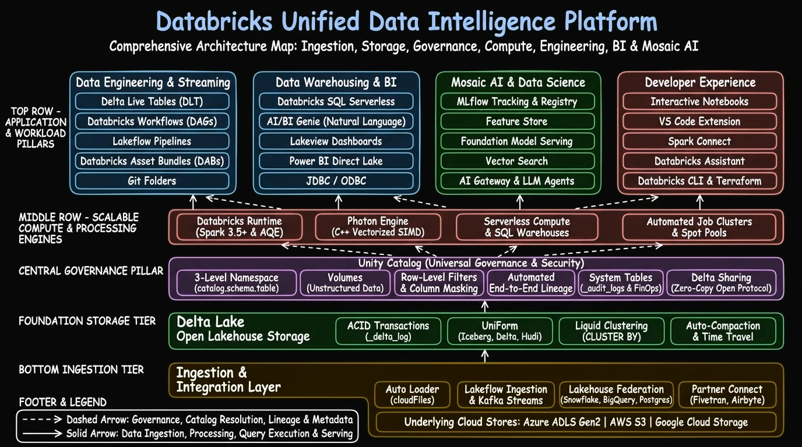
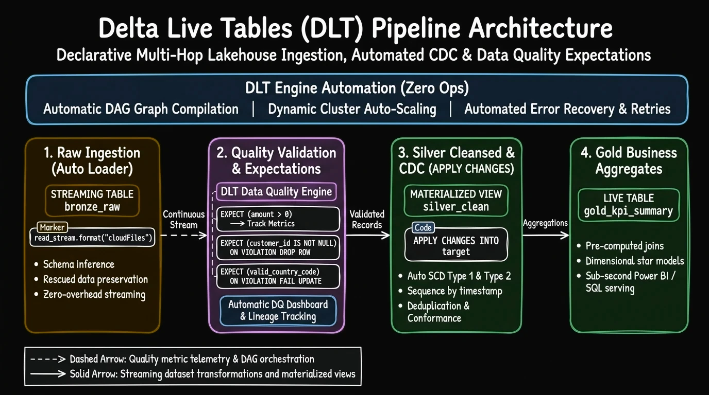
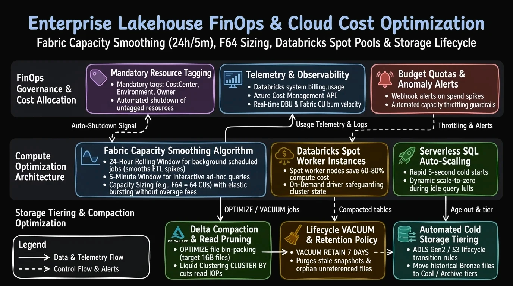

# ⚡ The Databricks Handbook

**105 Databricks Recipes across Four Verification Tiers (T0–T3), Unity Catalog Governance, Delta Lake 3.x, Lakeflow, Photon & Incident Runbooks**

[](https://github.com/santoshjammi29/databricks-handbook/actions)
[](https://www.databricks.com/)
[](https://spark.apache.org/)
[](https://delta.io/)
[](https://www.databricks.com/product/unity-catalog)
[](https://www.databricks.com/product/photon)
[](https://www.python.org/)
[](databricks.yml)
[](LICENSE)

*An enterprise reference repository of 105 Databricks Data Intelligence Platform recipes (tracked by automated execution tier in [Verification Tiers](docs/verification.md)), architectural blueprints, and disaster recovery incident runbooks.*  
*Structured in the official **Databricks Source Notebook format (`.py`)** for seamless 1-click sync with **Databricks Repos / Git Folders**, **Databricks Asset Bundles (DABs)**, **VS Code / Databricks Connect v2**, and automated CI/CD quality gates.*

[Quickstart](#quickstart) • [Verification Tiers](#verification-tiers) • [What's Inside](#whats-inside) • [Whiteboard Blueprints](#whiteboard-blueprints) • [Incident Runbooks](#incident-runbooks) • [Interview Matrix](#interview-matrix) • [DABs Deployment](#dabs-deployment) • [Developer CLI](#developer-cli)

---

## 🎯 Value Proposition

The Databricks Handbook provides deterministic coding blueprints and architectural guides for engineers building on the Databricks Data Intelligence Platform. Every recipe is tagged with an explicit **Verification Tier (`T0`–`T3`)** checked by `uv run handbook audit-content` and documented in [**Verification Matrix**](docs/verification.md), so readers know immediately which notebooks execute locally against Apache Spark + Delta Lake, which simulate cloud control-plane specs, and which require a live Databricks workspace.

<a id="verification-tiers"></a>
### Verification Tier Legend (`T0`–`T3`)

| Tier | Classification | What Is Verified Automatically |
|:---:|:---|:---|
| **`T2`** | **Local-executable** | Creates real data/tables and runs PySpark + Delta Lake 3.2 locally with assertions on computed outputs (`uv run handbook run-local --tier T2`) |
| **`T3`** | **Workspace-executable** | Targets Databricks-managed services (Unity Catalog, System Tables, DLT, Vector Search, Apps); requires a live workspace |
| **`T1`** | **Simulated** | Runs pure Python configurations, DSLs, or mock objects with assertions over literal/string specs |
| **`T0`** | **Reference** | Architecture or conceptual patterns verified for Databricks format and Python AST syntax |

---

<a id="quickstart"></a>
## ⚡ Quickstart

### 1. Use the Handbook (Databricks Workspace or Local)

- **Recommended (Databricks Workspace)**: In your Databricks workspace, open **Workspace -> Create -> Git folder** and paste `https://github.com/santoshjammi29/databricks-handbook.git`. Attach a **DBR 15.4+ LTS** cluster (or **Serverless compute**) to run recipes interactively.
- **Which recipes run where**:
  - **Local-executable (`T2`, `[spark]` extra)**: `46` notebooks across Apache Spark 3.5 + Delta Lake 3.2 run end-to-end locally (`Modules 03 [all 11]` and `10 [all 7]`, plus streaming, testing, RAG/monitoring, SQL/metric, and FinOps recipes in `Modules 01, 04, 06, 07, 08, 09`) via `uv sync --locked --extra spark` and `uv run pytest -m spark -v`.
  - **Databricks Workspace (`T1` / `T3` specs)**: Unity Catalog ACLs (`catalog.schema.table`), Lakehouse Federation, System Tables control-plane setup, Lakeflow Declarative Pipelines (DLT), Databricks Apps, and Mosaic AI Model Serving (`Modules 01–02, 04–09`) include simulated local validation specs (`58 T1`, `1 T0` reference) alongside live Databricks Runtime examples.
- **Cloud Cost & Cleanup Warning**: Deploying `databricks.yml` or running SQL Warehouses, DLT pipelines, and Vector Search endpoints incurs cloud VM and DBU charges. Always deploy to `dev` first, enforce auto-termination (10–15 min), and run `databricks bundle destroy -t dev` when finished.

### 2. Contribute & Verify Locally

Get up and running locally in under 2 minutes with [`uv`](https://docs.astral.sh/uv/):

```bash
# 1. Clone repository
git clone https://github.com/santoshjammi29/databricks-handbook.git
cd databricks-handbook

# 2. Synchronize locked virtual environment with dev extras
make install

# 3. Execute pre-flight verification gate (lint + build-check + readme-check + validate-fast + tests)
make check

# 4. Explore recipes interactively via CLI
uv run handbook explore 025

# 5. Export notebooks to standard Jupyter format (.ipynb)
uv run handbook export-ipynb
```

---

### 🧭 Suggested Learning Paths by Role

| Role / Goal | Recommended Modules | Supporting Docs & Guides |
|:---|:---|:---|
| **Platform & Security Engineer** | Modules `01`, `02`, `07` | [Split-Plane Architecture](architectures/01_split_plane_security_and_serverless_compute.md) · [UC Governance](architectures/02_unity_catalog_governance_and_lakehouse_federation.md) · [Credential Runbook](runbooks/06_unity_catalog_storage_credential_and_permission_disasters.md) |
| **Data & Lakehouse Engineer** | Modules `03`, `04`, `05` | [Delta 3.x Engine](architectures/03_delta_lake_3x_storage_engine_and_liquid_clustering.md) · [DevOps & DABs](architectures/04_enterprise_devops_dabs_and_lakeflow_orchestration.md) · [OCC & Skew Runbooks](runbooks/02_delta_concurrent_modification_conflicts.md) |
| **FinOps & DBSQL Owner** | Modules `06`, `09` | [Warehouse Queue Runbook](runbooks/05_serverless_sql_warehouse_queueing_and_spill_tuning.md) · [FinOps App](apps/lakehouse_finops_monitor/app.py) |
| **Interview & On-Call Prep** | Module `10` + Flashcards | [Level 1–4 Guides](interview/01_junior_and_associate_databricks_engineer.md) · [50 Flashcards](interview/05_flashcards_deck_50.md) · [OOM Triage Runbook](runbooks/01_driver_and_executor_oom_triage.md) |

---

<a id="whats-inside"></a>
## 📚 What's Inside: 10 Core Modules (105 Recipes)

Explore the complete curriculum breakdown in the [**Full Curriculum Catalog**](docs/curriculum/index.md), per-notebook verification tiers in the [**Verification Matrix**](docs/verification.md), and concept definitions in the [**132 Topics Directory**](docs/curriculum/topics.md).

<!-- BEGIN GENERATED:modules -->
| Track | Module Name | Range | Level | Domain Focus & Core Capabilities | Directory |
|:---:|:---|:---:|:---:|:---|:---:|
| **01** | [`01. Platform Architecture, Workspaces & Control Plane`](docs/curriculum/index.md#module-01-platform-architecture-and-security) | `001-010` | 🟢 Foundational | Split-plane security, VNet injection, cluster types & policies, CLI v0.200+, REST API 2.1, secrets | [`10 Recipes`](notebooks/01_platform_architecture_and_security/) |
| **02** | [`02. Unity Catalog — Governance, Security & Federation`](docs/curriculum/index.md#module-02-unity-catalog-and-governance) | `011-021` | 🟡 Intermediate | 3-level namespace, Managed vs External, Volumes, Dynamic RLS, Column Masking, Delta Sharing | [`11 Recipes`](notebooks/02_unity_catalog_and_governance/) |
| **03** | [`03. Delta Lake 3.x Deep Dive — Storage Engine & UniForm`](docs/curriculum/index.md#module-03-delta-lake-storage-engine) | `022-032` | 🟡 Intermediate | Transaction log internals, Deletion Vectors (MoR), Liquid Clustering, CDF, Predictive Optimization | [`11 Recipes`](notebooks/03_delta_lake_storage_engine/) |
| **04** | [`04. Lakeflow Ingestion, Auto Loader & Declarative Pipelines (DLT)`](docs/curriculum/index.md#module-04-lakeflow-ingestion-and-dlt) | `033-043` | 🔴 Advanced | Auto Loader (cloudFiles), schema drift, _rescued_data, DLT expectations, DLQ quarantine, CDC | [`11 Recipes`](notebooks/04_lakeflow_ingestion_and_dlt/) |
| **05** | [`05. Lakeflow Jobs, Workflows & Orchestration`](docs/curriculum/index.md#module-05-lakeflow-jobs-and-orchestration) | `044-054` | 🟡 Intermediate | Multi-task DAGs, taskValues context sharing, Service Principals, triggers, retries & repair | [`11 Recipes`](notebooks/05_lakeflow_jobs_and_orchestration/) |
| **06** | [`06. Databricks SQL (DBSQL), Photon & Semantic Layer`](docs/curriculum/index.md#module-06-databricks-sql-and-photon) | `055-065` | 🔴 Advanced | Serverless SQL Warehouses, Photon C++ SIMD, IWM admission, multi-tier caching, Query Profile | [`11 Recipes`](notebooks/06_databricks_sql_and_photon/) |
| **07** | [`07. Enterprise DevOps — DABs, CI/CD & Testing`](docs/curriculum/index.md#module-07-enterprise-devops-and-dabs) | `066-076` | 🔴 Advanced | Databricks Asset Bundles (databricks.yml), dev/staging/prod targets, GitHub Actions OIDC | [`11 Recipes`](notebooks/07_enterprise_devops_and_dabs/) |
| **08** | [`08. Databricks Apps & Mosaic AI (GenAI, Vector Search, RAG)`](docs/curriculum/index.md#module-08-databricks-apps-and-mosaic-ai) | `077-087` | 🟣 Expert | Databricks Apps (Streamlit/FastAPI), Vector Search Delta Sync, Foundation Model APIs, RAG | [`11 Recipes`](notebooks/08_databricks_apps_and_mosaic_ai/) |
| **09** | [`09. FinOps, Observability & System Tables Masterclass`](docs/curriculum/index.md#module-09-finops-and-system-tables) | `088-098` | 🟡 Intermediate | system.billing.usage, cluster tagging attribution, audit forensics, zombie detection, anomalies | [`11 Recipes`](notebooks/09_finops_and_system_tables/) |
| **10** | [`10. Production Incidents, Triage & Architecture Blueprints`](docs/curriculum/index.md#module-10-production-incidents-and-blueprints) | `099-105` | 🟣 Principal | Driver/Executor OOM triage, OCC conflict resolution, 99% straggler salting, RocksDB state leaks | [`7 Recipes`](notebooks/10_production_incidents_and_blueprints/) |
<!-- END GENERATED:modules -->

---

<a id="whiteboard-blueprints"></a>
## 📐 52 Whiteboard Architecture Blueprints

The repository provides **52 hand-drawn digital whiteboard blueprints** mirrored under [`assets/whiteboards/`](assets/whiteboards) (alongside 3 reference cheatsheets). Explore the [**Whiteboards Catalog**](docs/whiteboards/index.md).

| Platform & Lakehouse Master | Unity Catalog Governance | Delta Lake 3.x Storage Engine |
|:---:|:---:|:---:|
| [](docs/whiteboards/03_platform_landscape.md#databricks-platform-master) | [](docs/whiteboards/04_governance_security.md#unity-catalog-governance) | [](docs/whiteboards/05_storage_engine.md#delta-lake-under-the-hood) |
| **Delta Live Tables Pipeline** | **Catalyst & Photon C++ SIMD** | **FinOps & Cost Optimization** |
| [](docs/whiteboards/02_data_pipelines_ingestion.md#delta-live-tables-pipeline) | [](docs/whiteboards/06_compute_optimization.md#spark-catalyst-photon-engine) | [](docs/whiteboards/03_platform_landscape.md#lakehouse-finops-cost-optimization) |

- 📊 [**Fabric & Power BI (4 Blueprints)**](docs/whiteboards/01_fabric_power_bi.md) • 🌊 [**Pipelines & Ingestion (12 Blueprints)**](docs/whiteboards/02_data_pipelines_ingestion.md) • 🛡️ [**Platform Landscape (8 Blueprints)**](docs/whiteboards/03_platform_landscape.md)
- 🏛️ [**Governance & Security (4 Blueprints)**](docs/whiteboards/04_governance_security.md) • 💾 [**Storage Engine (9 Blueprints)**](docs/whiteboards/05_storage_engine.md) • 🚀 [**Compute & Optimization (11 Blueprints)**](docs/whiteboards/06_compute_optimization.md) • 🏗️ [**Data Modeling & Architecture (4 Blueprints)**](docs/whiteboards/07_data_modeling_architecture.md)

---

<a id="incident-runbooks"></a>
## 🚨 Production Incident Runbooks

Six battle-tested disaster recovery and forensic triage runbooks equipped with emergency decision trees:

- 🔍 [**01. Driver & Executor OOM Triage**](runbooks/01_driver_and_executor_oom_triage.md): Heap space exhaustion, GC limits, container exit code 137, driver collect traps.
- 💥 [**02. Concurrent Modification Conflicts**](runbooks/02_delta_concurrent_modification_conflicts.md): Concurrent `MERGE` and `UPDATE` collisions, protocol conflict matrix.
- 🐌 [**03. Streaming State & Checkpoint Corruption**](runbooks/03_streaming_checkpoint_and_rocksdb_state_corruption.md): 99th percentile task skew, RocksDB native memory, watermarking.
- 📦 [**04. Schema Drift & Poison Pill Quarantine**](runbooks/04_auto_loader_schema_drift_and_poison_pill_quarantine.md): Auto Loader schema evolution, `_rescued_data`, quarantine flows.
- ⏱️ [**05. Serverless Warehouse Queue Latency**](runbooks/05_serverless_sql_warehouse_queueing_and_spill_tuning.md): Intelligent Workload Management (IWM), scaling concurrency bottlenecks.
- 💸 [**06. Storage Credential & Permission Disasters**](runbooks/06_unity_catalog_storage_credential_and_permission_disasters.md): Unity Catalog IAM over-privileging, broken credential rotation.

---

<a id="interview-matrix"></a>
## 🎓 Architect Interview Preparation Matrix

System design defense, deep-dive architectural trade-offs, and 50 flashcards across 4 tiers:

- 🟢 [**Level 1: Junior & Associate**](interview/01_junior_and_associate_databricks_engineer.md): Spark RDD vs DataFrame, Catalyst optimizer phases, Delta ACID guarantees.
- 🟡 [**Level 2: Mid-Level Lakehouse**](interview/02_mid_level_lakehouse_engineer.md): Compaction, Liquid Clustering, UniForm Iceberg metadata, Delta Live Tables.
- 🔴 [**Level 3: Senior Performance Engineer**](interview/03_senior_databricks_performance_engineer.md): Tungsten shuffle spill, executor off-heap memory, DABs CI/CD workflows.
- 🟣 [**Level 4: Staff & Principal Architect**](interview/04_staff_and_principal_lakehouse_architect.md): Multi-workspace hub-and-spoke topologies, cross-region BCDR.
- 🃏 [**50 Architect Flashcards Deck**](interview/05_flashcards_deck_50.md): Rapid-fire interview questions with quantified production answers.

---

<a id="dabs-deployment"></a>
## 🚀 Deploy with Databricks Asset Bundles (DABs)

All jobs, pipelines, dashboards, and apps are codified Infrastructure-as-Code in `databricks.yml` and `resources/`:

```bash
# Validate bundle resource schemas offline or online
make validate

# Deploy to developer sandbox
databricks bundle deploy -t dev

# Deploy to production (mandates CI/CD Service Principal client ID)
databricks bundle deploy -t prod --var="prod_service_principal_id=<CLIENT_ID>"
```

See the [**Developer & Operations Guide**](docs/development.md) and [**DevOps Architecture Guide**](architectures/04_enterprise_devops_dabs_and_lakeflow_orchestration.md).

---

<a id="developer-cli"></a>
## 🛠️ Developer CLI & Bundle Reference

The repository build system provides full programmatic control:

```bash
# Handbook CLI syntax: handbook [build|validate|readme|export-ipynb|explore]
uv run handbook --help

# Verify notebook generation drift (fails if any notebook was hand-edited)
uv run handbook build --check

# Verify README generated module table drift
uv run handbook readme --check

# Validate internal link and anchor graph across all markdown docs
uv run handbook validate --target links
```

---

## 🤝 Contributing & Standards

Contributions must strictly satisfy the **Code-Test-Doc Triad**. Review our contribution standards before submitting:

- 📖 [**Contributing Guidelines**](CONTRIBUTING.md): Workflow, schema standards, and pre-publish checklist.
- 🛠️ [**Developer Guide**](docs/development.md): Deterministic generator architecture and testing procedures.
- 🗺️ [**Curriculum Roadmap**](docs/ROADMAP.md): Milestones and 4-tier tracking checklist.
- 🏷️ [**Curriculum Taxonomy**](docs/TAXONOMY.md): Canonical controlled vocabulary and domain standards.
- 🤖 [**Autonomous Agent Guidelines**](AGENTS.md): Operational invariants and multi-repository quality gates.
- 🔒 [**Security Policy**](.github/SECURITY.md) & 🤝 [**Code of Conduct**](.github/CODE_OF_CONDUCT.md)

---

## 🌐 Ecosystem & License

The Databricks Handbook is an authoritative core repository of the [Modern Data Engineering Lakehouse Ecosystem](https://moderndataengineer.uk). Released under the [MIT License](LICENSE).
