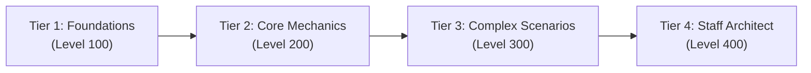

# 🗺️ Databricks Handbook — Interactive Curriculum Roadmap

> **Interactive Checkbox Study Tracker & Mastery Progression**  
> **Canonical Repository**: [santoshjammi29/databricks-handbook](https://github.com/santoshjammi29/databricks-handbook) | **Ecosystem**: [moderndataengineer.uk](https://moderndataengineer.uk)  
> **Total Exercises & Drills**: `116` | **Primary Pillar**: `Databricks Platform & Lakehouse`

---

## How to Use This Roadmap

1. **Fork this repository** to your personal GitHub account.
2. Work through the modules in sequence or target specific architectural topics.
3. Check off boxes (`- [x]`) as you complete each exercise, drill, or notebook.
4. Commit and push your progress to your personal branch to track your career journey!

```
Progress: [ ] 0 / 116 Completed (0.0%)
```

---

## Curriculum Structure: The 4 Mastery Tiers



### 🟡 Tier 2: Core Mechanics & Implementation (Level 200)
> Production pipeline patterns, schema validation, standard transformations, and unit tests.

- [ ] `databricks-handbook-curriculum-topics` — [Topics Directory: Databricks Handbook](topics/README.md) `Level 200`

### 🟠 Tier 3: Complex Scenarios, Edge Cases & Performance (Level 300)
> Performance tuning, partition skew, memory triage runbooks, and failure recovery.

- [ ] `databricks-handbook-001_split_plane_cloud_architecture_control_plane_classic_compute_and_serverless_networking` — [Split Plane Cloud Architecture Control Plane Classic Compute And Serverless Networking](notebooks/01_platform_architecture_and_security/001_split_plane_cloud_architecture_control_plane_classic_compute_and_serverless_networking.py) `Level 300`
- [ ] `databricks-handbook-002_databricks_workspace_topologies_multi_workspace_hub_and_spoke_and_private_link` — [Databricks Workspace Topologies Multi Workspace Hub And Spoke And Private Link](notebooks/01_platform_architecture_and_security/002_databricks_workspace_topologies_multi_workspace_hub_and_spoke_and_private_link.py) `Level 300`
- [ ] `databricks-handbook-003_cluster_types_and_workload_isolation_all_purpose_vs_automated_job_vs_sql_warehouses` — [Cluster Types And Workload Isolation All Purpose Vs Automated Job Vs Sql Warehouses](notebooks/01_platform_architecture_and_security/003_cluster_types_and_workload_isolation_all_purpose_vs_automated_job_vs_sql_warehouses.py) `Level 300`
- [ ] `databricks-handbook-004_cluster_policies_t_shirt_sizing_and_fleet_autoscaling_mechanics` — [Cluster Policies T Shirt Sizing And Fleet Autoscaling Mechanics](notebooks/01_platform_architecture_and_security/004_cluster_policies_t_shirt_sizing_and_fleet_autoscaling_mechanics.py) `Level 300`
- [ ] `databricks-handbook-005_databricks_cli_v0_200_automation_authentication_and_oauth_m2m_profiles` — [Databricks Cli V0 200 Automation Authentication And Oauth M2M Profiles](notebooks/01_platform_architecture_and_security/005_databricks_cli_v0_200_automation_authentication_and_oauth_m2m_profiles.py) `Level 300`
- [ ] `databricks-handbook-006_databricks_rest_api_2_1_programmatic_workspace_and_compute_lifecycle_management` — [Databricks Rest Api 2 1 Programmatic Workspace And Compute Lifecycle Management](notebooks/01_platform_architecture_and_security/006_databricks_rest_api_2_1_programmatic_workspace_and_compute_lifecycle_management.py) `Level 300`
- [ ] `databricks-handbook-007_databricks_secrets_and_cloud_kms_scopes_dbutils_secrets_and_zero_trust_ingestion` — [Databricks Secrets And Cloud Kms Scopes Dbutils Secrets And Zero Trust Ingestion](notebooks/01_platform_architecture_and_security/007_databricks_secrets_and_cloud_kms_scopes_dbutils_secrets_and_zero_trust_ingestion.py) `Level 300`
- [ ] `databricks-handbook-008_workspace_filesystem_vs_volumes_vs_legacy_dbfs_mounts` — [Workspace Filesystem Vs Volumes Vs Legacy Dbfs Mounts](notebooks/01_platform_architecture_and_security/008_workspace_filesystem_vs_volumes_vs_legacy_dbfs_mounts.py) `Level 300`
- [ ] `databricks-handbook-009_service_principals_scim_provisioning_and_enterprise_identity_federation` — [Service Principals Scim Provisioning And Enterprise Identity Federation](notebooks/01_platform_architecture_and_security/009_service_principals_scim_provisioning_and_enterprise_identity_federation.py) `Level 300`
- [ ] `databricks-handbook-010_workspace_audit_logging_and_security_event_ingestion_via_diagnostic_settings` — [Workspace Audit Logging And Security Event Ingestion Via Diagnostic Settings](notebooks/01_platform_architecture_and_security/010_workspace_audit_logging_and_security_event_ingestion_via_diagnostic_settings.py) `Level 300`
- [ ] `databricks-handbook-011_unity_catalog_3_level_namespace_catalogs_schemas_tables_and_volumes_architecture` — [Unity Catalog 3 Level Namespace Catalogs Schemas Tables And Volumes Architecture](notebooks/02_unity_catalog_and_governance/011_unity_catalog_3_level_namespace_catalogs_schemas_tables_and_volumes_architecture.py) `Level 300`
- [ ] `databricks-handbook-012_managed_tables_vs_external_tables_storage_credentials_and_external_locations` — [Managed Tables Vs External Tables Storage Credentials And External Locations](notebooks/02_unity_catalog_and_governance/012_managed_tables_vs_external_tables_storage_credentials_and_external_locations.py) `Level 300`
- [ ] `databricks-handbook-013_unity_catalog_volumes_governance_for_pdfs_images_audio_and_semi_structured_data` — [Unity Catalog Volumes Governance For Pdfs Images Audio And Semi Structured Data](notebooks/02_unity_catalog_and_governance/013_unity_catalog_volumes_governance_for_pdfs_images_audio_and_semi_structured_data.py) `Level 300`
- [ ] `databricks-handbook-014_fine_grained_row_level_security_rls_using_dynamic_row_filter_functions` — [Fine Grained Row Level Security Rls Using Dynamic Row Filter Functions](notebooks/02_unity_catalog_and_governance/014_fine_grained_row_level_security_rls_using_dynamic_row_filter_functions.py) `Level 300`
- [ ] `databricks-handbook-015_dynamic_column_masking_for_pii_protection_and_compliance` — [Dynamic Column Masking For Pii Protection And Compliance](notebooks/02_unity_catalog_and_governance/015_dynamic_column_masking_for_pii_protection_and_compliance.py) `Level 300`
- [ ] `databricks-handbook-016_lakehouse_federation_querying_postgresql_mysql_and_sql_server_without_etl` — [Lakehouse Federation Querying Postgresql Mysql And Sql Server Without Etl](notebooks/02_unity_catalog_and_governance/016_lakehouse_federation_querying_postgresql_mysql_and_sql_server_without_etl.py) `Level 300`
- [ ] `databricks-handbook-017_lakehouse_federation_querying_snowflake_and_google_bigquery_via_unity_catalog` — [Lakehouse Federation Querying Snowflake And Google Bigquery Via Unity Catalog](notebooks/02_unity_catalog_and_governance/017_lakehouse_federation_querying_snowflake_and_google_bigquery_via_unity_catalog.py) `Level 300`
- [ ] `databricks-handbook-018_delta_sharing_zero_copy_open_protocol_data_sharing_with_external_consumers` — [Delta Sharing Zero Copy Open Protocol Data Sharing With External Consumers](notebooks/02_unity_catalog_and_governance/018_delta_sharing_zero_copy_open_protocol_data_sharing_with_external_consumers.py) `Level 300`
- [ ] `databricks-handbook-019_delta_sharing_databricks_to_databricks_managed_cross_account_data_virtualization` — [Delta Sharing Databricks To Databricks Managed Cross Account Data Virtualization](notebooks/02_unity_catalog_and_governance/019_delta_sharing_databricks_to_databricks_managed_cross_account_data_virtualization.py) `Level 300`
- [ ] `databricks-handbook-020_attribute_based_access_control_abac_and_automated_pii_tagging_via_information_schema` — [Attribute Based Access Control Abac And Automated Pii Tagging Via Information Schema](notebooks/02_unity_catalog_and_governance/020_attribute_based_access_control_abac_and_automated_pii_tagging_via_information_schema.py) `Level 300`
- [ ] `databricks-handbook-021_clean_rooms_privacy_preserving_collaborative_analytics_across_enterprise_boundaries` — [Clean Rooms Privacy Preserving Collaborative Analytics Across Enterprise Boundaries](notebooks/02_unity_catalog_and_governance/021_clean_rooms_privacy_preserving_collaborative_analytics_across_enterprise_boundaries.py) `Level 300`
- [ ] `databricks-handbook-022_delta_transaction_log_internals_atomic_commits_checkpoints_and_crc` — [Delta Transaction Log Internals Atomic Commits Checkpoints And Crc](notebooks/03_delta_lake_storage_engine/022_delta_transaction_log_internals_atomic_commits_checkpoints_and_crc.py) `Level 300`
- [ ] `databricks-handbook-023_optimistic_concurrency_control_occ_and_row_level_concurrency_conflicts` — [Optimistic Concurrency Control Occ And Row Level Concurrency Conflicts](notebooks/03_delta_lake_storage_engine/023_optimistic_concurrency_control_occ_and_row_level_concurrency_conflicts.py) `Level 300`
- [ ] `databricks-handbook-024_deletion_vectors_mor_bitmap_invalidation_vs_copy_on_write_rewrite_overhead` — [Deletion Vectors Mor Bitmap Invalidation Vs Copy On Write Rewrite Overhead](notebooks/03_delta_lake_storage_engine/024_deletion_vectors_mor_bitmap_invalidation_vs_copy_on_write_rewrite_overhead.py) `Level 300`
- [ ] `databricks-handbook-025_liquid_clustering_cluster_by_hilbert_curves_and_hive_migration` — [Liquid Clustering Cluster By Hilbert Curves And Hive Migration](notebooks/03_delta_lake_storage_engine/025_liquid_clustering_cluster_by_hilbert_curves_and_hive_migration.py) `Level 300`
- [ ] `databricks-handbook-026_delta_change_data_feed_cdf_batch_and_streaming_micro_batch_deduplicated_merges` — [Delta Change Data Feed Cdf Batch And Streaming Micro Batch Deduplicated Merges](notebooks/03_delta_lake_storage_engine/026_delta_change_data_feed_cdf_batch_and_streaming_micro_batch_deduplicated_merges.py) `Level 300`
- [ ] `databricks-handbook-027_predictive_optimization_serverless_automatic_compaction_vacuum_and_analyze` — [Predictive Optimization Serverless Automatic Compaction Vacuum And Analyze](notebooks/03_delta_lake_storage_engine/027_predictive_optimization_serverless_automatic_compaction_vacuum_and_analyze.py) `Level 300`
- [ ] `databricks-handbook-028_delta_uniform_asynchronous_iceberg_metadata_manifest_generation_and_trino_access` — [Delta Uniform Asynchronous Iceberg Metadata Manifest Generation And Trino Access](notebooks/03_delta_lake_storage_engine/028_delta_uniform_asynchronous_iceberg_metadata_manifest_generation_and_trino_access.py) `Level 300`
- [ ] `databricks-handbook-029_shallow_clones_vs_deep_clones_zero_copy_sandboxes_testing_and_disaster_recovery` — [Shallow Clones Vs Deep Clones Zero Copy Sandboxes Testing And Disaster Recovery](notebooks/03_delta_lake_storage_engine/029_shallow_clones_vs_deep_clones_zero_copy_sandboxes_testing_and_disaster_recovery.py) `Level 300`
- [ ] `databricks-handbook-030_schema_evolution_mergeschema_vs_enforcement_and_table_constraints` — [Schema Evolution Mergeschema Vs Enforcement And Table Constraints](notebooks/03_delta_lake_storage_engine/030_schema_evolution_mergeschema_vs_enforcement_and_table_constraints.py) `Level 300`
- [ ] `databricks-handbook-031_delta_time_travel_historical_point_in_time_auditing_rollbacks_and_log_retention` — [Delta Time Travel Historical Point In Time Auditing Rollbacks And Log Retention](notebooks/03_delta_lake_storage_engine/031_delta_time_travel_historical_point_in_time_auditing_rollbacks_and_log_retention.py) `Level 300`
- [ ] `databricks-handbook-032_in_place_parquet_to_delta_migration_convert_to_delta_and_schema_repair` — [In Place Parquet To Delta Migration Convert To Delta And Schema Repair](notebooks/03_delta_lake_storage_engine/032_in_place_parquet_to_delta_migration_convert_to_delta_and_schema_repair.py) `Level 300`
- [ ] `databricks-handbook-033_auto_loader_cloudfiles_directory_listing_vs_file_notifications` — [Auto Loader Cloudfiles Directory Listing Vs File Notifications](notebooks/04_lakeflow_ingestion_and_dlt/033_auto_loader_cloudfiles_directory_listing_vs_file_notifications.py) `Level 300`
- [ ] `databricks-handbook-034_auto_loader_schema_inference_addnewcolumns_evolution_and_rescued_data_quarantine` — [Auto Loader Schema Inference Addnewcolumns Evolution And Rescued Data Quarantine](notebooks/04_lakeflow_ingestion_and_dlt/034_auto_loader_schema_inference_addnewcolumns_evolution_and_rescued_data_quarantine.py) `Level 300`
- [ ] `databricks-handbook-035_high_throughput_semi_structured_json_csv_ingestion_with_cloudfiles_and_rocksdb` — [High Throughput Semi Structured Json Csv Ingestion With Cloudfiles And Rocksdb](notebooks/04_lakeflow_ingestion_and_dlt/035_high_throughput_semi_structured_json_csv_ingestion_with_cloudfiles_and_rocksdb.py) `Level 300`
- [ ] `databricks-handbook-036_delta_live_tables_dlt_foundations_streaming_tables_vs_materialized_views` — [Delta Live Tables Dlt Foundations Streaming Tables Vs Materialized Views](notebooks/04_lakeflow_ingestion_and_dlt/036_delta_live_tables_dlt_foundations_streaming_tables_vs_materialized_views.py) `Level 300`
- [ ] `databricks-handbook-037_dlt_data_quality_expectations_expect_drop_fail` — [Dlt Data Quality Expectations Expect Drop Fail](notebooks/04_lakeflow_ingestion_and_dlt/037_dlt_data_quality_expectations_expect_drop_fail.py) `Level 300`
- [ ] `databricks-handbook-038_advanced_dlt_data_quality_dead_letter_queue_dlq_quarantine_tables_pattern` — [Advanced Dlt Data Quality Dead Letter Queue Dlq Quarantine Tables Pattern](notebooks/04_lakeflow_ingestion_and_dlt/038_advanced_dlt_data_quality_dead_letter_queue_dlq_quarantine_tables_pattern.py) `Level 300`
- [ ] `databricks-handbook-039_dlt_change_data_capture_incremental_upserts_apply_changes_scd1` — [Dlt Change Data Capture Incremental Upserts Apply Changes Scd1](notebooks/04_lakeflow_ingestion_and_dlt/039_dlt_change_data_capture_incremental_upserts_apply_changes_scd1.py) `Level 300`
- [ ] `databricks-handbook-040_dlt_change_data_capture_historical_tracking_apply_changes_scd2` — [Dlt Change Data Capture Historical Tracking Apply Changes Scd2](notebooks/04_lakeflow_ingestion_and_dlt/040_dlt_change_data_capture_historical_tracking_apply_changes_scd2.py) `Level 300`
- [ ] `databricks-handbook-041_dlt_execution_modes_triggered_vs_continuous_pipelines_and_serverless_runtime` — [Dlt Execution Modes Triggered Vs Continuous Pipelines And Serverless Runtime](notebooks/04_lakeflow_ingestion_and_dlt/041_dlt_execution_modes_triggered_vs_continuous_pipelines_and_serverless_runtime.py) `Level 300`
- [ ] `databricks-handbook-042_dlt_event_log_forensics_querying_lineage_metrics_quality_rates_and_execution_slas` — [Dlt Event Log Forensics Querying Lineage Metrics Quality Rates And Execution Slas](notebooks/04_lakeflow_ingestion_and_dlt/042_dlt_event_log_forensics_querying_lineage_metrics_quality_rates_and_execution_slas.py) `Level 300`
- [ ] `databricks-handbook-043_metaprogramming_dlt_dynamic_pipeline_generation_from_data_contracts_and_yaml_specs` — [Metaprogramming Dlt Dynamic Pipeline Generation From Data Contracts And Yaml Specs](notebooks/04_lakeflow_ingestion_and_dlt/043_metaprogramming_dlt_dynamic_pipeline_generation_from_data_contracts_and_yaml_specs.py) `Level 300`
- [ ] `databricks-handbook-044_multi_task_lakeflow_jobs_dag_task_dependencies_parameters_and_conditional_paths` — [Multi Task Lakeflow Jobs Dag Task Dependencies Parameters And Conditional Paths](notebooks/05_lakeflow_jobs_and_orchestration/044_multi_task_lakeflow_jobs_dag_task_dependencies_parameters_and_conditional_paths.py) `Level 300`
- [ ] `databricks-handbook-045_task_types_mastery_notebook_python_wheel_dlt_pipeline_dbt_and_sql_warehouse` — [Task Types Mastery Notebook Python Wheel Dlt Pipeline Dbt And Sql Warehouse](notebooks/05_lakeflow_jobs_and_orchestration/045_task_types_mastery_notebook_python_wheel_dlt_pipeline_dbt_and_sql_warehouse.py) `Level 300`
- [ ] `databricks-handbook-046_inter_task_communication_and_context_sharing_via_dbutils_jobs_taskvalues` — [Inter Task Communication And Context Sharing Via Dbutils Jobs Taskvalues](notebooks/05_lakeflow_jobs_and_orchestration/046_inter_task_communication_and_context_sharing_via_dbutils_jobs_taskvalues.py) `Level 300`
- [ ] `databricks-handbook-047_production_job_execution_run_as_service_principal_and_zero_interactive_identity` — [Production Job Execution Run As Service Principal And Zero Interactive Identity](notebooks/05_lakeflow_jobs_and_orchestration/047_production_job_execution_run_as_service_principal_and_zero_interactive_identity.py) `Level 300`
- [ ] `databricks-handbook-048_cluster_allocation_strategy_ephemeral_job_clusters_vs_shared_compute_pools` — [Cluster Allocation Strategy Ephemeral Job Clusters Vs Shared Compute Pools](notebooks/05_lakeflow_jobs_and_orchestration/048_cluster_allocation_strategy_ephemeral_job_clusters_vs_shared_compute_pools.py) `Level 300`
- [ ] `databricks-handbook-049_advanced_job_triggers_periodic_cron_file_arrival_triggers_and_continuous_triggers` — [Advanced Job Triggers Periodic Cron File Arrival Triggers And Continuous Triggers](notebooks/05_lakeflow_jobs_and_orchestration/049_advanced_job_triggers_periodic_cron_file_arrival_triggers_and_continuous_triggers.py) `Level 300`
- [ ] `databricks-handbook-050_resilient_error_handling_exponential_backoff_retries_and_pagerduty_slack_webhooks` — [Resilient Error Handling Exponential Backoff Retries And Pagerduty Slack Webhooks](notebooks/05_lakeflow_jobs_and_orchestration/050_resilient_error_handling_exponential_backoff_retries_and_pagerduty_slack_webhooks.py) `Level 300`
- [ ] `databricks-handbook-051_serverless_workflows_zero_startup_latency_scheduling_and_managed_concurrency` — [Serverless Workflows Zero Startup Latency Scheduling And Managed Concurrency](notebooks/05_lakeflow_jobs_and_orchestration/051_serverless_workflows_zero_startup_latency_scheduling_and_managed_concurrency.py) `Level 300`
- [ ] `databricks-handbook-052_repair_and_rerun_workflows_surgical_partial_dag_replay_on_upstream_failures` — [Repair And Rerun Workflows Surgical Partial Dag Replay On Upstream Failures](notebooks/05_lakeflow_jobs_and_orchestration/052_repair_and_rerun_workflows_surgical_partial_dag_replay_on_upstream_failures.py) `Level 300`
- [ ] `databricks-handbook-053_lakeflow_job_parameters_and_dynamic_base_parameters_inheritance` — [Lakeflow Job Parameters And Dynamic Base Parameters Inheritance](notebooks/05_lakeflow_jobs_and_orchestration/053_lakeflow_job_parameters_and_dynamic_base_parameters_inheritance.py) `Level 300`
- [ ] `databricks-handbook-054_orchestration_governance_monitoring_job_run_history_via_system_tables` — [Orchestration Governance Monitoring Job Run History Via System Tables](notebooks/05_lakeflow_jobs_and_orchestration/054_orchestration_governance_monitoring_job_run_history_via_system_tables.py) `Level 300`
- [ ] `databricks-handbook-055_serverless_sql_warehouses_instant_spin_up_autoscaling_policies_and_sizing_t_shirts` — [Serverless Sql Warehouses Instant Spin Up Autoscaling Policies And Sizing T Shirts](notebooks/06_databricks_sql_and_photon/055_serverless_sql_warehouses_instant_spin_up_autoscaling_policies_and_sizing_t_shirts.py) `Level 300`
- [ ] `databricks-handbook-056_photon_engine_internals_c_vectorized_execution_simd_hardware_and_memory_off_heap` — [Photon Engine Internals C Vectorized Execution Simd Hardware And Memory Off Heap](notebooks/06_databricks_sql_and_photon/056_photon_engine_internals_c_vectorized_execution_simd_hardware_and_memory_off_heap.py) `Level 300`
- [ ] `databricks-handbook-057_intelligent_workload_management_iwm_query_admission_control_and_queue_spill_prevention` — [Intelligent Workload Management Iwm Query Admission Control And Queue Spill Prevention](notebooks/06_databricks_sql_and_photon/057_intelligent_workload_management_iwm_query_admission_control_and_queue_spill_prevention.py) `Level 300`
- [ ] `databricks-handbook-058_multi_tier_caching_architecture_result_cache_local_disk_cache_and_remote_cache` — [Multi Tier Caching Architecture Result Cache Local Disk Cache And Remote Cache](notebooks/06_databricks_sql_and_photon/058_multi_tier_caching_architecture_result_cache_local_disk_cache_and_remote_cache.py) `Level 300`
- [ ] `databricks-handbook-059_dbsql_query_profile_analysis_diagnosing_scans_shuffles_spills_and_pruning_efficiency` — [Dbsql Query Profile Analysis Diagnosing Scans Shuffles Spills And Pruning Efficiency](notebooks/06_databricks_sql_and_photon/059_dbsql_query_profile_analysis_diagnosing_scans_shuffles_spills_and_pruning_efficiency.py) `Level 300`
- [ ] `databricks-handbook-060_materialized_views_and_streaming_tables_in_dbsql_without_apache_spark_code` — [Materialized Views And Streaming Tables In Dbsql Without Apache Spark Code](notebooks/06_databricks_sql_and_photon/060_materialized_views_and_streaming_tables_in_dbsql_without_apache_spark_code.py) `Level 300`
- [ ] `databricks-handbook-061_ai_bi_dashboards_lakeview_interactive_filtering_canvas_layouts_and_cross_filtering` — [Ai Bi Dashboards Lakeview Interactive Filtering Canvas Layouts And Cross Filtering](notebooks/06_databricks_sql_and_photon/061_ai_bi_dashboards_lakeview_interactive_filtering_canvas_layouts_and_cross_filtering.py) `Level 300`
- [ ] `databricks-handbook-062_databricks_genie_spaces_conversational_data_intelligence_and_certified_sql_assets` — [Databricks Genie Spaces Conversational Data Intelligence And Certified Sql Assets](notebooks/06_databricks_sql_and_photon/062_databricks_genie_spaces_conversational_data_intelligence_and_certified_sql_assets.py) `Level 300`
- [ ] `databricks-handbook-063_databricks_semantic_layer_and_metric_views_enterprise_dimensions_and_measures` — [Databricks Semantic Layer And Metric Views Enterprise Dimensions And Measures](notebooks/06_databricks_sql_and_photon/063_databricks_semantic_layer_and_metric_views_enterprise_dimensions_and_measures.py) `Level 300`
- [ ] `databricks-handbook-064_dbsql_alerts_automated_refresh_schedules_and_sla_driven_slack_notifications` — [Dbsql Alerts Automated Refresh Schedules And Sla Driven Slack Notifications](notebooks/06_databricks_sql_and_photon/064_dbsql_alerts_automated_refresh_schedules_and_sla_driven_slack_notifications.py) `Level 300`
- [ ] `databricks-handbook-065_sql_warehouse_concurrency_scaling_horizontal_multi_cluster_load_balancing` — [Sql Warehouse Concurrency Scaling Horizontal Multi Cluster Load Balancing](notebooks/06_databricks_sql_and_photon/065_sql_warehouse_concurrency_scaling_horizontal_multi_cluster_load_balancing.py) `Level 300`
- [ ] `databricks-handbook-066_databricks_asset_bundles_dabs_architecture_databricks_yml_and_variable_scopes` — [Databricks Asset Bundles Dabs Architecture Databricks Yml And Variable Scopes](notebooks/07_enterprise_devops_and_dabs/066_databricks_asset_bundles_dabs_architecture_databricks_yml_and_variable_scopes.py) `Level 300`
- [ ] `databricks-handbook-067_defining_multi_resource_bundles_jobs_dlt_pipelines_volumes_and_model_serving` — [Defining Multi Resource Bundles Jobs Dlt Pipelines Volumes And Model Serving](notebooks/07_enterprise_devops_and_dabs/067_defining_multi_resource_bundles_jobs_dlt_pipelines_volumes_and_model_serving.py) `Level 300`
- [ ] `databricks-handbook-068_dabs_multi_environment_targeting_dev_staging_and_prod_promotion_topologies` — [Dabs Multi Environment Targeting Dev Staging And Prod Promotion Topologies](notebooks/07_enterprise_devops_and_dabs/068_dabs_multi_environment_targeting_dev_staging_and_prod_promotion_topologies.py) `Level 300`
- [ ] `databricks-handbook-069_bundle_lifecycle_automation_bundle_validate_bundle_deploy_and_bundle_run_cli` — [Bundle Lifecycle Automation Bundle Validate Bundle Deploy And Bundle Run Cli](notebooks/07_enterprise_devops_and_dabs/069_bundle_lifecycle_automation_bundle_validate_bundle_deploy_and_bundle_run_cli.py) `Level 300`
- [ ] `databricks-handbook-070_github_actions_ci_cd_pipeline_automated_bundle_linting_testing_and_validation` — [Github Actions Ci Cd Pipeline Automated Bundle Linting Testing And Validation](notebooks/07_enterprise_devops_and_dabs/070_github_actions_ci_cd_pipeline_automated_bundle_linting_testing_and_validation.py) `Level 300`
- [ ] `databricks-handbook-071_service_principal_authentication_in_ci_cd_runners_using_azure_oidc_aws_iam` — [Service Principal Authentication In Ci Cd Runners Using Azure Oidc Aws Iam](notebooks/07_enterprise_devops_and_dabs/071_service_principal_authentication_in_ci_cd_runners_using_azure_oidc_aws_iam.py) `Level 300`
- [ ] `databricks-handbook-072_infrastructure_as_code_iac_with_databricks_terraform_provider` — [Infrastructure As Code Iac With Databricks Terraform Provider](notebooks/07_enterprise_devops_and_dabs/072_infrastructure_as_code_iac_with_databricks_terraform_provider.py) `Level 300`
- [ ] `databricks-handbook-073_databricks_connect_v2_local_ide_development_in_vs_code_with_remote_dbr_compute` — [Databricks Connect V2 Local Ide Development In Vs Code With Remote Dbr Compute](notebooks/07_enterprise_devops_and_dabs/073_databricks_connect_v2_local_ide_development_in_vs_code_with_remote_dbr_compute.py) `Level 300`
- [ ] `databricks-handbook-074_unit_testing_databricks_data_pipelines_with_pytest_chispa_and_mock_dataframes` — [Unit Testing Databricks Data Pipelines With Pytest Chispa And Mock Dataframes](notebooks/07_enterprise_devops_and_dabs/074_unit_testing_databricks_data_pipelines_with_pytest_chispa_and_mock_dataframes.py) `Level 300`
- [ ] `databricks-handbook-075_python_wheel_packaging_uc_volume_deployment_and_dependency_pinning` — [Python Wheel Packaging Uc Volume Deployment And Dependency Pinning](notebooks/07_enterprise_devops_and_dabs/075_python_wheel_packaging_uc_volume_deployment_and_dependency_pinning.py) `Level 300`
- [ ] `databricks-handbook-076_blue_green_pipeline_deployment_and_zero_downtime_bundle_rollouts` — [Blue Green Pipeline Deployment And Zero Downtime Bundle Rollouts](notebooks/07_enterprise_devops_and_dabs/076_blue_green_pipeline_deployment_and_zero_downtime_bundle_rollouts.py) `Level 300`
- [ ] `databricks-handbook-077_databricks_apps_serverless_hosting_for_streamlit_dash_gradio_and_fastapi` — [Databricks Apps Serverless Hosting For Streamlit Dash Gradio And Fastapi](notebooks/08_databricks_apps_and_mosaic_ai/077_databricks_apps_serverless_hosting_for_streamlit_dash_gradio_and_fastapi.py) `Level 300`
- [ ] `databricks-handbook-078_databricks_app_manifest_app_yaml_resource_bindings_and_service_principal_iam` — [Databricks App Manifest App Yaml Resource Bindings And Service Principal Iam](notebooks/08_databricks_apps_and_mosaic_ai/078_databricks_app_manifest_app_yaml_resource_bindings_and_service_principal_iam.py) `Level 300`
- [ ] `databricks-handbook-079_databricks_vector_search_managed_vector_endpoints_and_delta_sync_indexes` — [Databricks Vector Search Managed Vector Endpoints And Delta Sync Indexes](notebooks/08_databricks_apps_and_mosaic_ai/079_databricks_vector_search_managed_vector_endpoints_and_delta_sync_indexes.py) `Level 300`
- [ ] `databricks-handbook-080_embedding_models_and_foundation_model_apis_bge_large_text_embedding_3_and_serving` — [Embedding Models And Foundation Model Apis Bge Large Text Embedding 3 And Serving](notebooks/08_databricks_apps_and_mosaic_ai/080_embedding_models_and_foundation_model_apis_bge_large_text_embedding_3_and_serving.py) `Level 300`
- [ ] `databricks-handbook-081_mlflow_2_15_in_unity_catalog_tracking_runs_signatures_and_3_level_model_registry` — [Mlflow 2 15 In Unity Catalog Tracking Runs Signatures And 3 Level Model Registry](notebooks/08_databricks_apps_and_mosaic_ai/081_mlflow_2_15_in_unity_catalog_tracking_runs_signatures_and_3_level_model_registry.py) `Level 300`
- [ ] `databricks-handbook-082_mosaic_ai_model_serving_serverless_real_time_endpoints_and_provisioned_concurrency` — [Mosaic Ai Model Serving Serverless Real Time Endpoints And Provisioned Concurrency](notebooks/08_databricks_apps_and_mosaic_ai/082_mosaic_ai_model_serving_serverless_real_time_endpoints_and_provisioned_concurrency.py) `Level 300`
- [ ] `databricks-handbook-083_enterprise_rag_architecture_semantic_chunking_dense_vector_sparse_bm25_search` — [Enterprise Rag Architecture Semantic Chunking Dense Vector Sparse Bm25 Search](notebooks/08_databricks_apps_and_mosaic_ai/083_enterprise_rag_architecture_semantic_chunking_dense_vector_sparse_bm25_search.py) `Level 300`
- [ ] `databricks-handbook-084_mosaic_ai_agent_evaluation_mlflow_evaluate_groundedness_faithfulness_and_relevance` — [Mosaic Ai Agent Evaluation Mlflow Evaluate Groundedness Faithfulness And Relevance](notebooks/08_databricks_apps_and_mosaic_ai/084_mosaic_ai_agent_evaluation_mlflow_evaluate_groundedness_faithfulness_and_relevance.py) `Level 300`
- [ ] `databricks-handbook-085_ai_functions_in_sql_ai_query_ai_summarize_ai_classify_and_ai_analyze_sentiment` — [Ai Functions In Sql Ai Query Ai Summarize Ai Classify And Ai Analyze Sentiment](notebooks/08_databricks_apps_and_mosaic_ai/085_ai_functions_in_sql_ai_query_ai_summarize_ai_classify_and_ai_analyze_sentiment.py) `Level 300`
- [ ] `databricks-handbook-086_lakehouse_monitoring_automated_drift_detection_quality_metrics_and_alerting_tables` — [Lakehouse Monitoring Automated Drift Detection Quality Metrics And Alerting Tables](notebooks/08_databricks_apps_and_mosaic_ai/086_lakehouse_monitoring_automated_drift_detection_quality_metrics_and_alerting_tables.py) `Level 300`
- [ ] `databricks-handbook-087_fine_tuning_llms_on_lakehouse_data_mosaic_ai_training_and_parameter_efficient_lora` — [Fine Tuning Llms On Lakehouse Data Mosaic Ai Training And Parameter Efficient Lora](notebooks/08_databricks_apps_and_mosaic_ai/087_fine_tuning_llms_on_lakehouse_data_mosaic_ai_training_and_parameter_efficient_lora.py) `Level 300`
- [ ] `databricks-handbook-088_system_tables_architecture_enabling_and_navigating_billing_access_and_compute` — [System Tables Architecture Enabling And Navigating Billing Access And Compute](notebooks/09_finops_and_system_tables/088_system_tables_architecture_enabling_and_navigating_billing_access_and_compute.py) `Level 300`
- [ ] `databricks-handbook-089_calculating_dbu_consumption_and_cloud_costs_via_system_billing_usage` — [Calculating Dbu Consumption And Cloud Costs Via System Billing Usage](notebooks/09_finops_and_system_tables/089_calculating_dbu_consumption_and_cloud_costs_via_system_billing_usage.py) `Level 300`
- [ ] `databricks-handbook-090_mandatory_cluster_tagging_costcenter_environment_owner_and_cost_attribution` — [Mandatory Cluster Tagging Costcenter Environment Owner And Cost Attribution](notebooks/09_finops_and_system_tables/090_mandatory_cluster_tagging_costcenter_environment_owner_and_cost_attribution.py) `Level 300`
- [ ] `databricks-handbook-091_cost_breakdown_analysis_interactive_vs_job_vs_dbsql_vs_serverless_vs_dlt` — [Cost Breakdown Analysis Interactive Vs Job Vs Dbsql Vs Serverless Vs Dlt](notebooks/09_finops_and_system_tables/091_cost_breakdown_analysis_interactive_vs_job_vs_dbsql_vs_serverless_vs_dlt.py) `Level 300`
- [ ] `databricks-handbook-092_audit_and_security_analytics_investigating_access_logs_with_system_access_audit` — [Audit And Security Analytics Investigating Access Logs With System Access Audit](notebooks/09_finops_and_system_tables/092_audit_and_security_analytics_investigating_access_logs_with_system_access_audit.py) `Level 300`
- [ ] `databricks-handbook-093_compute_right_sizing_detecting_zombie_clusters_and_low_cpu_utilization` — [Compute Right Sizing Detecting Zombie Clusters And Low Cpu Utilization](notebooks/09_finops_and_system_tables/093_compute_right_sizing_detecting_zombie_clusters_and_low_cpu_utilization.py) `Level 300`
- [ ] `databricks-handbook-094_evaluating_predictive_optimization_roi_with_system_storage_predictive_optimization` — [Evaluating Predictive Optimization Roi With System Storage Predictive Optimization](notebooks/09_finops_and_system_tables/094_evaluating_predictive_optimization_roi_with_system_storage_predictive_optimization.py) `Level 300`
- [ ] `databricks-handbook-095_automated_finops_anomaly_detection_and_daily_budget_exceedance_alerting` — [Automated Finops Anomaly Detection And Daily Budget Exceedance Alerting](notebooks/09_finops_and_system_tables/095_automated_finops_anomaly_detection_and_daily_budget_exceedance_alerting.py) `Level 300`
- [ ] `databricks-handbook-096_spot_instance_fleet_optimization_and_aws_graviton_azure_arm_vm_migrations` — [Spot Instance Fleet Optimization And Aws Graviton Azure Arm Vm Migrations](notebooks/09_finops_and_system_tables/096_spot_instance_fleet_optimization_and_aws_graviton_azure_arm_vm_migrations.py) `Level 300`
- [ ] `databricks-handbook-097_aggressive_auto_stop_policies_and_cold_compute_idle_reduction_strategies` — [Aggressive Auto Stop Policies And Cold Compute Idle Reduction Strategies](notebooks/09_finops_and_system_tables/097_aggressive_auto_stop_policies_and_cold_compute_idle_reduction_strategies.py) `Level 300`
- [ ] `databricks-handbook-098_multi_tenant_showback_and_chargeback_dashboards_for_enterprise_business_units` — [Multi Tenant Showback And Chargeback Dashboards For Enterprise Business Units](notebooks/09_finops_and_system_tables/098_multi_tenant_showback_and_chargeback_dashboards_for_enterprise_business_units.py) `Level 300`
- [ ] `databricks-handbook-099_production_incident_01_driver_and_executor_oom_forensic_triage` — [Production Incident 01 Driver And Executor Oom Forensic Triage](notebooks/10_production_incidents_and_blueprints/099_production_incident_01_driver_and_executor_oom_forensic_triage.py) `Level 300`
- [ ] `databricks-handbook-100_production_incident_02_concurrent_modification_occ_conflict_resolution_in_delta` — [Production Incident 02 Concurrent Modification Occ Conflict Resolution In Delta](notebooks/10_production_incidents_and_blueprints/100_production_incident_02_concurrent_modification_occ_conflict_resolution_in_delta.py) `Level 300`
- [ ] `databricks-handbook-101_production_incident_03_straggler_tasks_and_extreme_data_skew_salting_remediation` — [Production Incident 03 Straggler Tasks And Extreme Data Skew Salting Remediation](notebooks/10_production_incidents_and_blueprints/101_production_incident_03_straggler_tasks_and_extreme_data_skew_salting_remediation.py) `Level 300`
- [ ] `databricks-handbook-102_production_incident_04_streaming_state_explosions_and_rocksdb_checkpoint_recovery` — [Production Incident 04 Streaming State Explosions And Rocksdb Checkpoint Recovery](notebooks/10_production_incidents_and_blueprints/102_production_incident_04_streaming_state_explosions_and_rocksdb_checkpoint_recovery.py) `Level 300`
- [ ] `databricks-handbook-103_production_incident_05_auto_loader_schema_drift_and_poison_pill_quarantine_forensics` — [Production Incident 05 Auto Loader Schema Drift And Poison Pill Quarantine Forensics](notebooks/10_production_incidents_and_blueprints/103_production_incident_05_auto_loader_schema_drift_and_poison_pill_quarantine_forensics.py) `Level 300`
- [ ] `databricks-handbook-104_production_incident_06_serverless_sql_warehouse_queue_saturation_and_spill_tuning` — [Production Incident 06 Serverless Sql Warehouse Queue Saturation And Spill Tuning](notebooks/10_production_incidents_and_blueprints/104_production_incident_06_serverless_sql_warehouse_queue_saturation_and_spill_tuning.py) `Level 300`
- [ ] `databricks-handbook-105_enterprise_lakehouse_master_blueprint_end_to_end_multi_cloud_production_architecture` — [Enterprise Lakehouse Master Blueprint End To End Multi Cloud Production Architecture](notebooks/10_production_incidents_and_blueprints/105_enterprise_lakehouse_master_blueprint_end_to_end_multi_cloud_production_architecture.py) `Level 300`

### 🔴 Tier 4: Production Hardening, FinOps & Staff Architecture (Level 400)
> Enterprise trade-offs, cross-cloud DR, zero-trust security, and FinOps cost optimization.

- [ ] `databricks-handbook-rb-01_driver_and_executor_oom_triage` — [Incident Runbook: Driver And Executor Oom Triage](runbooks/01_driver_and_executor_oom_triage.md) `Level 400`
- [ ] `databricks-handbook-rb-02_delta_concurrent_modification_conflicts` — [Incident Runbook: Delta Concurrent Modification Conflicts](runbooks/02_delta_concurrent_modification_conflicts.md) `Level 400`
- [ ] `databricks-handbook-rb-03_streaming_checkpoint_and_rocksdb_state_corruption` — [Incident Runbook: Streaming Checkpoint And Rocksdb State Corruption](runbooks/03_streaming_checkpoint_and_rocksdb_state_corruption.md) `Level 400`
- [ ] `databricks-handbook-rb-04_auto_loader_schema_drift_and_poison_pill_quarantine` — [Incident Runbook: Auto Loader Schema Drift And Poison Pill Quarantine](runbooks/04_auto_loader_schema_drift_and_poison_pill_quarantine.md) `Level 400`
- [ ] `databricks-handbook-rb-05_serverless_sql_warehouse_queueing_and_spill_tuning` — [Incident Runbook: Serverless Sql Warehouse Queueing And Spill Tuning](runbooks/05_serverless_sql_warehouse_queueing_and_spill_tuning.md) `Level 400`
- [ ] `databricks-handbook-rb-06_unity_catalog_storage_credential_and_permission_disasters` — [Incident Runbook: Unity Catalog Storage Credential And Permission Disasters](runbooks/06_unity_catalog_storage_credential_and_permission_disasters.md) `Level 400`
- [ ] `databricks-handbook-doc-01_split_plane_security_and_serverless_compute` — [Architecture: 01 Split Plane Security And Serverless Compute](architectures/01_split_plane_security_and_serverless_compute.md) `Level 400`
- [ ] `databricks-handbook-doc-02_unity_catalog_governance_and_lakehouse_federation` — [Architecture: 02 Unity Catalog Governance And Lakehouse Federation](architectures/02_unity_catalog_governance_and_lakehouse_federation.md) `Level 400`
- [ ] `databricks-handbook-doc-03_delta_lake_3x_storage_engine_and_liquid_clustering` — [Architecture: 03 Delta Lake 3X Storage Engine And Liquid Clustering](architectures/03_delta_lake_3x_storage_engine_and_liquid_clustering.md) `Level 400`
- [ ] `databricks-handbook-doc-04_enterprise_devops_dabs_and_lakeflow_orchestration` — [Architecture: 04 Enterprise Devops Dabs And Lakeflow Orchestration](architectures/04_enterprise_devops_dabs_and_lakeflow_orchestration.md) `Level 400`

---

## Suggested Study Schedules

| Schedule | Pace | Target Audience | Focus |
|---|---|---|---|
| **4-Week Sprint** | 5-6 drills / day | Interview Prep / Fast Track | Focus on Tier 2 & Tier 3 core drills |
| **8-Week Deep-Dive** | 2-3 drills / day | Full Technical Mastery | Complete all 116 exercises + tests |
| **12-Week Staff Track** | 1-2 drills / day | Architect & Tech Lead | Deep dive into Tier 3 & Tier 4 blueprints |

---

## Sister Repositories & Ecosystem Roadmaps

Explore interactive roadmaps across all 14 pillars of the lakehouse ecosystem:
- [Modern Data Engineer Central Hub](https://moderndataengineer.uk)
- [Databricks Handbook](https://github.com/santoshjammi29/databricks-handbook)
- [PySpark Handbook](https://github.com/santoshjammi29/pyspark-handbook)
- [SQL Handbook](https://github.com/santoshjammi29/sql-handbook)
- [dbt Handbook](https://github.com/santoshjammi29/dbt-handbook)
- [Streaming Handbook](https://github.com/santoshjammi29/streaming-handbook)
- [DataOps & CI/CD Handbook](https://github.com/santoshjammi29/dataops-cicd-handbook)
- [System Design Handbook](https://github.com/santoshjammi29/data-system-design-handbook)
- [Interview Handbook](https://github.com/santoshjammi29/data-engineering-interview-handbook)
- [Security Handbook](https://github.com/santoshjammi29/security-handbook)
