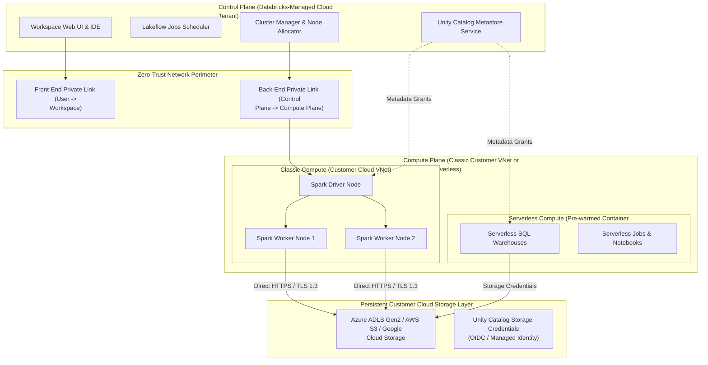
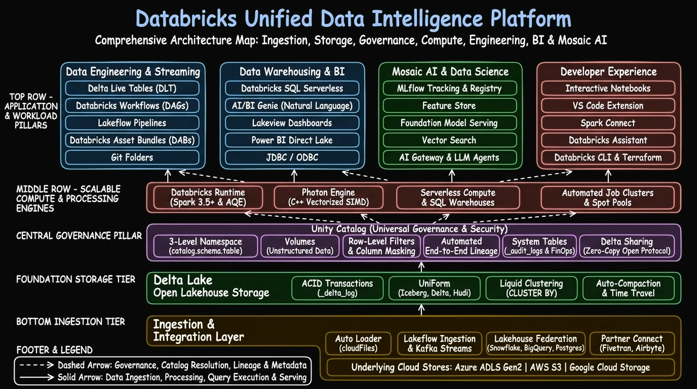
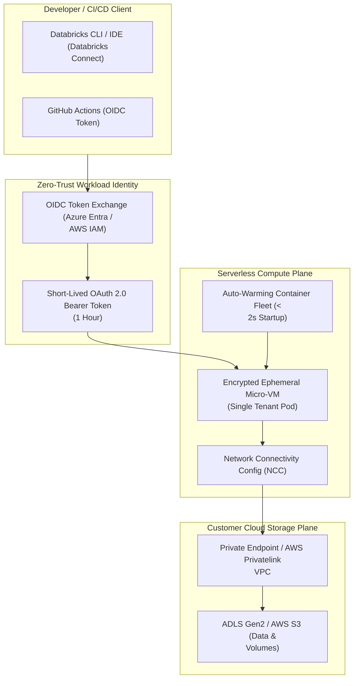

# 🏛️ Architecture Deep Dive: Split-Plane Cloud Security & Serverless Compute

## 1. Executive Overview & Theoretical Foundations

The Databricks Data Intelligence Platform is engineered on a **split-plane cloud architecture** that cleanly separates workspace orchestration and metadata management from raw compute execution and persistent customer storage. This decoupling guarantees that enterprise data assets remain strictly within the customer's cloud boundary while allowing Databricks to manage compute lifecycle, cluster orchestration, and platform telemetry.



### 📐 Visual Architectural Blueprint: Unified Lakehouse Platform


---

## 2. Architectural Comparison: Classic Compute vs. Serverless Compute

| Architectural Dimension | Classic Compute Plane | Serverless Compute Plane |
| :--- | :--- | :--- |
| **Hosting Boundary** | Customer cloud subscription (VNet / VPC) | Databricks-managed secure cloud subscription |
| **Provisioning Latency** | 3 to 7 minutes (VM allocation, disk mount, OS boot) | 2 to 6 seconds (pre-warmed container micro-VMs) |
| **Networking & Security** | Customer manages VNet injection, NSGs, NAT gateways, route tables | Databricks manages network isolation + Private Endpoints to storage |
| **Autoscaling Mechanics** | VM-level horizontal scaling based on task backlog | Sub-second workload-aware horizontal and vertical elasticity |
| **Runtime Upgrades** | Manual Databricks Runtime (DBR) version selection & regression testing | Fully versionless; continuous security patching and engine optimizations |
| **Billing Model** | Databricks DBUs + Cloud Provider VM/Disk Infrastructure Costs | Unified all-inclusive Databricks DBU billing (zero direct VM bills) |
| **Idle Cost Waste** | Minimum 15-20 min cluster termination delays incur cost | Scale-to-zero within seconds of query completion |
| **Workload Suitability** | Long-running legacy batch pipelines requiring custom OS packages | DBSQL BI queries, automated Lakeflow Jobs, and DLT pipelines |

### 📐 Visual Architectural Blueprint: Serverless Photon Engine vs. Classic JVM


---

## 3. Zero-Trust Network Perimeter & Private Link Architecture

In enterprise deployments (Banking, Healthcare, Government), public internet access to Databricks workspaces and data planes is strictly prohibited. Production environments implement dual Private Link endpoints:

1. **Front-End Private Link (User-to-Workspace)**:
   - Connects corporate VPNs or ExpressRoute / Direct Connect lines to the Databricks Web UI and REST API.
   - Public internet traffic is rejected at the workspace boundary (`publicNetworkAccess = Disabled`).
2. **Back-End Private Link (Control Plane to Compute Plane)**:
   - Secures the secure cluster connectivity relay (SCC).
   - Compute nodes establish outbound-only secure tunnels to the control plane without requiring public IP addresses on VMs (`enableNoPublicIp = true`).
3. **Storage Firewall & Private Endpoints**:
   - Customer storage accounts (ADLS Gen2 / S3) allow access *only* from the customer's VNet subnets and Databricks Serverless NAT IP ranges.
   - All data in transit is encrypted using TLS 1.3 with Customer-Managed Keys (CMK) for double encryption at rest.

---

## 4. Unity Catalog Storage Credential Delegation

Legacy architectures relied on static storage account keys or DBFS root mounts (`/mnt/`), creating significant security risks. Unity Catalog replaces mounts with **identity-based credential delegation**:

1. A cloud identity (Azure Managed Identity or AWS IAM Role) is created with least-privilege storage blob reader/writer access.
2. An account admin creates a **Storage Credential** in Unity Catalog pointing to that identity.
3. An **External Location** is created binding the Storage Credential to a specific container path (`abfss://data@lake.dfs.core.windows.net/`).
4. Users and compute clusters access tables using standard 3-level SQL (`SELECT * FROM prod.silver.orders`), and the driver obtains short-lived scoped SAS / STS tokens on demand. The user never sees or accesses storage keys.

---

## 4. Serverless Compute Architecture & Zero-Trust Workload Identity

Databricks Serverless Compute abstracts cluster provisioning entirely into an instant-on, auto-elastic compute fleet managed within Databricks cloud infrastructure with strict network and tenant isolation.



### Production Security Implementation: OAuth M2M Workload Identity (GitHub Actions)
```yaml
# GitHub Actions workflow authenticating via OIDC federation
name: Deploy Serverless Workload
on: [push]

jobs:
  deploy:
    runs-on: ubuntu-latest
    permissions:
      id-token: write # Mandate OIDC JWT token generation
      contents: read
    steps:
      - uses: actions/checkout@v4
      - name: Authenticate to Databricks via OIDC
        uses: databricks/setup-cli@v0.220.0
        with:
          host: https://adb-1234567890123456.7.azuredatabricks.net
          client-id: ${{ secrets.DATABRICKS_CLIENT_ID }}
          azure-tenant-id: ${{ secrets.AZURE_TENANT_ID }}
          oidc-token: true # Zero static long-lived PAT tokens
```

### Key Serverless Security Invariants:
- **Instant Warm Pools**: Compute initializes in $< 2$ seconds by drawing from pre-warmed, patched container pools.
- **Network Connectivity Config (NCC)**: Directs outbound traffic from serverless compute through dedicated customer private endpoints.
- **Zero Static Credentials**: All service-to-service communication relies on short-lived OAuth 2.0 access tokens refreshed every 60 minutes.
