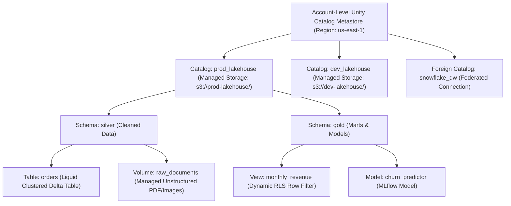
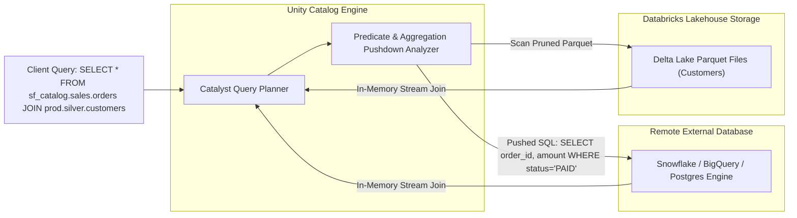

# 🏛️ Architecture Deep Dive: Unity Catalog Governance & Lakehouse Federation

## 1. Executive Overview & The 3-Level Namespace

Unity Catalog (UC) provides centralized, unified governance across all data and AI assets (tables, views, volumes, ML models, dashboards, and connections) within the Databricks Lakehouse. It completely replaces workspace-scoped Hive metastores with an **account-level metastore** bound across cloud regions and workspaces.



---

## 2. Managed Tables vs. External Tables vs. Unity Catalog Volumes

| Asset Type | Storage Location | Drop Lifecycle Semantics | Performance & Optimizations |
| :--- | :--- | :--- | :--- |
| **Managed Table** | Default schema storage path managed by UC | Dropping table permanently deletes metadata **AND** underlying Parquet files | Full Predictive Optimization (auto-compaction, auto-VACUUM, liquid clustering) |
| **External Table** | Explicit external cloud path (`LOCATION 's3://...'`) | Dropping table removes **ONLY** metadata; underlying cloud files remain intact | User must manually orchestrate `OPTIMIZE` and `VACUUM` policies |
| **Managed Volume** | Default volume storage path managed by UC | Dropping volume purges all uploaded unstructured files | Governed file system access via `/Volumes/catalog/schema/volume` |
| **External Volume** | Explicit external cloud folder path | Dropping volume removes catalog pointer; external files remain intact | Zero-copy access to enterprise document and imagery lakes |

---

## 3. Dynamic Row-Level Security (RLS) & Column Masking

Unity Catalog enforces fine-grained data access controls declaratively using standard SQL functions without duplicating data into separate views:

### Dynamic Row Filter Pattern:
```sql
-- Define SQL function checking caller group membership
CREATE OR REPLACE FUNCTION prod_lakehouse.silver.region_row_filter(region_code STRING)
RETURNS BOOLEAN
RETURN 
  IS_ACCOUNT_GROUP_MEMBER('global_admins') OR 
  (IS_ACCOUNT_GROUP_MEMBER('emea_analysts') AND region_code = 'EMEA') OR
  (IS_ACCOUNT_GROUP_MEMBER('apac_analysts') AND region_code = 'APAC');

-- Bind the row filter to the physical table
ALTER TABLE prod_lakehouse.silver.sales_transactions
SET ROW FILTER prod_lakehouse.silver.region_row_filter ON (region);
```

### Dynamic Column Masking Pattern:
```sql
-- Define PII masking function with role-based redaction
CREATE OR REPLACE FUNCTION prod_lakehouse.silver.ssn_mask(ssn_val STRING)
RETURNS STRING
RETURN 
  CASE 
    WHEN IS_ACCOUNT_GROUP_MEMBER('hr_payroll_executives') THEN ssn_val
    ELSE CONCAT('XXX-XX-', RIGHT(ssn_val, 4))
  END;

-- Bind the column mask to the sensitive attribute
ALTER TABLE prod_lakehouse.silver.employees
ALTER COLUMN national_id SET MASK prod_lakehouse.silver.ssn_mask;
```

---

## 4. Lakehouse Federation Architecture

Lakehouse Federation allows data engineers and BI analysts to query remote database engines (Snowflake, Google BigQuery, PostgreSQL, MySQL, Azure Synapse, and Amazon Redshift) directly through the Unity Catalog 3-level namespace without building ETL pipelines.



1. **Foreign Connection**: Centralizes secure OAuth or credential secrets within Unity Catalog.
2. **Foreign Catalog**: Maps remote database schemas and tables automatically into Databricks.
3. **Intelligent Pushdown**: Filters (`WHERE`), projections (`SELECT`), and aggregations (`GROUP BY`) are translated into remote native SQL dialects and executed remotely, transferring only filtered rows across the network.
