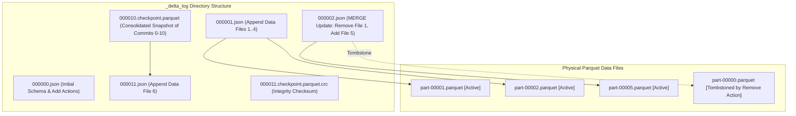
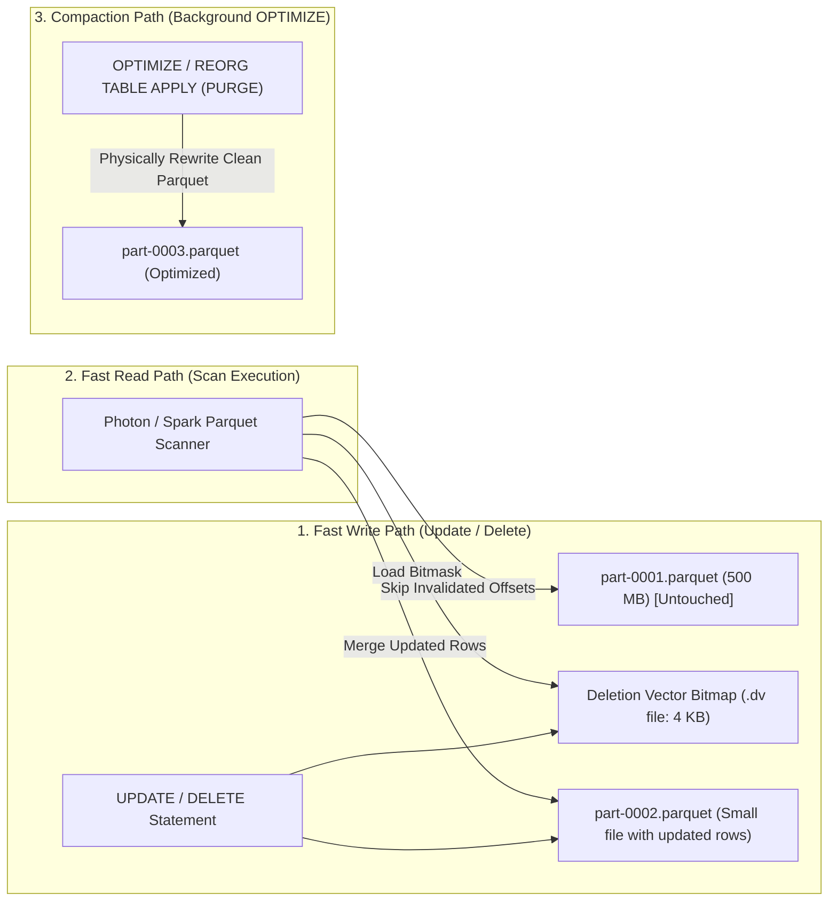

# 🏛️ Architecture Deep Dive: Delta Lake 3.x Storage Engine & Liquid Clustering

## 1. Executive Overview & ACID Transaction Log Internals

Delta Lake 3.x is an open-source storage framework that brings ACID transactional integrity, scalable metadata handling, and fine-grained mutation mechanics directly to cloud object storage. At the core of every Delta table is the **`_delta_log`** transaction log directory.

---

## 2. Deletion Vectors (Merge-on-Read vs. Copy-on-Write)

Traditional cloud lakehouse engines relied strictly on **Copy-on-Write (CoW)**: modifying a single row inside a 500 MB Parquet file required reading all 500 MB, rewriting the unaffected rows plus the updated row into a brand-new 500 MB file, and tombstoning the old file.

Delta Lake 3.x introduces **Deletion Vectors (DVs)**, transitioning DML operations to **Merge-on-Read (MoR)**:

### Key Performance Benefits of Deletion Vectors:
- **Write Latency Reduction**: DML updates and deletes complete in seconds rather than minutes because 99% of unchanged data is never rewritten during the transaction.
- **Row-Level Concurrency (RLC)**: Two concurrent transactions updating distinct rows within the *exact same* physical Parquet file no longer trigger `ConcurrentModificationException` conflict failures.
- **Physical Space Reclaim**: Running `REORG TABLE my_table APPLY (PURGE)` physically purges deleted rows from storage to satisfy GDPR/CCPA "right to be forgotten" compliance mandates.

---

## 3. Liquid Clustering (`CLUSTER BY`) Internals

For over a decade, big data architectures relied on Hive directory partitioning (`/year=2026/month=11/day=17/`). Hive partitioning suffers from three critical failure modes:
1. **The Small File Problem**: Partitioning by high-cardinality keys creates millions of sub-megabyte files, crippling storage metadata listings.
2. **Data Skew**: Some partitions contain 50 GB while others contain 5 KB.
3. **Rigid Layout**: Altering the partition key requires rewriting the entire historical dataset.

**Liquid Clustering** replaces both Hive partitioning and multi-dimensional `ZORDER BY` using space-filling **Hilbert curves** that organize data points into multi-dimensional ZCubes:

| Dimension | Hive Partitioning (`PARTITIONED BY`) | Z-Ordering (`ZORDER BY`) | Liquid Clustering (`CLUSTER BY`) |
| :--- | :--- | :--- | :--- |
| **Physical Organization** | Rigid directory folders on disk | Multi-column clustering within files | Incremental Hilbert-curve ZCubes |
| **Key Alteration** | Requires complete table rewrite | Re-clusters entire table on next optimize | Instant metadata operation via `ALTER TABLE` |
| **Write Amplification** | Severe on high-cardinality keys | High (re-sorts full historical files) | Low (clusters only newly arrived unclustered files) |
| **Small File Hygiene** | Fragile; causes metadata explosion | Moderate | Automated; target file sizes tuned to 256MB–1GB |
| **Recommended Grain** | Low cardinality (< 1,000 distinct values) | Medium cardinality (1–4 columns) | High cardinality (UUIDs, timestamps, customer IDs) |

---

## 4. Delta UniForm (Universal Format) Architecture

Delta UniForm eliminates data duplication across enterprise platforms. When UniForm is enabled on a Delta table, Databricks automatically and asynchronously generates Apache Iceberg and Apache Hudi metadata catalogs in the background alongside native `_delta_log` commits. External compute engines (Snowflake, Trino, BigQuery, AWS Athena) query the table as if it were a native Iceberg table without copying a single byte of Parquet data.
