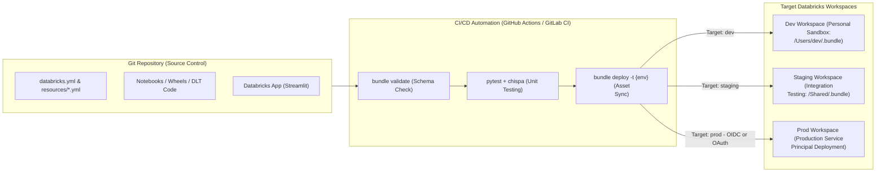
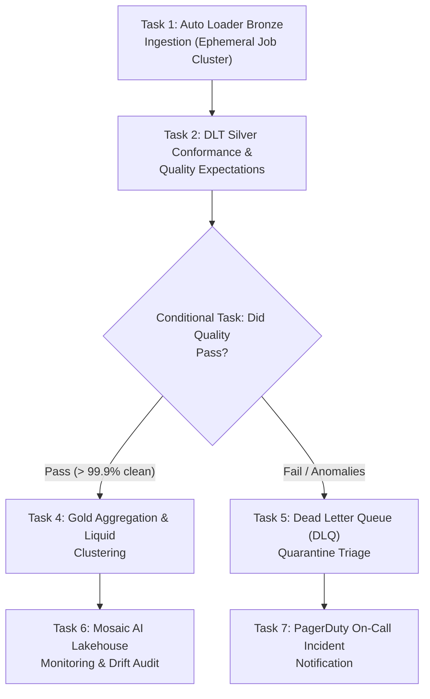
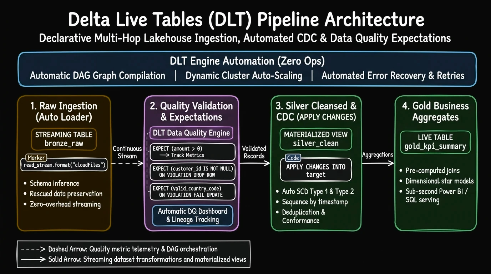
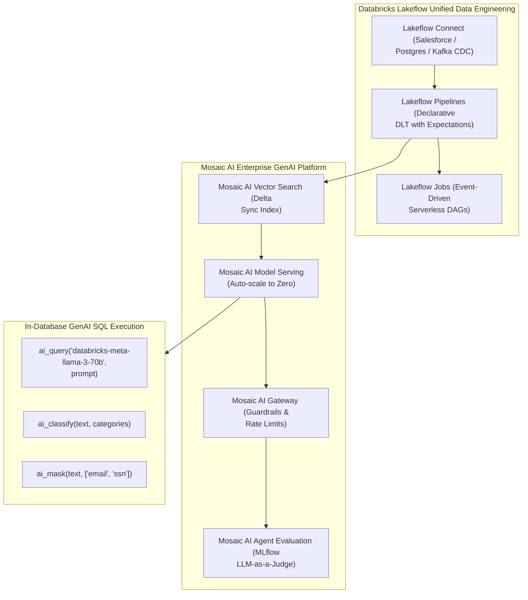

# 🏛️ Architecture Deep Dive: Enterprise DevOps, DABs & Lakeflow Orchestration

## 1. Executive Overview: Infrastructure as Code for Data & AI

Modern enterprise data platforms require automated, reproducible, multi-environment deployment pipelines. **Databricks Asset Bundles (DABs)** provide declarative Infrastructure as Code (IaC) for Lakeflow Jobs, Delta Live Tables (DLT) declarative pipelines, Unity Catalog schemas, MLflow model serving endpoints, and Databricks Apps.



### 📐 Visual Architectural Blueprint: Databricks Asset Bundles (DABs) Enterprise DevOps


---

## 2. DABs Multi-Environment Targeting & Variable Scoping

A single bundle definition dynamically adapts across deployment targets via declarative variable substitution in `databricks.yml`:

```yaml
bundle:
  name: databricks-handbook

variables:
  catalog:
    default: "main"
  schema:
    default: "analytics"

targets:
  dev:
    mode: development
    default: true
    workspace:
      root_path: /Users/${workspace.current_user.userName}/.bundle/${bundle.name}/${bundle.target}
    variables:
      catalog: "dev_lakehouse"
      schema: "sandbox_${workspace.current_user.short_name}"

  prod:
    mode: production
    workspace:
      root_path: /Shared/.bundle/${bundle.name}/${bundle.target}
    variables:
      catalog: "prod_lakehouse"
      schema: "gold_reporting"
    run_as:
      service_principal_name: "4f63c679-0db8-40a2-b91a-7b3b7e7136f4"
```

### Critical Production Rules:
- **`mode: development`**: Automatically pauses job schedules, prepends `[dev username]` to resource names, and deletes resources when developer sandboxes are torn down.
- **`mode: production`**: Enforces strict git branch validation, prevents accidental deletion of production tables, unpauses scheduled triggers, and mandates `run_as` Service Principal ownership.
- **Zero Human Credentials in CI/CD**: GitHub Actions authenticates via cloud OIDC (OpenID Connect) federation using Azure App Registrations or AWS IAM Roles. No static tokens are stored in repository secrets.

---

## 3. Lakeflow Jobs: Multi-Task Orchestration & Failure Recovery

Lakeflow Jobs provide enterprise DAG orchestration with fine-grained task dependencies, parameter inheritance, and conditional branching:



### 📐 Visual Architectural Blueprint: Lakeflow Declarative Delta Live Tables (DLT) Pipeline


### Production Orchestration Invariants:
1. **Inter-Task Parameter Passing**: Upstream tasks emit dynamic metrics (processed row counts, execution timestamps, validation flags) using `dbutils.jobs.taskValues.set(key, value)`. Downstream tasks consume them via `dbutils.jobs.taskValues.get(taskKey, key)`.
2. **Surgical Repair and Rerun**: If Task 4 fails due to temporary network saturation, the data engineer triggers `Repair Run`. Lakeflow re-runs *only* Task 4 and downstream tasks, completely preserving the compute time and state of completed upstream tasks (Tasks 1 and 2).
3. **Ephemeral Job Clusters vs. Serverless**: Batch ETL jobs utilize ephemeral job clusters (which terminate immediately upon task completion) or Serverless Jobs (instant zero-startup-latency compute) to eliminate idle infrastructure waste.

---

## 4. Databricks Lakeflow & Mosaic AI Agentic Framework

The modern Databricks platform unifies data engineering with production Generative AI via **Databricks Lakeflow** (Connect, Pipelines, Jobs) and the **Mosaic AI Suite**.



### Production GenAI Implementation: In-Database SQL AI Functions & Vector Search
```sql
-- 1. In-database PII masking and classification using native AI functions
SELECT
    ticket_id,
    ai_mask(customer_notes, ARRAY('email', 'phone', 'ssn')) AS sanitized_notes,
    ai_classify(customer_notes, ARRAY('hardware', 'billing', 'outage')) AS issue_category,
    ai_summarize(customer_notes, 50) AS executive_summary
FROM prod_catalog.silver.customer_support_tickets;

-- 2. Hybrid semantic similarity query over Mosaic AI Vector Search
SELECT
    doc_id,
    document_title,
    semantic_score
FROM vector_search(
    index => 'prod_catalog.knowledge_base.kb_vector_idx',
    query_text => 'How do I resolve Spark shuffle spill on serverless?',
    num_results => 5
);
```

### Key AI Platform Invariants:
- **Delta Sync Vector Indexes**: Embeddings update automatically in real-time as source Delta tables ingest new records via streaming checkpoints.
- **AI Gateway Governance**: Intercepts external and internal LLM calls to enforce enterprise rate limits, token budgets, and automated PII redaction.
- **Task-Specific AI Functions**: Prefer `ai_classify`, `ai_extract`, and `ai_mask` over raw LLM prompt calls for $5	imes$ lower latency and deterministic outputs.
