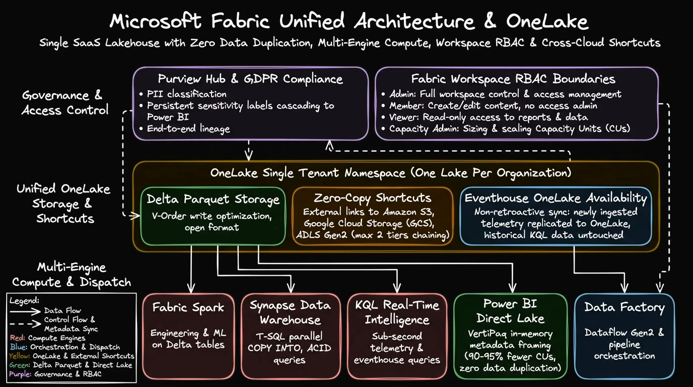
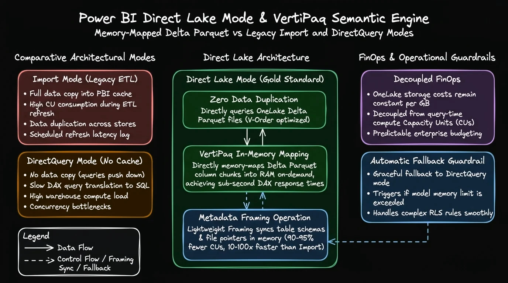
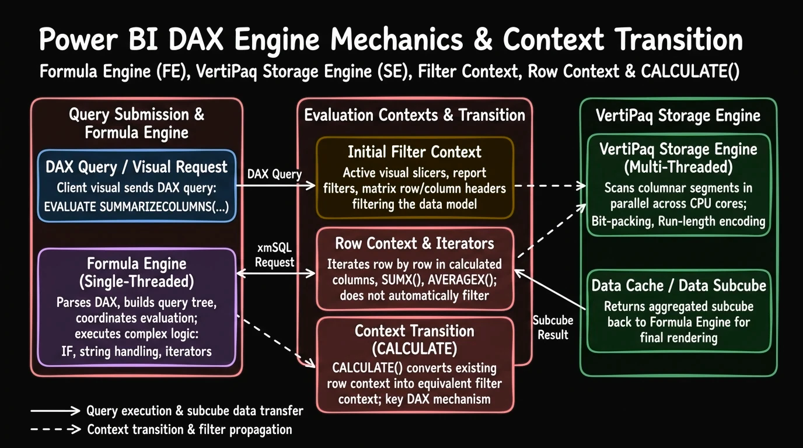
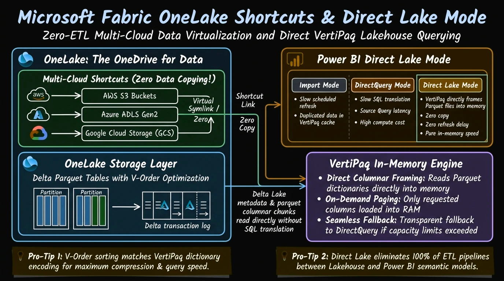

# Fabric & Power BI — Architecture Whiteboard Blueprints

> **Domain**: `Fabric & Power BI` | **Blueprints**: 4 | [← Back to Whiteboards Index](index.md)

---

## Fabric & Power BI
*4 Architecture Blueprints in this domain*

### 📐 Fabric & Power BI — Visual Blueprints Grid (2x2)

<table>
  <tr>
    <td width="50%" valign="top">
      
       <strong><a href="#fabric-onelake-architecture">Microsoft Fabric Unified Architecture & OneLake</a></strong> 
      <em>Single SaaS Lakehouse with Zero Data Duplication, Multi-Engine Compute, and Cross-Cloud Shortcuts</em> 
      <small>`Microsoft Fabric` · `OneLake` · `Delta Lake` · `Direct Lake`</small> 
      <a href="#fabric-onelake-architecture">🔍 Inspect Deep Dive & Architecture →</a>
    </td>
    <td width="50%" valign="top">
      
       <strong><a href="#powerbi-direct-lake-vertipaq">Power BI Direct Lake Mode & VertiPaq Semantic Engine</a></strong> 
      <em>Memory-Mapped Delta Parquet vs Legacy Import and DirectQuery Modes</em> 
      <small>`Power BI` · `Direct Lake` · `VertiPaq` · `DAX`</small> 
      <a href="#powerbi-direct-lake-vertipaq">🔍 Inspect Deep Dive & Architecture →</a>
    </td>
  </tr>
  <tr>
    <td width="50%" valign="top">
      
       <strong><a href="#powerbi-dax-engine-context">Power BI DAX Engine Mechanics & Context Transition</a></strong> 
      <em>Formula Engine vs Storage Engine (VertiPaq) Mechanics, xmSQL Generation, and Context Transition</em> 
      <small>`DAX` · `Power BI` · `VertiPaq` · `Formula Engine`</small> 
      <a href="#powerbi-dax-engine-context">🔍 Inspect Deep Dive & Architecture →</a>
    </td>
    <td width="50%" valign="top">
      
       <strong><a href="#fabric-onelake-direct-lake-architecture">Microsoft Fabric OneLake Shortcuts & Direct Lake Mode</a></strong> 
      <em>Cross-Cloud Zero-Copy Virtualization, ADLS/S3/GCS Integration, and Direct Lake Paging</em> 
      <small>`OneLake Shortcuts` · `Direct Lake` · `Cross-Cloud` · `AWS S3`</small> 
      <a href="#fabric-onelake-direct-lake-architecture">🔍 Inspect Deep Dive & Architecture →</a>
    </td>
  </tr>
</table>

---

### Microsoft Fabric Unified Architecture & OneLake
**Single SaaS Lakehouse with Zero Data Duplication, Multi-Engine Compute, and Cross-Cloud Shortcuts**

**Tags:** `Microsoft Fabric` · `OneLake` · `Delta Lake` · `Direct Lake` · `Shortcuts` · `Synapse Data Warehouse` · `Fabric Spark` · `Purview` · `V-Order` · `Capacity Units` · [📖 Official Docs](https://learn.microsoft.com/en-us/fabric/onelake/onelake-overview)

**Overview:** Enterprise-grade SaaS data lakehouse unifying disparate storage accounts into a single hierarchical OneLake namespace (onelake.dfs.fabric.microsoft.com). Eliminates physical data silos by providing zero-copy shortcuts to AWS S3, Google Cloud Storage, and ADLS Gen2, while enabling native multi-engine compute (Spark, Synapse DW, Power BI Direct Lake, KQL Eventhouse, and Data Factory) over standardized Delta Parquet with proprietary V-Order read optimization.

**Key Architecture Points:**
- Single Unified Namespace: Exactly one OneLake per Microsoft Entra tenant, exposing an ADLS Gen2-compatible DFS endpoint (https://onelake.dfs.fabric.microsoft.com).
- Zero Data Duplication via Shortcuts: Virtual directory links point to internal workspace folders or external clouds (AWS S3 IAM roles, GCS service accounts, ADLS Gen2) with zero data movement.
- V-Order Parquet Layout: Proprietary write-time sorting algorithm that reorders row groups and dictionary pages to match Power BI VertiPaq's in-memory columnar layout for zero-transcode memory paging.
- Multi-Engine Interoperability: Native Delta transaction log compatibility allows Fabric Spark, T-SQL Synapse Warehouse, KQL Eventhouse, and Power BI Direct Lake to read and write against identical Delta tables.
- Capacity Unit (CU) Smoothing & Throttling: Fabric dynamically smooths bursty compute spikes over 24-hour evaluation cycles; sustained overconsumption triggers HTTP 429 throttling managed via Fabric Capacity Metrics.
- Eventhouse Delta Synchronization: Real-time KQL telemetry availability in OneLake is forward-looking; newly ingested streaming data is materialized as Delta Parquet without retroactively converting historical records.
- Unified Purview Governance: Native bidirectional integration with Microsoft Purview for automated PII discovery, sensitivity labeling, and cross-workspace audit lineage.

> **Architect Note:** OneLake establishes the single tenant data plane: Workspaces function as logical domain containers and RBAC boundaries, while Capacities (F-SKUs) decouple billing and compute pooling from physical storage. Cross-cloud shortcuts virtualize external storage without egress fees during idle states, but multi-hop shortcut chaining (>2 hops) must be strictly forbidden to avoid metadata lease expiration and latency amplification. Capacity smoothing averages burst consumption over a 24-hour window, preventing transient ETL spikes from triggering throttling.

<strong>Multi-Persona Architectural Breakdown (Click to expand)</strong>

- **Enterprise Architect:** Defines enterprise workspace topology and domain boundaries; determines capacity sizing (F64 vs F128) based on peak concurrent Spark and semantic model workloads; establishes zero-trust network boundaries with Managed Private Endpoints and conditional access policies.
- **Senior Data Engineer:** Tunes Spark delta write configurations to enforce V-Order optimization (`spark.sql.parquet.vorder.enabled=true`); profiles OneLake REST API throughput; optimizes Delta log retention and compaction schedules to keep file counts under 10,000 per table for optimal Direct Lake performance.
- **Data Engineer:** Authors Data Factory copy pipelines and Fabric Spark notebooks; creates and manages OneLake shortcuts linking legacy Azure Blob or S3 buckets into Lakehouse Bronze tables; handles schema evolution during Delta appends.
- **Data Steward:** Maintains data classification and sensitivity labels across OneLake workspaces; reviews Purview Hub lineage graphs to track data movement from operational sources to executive reporting; configures workspace access control roles (Admin, Member, Contributor, Viewer).
- **Business Analyst:** Queries Lakehouse SQL analytics endpoints using familiar T-SQL syntax without spinning up dedicated compute; builds Direct Lake semantic models delivering sub-second interactive dashboard performance without waiting for scheduled data refreshes.

**Under-the-Hood Technical Mechanisms:**
- OneLake Hierarchical File System (HFS) DFS protocol translation
- V-Order columnar index page restructuring during Parquet file serialization
- Cross-cloud AWS STS AssumedRole credential delegation for S3 shortcuts
- Capacity Unit smoothing and burndown time-window algorithm
- Eventhouse Delta sync daemon materializing KQL shards into standard Delta tables

**Production Failure Modes & Incident Triage:**
- Capacity Throttling (HTTP 429 / Query Rejected): Inspect Fabric Capacity Metrics app to identify rogue runaway Spark notebooks or Cartesian DirectQuery calls; enable autoscale or scale SKU tier.
- Direct Lake Fallback to DirectQuery: Triggered if Delta table exceeds F-SKU memory limits or contains unsupported features (RLS, complex calculated columns, >10k files); run `OPTIMIZE` and push calculated logic upstream into Delta.
- Shortcut Authentication Expiration: Cloud provider credential rotation breaks external shortcut; re-authenticate cloud connection credentials in Fabric Admin Portal and verify IAM trust policies.

**Governance & Regulatory Compliance:**
- Microsoft Purview Hub automated classification and sensitivity label inheritance
- Entra ID Conditional Access and workspace RBAC isolation
- Detailed audit logging captured in Microsoft 365 Unified Audit Log (UAL) and Azure Monitor
- GDPR right-to-be-forgotten executed via Delta ACID DELETE followed by VACUUM with retention overrides

[↑ Return to Fabric & Power BI 2x2 Grid](#fabric-power-bi) · [Top of Catalog](index.md)

---

### Power BI Direct Lake Mode & VertiPaq Semantic Engine
**Memory-Mapped Delta Parquet vs Legacy Import and DirectQuery Modes**

**Tags:** `Power BI` · `Direct Lake` · `VertiPaq` · `DAX` · `Fabric Semantic Model` · `Delta Parquet` · `Import vs DirectQuery` · `V-Order` · `Framing` · [📖 Official Docs](https://learn.microsoft.com/en-us/power-bi/enterprise/directlake-overview)

**Overview:** Groundbreaking semantic modeling architecture that eliminates the historical trade-off between performance (Import mode) and data freshness (DirectQuery mode). Direct Lake enables the VertiPaq analytics engine to memory-map Delta Parquet columnar chunks directly from OneLake storage into memory on-demand. When combined with V-Order sorted Parquet, it achieves sub-second DAX analytical queries over billions of rows without duplicating data into proprietary Analysis Services model files.

**Key Architecture Points:**
- Zero Data Duplication: Reads Delta Parquet files directly from OneLake without importing or duplicating data into proprietary Power BI .pbix/Analysis Services storage.
- Columnar On-Demand Memory Paging: VertiPaq pages individual column chunks into RAM only when referenced by visual DAX queries, keeping memory footprints strictly proportional to active measures.
- V-Order Acceleration: Delta Parquet files written with V-Order sorting have physical row-group column orders matching VertiPaq in-memory structures, enabling zero-CPU transcoding upon paging.
- Framing Snapshot Isolation: Direct Lake 'frames' a specific Delta table transaction version, ensuring consistent report visuals during concurrent ETL writes until an explicit refresh or automatic sync advances the frame.
- Fallback Circuit Breaker: If memory limits are exceeded, Delta table contains unsupported data types, or row-level security (RLS) is applied at the Lakehouse level, the engine seamlessly falls back to DirectQuery mode.
- Sub-Second Analytical Latency: Delivers equivalent or superior query response times compared to classic in-memory Import mode, while reflecting upstream Delta Lake commits within seconds.

> **Architect Note:** Direct Lake fundamentally transforms enterprise BI economics by eliminating memory-hungry scheduled import refreshes and fragile DirectQuery relational translation layers. However, architects must design semantic models around capacity memory limits: if a query requires paging more columns than the F-SKU memory limit allows, or if table metadata is fragmented, the model silently falls back to DirectQuery, causing sudden query latency degradation. Enforce strict gold-layer star schema modeling with pre-aggregated dimension tables to keep active working sets compact.

<strong>Multi-Persona Architectural Breakdown (Click to expand)</strong>

- **Enterprise Architect:** Establishes semantic layer standards; sizes Fabric capacity tiers to ensure peak concurrent dashboard usage remains within VertiPaq memory boundaries; establishes fallback monitoring and alert thresholds.
- **Senior Data Engineer:** Profiles DAX queries using DAX Studio and Server Timings; tunes upstream Delta tables using `OPTIMIZE ... VORDER` and sets target file sizes to 500MB-1GB to maximize column chunk paging efficiency.
- **Data Engineer:** Maintains clean, consolidated Delta tables in the Gold lakehouse layer; orchestrates pipeline completion notifications to trigger semantic model framing refresh API calls (`POST /models/{id}/refresh`).
- **Data Steward:** Implements Row-Level Security (RLS) and Object-Level Security (OLS) directly within the Power BI semantic model rather than the SQL endpoint to avoid inadvertent DirectQuery fallbacks.
- **Business Analyst:** Designs rich interactive dashboards with dozens of visuals without fearing slow load times; builds complex DAX measures over massive multi-billion row transaction fact tables with zero refresh lag.

**Under-the-Hood Technical Mechanisms:**
- VertiPaq memory-mapped column chunk loading via OneLake REST paging
- Delta Log transaction version framing and snapshot lease acquisition
- V-Order dictionary encoding alignment and zero-transcode memory transfer
- DirectQuery fallback routing engine and query translation dispatch
- Fabric Capacity Memory throttling and Least-Recently-Used (LRU) column eviction

**Production Failure Modes & Incident Triage:**
- Silent DirectQuery Fallback: Caused by exceeding capacity memory limits, file count > 10,000, or lakehouse-level RLS; check Fabric Capacity Metrics app, compact small files via `OPTIMIZE`, and verify semantic model configuration.
- Visual Memory Limit Exceeded: High-cardinality columns (e.g. GUIDs, raw timestamps) paged into VertiPaq; remove unneeded high-cardinality keys from semantic model and replace with integer surrogate keys.
- Out-of-Sync Visuals During Active Writes: Long-running framing lease keeps old Delta version active; invoke semantic model refresh API or enable automatic sync in dataset settings.

**Governance & Regulatory Compliance:**
- Model-level Row-Level Security (RLS) and Object-Level Security (OLS) role mappings
- Purview automated lineage tracing from Power BI visual fields down to OneLake Delta columns
- Microsoft Entra ID token pass-through for secured OneLake file access
- Compliance with data residency policies since data remains within OneLake tenant boundaries

[↑ Return to Fabric & Power BI 2x2 Grid](#fabric-power-bi) · [Top of Catalog](index.md)

---

### Power BI DAX Engine Mechanics & Context Transition
**Formula Engine vs Storage Engine (VertiPaq) Mechanics, xmSQL Generation, and Context Transition**

**Tags:** `DAX` · `Power BI` · `VertiPaq` · `Formula Engine` · `Storage Engine` · `Context Transition` · `CALCULATE` · `xmSQL` · `Query Optimization` · [📖 Official Docs](https://learn.microsoft.com/en-us/dax/dax-overview)

**Overview:** Architectural breakdown of the dual-engine execution model powering DAX analytical queries: the single-threaded Formula Engine (FE) and the highly parallel, in-memory Storage Engine (SE / VertiPaq). Details the internal transition mechanism where `CALCULATE()` and `CALCULATETABLE()` transform existing Row Contexts into equivalent Filter Contexts, triggering SE xmSQL queries, data cache lookups, and callback evaluations.

**Key Architecture Points:**
- Dual-Engine Architecture: Queries are coordinated by the Formula Engine (FE - single-threaded, executes complex logic, Janino bytecode) and executed by the Storage Engine (SE / VertiPaq - multi-threaded, scans compressed column indexes).
- Context Transition Mechanism: `CALCULATE()` inspects all active Row Contexts (from iteration loops or calculated columns) and converts each current row value into an equivalent Filter Context predicate.
- xmSQL Generation: The Storage Engine translates filter contexts into internal xmSQL queries to scan VertiPaq compressed dictionaries, utilizing SIMD parallelism across multiple CPU cores.
- VertiPaq Data Cache: SE caches query results in an ephemeral cache; identical or subset DAX queries retrieve results directly from memory without re-scanning column partitions.
- Formula Engine Callback Bottleneck: Non-sargable functions or complex conditional logic inside SE scans force the Storage Engine to invoke the Formula Engine row-by-row (CallbackDataID), severely degrading query latency.
- Expanded Tables Concept: Filter Context applied to a table automatically expands across active 1-to-many relationships, filtering related fact and dimension tables along the relationship chain.

> **Architect Note:** High-concurrency enterprise BI solutions depend on shifting computational weight from the single-threaded Formula Engine into the multi-threaded Storage Engine. When measures invoke `CALCULATE` inside large iterative loops (e.g. `SUMX`), Context Transition forces row-by-row filter context evaluation, collapsing parallelism and triggering catastrophic CPU bottlenecks. Enterprise semantic models must replace iterative context transitions with set-based matrix calculations and pre-aggregated dimensional views.

<strong>Multi-Persona Architectural Breakdown (Click to expand)</strong>

- **Enterprise Architect:** Establishes enterprise DAX coding guidelines; designs star schema relationships to prevent ambiguous bi-directional cross-filtering; audits memory and CPU consumption across shared Analysis Services / Fabric capacities.
- **Senior Data Engineer:** Profiles slow report pages using DAX Studio; analyzes Server Timings (FE vs SE duration); eliminates CallbackDataIDs by refactoring complex logic into native SE operations or pushing transformations upstream into the Lakehouse.
- **Data Engineer:** Pre-aggregates high-cardinality transactional attributes and calculates common business metrics in the Gold Delta tables to reduce VertiPaq memory pressure and eliminate expensive runtime DAX computations.
- **Data Steward:** Maintains centralized calculation definitions in master semantic models (certified datasets) to guarantee single-version-of-truth business metrics across all corporate reporting tools.
- **Business Analyst:** Masters the difference between Row Context and Filter Context; writes efficient measures using `CALCULATE`, `KEEPFILTERS`, and time intelligence functions (`DATESYTD`, `SAMEPERIODLASTYEAR`) without triggering unintended filter overrides.

**Under-the-Hood Technical Mechanisms:**
- Row Context to Filter Context translation matrix via CALCULATE
- xmSQL internal query compilation and execution across VertiPaq partitions
- Storage Engine Data Cache hashing and hit/miss evaluation
- CallbackDataID invocation when SE encounters unsupported expressions
- Expanded table semantic filtering across active one-to-many relationships

**Production Failure Modes & Incident Triage:**
- High Formula Engine Duration (>50% FE time in DAX Studio): Caused by iterating over large tables with nested CALCULATE or complex IF/SWITCH conditions; rewrite using set-based SUMMARIZECOLUMNS or push calculated columns to lakehouse.
- Memory Grant Exhaustion: Heavy visual matrices cross-joining multiple high-cardinality dimensions; introduce TopN filtering, disable 'Show items with no data', and optimize relationship cardinality.
- Incorrect Totals in Matrix Visuals: Measure relies on row context that does not exist at total/subtotal summary rows; rewrite measure using `HASONEVALUE()` or `SELECTEDVALUE()` with explicit aggregation fallbacks.

**Governance & Regulatory Compliance:**
- Centralized metric governance via Certified and Promoted semantic models
- Role-based DAX security filters enforcing tenant and regional data isolation
- Audit logging of DAX query execution times via Azure Log Analytics and Purview Insights
- Prevention of unauthorized data exposure through strict relationship cross-filtering rules

[↑ Return to Fabric & Power BI 2x2 Grid](#fabric-power-bi) · [Top of Catalog](index.md)

---

### Microsoft Fabric OneLake Shortcuts & Direct Lake Mode
**Cross-Cloud Zero-Copy Virtualization, ADLS/S3/GCS Integration, and Direct Lake Paging**

**Tags:** `OneLake Shortcuts` · `Direct Lake` · `Cross-Cloud` · `AWS S3` · `Google Cloud Storage` · `ADLS Gen2` · `Storage Virtualization` · `Zero Copy` · `Federation` · [📖 Official Docs](https://learn.microsoft.com/en-us/fabric/onelake/onelake-shortcuts)

**Overview:** Deep architectural integration between OneLake's cross-cloud storage virtualization (Shortcuts) and Power BI Direct Lake mode. Illustrates how OneLake maps external object stores (Amazon S3, Google Cloud Storage, Azure Data Lake Gen2) into the Fabric unified namespace with zero data egress or duplication, enabling VertiPaq to execute Direct Lake queries directly across federated multi-cloud data lakes.

**Key Architecture Points:**
- Cross-Cloud Virtualization: External S3 buckets and GCS storage buckets appear as native folders inside OneLake workspaces with zero physical data movement.
- Credential Delegation: Leverages AWS IAM roles with Web Identity Federation and Google Cloud Service Account federation for zero-secret, token-based cloud authentication.
- Direct Lake Over Shortcuts: Power BI Direct Lake can query Delta tables physically residing in AWS S3 or ADLS Gen2 via OneLake shortcut pointers with full VertiPaq acceleration.
- Metadata-Only Synchronization: OneLake maintains lightweight metadata pointers and caches Parquet file footers, minimizing cross-cloud REST calls during query planning.
- Egress Cost Optimization: Data is streamed across clouds only when specific column chunks are paged into memory by active queries, eliminating massive bulk data egress fees.
- Multi-Tenant Workspace Boundaries: Shortcuts can cross workspace boundaries internally, allowing domain teams to share curated gold tables without duplicating storage or compute.

> **Architect Note:** Shortcuts provide the ultimate anti-lock-in mechanism for enterprise data platforms, virtualizing external cloud lakes into a single unified analytical plane. However, cross-cloud Direct Lake queries are subject to internet/cloud-interconnect network latencies. For mission-critical dashboards requiring sub-second response times, architects must implement automated cache warming or schedule selective Delta cloning for high-frequency dimensional tables, while leaving multi-terabyte transactional tables virtualized via S3 shortcuts.

<strong>Multi-Persona Architectural Breakdown (Click to expand)</strong>

- **Enterprise Architect:** Architects multi-cloud enterprise data federation; establishes AWS STS and GCP workload identity federation trust relationships; evaluates cross-cloud network throughput and interconnect bandwidth (ExpressRoute / Direct Connect).
- **Senior Data Engineer:** Monitors cross-cloud network latency and Delta log resolution times; ensures external S3 Delta tables maintain valid transaction checkpoints to avoid thousands of remote JSON log fetches during Direct Lake initialization.
- **Data Engineer:** Configures and manages OneLake shortcuts using the Fabric REST API and PowerShell/Python SDKs; sets up automated health checks to verify external cloud bucket reachability.
- **Data Steward:** Maintains unified governance policies across clouds; ensures Microsoft Purview scans external shortcut targets to apply consistent enterprise classification and data retention rules.
- **Business Analyst:** Builds cross-cloud executive dashboards combining real-time AWS operational telemetry with Azure financial data in a single unified Power BI report with zero manual data stitching.

**Under-the-Hood Technical Mechanisms:**
- AWS STS AssumeRoleWithWebIdentity token exchange for S3 shortcut mounting
- GCS Workload Identity Federation credential translation
- OneLake metadata lease caching and remote Parquet footer pre-fetching
- Direct Lake remote columnar paging through virtualized DFS endpoints
- Internal workspace shortcut pointer resolution within tenant boundaries

**Production Failure Modes & Incident Triage:**
- Shortcut Access Denied (HTTP 403): External cloud IAM role trust policy expired, deleted, or missing s3:GetObject/s3:ListBucket permissions; re-verify cloud federation trust policy.
- Direct Lake Fallback Due to Remote Latency: Cross-cloud network latency spikes cause metadata fetch timeout; configure Azure ExpressRoute / AWS Direct Connect or replicate latency-sensitive dimensions locally.
- Delta Log Inconsistency: External Spark job writes Delta commits with incompatible reader/writer version; standardize Delta protocol versions across Databricks, EMR, and Fabric.

**Governance & Regulatory Compliance:**
- Cross-cloud audit logging linking OneLake access events to AWS CloudTrail and GCP Cloud Audit Logs
- Microsoft Purview unified data classification across internal and shortcut storage locations
- Strict compliance with regional data residency laws by verifying shortcut targets remain within approved geographic regions
- Zero-trust credential lifecycle management using short-lived OIDC tokens

[↑ Return to Fabric & Power BI 2x2 Grid](#fabric-power-bi) · [Top of Catalog](index.md)

---

