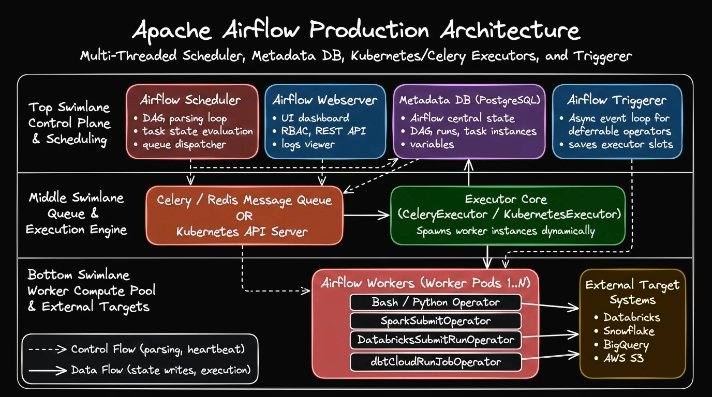
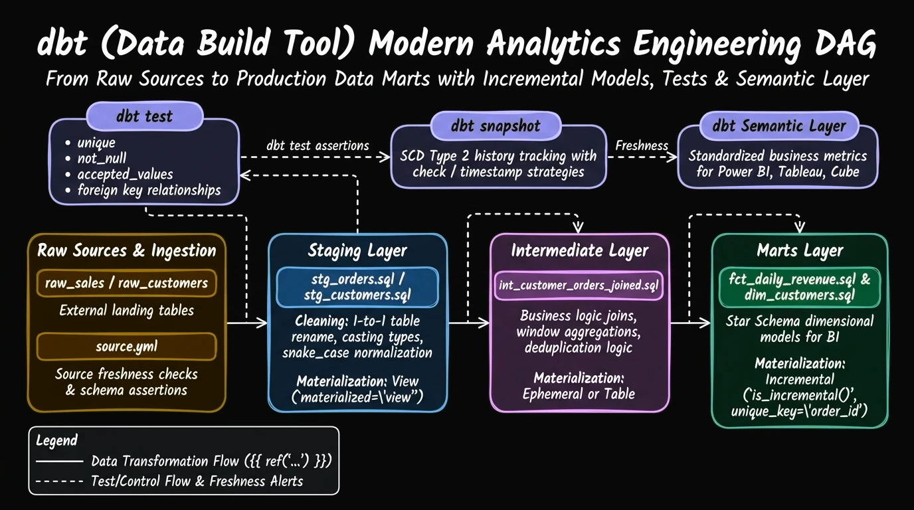
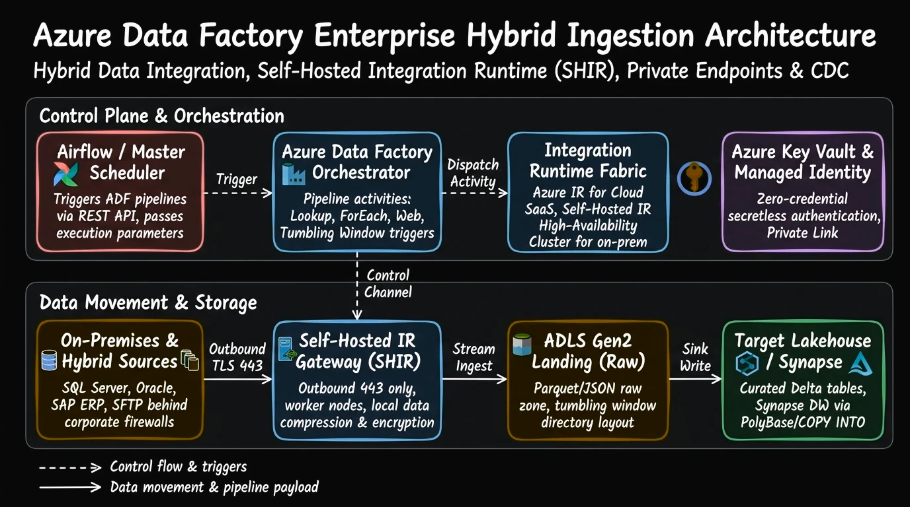
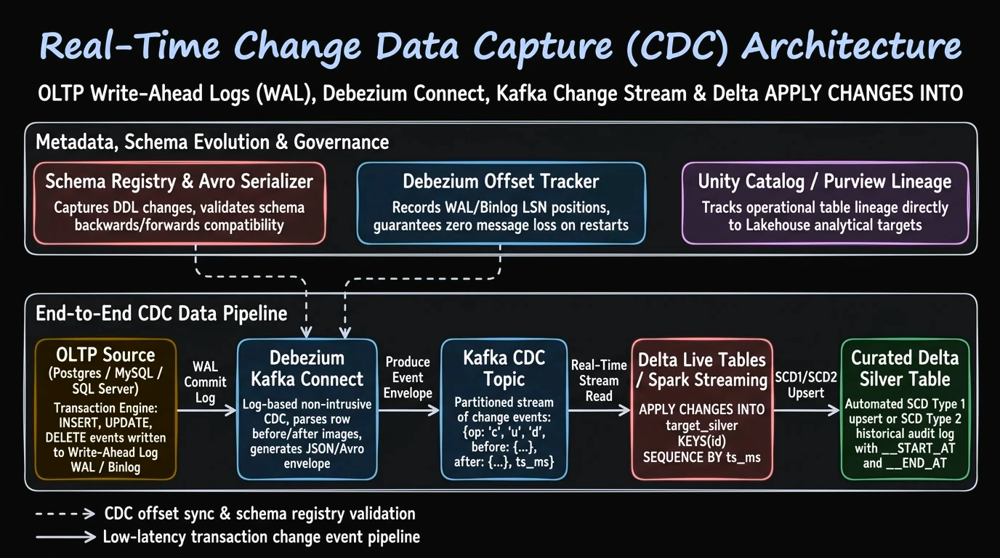
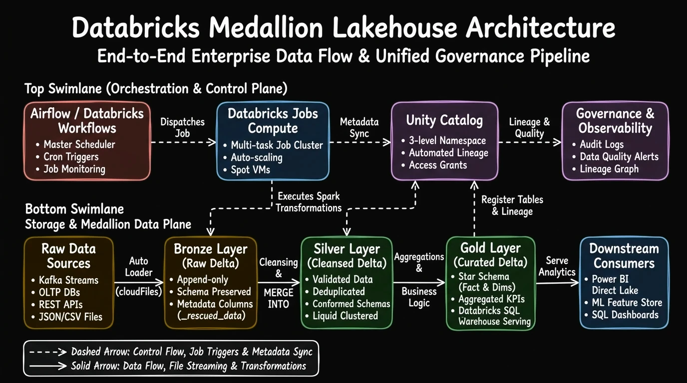
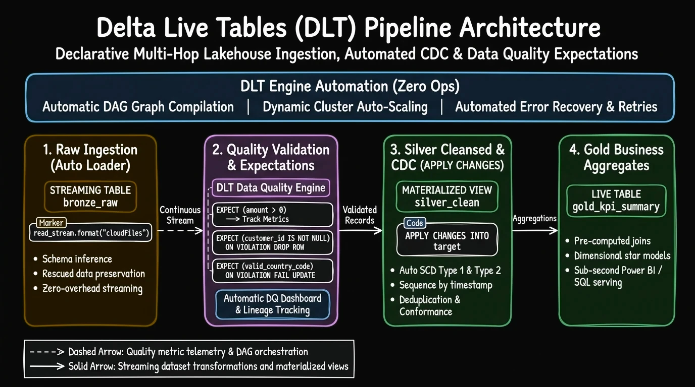
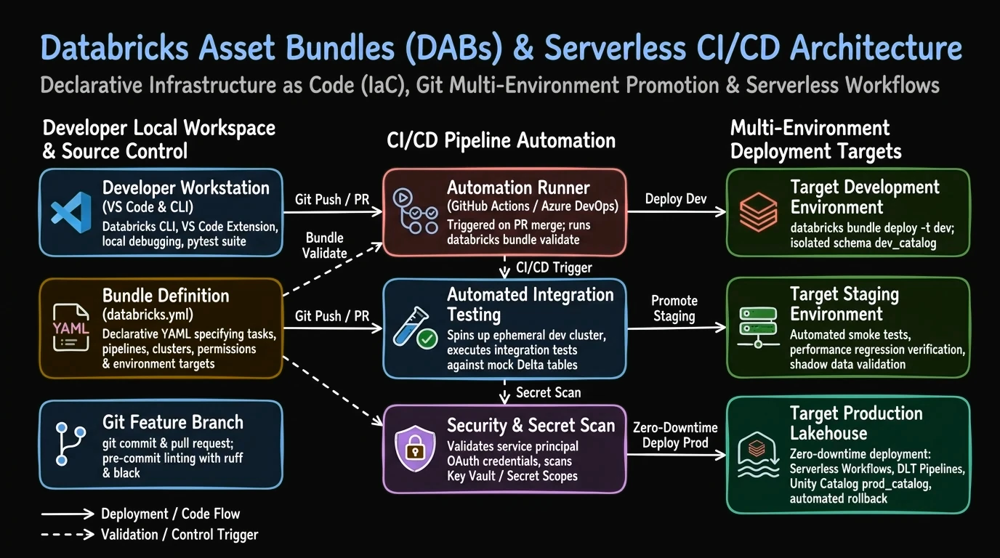
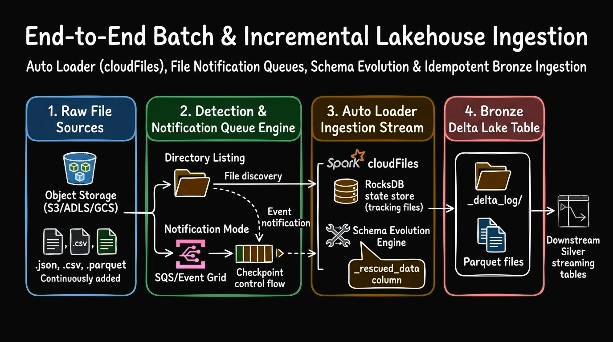
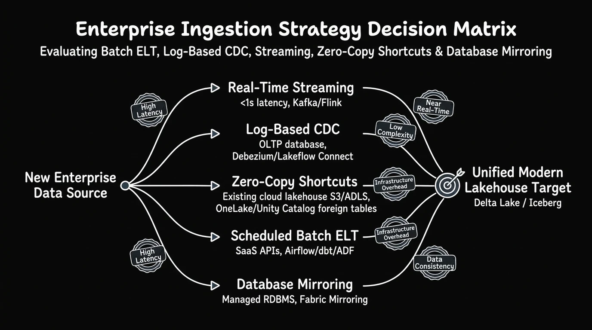
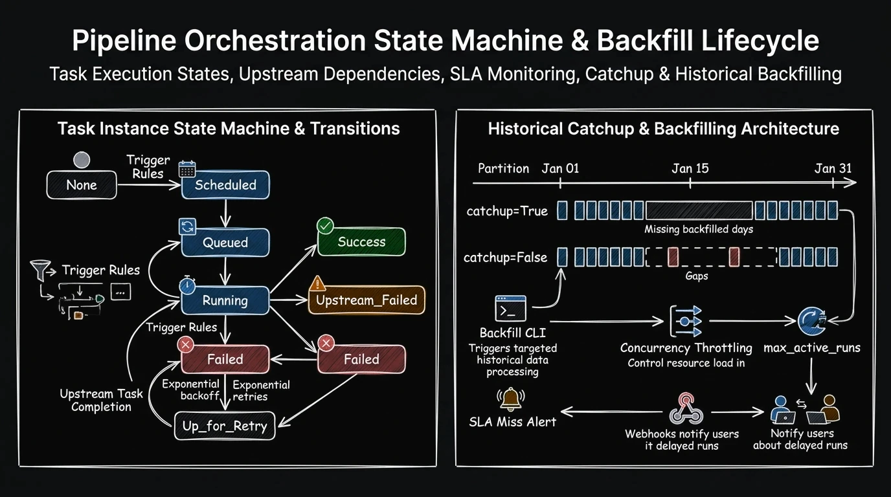

# Data Pipelines & Ingestion — Architecture Whiteboard Blueprints

> **Domain**: `Data Pipelines & Ingestion` | **Blueprints**: 12 | [← Back to Whiteboards Index](index.md)

---

## Data Pipelines & Ingestion
*12 Architecture Blueprints in this domain*

### 📐 Data Pipelines & Ingestion — Visual Blueprints Grid (2x2)

<table>
  <tr>
    <td width="50%" valign="top">
      
       <strong><a href="#apache-airflow-distributed-architecture">Apache Airflow Distributed Production Architecture</a></strong> 
      <em>High-Availability Schedulers, Celery/Kubernetes Executors, Metadata DB Pooling, and State Machines</em> 
      <small>`Apache Airflow` · `Orchestration` · `Celery Executor` · `Kubernetes Executor`</small> 
      <a href="#apache-airflow-distributed-architecture">🔍 Inspect Deep Dive & Architecture →</a>
    </td>
    <td width="50%" valign="top">
      
       <strong><a href="#dbt-analytics-engineering-dag">dbt (Data Build Tool) Modern Analytics Engineering DAG</a></strong> 
      <em>Modular SQL Transformation Mesh, Incremental Strategies, Snapshot SCD2, and Semantic Layer</em> 
      <small>`dbt` · `Analytics Engineering` · `DAG` · `Incremental Models`</small> 
      <a href="#dbt-analytics-engineering-dag">🔍 Inspect Deep Dive & Architecture →</a>
    </td>
  </tr>
  <tr>
    <td width="50%" valign="top">
      
       <strong><a href="#adf-hybrid-integration-runtime">Azure Data Factory Enterprise Hybrid Ingestion Architecture</a></strong> 
      <em>Control Plane vs Data Plane, Self-Hosted Integration Runtime (SHIR), and Private Endpoints</em> 
      <small>`Azure Data Factory` · `SHIR` · `Integration Runtime` · `Hybrid Cloud`</small> 
      <a href="#adf-hybrid-integration-runtime">🔍 Inspect Deep Dive & Architecture →</a>
    </td>
    <td width="50%" valign="top">
      
       <strong><a href="#kafka-event-streaming-pipeline">Real-Time Event Streaming & Kafka Architecture</a></strong> 
      <em>Distributed Broker Clusters, KRaft Consensus, Partitioning, and Consumer Rebalance Protocols</em> 
      <small>`Apache Kafka` · `Event Streaming` · `KRaft` · `Partitions`</small> 
      <a href="#kafka-event-streaming-pipeline">🔍 Inspect Deep Dive & Architecture →</a>
    </td>
  </tr>
  <tr>
    <td width="50%" valign="top">
      
       <strong><a href="#cdc-debezium-lakehouse-pipeline">Real-Time Change Data Capture (CDC) Architecture</a></strong> 
      <em>Transaction Log Decoding (WAL/Binlog), Kafka Connect, and Lakehouse ACID Merge Ingestion</em> 
      <small>`Debezium` · `CDC` · `Change Data Capture` · `PostgreSQL WAL`</small> 
      <a href="#cdc-debezium-lakehouse-pipeline">🔍 Inspect Deep Dive & Architecture →</a>
    </td>
    <td width="50%" valign="top">
      
       <strong><a href="#databricks-medallion-pipeline">Databricks Medallion Lakehouse Architecture</a></strong> 
      <em>Multi-Hop Refinement: Bronze (Raw Append), Silver (Cleaned/Enriched), and Gold (Business Marts)</em> 
      <small>`Databricks` · `Medallion` · `Bronze` · `Silver`</small> 
      <a href="#databricks-medallion-pipeline">🔍 Inspect Deep Dive & Architecture →</a>
    </td>
  </tr>
  <tr>
    <td width="50%" valign="top">
      
       <strong><a href="#delta-live-tables-pipeline">Delta Live Tables (DLT) Pipeline Architecture</a></strong> 
      <em>Declarative Lakehouse ETL, Streaming Tables vs Materialized Views, and Quality Expectations</em> 
      <small>`Delta Live Tables` · `DLT` · `Declarative ETL` · `Streaming Tables`</small> 
      <a href="#delta-live-tables-pipeline">🔍 Inspect Deep Dive & Architecture →</a>
    </td>
    <td width="50%" valign="top">
      
       <strong><a href="#databricks-dabs-devops-pipeline">Databricks Asset Bundles (DABs) & Serverless CI/CD Architecture</a></strong> 
      <em>Declarative Infrastructure-as-Code, Multi-Environment Targets, and GitOps Automation</em> 
      <small>`Databricks Asset Bundles` · `DABs` · `CI/CD` · `DevOps`</small> 
      <a href="#databricks-dabs-devops-pipeline">🔍 Inspect Deep Dive & Architecture →</a>
    </td>
  </tr>
  <tr>
    <td width="50%" valign="top">
      
       <strong><a href="#lakehouse-ingestion-autoloader">End-to-End Batch & Incremental Lakehouse Ingestion</a></strong> 
      <em>Auto Loader (cloudFiles), File Notification Queues, Schema Evolution & Idempotent Bronze Ingestion</em> 
      <small>`Auto Loader` · `cloudFiles` · `Incremental Ingestion` · `Bronze Layer`</small> 
      <a href="#lakehouse-ingestion-autoloader">🔍 Inspect Deep Dive & Architecture →</a>
    </td>
    <td width="50%" valign="top">
      
       <strong><a href="#streaming-dlq-recovery-flow">Stateful Streaming Failure Recovery & Dead-Letter Queue (DLQ) Remediation</a></strong> 
      <em>Poison Pill Quarantine, Circuit Breakers, Checkpoint State Recovery & Replay Lifecycle</em> 
      <small>`Dead-Letter Queue` · `DLQ` · `Structured Streaming` · `Stateful Stream`</small> 
      <a href="#streaming-dlq-recovery-flow">🔍 Inspect Deep Dive & Architecture →</a>
    </td>
  </tr>
  <tr>
    <td width="50%" valign="top">
      
       <strong><a href="#data-ingestion-strategy-matrix">Enterprise Data Movement & Replication Strategy Decision Flow</a></strong> 
      <em>Evaluating Batch ELT, Log-Based CDC, Streaming, Zero-Copy Shortcuts & Database Mirroring</em> 
      <small>`Data Ingestion` · `CDC` · `Batch ELT` · `Streaming`</small> 
      <a href="#data-ingestion-strategy-matrix">🔍 Inspect Deep Dive & Architecture →</a>
    </td>
    <td width="50%" valign="top">
      
       <strong><a href="#orchestration-backfill-lifecycle">Pipeline Orchestration Lifecycle, State Machine & Catchup Backfill</a></strong> 
      <em>Task Execution States, Upstream Dependencies, SLA Monitoring, Catchup & Historical Backfilling</em> 
      <small>`Orchestration` · `Apache Airflow` · `State Machine` · `Backfill`</small> 
      <a href="#orchestration-backfill-lifecycle">🔍 Inspect Deep Dive & Architecture →</a>
    </td>
  </tr>
</table>

---

### Apache Airflow Distributed Production Architecture
**High-Availability Schedulers, Celery/Kubernetes Executors, Metadata DB Pooling, and State Machines**

**Tags:** `Apache Airflow` · `Orchestration` · `Celery Executor` · `Kubernetes Executor` · `Metadata Database` · `Redis` · `Scheduler HA` · `PgBouncer` · `TaskInstance` · [📖 Official Docs](https://airflow.apache.org/docs/apache-airflow/stable/core-concepts/overview.html)

**Overview:** Production-grade distributed orchestration topology featuring multi-master high-availability Schedulers, horizontal worker scaling via Celery or KubernetesExecutor, message brokering (Redis/RabbitMQ), and connection pooling (PgBouncer) over PostgreSQL metadata databases. Demonstrates the complete DAG parsing loop, task state machine transitions, and external worker execution models.

**Key Architecture Points:**
- Scheduler High Availability: Multiple active scheduler instances run concurrently, coordinating task dispatching via database row-level locking without single-point-of-failure risks.
- Executor Selection Topology: CeleryExecutor provides warm persistent workers for high-frequency lightweight tasks; KubernetesExecutor provides isolated, dynamic, auto-scaling ephemeral pods for resource-intensive workloads.
- Metadata DB Connection Pooling: Deploying PgBouncer between Airflow components and PostgreSQL prevents connection exhaustion during massive concurrent task execution bursts.
- DAG Serialization: Schedulers serialize parsed DAGs into JSON/MessagePack within the metadata database (`serialized_dag` table), shielding Webservers from executing untrusted Python DAG files directly.
- TaskInstance State Machine: Strict finite state transitions (None -> Scheduled -> Queued -> Running -> Success/Failed/UpstreamFailed/UpForRetry) monitored via scheduler heartbeat loops.
- Custom XCom Backends: Overriding default relational XCom storage with cloud object storage (S3/ADLS/GCS) prevents metadata DB bloat when tasks exchange intermediate metadata payloads.
- Dynamic Task Mapping: Native runtime task branching and parallelization (`expand()`) based on upstream output arrays, replacing brittle static DAG generation patterns.

> **Architect Note:** Airflow is an orchestration engine, not an execution engine. Architects must strictly enforce the 'Thin DAG' philosophy: tasks must trigger distributed compute (Spark, Databricks, BigQuery, Snowflake, dbt) rather than processing data in-process on Airflow workers. In production, single-scheduler bottlenecks must be eliminated by deploying HA schedulers with distinct file-parsing loops and utilizing PgBouncer to prevent worker connection starvation against the metadata database.

<strong>Multi-Persona Architectural Breakdown (Click to expand)</strong>

- **Enterprise Architect:** Designs multi-tenant Airflow infrastructure on Kubernetes (Astronomer or self-hosted Helm); defines SLA alerting, disaster recovery, and metadata DB replication topologies; establishes compute handoff boundaries.
- **Senior Data Engineer:** Optimizes DAG parsing performance (`min_file_process_interval`, `dag_dir_list_interval`); tunes Celery concurrency and worker memory limits; implements custom XCom backends and shared plugin libraries.
- **Data Engineer:** Authors robust, idempotent DAGs using modern TaskFlow API (`@dag`, `@task`); manages Airflow Variables and Connections securely; handles retries with exponential backoffs and alerting webhooks.
- **Data Steward:** Audits pipeline execution histories and SLA breach reports; ensures pipeline task definitions adhere to company data naming conventions and tagging taxonomies.
- **Business Analyst:** Monitors executive reporting pipeline completion times; subscribes to SLA miss notifications to manage downstream stakeholder expectations.

**Under-the-Hood Technical Mechanisms:**
- DAG file parsing daemon process isolation and serialization loop
- Distributed task queuing via Redis list push/pop and Celery worker heartbeat
- Kubernetes Pod Operator API lifecycle and ephemeral container reconciliation
- Row-level database locking (`SELECT ... FOR UPDATE`) in scheduler task assignment
- PgBouncer transaction-mode connection pooling and socket recycling

**Production Failure Modes & Incident Triage:**
- Metadata DB Connection Starvation (Too many connections): Schedulers and hundreds of Celery workers exhaust PostgreSQL max_connections; introduce PgBouncer in transaction mode and lower worker concurrency.
- Zombie Tasks / Heartbeat Timeout: Executor worker pod killed by OOM-killer or network partition; inspect worker logs (`dmesg`), increase pod memory requests/limits, and check `scheduler_zombie_task_threshold`.
- Scheduler DAG Parsing Loop Stalling: Heavy top-level Python code (e.g. database connections, API calls) in DAG files; refactor top-level code into task execution callables and enable DAG serialization.

**Governance & Regulatory Compliance:**
- Role-Based Access Control (RBAC) in Airflow Web UI integrating with Okta / Entra ID via OAuth2
- Audit trail of manual task state overrides and trigger DAG operations recorded in metadata DB
- Secure secrets management integrating HashiCorp Vault or Azure Key Vault secrets backends
- Task-level execution metadata published to open lineage standards (OpenLineage / Marquez)

[↑ Return to Data Pipelines & Ingestion 2x2 Grid](#data-pipelines-ingestion) · [Top of Catalog](index.md)

---

### dbt (Data Build Tool) Modern Analytics Engineering DAG
**Modular SQL Transformation Mesh, Incremental Strategies, Snapshot SCD2, and Semantic Layer**

**Tags:** `dbt` · `Analytics Engineering` · `DAG` · `Incremental Models` · `Snapshots` · `SCD Type 2` · `Data Testing` · `Semantic Layer` · `Jinja` · `Documentation` · [📖 Official Docs](https://docs.getdbt.com/docs/build/models)

**Overview:** Architectural representation of modern analytics engineering workflow using dbt. Covers the complete transformation mesh from staging raw sources to intermediate business logic and dimensional presentation marts. Details Jinja macro compilation, incremental materialization strategies (merge, insert_overwrite), snapshot-based Slowly Changing Dimensions (SCD Type 2), automated schema/data testing, and metadata-driven documentation generation.

**Key Architecture Points:**
- Modular DAG Construction: Clean separation of concerns across staging (`stg_`), intermediate (`int_`), and presentation marts (`fct_`, `dim_`) using the `ref()` function dependency graph.
- Jinja & Macro Compilation: Parameterized SQL templates compiled at runtime into native target SQL dialects (Snowflake, Databricks Spark SQL, BigQuery, Synapse).
- Incremental Materialization Strategies: Configurable micro-batch processing strategies (`merge`, `insert_overwrite`, `delete+insert`, `microbatch`) that scan only new/updated records using watermark predicates.
- Snapshot SCD Type 2 Engine: Built-in change data tracking using `check` (comparing column hash diffs) or `timestamp` strategies to automatically maintain `valid_from` and `valid_to` historical records.
- Automated Testing Framework: Enforces schema contracts and data quality at compile and run time via built-in tests (`unique`, `not_null`, `relationships`, `accepted_values`) and custom singular SQL tests.
- dbt Semantic Layer & MetricFlow: Centralized, governed metric definitions (revenue, churn, margin) compiled directly into SQL queries to eliminate metric divergence across BI tools.
- Self-Documenting Data Catalog: Automated generation of `manifest.json` and interactive web documentation detailing column descriptions, dependencies, and upstream source data freshness.

> **Architect Note:** dbt elevates transformation logic into software engineering disciplines (version control, automated testing, CI/CD, modularity). The primary architectural challenge is managing DAG sprawl and runaway compute costs in the warehouse/lakehouse. Architects must mandate strict layer boundaries (staging -> intermediate -> marts) and establish guidelines for materialization types: views for lightweight staging, ephemeral for non-reused common logic, and incremental tables with strict partition pruning predicates for multi-million-row fact tables.

<strong>Multi-Persona Architectural Breakdown (Click to expand)</strong>

- **Enterprise Architect:** Defines enterprise dbt project organization (mono-repo vs multi-project mesh); sets modeling standards and materialization governance; configures CI/CD testing gates in GitHub Actions or dbt Cloud.
- **Senior Data Engineer:** Authors complex reusable Jinja macros; optimizes incremental model SQL predicates and cluster/partition keys to prevent warehouse full table scans; designs custom generic tests for business edge cases.
- **Data Engineer:** Develops and maintains daily transformation models; configures source freshness checks (`dbt source freshness`); investigates model failure alerts and tunes staging layer views.
- **Data Steward:** Enforces documentation completeness via `dbt-checkpoint` pre-commit hooks; reviews column-level lineage and ensures sensitive data attributes are properly tagged and documented in schema YAML files.
- **Business Analyst:** Queries clean, certified gold marts without writing complex joins; defines business metrics in the dbt semantic layer; explores model documentation and lineage to verify source calculations.

**Under-the-Hood Technical Mechanisms:**
- Jinja template AST parsing and target-specific SQL transpilation
- Topological sorting algorithm resolving the model dependency DAG
- Incremental predicate pushdown and temporary staging table merge execution
- Snapshot hash diff comparison algorithm generating SCD2 validity ranges
- Manifest.json metadata compilation for lineage and catalog generation

**Production Failure Modes & Incident Triage:**
- Incremental Model Full Table Scan: Missing or non-sargable `is_incremental()` filter predicate; verify `where event_time >= (select max(event_time) from {{ this }})` is present and partitioned.
- Duplicate Key Violation in Incremental Merge: Source data contains multiple updates for the same `unique_key` in a single micro-batch; implement deduplication (`qualify row_number() over (partition by id order by updated_at desc) = 1`) in upstream intermediate model.
- Snapshot Flapping / Unintended New Rows: Source system updates `updated_at` timestamps without modifying attribute values; switch snapshot strategy from `timestamp` to `check` with explicit column lists.

**Governance & Regulatory Compliance:**
- Column-level descriptions and business glossary mapping enforced via schema.yml files
- Automated data contracts (`contract: {enforced: true}`) preventing upstream schema breaking changes
- Auditability of all data transformation logic version-controlled in Git repositories
- Exposure tracking mapping downstream BI dashboards directly to source dbt models

[↑ Return to Data Pipelines & Ingestion 2x2 Grid](#data-pipelines-ingestion) · [Top of Catalog](index.md)

---

### Azure Data Factory Enterprise Hybrid Ingestion Architecture
**Control Plane vs Data Plane, Self-Hosted Integration Runtime (SHIR), and Private Endpoints**

**Tags:** `Azure Data Factory` · `SHIR` · `Integration Runtime` · `Hybrid Cloud` · `Private Endpoints` · `Data Management Gateway` · `ExpressRoute` · `Data Integration Units` · [📖 Official Docs](https://learn.microsoft.com/en-us/azure/data-factory/create-self-hosted-integration-runtime)

**Overview:** Enterprise hybrid data integration topology separating the ADF cloud Control Plane from secure, on-premises/cloud-isolated Data Planes. Focuses on the Self-Hosted Integration Runtime (SHIR) high-availability multi-node clustering, outbound-only HTTPS relay communication over port 443 via Azure Service Bus, Data Integration Unit (DIU) throughput sizing, and Managed Virtual Network private endpoint connectivity.

**Key Architecture Points:**
- Control Plane vs Data Plane Separation: Pipeline definitions, scheduling, and monitoring reside in the ADF cloud management plane; actual data bytes flow exclusively through the Integration Runtime data plane.
- Zero Inbound Firewall Ports: SHIR nodes establish encrypted outbound-only HTTPS connections (port 443) to Azure Service Bus relay endpoints, adhering to strict corporate security policies.
- High-Availability SHIR Clustering: Up to 4 physical or virtual worker nodes can be paired into a single logical SHIR cluster, supporting automatic failover and active-active task load balancing.
- Data Integration Units (DIUs): Configurable compute allocation parameter for cloud copy activities; dynamically allocates CPU and network bandwidth slices to optimize data transfer throughput.
- Managed VNet & Private Endpoints: Cloud-native execution utilizes ADF Managed VNet Integration Runtime, communicating with storage accounts and databases through private IPs, bypassing public internet routes.
- Staged Copy Optimization: High-latency hybrid copy activities utilize intermediate cloud staging (blob/ADLS Gen2) with polybase/bulk insert acceleration to minimize transactional lock times on on-prem databases.

> **Architect Note:** In enterprise environments, data security mandates that zero inbound firewall ports be opened to corporate networks. ADF achieves this via SHIR agent nodes establishing outbound TLS connections to Azure Service Bus relays. Architects must design SHIR clusters with N+1 high availability across separate failure domains, size host VM memory to support concurrent copy buffers, and configure Managed VNet Private Endpoints for cloud data stores (ADLS Gen2, Snowflake, Synapse) to prevent telemetry from traversing public internet backbones.

<strong>Multi-Persona Architectural Breakdown (Click to expand)</strong>

- **Enterprise Architect:** Designs hybrid networking architecture (VPN / ExpressRoute); provisions SHIR node clusters across on-prem data centers; approves network security groups (NSGs) and managed private endpoint configurations.
- **Senior Data Engineer:** Tunes Copy Activity performance parameters (DIUs, degree of copy parallelism, batch size); configures staged copy buffers; monitors SHIR host node CPU, memory, and concurrent job slot utilization.
- **Data Engineer:** Builds parameterized ADF pipelines, linked services, and datasets; configures tumbling window and event-based triggers; sets up automated pipeline failure alert notifications.
- **Data Steward:** Enforces authentication standards using Managed Identities and Azure Key Vault linked services, eliminating plain-text credentials in pipeline JSON definitions.
- **Business Analyst:** Tracks operational ingestion schedules to confirm enterprise ERP/CRM data arrives in the lakehouse within agreed business SLA windows.

**Under-the-Hood Technical Mechanisms:**
- Outbound TLS 1.3 polling over Azure Service Bus relay channels
- SHIR node gossip protocol and active-active task dispatching
- DIU dynamic buffer allocation and TCP window scaling
- Azure Private Link DNS zone resolution and virtual network interface mapping
- Credential encryption at rest on SHIR nodes using DPAPI (Data Protection API)

**Production Failure Modes & Incident Triage:**
- SHIR Node Disconnection / Gateway Offline: Host VM networking interrupted or machine rebooted; verify SHIR service (`diahost.exe`) status, check outbound port 443 connectivity to `*.servicebus.windows.net`, and failover to secondary node.
- Copy Activity Queueing / High Concurrency Starvation: Concurrent pipeline runs exceed SHIR cluster task limits; scale out by adding nodes to cluster or increase `maxConcurrentJobsLimit` per node.
- Throughput Bottleneck / Slow Hybrid Copy: High latency over WAN without staging; enable 'Staged Copy' via ADLS Gen2, increase DIU allocation, and partition source table queries using physical slice columns.

**Governance & Regulatory Compliance:**
- Zero-trust credential storage using Azure Key Vault secrets and system-assigned Managed Identities
- Data in transit encrypted using TLS 1.2+; data at rest encrypted using customer-managed keys (CMK)
- Comprehensive pipeline audit and execution logs forwarded to Azure Log Analytics
- Compliance with data sovereignty mandates by pinning SHIR runtime execution to geographic regions

[↑ Return to Data Pipelines & Ingestion 2x2 Grid](#data-pipelines-ingestion) · [Top of Catalog](index.md)

---

### Real-Time Event Streaming & Kafka Architecture
**Distributed Broker Clusters, KRaft Consensus, Partitioning, and Consumer Rebalance Protocols**

**Tags:** `Apache Kafka` · `Event Streaming` · `KRaft` · `Partitions` · `Consumer Groups` · `Zero-Copy` · `Page Cache` · `Exactly-Once` · `Producer Idempotence` · [📖 Official Docs](https://spark.apache.org/docs/latest/structured-streaming-programming-guide.html)

**Overview:** Production event streaming architecture illustrating high-throughput, fault-tolerant publish-subscribe messaging with Apache Kafka. Details the distributed commit log, KRaft metadata quorum consensus (replacing ZooKeeper), partition leader/follower replication (In-Sync Replicas), OS page-cache memory mechanics, Linux sendfile() zero-copy data transfer, consumer group cooperative sticky rebalance protocols, and end-to-end exactly-once processing (EOS).

**Key Architecture Points:**
- Distributed Commit Log: Topics are partitioned into immutable, ordered sequence of records, providing horizontal scale-out and sequential disk I/O performance.
- KRaft Quorum Consensus: Native Raft metadata protocol eliminates external ZooKeeper dependencies, enabling sub-second controller failovers and millions of partitions per cluster.
- Zero-Copy Data Transfer: Utilizes Linux OS page cache and the `sendfile()` system call to bypass user-space memory copying, streaming network packets directly from disk cache to NIC buffers.
- In-Sync Replicas (ISR) & Quorum Writes: Partition leaders replicate records to followers; `min.insync.replicas` and `acks=all` guarantee zero data loss during broker crashes.
- Consumer Group Parallelism: Partitions are exclusively assigned across consumers within a consumer group; consumer count cannot exceed partition count for a single group.
- Cooperative Sticky Rebalance: Incremental rebalancing avoids 'stop-the-world' consumer freezes by revoking and reassigning only the specific partitions migrating between consumer instances.
- Compacted Topics: Log compaction retains only the latest record value per key, enabling Kafka to serve as an immutable state-store changelog for downstream materialized views.

> **Architect Note:** Kafka is a distributed append-only commit log, not a simple message queue. Architectural throughput is fundamentally governed by partition count and consumer group parallelism. Architects must plan partition sizing based on target throughput (1 MB/sec per partition rule of thumb) and disk retention policies. Producer idempotence (`acks=all`, `enable.idempotence=true`) must be standardized to prevent duplicate records during network transient retries, and schema registries must be mandated to prevent poison pill messages from breaking downstream consumers.

<strong>Multi-Persona Architectural Breakdown (Click to expand)</strong>

- **Enterprise Architect:** Sizes Kafka cluster infrastructure (broker count, disk IOPS, network NIC bandwidth); defines multi-datacenter disaster recovery and replication topologies (MirrorMaker 2); establishes enterprise schema governance policies.
- **Senior Data Engineer:** Tunes producer batching (`linger.ms`, `batch.size`, `compression.type=zstd`); configures consumer socket buffers (`fetch.min.bytes`, `max.poll.interval.ms`); monitors consumer group lag using Burrow or Prometheus metrics.
- **Data Engineer:** Builds Kafka producers and consumers using Java/Python or Kafka Connect; integrates Schema Registry (Avro/Protobuf/JSON Schema) for strict contract validation; handles dead-letter queues (DLQ) for malformed payloads.
- **Data Steward:** Governs topic schema evolution rules (BACKWARD, FORWARD, FULL); audits message payloads for sensitive PII data; enforces topic access control lists (ACLs) using mTLS and SASL/SCRAM.
- **Business Analyst:** Monitors business event freshness and real-time transaction processing velocity on executive operational monitoring dashboards.

**Under-the-Hood Technical Mechanisms:**
- OS Page Cache write-through and sendfile() DMA zero-copy kernel transfer
- KRaft metadata replication state machine and leader election quorum
- Partition leader/follower fetch replica protocol and High Watermark advancement
- CooperativeStickyAssignor incremental rebalance protocol
- Two-phase commit transactional coordinator protocol for Exactly-Once Semantics (EOS)

**Production Failure Modes & Incident Triage:**
- Consumer Group Lag Spike / Processing Starvation: Slow processing per record or downstream database lock; scale consumer instances up to partition count, increase `max.poll.interval.ms`, or optimize batch write sizes.
- Stop-the-World Consumer Rebalance Storms: Consumer heartbeat timeout due to lengthy task processing; switch to Cooperative Sticky Rebalance and tune `max.poll.records` down to match processing speeds.
- Poison Pill Message Crashing Consumers: Deserialization exception kills consumer loop; implement a robust ErrorHandler with Dead Letter Topic (DLT) routing to skip malformed payloads without halting partition progress.

**Governance & Regulatory Compliance:**
- Schema Registry schema validation preventing unapproved breaking schema changes
- Fine-grained ACLs and SASL/SCRAM / mTLS authentication per topic
- End-to-end payload encryption in transit (TLS) and at rest (LUKS / EBS encryption)
- Data retention and log compaction policies enforcing compliance with data minimization laws

[↑ Return to Data Pipelines & Ingestion 2x2 Grid](#data-pipelines-ingestion) · [Top of Catalog](index.md)

---

### Real-Time Change Data Capture (CDC) Architecture
**Transaction Log Decoding (WAL/Binlog), Kafka Connect, and Lakehouse ACID Merge Ingestion**

**Tags:** `Debezium` · `CDC` · `Change Data Capture` · `PostgreSQL WAL` · `MySQL Binlog` · `Kafka Connect` · `Delta Lake` · `MERGE INTO` · `apply_changes` · `Streaming` · [📖 Official Docs](https://debezium.io/documentation/reference/stable/architecture.html)

**Overview:** End-to-end Change Data Capture (CDC) pipeline capturing low-latency row-level mutations from relational databases without taxing operational workloads. Follows the transaction log mining process (PostgreSQL WAL via pgoutput, MySQL Binlog, SQL Server CDC), Debezium Kafka Connect serialization with schema history, streaming event ingestion via Kafka topics, and idempotent ACID deduplication and merge into Delta Lake / Lakehouse tables.

**Key Architecture Points:**
- Zero-Impact Transaction Log Mining: Captures every INSERT, UPDATE, and DELETE at the storage engine log level (PostgreSQL WAL, MySQL Binlog, Oracle Redo, SQL Server CDC) with negligible overhead on active OLTP transactions.
- Full Pre/Post State Capture: Debezium payloads contain complete change event metadata including operation type (`c`, `u`, `d`, `r`), transaction timestamp, LSN/SCN commit offset, and exact 'before' and 'after' column tuples.
- Schema History Tracking: Dedicated schema history Kafka topic records DDL alterations, allowing the connector to adapt to table migrations without dropping inflight records.
- Tombstone Event Handling: DELETE operations emit a CDC delete event followed immediately by a null-payload 'tombstone' record, facilitating log compaction and downstream soft/hard delete handling.
- Outbox Pattern Integration: Application microservices write business events into an 'outbox' database table within standard transactional boundaries; Debezium streams these events to Kafka with guaranteed at-least-once delivery.
- Lakehouse Streaming Ingestion & Merge: Spark Structured Streaming or Delta Live Tables (`apply_changes_into`) consumes the CDC topic, orders events by sequence number, and executes an idempotent ACID `MERGE INTO` over target Delta tables.

> **Architect Note:** CDC is the gold standard for operational database replication because it reads raw transaction logs on disk rather than executing expensive SQL polling queries (`SELECT ... WHERE updated_at > ?`). However, architects must plan for database transaction log disk growth: if a Debezium connector stalls or a network disconnect occurs, replication slots prevent the database from truncating logs, risking operational disk exhaustion. Always implement replication slot disk alerts and configure downstream lakehouse ingestion with idempotent deduplication keys.

<strong>Multi-Persona Architectural Breakdown (Click to expand)</strong>

- **Enterprise Architect:** Designs cross-system replication topologies; establishes replication slot failover protocols; determines data freshness SLAs (sub-minute vs real-time) and downstream lakehouse storage format requirements.
- **Senior Data Engineer:** Configures Debezium connector properties (`decimal.handling.mode`, `tombstones.on.delete`); manages PostgreSQL logical decoding plugins (`pgoutput`); tunes Kafka Connect worker heap and buffer memory.
- **Data Engineer:** Builds Spark Structured Streaming / Delta Live Tables pipelines to consume CDC events; implements windowed deduplication and `MERGE INTO` logic; handles schema evolution during column additions.
- **Data Steward:** Audits database mutation trails for regulatory compliance; ensures soft-deleted PII records in OLTP systems propagate completely through the lakehouse to satisfy GDPR erasure requests.
- **Business Analyst:** Enjoys access to near-real-time operational replicas in the data lakehouse, enabling intraday operational reporting without querying live production transactional databases.

**Under-the-Hood Technical Mechanisms:**
- PostgreSQL logical decoding replication slot and LSN commit tracking
- MySQL binlog position offset committing to Kafka Connect config topics
- Debezium envelope serialization (source, op, ts_ms, before, after) with JSON/Avro
- Spark Structured Streaming stateful micro-batch deduplication by LSN/timestamp
- Delta Lake atomic MERGE INTO executing update, insert, and delete branches

**Production Failure Modes & Incident Triage:**
- PostgreSQL Disk Full due to Abandoned Replication Slot: Debezium connector stopped, causing WAL logs to accumulate uncontrollably on the database server; monitor `pg_replication_slots.active`, restart connector, or drop abandoned slot if permanently inactive.
- Source Schema Migration Crash (DDL Drift): Relational table column altered without updating Kafka Connect schema; ensure `schema.history.internal.kafka.topic` is active and configure schema compatibility in Schema Registry.
- Out-of-Order Message Processing in Lakehouse: Multiple Kafka partitions for the same primary key cause updates to arrive out of sequence; ensure CDC messages are strictly keyed by primary key hash to preserve partition-level ordering.

**Governance & Regulatory Compliance:**
- Full non-repudiation audit trail capturing every database mutation with commit user and timestamp
- PII field masking configured directly within Debezium SMT (Single Message Transforms) before writing to Kafka
- Strict adherence to data deletion mandates by propagating tombstone deletes into downstream gold marts
- Replication traffic encrypted over TLS using database SSL certificates

[↑ Return to Data Pipelines & Ingestion 2x2 Grid](#data-pipelines-ingestion) · [Top of Catalog](index.md)

---

### Databricks Medallion Lakehouse Architecture
**Multi-Hop Refinement: Bronze (Raw Append), Silver (Cleaned/Enriched), and Gold (Business Marts)**

**Tags:** `Databricks` · `Medallion` · `Bronze` · `Silver` · `Gold` · `Delta Lake` · `Auto Loader` · `Liquid Clustering` · `Data Quality` · `Multi-Hop` · [📖 Official Docs](https://docs.databricks.com/en/lakehouse/medallion.html)

**Overview:** Foundational architectural pattern of modern enterprise lakehouses. Visualizes the multi-hop refinement pipeline progressing from raw ingestion (Bronze) through standardized, cleansed, deduplicated enterprise views (Silver) to business-level dimensional star schemas and aggregated data marts (Gold). Integrates Databricks Auto Loader, streaming checkpoints, Delta ACID transactions, and Liquid Clustering.

**Key Architecture Points:**
- Bronze Layer (Raw Ingestion): Immutable, append-only history of raw source data preserved in original fidelity. Utilizes Auto Loader (`cloudFiles`) with schema-on-read inference to ingest files without data loss.
- Silver Layer (Enterprise Standardized): Validated, cleansed, filtered, and deduplicated data. Schemas are standardized, data types cast, surrogate keys generated, and referential integrity validated.
- Gold Layer (Business Aggregated): Curated dimensional star schemas, aggregated business metrics, and feature tables optimized for high-concurrency analytical queries and executive dashboards.
- Streaming Multi-Hop Propagation: Changes flow continuously between layers using Structured Streaming with `availableNow=true` triggers, combining streaming semantics with cost-effective batch compute schedules.
- Schema Evolution Guardrails: Bronze embraces schema evolution (`mergeSchema=true`) to absorb unexpected source changes; Silver and Gold enforce strict schema enforcement to protect downstream consumers.
- Automated Storage Hygiene: Scheduled maintenance runs `OPTIMIZE` and `VACUUM` across each hop, ensuring optimal Parquet file sizing and pruning unneeded historical Delta logs.
- Liquid Clustering in Gold: Gold fact tables utilize Liquid Clustering (`CLUSTER BY`) on high-cardinality query filter dimensions, replacing rigid legacy Hive partitioning.

> **Architect Note:** The Medallion pattern represents a progression of structure, quality, and governance, NOT simply three storage directories. Architects must enforce clear data consumption policies: end-user BI tools and data analysts must ONLY access the Gold layer. Direct access to Bronze and Silver must be restricted to data engineering pipelines and ML data scientists to prevent un-cleansed data leaks and maintain strict metric governance across business domains.

<strong>Multi-Persona Architectural Breakdown (Click to expand)</strong>

- **Enterprise Architect:** Establishes data tiering policies, retention lifecycles per layer, and access control governance; defines compute allocation strategies (serverless vs dedicated clusters) across pipeline stages.
- **Senior Data Engineer:** Architects streaming checkpoint strategies and watermark thresholds; implements idempotency mechanisms to guarantee replayability; tunes cluster memory and shuffle configurations across heavy Silver-to-Gold joins.
- **Data Engineer:** Authors daily ETL/ELT notebooks and Delta Live Tables pipelines; configures Auto Loader file notification queues; sets up automated schema drift alerting.
- **Data Steward:** Restricts user permissions by layer via Unity Catalog; enforces PII masking in Silver; reviews data quality validation metrics and compliance audit logs.
- **Business Analyst:** Connects Power BI, Tableau, and SQL clients directly to Gold layer dimensional marts; relies on certified business metrics without worrying about raw schema idiosyncrasies.

**Under-the-Hood Technical Mechanisms:**
- Auto Loader cloud notification queue (SQS / Event Grid) incremental file discovery
- Delta Lake atomic commit protocol per hop with ACID snapshot isolation
- Structured Streaming RocksDB state store checkpointing and watermarking
- Liquid Clustering Hilbert space-filling curve file restructuring in Gold
- Schema inference and rescue data column handling (`_rescued_data`)

**Production Failure Modes & Incident Triage:**
- Bronze Layer Small File Explosion: Ingesting high-frequency streaming events without compaction; enable Auto-Compact (`spark.databricks.delta.autoCompact.enabled=true`) and run `OPTIMIZE`.
- Silver Deduplication Memory Spill: Deduplication window without watermark forces executor state store into memory spill; define an explicit `withWatermark()` on event timestamp before deduplication.
- Gold Schema Drift Incident: Upstream schema alteration breaks Gold mart; use schema enforcement (`mergeSchema=false`) in Gold and route unexpected columns to dead-letter review.

**Governance & Regulatory Compliance:**
- Unity Catalog 3-level namespace RBAC isolating access across raw, cleansed, and curated schemas
- GDPR / CCPA right-to-be-forgotten executed by cascading deletes from Gold back to Silver/Bronze with VACUUM
- Automated lineage tracing data provenance from source files all the way to final Gold dashboard metrics
- Data retention policies: 90 days in Bronze, 2 years in Silver, indefinite in Gold

[↑ Return to Data Pipelines & Ingestion 2x2 Grid](#data-pipelines-ingestion) · [Top of Catalog](index.md)

---

### Delta Live Tables (DLT) Pipeline Architecture
**Declarative Lakehouse ETL, Streaming Tables vs Materialized Views, and Quality Expectations**

**Tags:** `Delta Live Tables` · `DLT` · `Declarative ETL` · `Streaming Tables` · `Materialized Views` · `Expectations` · `Data Quality` · `Event Log` · `Databricks` · [📖 Official Docs](https://docs.databricks.com/en/delta-live-tables/index.html)

**Overview:** Architecture of Databricks Delta Live Tables (DLT), the declarative pipeline framework that simplifies ETL engineering. Demonstrates the distinction between Streaming Tables (incremental append-only data) and Materialized Views (recomputed or incremental aggregations), automated pipeline DAG generation, data quality enforcement using Expectations (@dlt.expect), automated maintenance, and real-time event log telemetry.

**Key Architecture Points:**
- Declarative Pipeline Specification: Engineers define target tables and transformations in SQL or Python; DLT automatically synthesizes the dependency DAG and orchestrates optimal execution orders.
- Streaming Tables vs Materialized Views: Streaming Tables (`CREATE STREAMING TABLE`) process only new data arriving since the last run; Materialized Views (`CREATE MATERIALIZED VIEW`) maintain up-to-date query results via incremental or complete state refreshes.
- Data Quality Expectations: Built-in validation rules declared directly on tables: `@dlt.expect` (warn and track), `@dlt.expect_or_drop` (quarantine invalid rows), and `@dlt.expect_or_fail` (halt pipeline immediately on invalid records).
- Automated Infrastructure & Auto-Scaling: Serverless or enhanced auto-scaling cluster compute dynamically expands and contracts based on workload backpressure without manual cluster sizing.
- Unified Event Log Telemetry: Every pipeline event (data quality pass/fail rates, cluster sizing events, transformation runtimes, lineage) is automatically logged to an internal Delta table for SQL analytics.
- CDC Ingestion with APPLY CHANGES INTO: Simplified, declarative Change Data Capture handling that automatically manages out-of-order sequence numbers, SCD Type 1 overwrites, and SCD Type 2 historical tracking.
- Automated Table Maintenance: The DLT runtime automatically performs background file compaction (`OPTIMIZE`) and cleans up historical snapshots without requiring dedicated maintenance jobs.

> **Architect Note:** DLT transforms data engineering from imperative procedural scripting (managing clusters, checkpoints, VACUUM, and retries manually) into declarative intent (defining what tables should exist and what quality constraints they must satisfy). Architects should adopt DLT for mission-critical lakehouses to standardize data quality metrics, enforce automated recovery, and capture fine-grained pipeline telemetry via the DLT Event Log for automated FinOps and SLA monitoring.

<strong>Multi-Persona Architectural Breakdown (Click to expand)</strong>

- **Enterprise Architect:** Establishes enterprise data quality standards; selects DLT pipeline modes (Continuous vs Triggered); configures cluster policies and serverless compute budgets; monitors DLT Event Log dashboards.
- **Senior Data Engineer:** Authors advanced Python DLT pipelines utilizing dynamic meta-programming; optimizes CDC `apply_changes_into` keys and sequence attributes; inspects execution DAG bottlenecks.
- **Data Engineer:** Writes standard SQL and Python DLT transformations; implements `@dlt.expect` quality rules; monitors real-time pipeline run status in the Databricks UI.
- **Data Steward:** Monitors data quality compliance metrics published by the DLT event log; defines data quarantine policies for records violating enterprise regulatory rules.
- **Business Analyst:** Queries certified Materialized Views with guaranteed data quality SLAs; traces upstream transformation lineage directly in Catalog Explorer.

**Under-the-Hood Technical Mechanisms:**
- Declarative DAG topological compiler resolving Python/SQL dependencies
- DLT state coordinator managing internal streaming checkpoints and table metadata
- Expectation validation interceptor evaluating constraints during micro-batch writes
- APPLY CHANGES INTO sequencing engine handling out-of-order CDC transactions
- Event log Delta table capture recording all pipeline telemetry in structured JSON

**Production Failure Modes & Incident Triage:**
- Pipeline Failure on Expectation (`expect_or_fail`): Upstream data source injected corrupted records; check event log (`SELECT * FROM event_log WHERE event_type = 'expectation'`), identify offending rows, and update source or switch rule to `expect_or_drop`.
- Continuous Pipeline Runaway Cost: Low-volume streaming pipeline running 24/7 on dedicated compute; switch pipeline mode from Continuous to Triggered (running every 15-30 minutes) to eliminate idle cluster costs.
- Schema Incompatibility in Materialized View: Underlying source table schema changed; trigger a 'Full Refresh' on the specific affected table in the DLT pipeline UI.

**Governance & Regulatory Compliance:**
- Formal data quality contracts embedded directly in pipeline code via Expectations
- Transparent quality telemetry stored in queryable audit tables for compliance reporting
- Automatic lineage generation integrated natively with Unity Catalog
- Zero-credential cluster execution using Unity Catalog managed identity service principals

[↑ Return to Data Pipelines & Ingestion 2x2 Grid](#data-pipelines-ingestion) · [Top of Catalog](index.md)

---

### Databricks Asset Bundles (DABs) & Serverless CI/CD Architecture
**Declarative Infrastructure-as-Code, Multi-Environment Targets, and GitOps Automation**

**Tags:** `Databricks Asset Bundles` · `DABs` · `CI/CD` · `DevOps` · `Infrastructure as Code` · `GitOps` · `GitHub Actions` · `Azure DevOps` · `Serverless Workflows` · [📖 Official Docs](https://docs.databricks.com/en/dev-tools/bundles/index.html)

**Overview:** Modern DataOps and enterprise CI/CD deployment architecture using Databricks Asset Bundles (DABs). Illustrates declarative infrastructure-as-code packaging (databricks.yml) governing jobs, DLT pipelines, models, and cluster resources across dev, staging, and production workspaces. Demonstrates automated linting, validation (bundle validate), artifact packaging, Git branch deployment triggers, and service principal execution.

**Key Architecture Points:**
- Declarative IaC Specification: Complete lakehouse projects (notebooks, Python wheels, DLT pipelines, workflows, cluster specs) declared in structured `databricks.yml` files.
- Multi-Environment Target Isolation: Clean separation of environments (dev, staging, prod) within the same bundle, allowing overrides for cluster sizes, schedule states, and storage locations.
- CLI-Driven Development Loop: Developers test locally and deploy to personal scratch workspaces using `databricks bundle deploy -t dev` and execute runs using `databricks bundle run`.
- Automated CI/CD Verification: GitHub Actions or Azure DevOps pipelines run `databricks bundle validate` to catch syntax, schema, and reference errors before merging code.
- Service Principal Production Ownership: Production bundle deployments (`databricks bundle deploy -t prod`) are executed exclusively by a dedicated Service Principal, removing individual human permissions.
- Artifact Versioning & Packaging: Automatically bundles Python wheels and libraries, uploading them to Unity Catalog Volumes or workspace files with cryptographic hash tracking.
- Drift Detection & Asset Reconciliation: Reconciles workspace assets against bundle declarations, ensuring orphaned or deleted pipeline resources are cleanly decommissioned.

> **Architect Note:** Enterprise lakehouses require reproducible, automated software release cycles. Manual UI creation of jobs and clusters leads to configuration drift, permission chaos, and un-tracked production failures. DABs provides the standard declarative IaC framework for Databricks. Architects must enforce 100% bundle-managed production deployments: developers commit code and bundle YAML to Git, automated CI/CD pipelines run unit tests and bundle validation, and deployment to production is executed strictly by an authorized Service Principal.

<strong>Multi-Persona Architectural Breakdown (Click to expand)</strong>

- **Enterprise Architect:** Establishes enterprise DataOps and Git branching strategies; designs service principal permission models across Azure/AWS workspaces; mandates automated deployment gates.
- **Senior Data Engineer:** Authors root `databricks.yml` configuration templates and custom includes; builds reusable GitHub Actions / Azure DevOps CI/CD pipeline workflows; manages variable substitution across environments.
- **Data Engineer:** Develops pipelines locally in VS Code / PyCharm using Databricks Connect; tests bundle deployments in development sandbox environments; submits Pull Requests with automated bundle validation.
- **Data Steward:** Reviews audit logs to verify all production jobs and compute resources are deployed via approved CI/CD pipelines rather than manual UI overrides.
- **Business Analyst:** Benefits from high platform reliability and zero deployment downtime during scheduled report and pipeline releases.

**Under-the-Hood Technical Mechanisms:**
- Databricks CLI bundle compilation and schema validation engine
- Resource synchronization engine managing workspace REST API asset updates
- Service Principal token authentication via Azure AD / OAuth M2M credentials
- Git commit hash tagging and asset metadata annotation in Databricks Workflows
- Unity Catalog Volumes automated file artifact upload and checksum validation

**Production Failure Modes & Incident Triage:**
- Bundle Validation Failure (`databricks bundle validate`): Schema violation or invalid cluster configuration parameter in `databricks.yml`; verify syntax against Databricks bundle JSON schema.
- Production Deployment Permission Denied: Service principal lacks `CAN_MANAGE` permissions on target production catalog or workspace folder; grant required RBAC roles to service principal.
- Concurrent Deployment Conflict: Multiple CI/CD runs attempting simultaneous bundle deploy; introduce pipeline concurrency locks / serialize deployment steps in GitHub Actions.

**Governance & Regulatory Compliance:**
- Immutable audit trail linking every production job run directly to a specific Git commit SHA
- Elimination of individual human write access to production workspaces (Least Privilege Principle)
- Automated security scanning of dependencies and Python packages during CI builds
- Environment configuration isolation preventing accidental execution of test code against production data

[↑ Return to Data Pipelines & Ingestion 2x2 Grid](#data-pipelines-ingestion) · [Top of Catalog](index.md)

---

### End-to-End Batch & Incremental Lakehouse Ingestion
**Auto Loader (cloudFiles), File Notification Queues, Schema Evolution & Idempotent Bronze Ingestion**

**Tags:** `Auto Loader` · `cloudFiles` · `Incremental Ingestion` · `Bronze Layer` · `Schema Evolution` · `Rescued Data Column` · `File Notification` · `Directory Listing` · `RocksDB State Store` · `Delta Lake` · `Structured Streaming` · [📖 Official Docs](https://docs.databricks.com/en/ingestion/auto-loader/index.html)

**Overview:** Production-grade incremental lakehouse ingestion pattern utilizing Apache Spark's Auto Loader (`cloudFiles`) to process millions of incoming semi-structured files from cloud object storage (S3, ADLS Gen2, GCS) into Bronze Delta tables. Combines automatic cloud notification queues (AWS SNS/SQS, Azure Event Grid) with an embedded RocksDB state store for exactly-once metadata tracking, asynchronous schema inference, automatic schema evolution, and malformed record quarantine via `_rescued_data`.

**Key Architecture Points:**
- Dual Ingestion Modalities: Automatically transitions between Directory Listing mode (efficient for <1M files) and File Notification mode (using SNS/SQS or Event Grid queues for >10M files).
- RocksDB Metadata State Store: Persists ingested file metadata and offsets in a high-throughput off-heap RocksDB state store in the checkpoint directory, preventing costly repeated list operations.
- Zero Data Loss via Rescued Data: Automatically quarantines corrupt JSON/CSV payloads and unmapped columns into a string column (`_rescued_data`) without breaking active stream execution.
- Automatic Schema Inference & Evolution: Ingests new columns on the fly when configured with `cloudFiles.schemaEvolutionMode = 'addNewColumns'`, avoiding manual schema definition migrations.
- Idempotent Exactly-Once Ingestion: End-to-end exactly-once delivery guarantees enforced through Spark Structured Streaming checkpointing combined with Delta Lake ACID transaction log commits.
- Cost-Efficient Cloud Notification Cleanup: Automatically manages cloud queue resources, including Dead-Letter Queues (DLQ) and TTL message expiration to eliminate runaway cloud billing.
- Multi-Format Native Decoding: Native streaming decoding across JSON, CSV, Parquet, Avro, ORC, XML, and binary text formats with built-in gzip/snappy/zstd decompression.

> **Architect Note:** Auto Loader scales beyond the physical limits of cloud directory listing by pivoting from directory-walk mode to event-driven notification mode when file counts exceed 1 million. For enterprise landing zones receiving thousands of micro-batches per hour, directory listing introduces exponential latency and API throttling (HTTP 429). File notification decouples file arrival from processing, enabling sub-minute SLA ingestion. Never disable `cloudFiles.schemaEvolutionMode` in dynamic SaaS ingestion; always persist `_rescued_data` to guarantee zero data loss when upstream producers alter field data types or append unannounced keys.

<strong>Multi-Persona Architectural Breakdown (Click to expand)</strong>

- **Enterprise Architect:** Designs cross-cloud ingestion topologies; balances directory listing vs. notification queue operational costs; defines global Bronze storage partitioning standards and IAM service principal least-privilege policies for cloud messaging services.
- **Senior Data Engineer:** Configures Auto Loader streaming options (`cloudFiles.maxFilesPerTrigger`, `cloudFiles.backpressure.enabled`); tunes RocksDB memory allocations; authors schema evolution rules and automated schema drift alerts.
- **Data Engineer:** Implements Auto Loader streaming pipelines via PySpark or Delta Live Tables; monitors streaming checkpoint directories and handles schema evolutions; audits `_rescued_data` to identify malformed vendor payloads.
- **Data Steward:** Audits incoming raw file formats and column mutations; verifies that newly inferred columns do not expose unclassified PII; establishes retention policies for raw landing zones versus Bronze Delta tables.
- **Business Analyst:** Gains rapid access to newly landed operational data without waiting for weekly schema migration change requests; queries Bronze and Silver layers with high schema fidelity.

**Under-the-Hood Technical Mechanisms:**
- Cloud event subscription synthesis via AWS EventBridge/SNS/SQS and Azure Event Grid Storage queues
- Off-heap embedded RocksDB state store managing file checkpoint monotonically increasing sequence IDs
- Micro-batch execution triggering dynamic schema inference and Delta transaction commit protocol
- Column type widening and nullability relaxation rules during `addNewColumns` schema evolution
- JSON parser fallback populating the hidden `_rescued_data` struct during deserialization failures

**Production Failure Modes & Incident Triage:**
- File Notification Queue Permission Expiration: Ingestion stalls with AccessDeniedException on cloud queue; re-issue cloud IAM role credentials and verify SNS/SQS or Event Grid subscription permissions.
- Exploding Checkpoint RocksDB Size: Checkpoint directory bloat slows down driver state initialization; run checkpoint compaction and tune `spark.sql.streaming.stateStore.rocksdb.compactOnCommit`.
- Unintended Schema Pollution: Rogue API client sends thousands of unique key-value pairs, causing schema widening limits to trip; switch `schemaEvolutionMode` from `addNewColumns` to `rescue` and quarantine rogue attributes.

**Governance & Regulatory Compliance:**
- Immutable Bronze audit trail: raw ingested records preserved byte-for-byte including original file names and ingestion timestamps
- Automated PII detection on newly evolved columns via Unity Catalog and Purview system classification hooks
- Storage access controlled through cloud storage IAM policies and short-lived credential vending
- GDPR deletion support via Delta Lake ACID table vacuuming following Bronze redaction pipelines

[↑ Return to Data Pipelines & Ingestion 2x2 Grid](#data-pipelines-ingestion) · [Top of Catalog](index.md)

---

### Stateful Streaming Failure Recovery & Dead-Letter Queue (DLQ) Remediation
**Poison Pill Quarantine, Circuit Breakers, Checkpoint State Recovery & Replay Lifecycle**

**Tags:** `Dead-Letter Queue` · `DLQ` · `Structured Streaming` · `Stateful Stream` · `Poison Pill` · `Circuit Breaker` · `Kafka` · `Checkpointing` · `Failure Recovery` · `Idempotency` · `Data Observability` · [📖 Official Docs](https://spark.apache.org/docs/latest/structured-streaming-programming-guide.html#recovering-from-failures-with-checkpointing)

**Overview:** Comprehensive resilience architecture for mission-critical streaming pipelines encountering unparseable payloads, schema violations, or stateful crashes. Combines an in-line poison pill routing gate, a configurable circuit breaker threshold, a partitioned Dead-Letter Queue (Kafka topic / Delta quarantine table), and an automated triage and re-injection loop that preserves consumer offsets and maintains 99.99% pipeline uptime.

**Key Architecture Points:**
- Non-Blocking Poison Pill Quarantine: Diverts corrupt records, invalid JSON schemas, and deserialization exceptions directly to a DLQ topic or table without halting the main pipeline.
- Adaptive Circuit Breaker Pattern: Automatically pauses streaming ingestion and triggers PagerDuty alerts if the error rate exceeds pre-configured thresholds (e.g., >2% of micro-batch volume).
- State Store Checkpoint Isolation: Separates validation stages from stateful aggregations (e.g., stream-stream joins, flatMapGroupsWithState) to protect state store consistency.
- Dead-Letter Metadata Enrichment: Appends rich failure diagnostic metadata to each quarantined record, including source topic, partition, offset, timestamp, error class, and full stack trace.
- Idempotent Replay Engine: Dedicated remediation pipeline allows engineers to patch schema parsers, reprocess quarantined events, and merge them back into the main stream with deduplication.
- Watermark & Late-Data Handling: Distinguishes between corrupt records (routed to DLQ) and valid records arriving outside the watermark window (logged to late-arrival telemetry).
- Audit Trail & Compliance Logging: Preserves a tamper-evident audit record of all diverted payloads and manual interventions to satisfy financial and operational regulatory compliance.

> **Architect Note:** In stateful streaming, a single unhandled parsing error or malformed payload ('poison pill') will crash the streaming driver and cause repeated container restart loops, violating pipeline SLAs. The architectural rule of thumb is: never let unvalidated external data enter the primary state store. Separate stream validation into an inline evaluator; when error rates exceed a safety threshold (e.g., >1% in 5 consecutive micro-batches), trip a circuit breaker to halt the consumer gracefully rather than filling the DLQ with millions of valid records caused by an upstream bug.

<strong>Multi-Persona Architectural Breakdown (Click to expand)</strong>

- **Enterprise Architect:** Establishes enterprise streaming fault-tolerance standards; sets maximum allowable data loss (RPO = 0) and downtime (RTO < 15m); determines DLQ storage formats and multi-tenant isolation policies.
- **Senior Data Engineer:** Implements custom streaming deserialization wrappers with try-catch quarantine routing; tunes checkpoint commit intervals and RocksDB memory; designs replay micro-batch jobs with deduplication.
- **Data Engineer:** Monitors active streaming pipelines and DLQ alert notifications; runs triage notebooks to inspect malformed records; coordinates with upstream producer teams when schema drift occurs.
- **Data Steward:** Monitors DLQ tables to ensure quarantined payloads containing unmasked PII or sensitive operational data are encrypted and subject to automated data retention/purging policies.
- **Business Analyst:** Receives notifications regarding potential temporary data latency in downstream BI dashboards during active circuit breaker trip events; queries DLQ metrics for pipeline health visibility.

**Under-the-Hood Technical Mechanisms:**
- UDF-based deserialization wrapper utilizing try-catch semantics to emit Either[CleanRecord, CorruptRecord]
- Spark Structured Streaming dual-sink dispatching via `foreachBatch` or multi-query streaming execution
- Circuit breaker rate-limiting counter tracking failed rows across micro-batch sliding windows
- Kafka producer idempotent routing sending failed payloads with original partition headers to `.dlq` topic
- Delta Lake `MERGE INTO` statement with unique event UUIDs for deduplicated post-repair replay

**Production Failure Modes & Incident Triage:**
- Driver Crash-Loop on Poison Pill: Pipeline crashes continuously upon restart; verify checkpoint directory is intact, wrap parser in permissive rescue mode, and point stream to clean checkpoint.
- DLQ Runaway Storage Spillage: Upstream producer releases broken schema sending 100% of events to DLQ; circuit breaker trips, engineer alerts upstream team and rolls back producer deployment.
- State Store Version Inconsistency: Unclean shutdown corrupts state store files; restore from latest valid metadata checkpoint version and reprocess offsets from Kafka commit log.

**Governance & Regulatory Compliance:**
- Quarantined payloads encrypted at rest using customer-managed encryption keys (CMEK)
- Strict 30-day retention policies on DLQ storage to comply with GDPR data minimization principles
- Detailed audit logging of all DLQ reprocessing and manual record injection actions
- SOC 2 compliance verified via automated alerting when pipeline availability deviates from SLA

[↑ Return to Data Pipelines & Ingestion 2x2 Grid](#data-pipelines-ingestion) · [Top of Catalog](index.md)

---

### Enterprise Data Movement & Replication Strategy Decision Flow
**Evaluating Batch ELT, Log-Based CDC, Streaming, Zero-Copy Shortcuts & Database Mirroring**

**Tags:** `Data Ingestion` · `CDC` · `Batch ELT` · `Streaming` · `Zero-Copy` · `Shortcuts` · `Mirroring` · `Lakehouse Ingestion` · `Decision Tree` · `Architecture Strategy` · `Data Engineering` · [📖 Official Docs](https://docs.databricks.com/en/ingestion/index.html)

**Overview:** Architectural decision matrix and flow diagram evaluating modern data ingestion patterns based on business latency SLAs, source engine constraints, network egress, and compute cost. Compares scheduled Batch ELT, Log-Based Change Data Capture (CDC), Real-Time Event Streaming, Zero-Copy Object Storage Shortcuts, and Managed Database Mirroring to guide architects toward the optimal ingestion archetype.

**Key Architecture Points:**
- Latency-Driven Pattern Selection: Matches data movement paradigms (sub-second streaming, 5-minute CDC, hourly micro-batch, daily bulk ELT) to actual business query requirements.
- Log-Based CDC Superiority: Emphasizes zero-impact read-only replication via database transaction logs (WAL/Binlog) rather than query-based polling with timestamp columns.
- Zero-Copy Lakehouse Federation: Highlights Microsoft Fabric OneLake shortcuts and Databricks Unity Catalog foreign tables to query external object stores without copying bytes.
- Managed Database Mirroring: Evaluates near-real-time managed replication (Fabric Mirroring, Snowflake Zero-ETL) that bypasses ETL pipelines for supported cloud databases.
- Compute Cost & Resource Optimization: Demonstrates how transitioning from idle 24/7 streaming clusters to serverless micro-batches cuts cloud compute spend by 40-70%.
- Network Egress & Security Boundaries: Incorporates private link connectivity and VPC peering requirements to avoid internet transit and egress charges during cross-cloud ingestion.
- Unified Lakehouse Landing: Converges disparate ingestion archetypes into standardized Delta Lake or Apache Iceberg tables with uniform ACID governance.

> **Architect Note:** A common architectural failure is defaulting to real-time streaming for workloads whose downstream consumers only query data on a daily or hourly cadence. Real-time streaming carries continuous 24/7 compute costs, complex state store management, and heightened operational overhead. Conversely, traditional batch extraction against OLTP databases locks transactional tables and misses intraday mutations. Use zero-copy shortcuts when data already resides in Delta/Iceberg format in a companion cloud; use log-based CDC for transactional databases; reserve streaming for true event-driven telemetry.

<strong>Multi-Persona Architectural Breakdown (Click to expand)</strong>

- **Enterprise Architect:** Evaluates TCO, operational complexity, and data freshness requirements across enterprise business domains; establishes enterprise ingestion standards and approves cross-cloud shortcut policies.
- **Senior Data Engineer:** Selects appropriate ingestion connectors (Debezium, Fivetran, Kafka Connect, Auto Loader); designs high-availability networking and replication failover topologies.
- **Data Engineer:** Configures and deploys ingestion pipelines; monitors replication lag, connection pools, and source database transaction log growth; handles initial snapshot synchronizations.
- **Data Steward:** Maintains data catalog entries for all ingested sources; verifies that database mirroring and shortcuts maintain row-level security and column masking definitions.
- **Business Analyst:** Aligns report refresh schedules with pipeline replication frequency; avoids building DirectQuery dashboards against batch-ingested tables that only refresh nightly.

**Under-the-Hood Technical Mechanisms:**
- Transaction log extraction (PostgreSQL WAL, MySQL Binlog, Oracle Redo) via Debezium Kafka Connect
- Zero-copy DFS shortcut pointer resolution across ADLS Gen2, AWS S3, and Google Cloud Storage
- Micro-batch triggering (`Trigger.AvailableNow` / `Trigger.ProcessingTime`) for cost-optimized Spark jobs
- Asynchronous continuous replication engine converting OLTP row changes into Delta Lake change data feed (CDF)
- Reverse proxy and PrivateLink endpoint tunneling for secure hybrid-cloud network traversal

**Production Failure Modes & Incident Triage:**
- OLTP Source Transaction Log Bloat: CDC replication stalls and source database transaction logs exhaust disk space; immediately verify CDC consumer lag and increase CDC slot retention thresholds.
- Shortcut Metadata Lease Timeout: Cross-cloud shortcut queries fail with HTTP 403 or 408; refresh cloud IAM assume-role credentials and check cross-region network latency.
- Downstream Ingestion Lag Spike: Batch copy pipeline exceeds allotted execution window; partition the extraction query by primary key chunks to enable parallel ingestion threads.

**Governance & Regulatory Compliance:**
- Least-privilege replication service accounts configured with read-only transaction log permissions
- End-to-end data encryption in transit via TLS 1.3 and at rest with cloud provider KMS keys
- Automated lineage tracking registering source endpoints and target lakehouse table dependencies
- Compliance with data residency regulations by restricting cross-region shortcuts and replication

[↑ Return to Data Pipelines & Ingestion 2x2 Grid](#data-pipelines-ingestion) · [Top of Catalog](index.md)

---

### Pipeline Orchestration Lifecycle, State Machine & Catchup Backfill
**Task Execution States, Upstream Dependencies, SLA Monitoring, Catchup & Historical Backfilling**

**Tags:** `Orchestration` · `Apache Airflow` · `State Machine` · `Backfill` · `Catchup` · `Task Dependencies` · `SLA Monitoring` · `Retry Policy` · `Idempotency` · `DataOps` · [📖 Official Docs](https://airflow.apache.org/docs/apache-airflow/stable/core-concepts/dag-run.html#catchup)

**Overview:** Deep-dive architecture into production pipeline orchestration lifecycles, task instance state machines, and historical catchup backfill operations. Visualizes the exact state transitions (None -> Scheduled -> Queued -> Running -> Success/Failed/Up_for_Retry), task dependency evaluation, concurrency throttling, SLA miss alerting, and safe historical backfilling practices across Apache Airflow, Dagster, and Databricks Lakeflow.

**Key Architecture Points:**
- Deterministic State Machine Transitions: Maps every task lifecycle state (Scheduled, Queued, Running, Success, Failed, Upstream_Failed, Up_for_Retry, Skipped) and its scheduler triggers.
- Safe Historical Backfilling: Step-by-step backfill execution protocols using CLI parameters (`airflow dags backfill -s -e`) with isolated execution date contexts (`data_interval_start`).
- Concurrency & Connection Throttling: Employs `max_active_runs`, `max_active_tasks_per_dag`, and pool concurrency limits to prevent database connection exhaustion.
- Smart Retries with Exponential Backoff: Configures resilient retry policies with jitter to avoid 'thundering herd' retry storms against external APIs and warehouses.
- Cross-DAG Dependencies & Sensors: Utilizes `ExternalTaskSensor` (in `reschedule` mode) and dataset-triggered scheduling to build modular, loosely coupled data pipelines.
- SLA Monitoring & Miss Alerting: Real-time SLA tracking mechanisms triggering automated Slack/Teams webhooks and incident tickets before downstream executive reports are impacted.
- Dynamic Task Mapping & Sharding: Dynamically spawns parallel task instances at runtime based on incoming partition files or database chunks without hardcoding DAG topology.

> **Architect Note:** The single most dangerous setting in legacy orchestration DAGs is `catchup=True` paired with non-idempotent task logic. If a DAG with `catchup=True` is paused for weeks and unpaused, the scheduler will trigger hundreds of simultaneous DAG runs, overwhelming data warehouses and producing duplicated or corrupt table partitions. Always design tasks to be idempotent using deterministic partition overwrites or `MERGE INTO`, set `catchup=False` by default, and execute backfills deliberately using controlled CLI/API commands with strict `max_active_runs` concurrency limits.

<strong>Multi-Persona Architectural Breakdown (Click to expand)</strong>

- **Enterprise Architect:** Establishes enterprise orchestration topology (single central Airflow cluster vs. decentralized domain clusters); defines SLA policies, secret management integrations, and backfill guardrails.
- **Senior Data Engineer:** Designs reusable DAG factory templates, custom Airflow operators, and hook libraries; optimizes scheduler heartbeat intervals and worker pool allocations.
- **Data Engineer:** Authors daily production DAGs; debugs task failures and state exceptions; executes historical data backfills; tunes task memory and timeout configurations.
- **Data Steward:** Audits pipeline run history and SLA attainment metrics to verify data timeliness compliance against enterprise data service level agreements.
- **Business Analyst:** Tracks expected data refresh times; receives automated notifications if upstream pipeline delays threaten morning dashboard availability.

**Under-the-Hood Technical Mechanisms:**
- Scheduler heartbeat loop querying database for eligible DAG runs and updating state to `Queued`
- Executor worker pool dispatching tasks via Celery, Kubernetes, or CeleryKubernetesExecutor
- Dynamic execution date interval calculation (`data_interval_start`, `data_interval_end`) for deterministic partitioning
- ExternalTaskSensor non-blocking `reschedule` mode freeing worker slots between status polls
- Transactional Airflow metadata database locking ensuring single-thread task state promotions

**Production Failure Modes & Incident Triage:**
- Thundering Herd Backfill Overload: Unpausing a DAG with `catchup=True` triggers 200 concurrent runs, exhausting database connections; immediately pause DAG, set `catchup=False`, and run backfill in bounded chunks.
- Worker Slot Starvation by Sensors: Sensors running in `poke` mode hold worker slots for hours, blocking active ETL tasks; switch all long-running sensors to `mode='reschedule'`.
- Ghost Task Hanging in Running State: Worker pod terminated by OOM without notifying scheduler; configure task `execution_timeout` and let scheduler heartbeat transition task to `Up_for_Retry`.

**Governance & Regulatory Compliance:**
- Immutable execution logs persisted in cloud object storage with 90-day retention policies
- Role-based access control (RBAC) governing who can trigger DAGs, clear states, or execute backfills
- Secure credential retrieval via HashiCorp Vault or AWS Secrets Manager integrations
- Full audit trail recording user identity for every manual state override or rerun action

[↑ Return to Data Pipelines & Ingestion 2x2 Grid](#data-pipelines-ingestion) · [Top of Catalog](index.md)

---

