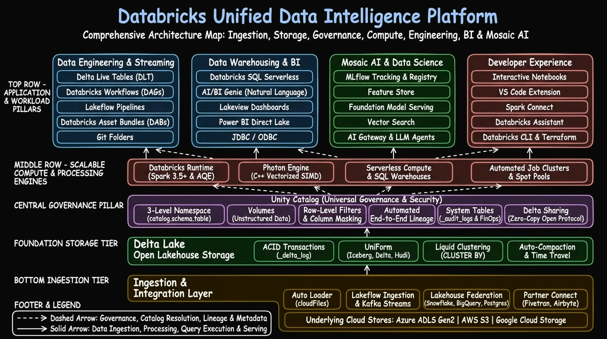
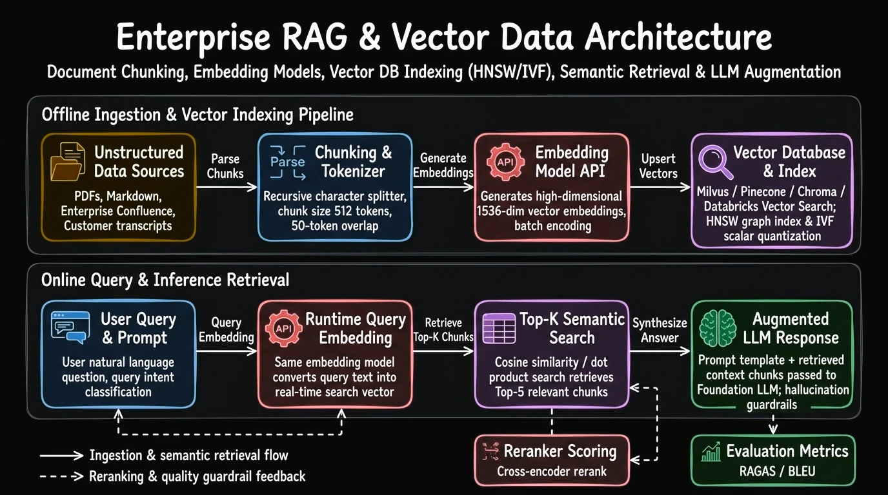
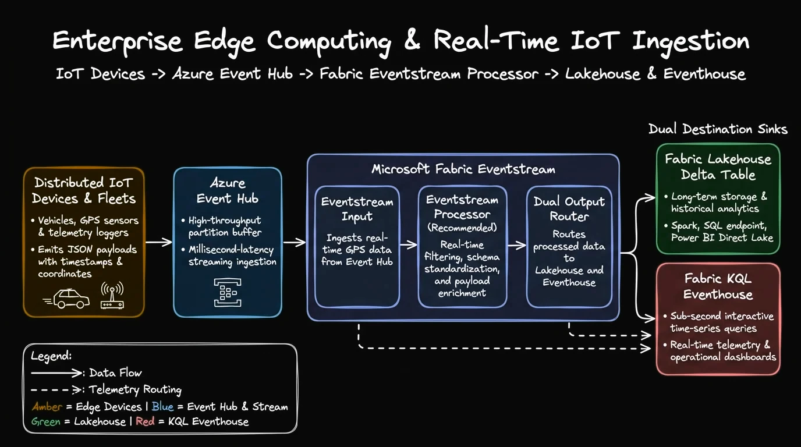
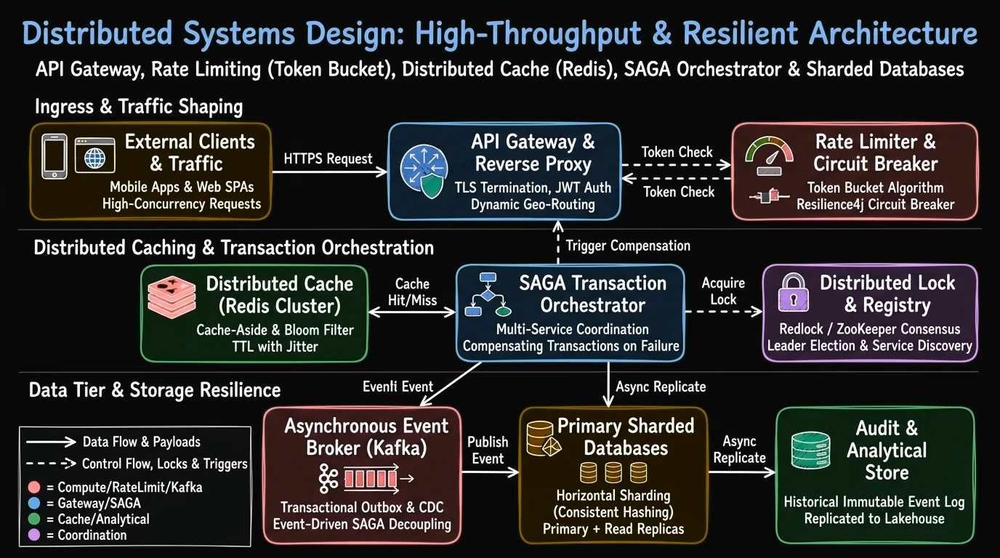
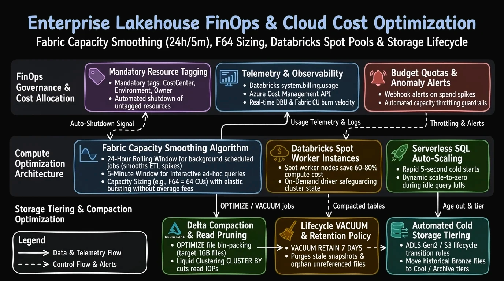
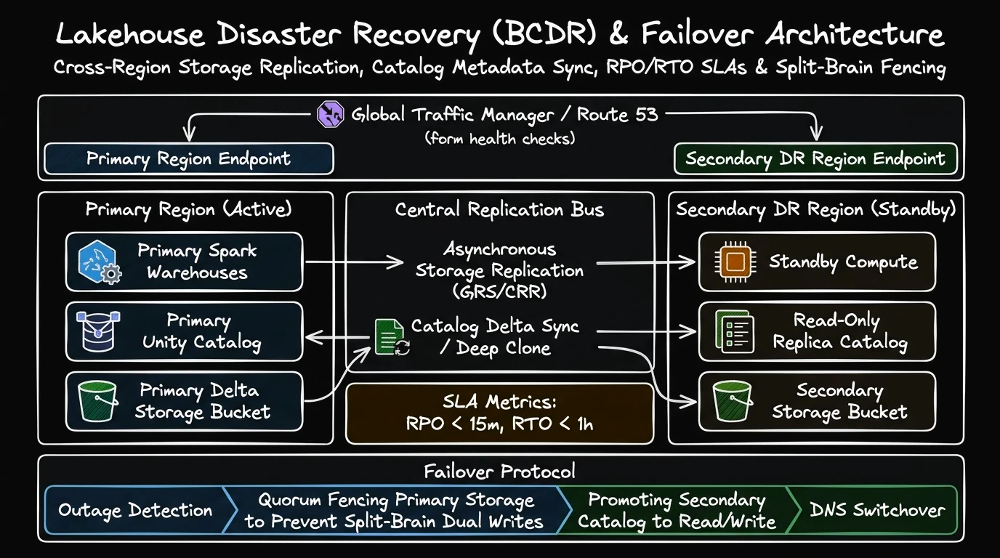
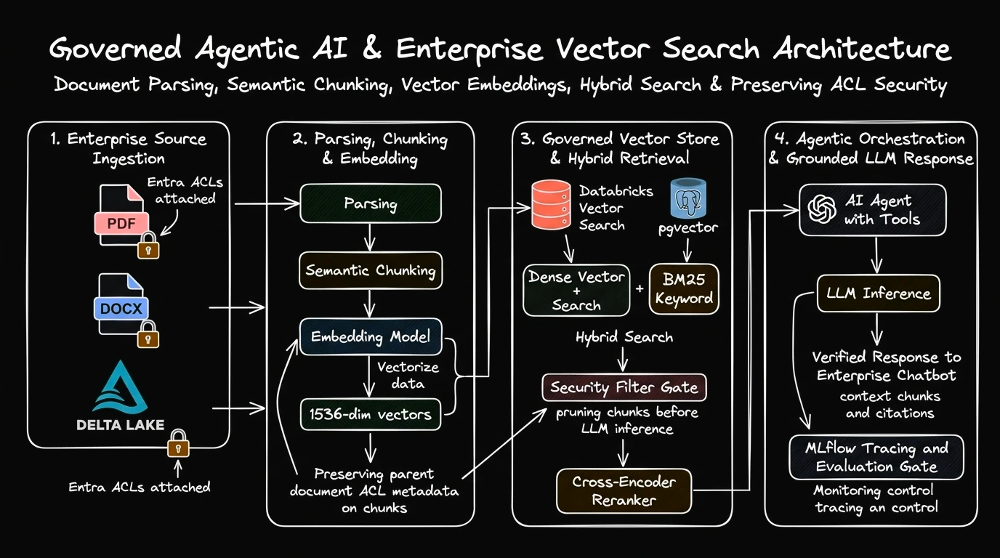

# Platform Landscape — Architecture Whiteboard Blueprints

> **Domain**: `Platform Landscape` | **Blueprints**: 8 | [← Back to Whiteboards Index](index.md)

---

## Platform Landscape
*8 Architecture Blueprints in this domain*

### 📐 Platform Landscape — Visual Blueprints Grid (2x2)

<table>
  <tr>
    <td width="50%" valign="top">
      
       <strong><a href="#databricks-platform-master">Databricks Unified Data Intelligence Platform</a></strong> 
      <em>Lakehouse Storage, Unity Catalog Governance, Multi-Engine Compute, and Mosaic AI</em> 
      <small>`Databricks` · `Data Intelligence Platform` · `Unity Catalog` · `Photon`</small> 
      <a href="#databricks-platform-master">🔍 Inspect Deep Dive & Architecture →</a>
    </td>
    <td width="50%" valign="top">
      
       <strong><a href="#rag-vector-search-data-pipeline">Enterprise RAG & Vector Data Architecture</a></strong> 
      <em>Document Ingestion, Chunking Strategies, Vector Indexing (HNSW), Hybrid Search, and LLM Reranking</em> 
      <small>`RAG` · `Vector Search` · `Generative AI` · `HNSW`</small> 
      <a href="#rag-vector-search-data-pipeline">🔍 Inspect Deep Dive & Architecture →</a>
    </td>
  </tr>
  <tr>
    <td width="50%" valign="top">
      
       <strong><a href="#enterprise-edge-client-architecture">Enterprise Edge Architecture: Data, Edge & Client Flow</a></strong> 
      <em>IoT Edge Gateways, MQTT/OPC-UA Telemetry, Cloud Ingestion Hubs, and Offline Client Sync</em> 
      <small>`Edge Computing` · `IoT Hub` · `MQTT` · `OPC-UA`</small> 
      <a href="#enterprise-edge-client-architecture">🔍 Inspect Deep Dive & Architecture →</a>
    </td>
    <td width="50%" valign="top">
      
       <strong><a href="#distributed-systems-resilience-architecture">Distributed Systems Design: High-Throughput & Resilient Architecture</a></strong> 
      <em>Circuit Breakers, Bulkheads, Token Bucket Rate Limiting, Backoff with Jitter, and Idempotency Keys</em> 
      <small>`Distributed Systems` · `Resilience` · `Circuit Breaker` · `Bulkhead`</small> 
      <a href="#distributed-systems-resilience-architecture">🔍 Inspect Deep Dive & Architecture →</a>
    </td>
  </tr>
  <tr>
    <td width="50%" valign="top">
      
       <strong><a href="#lakehouse-finops-cost-optimization">Enterprise Lakehouse FinOps & Cloud Cost Optimization</a></strong> 
      <em>Compute Unit Economics, Spot vs On-Demand, Cluster Sizing, Auto-Termination, and Storage Tiering</em> 
      <small>`FinOps` · `Cost Optimization` · `Databricks DBUs` · `Fabric CUs`</small> 
      <a href="#lakehouse-finops-cost-optimization">🔍 Inspect Deep Dive & Architecture →</a>
    </td>
    <td width="50%" valign="top">
      
       <strong><a href="#lakehouse-cicd-promotion-lifecycle">Enterprise Lakehouse CI/CD Multi-Environment Promotion & Rollback Flow</a></strong> 
      <em>Databricks Asset Bundles (DABs), dbt Core, Automated PR Validation & Blue/Green Table Promotion</em> 
      <small>`CI/CD` · `Databricks Asset Bundles` · `DABs` · `DevOps`</small> 
      <a href="#lakehouse-cicd-promotion-lifecycle">🔍 Inspect Deep Dive & Architecture →</a>
    </td>
  </tr>
  <tr>
    <td width="50%" valign="top">
      
       <strong><a href="#lakehouse-bcdr-failover">Lakehouse Disaster Recovery (BCDR) Cross-Region Failover & Split-Brain Prevention</a></strong> 
      <em>Cross-Region Storage Replication, Catalog Metadata Sync, RPO/RTO SLAs & Split-Brain Fencing</em> 
      <small>`Disaster Recovery` · `BCDR` · `High Availability` · `Failover`</small> 
      <a href="#lakehouse-bcdr-failover">🔍 Inspect Deep Dive & Architecture →</a>
    </td>
    <td width="50%" valign="top">
      
       <strong><a href="#governed-agentic-rag-pipeline">Governed Agentic AI & Enterprise Vector Search Pipeline with ACL Propagation</a></strong> 
      <em>Document Parsing, Semantic Chunking, Vector Embeddings, Hybrid Search & Preserving ACL Security</em> 
      <small>`Agentic AI` · `RAG` · `Vector Search` · `ACL Propagation`</small> 
      <a href="#governed-agentic-rag-pipeline">🔍 Inspect Deep Dive & Architecture →</a>
    </td>
  </tr>
</table>

---

### Databricks Unified Data Intelligence Platform
**Lakehouse Storage, Unity Catalog Governance, Multi-Engine Compute, and Mosaic AI**

**Tags:** `Databricks` · `Data Intelligence Platform` · `Unity Catalog` · `Photon` · `Serverless` · `Mosaic AI` · `Delta Lake` · `Lakehouse` · `UniForm` · [📖 Official Docs](https://docs.databricks.com/en/introduction/index.html)

**Overview:** Master reference architecture of the Databricks Data Intelligence Platform. Details the unified ecosystem built on open Lakehouse storage (AWS S3, ADLS Gen2, GCS) with Delta Lake and Apache Iceberg (via UniForm), centralized cross-workspace governance via Unity Catalog, elastic multi-engine compute (Photon, Serverless SQL Warehouses, Automated Jobs), and integrated Generative AI capabilities (Mosaic AI, Vector Search, AI Functions).

**Key Architecture Points:**
- Open Lakehouse Storage Layer: Open, standardized data storage across AWS, Azure, and GCP using Delta Lake with universal table format compatibility (UniForm for Iceberg/Hudi).
- Unified Governance via Unity Catalog: Centralized identity, data cataloging, access control, automated lineage, and audit logging spanning all workspaces and cloud regions.
- Photon-Powered Vectorized Compute: High-performance C++ execution engine optimized for modern hardware and vectorized instruction sets, accelerating SQL and DataFrame operations.
- Serverless Elastic Infrastructure: Instant compute availability (<5 seconds) with automated scaling, intelligent workload management, and zero idle VM infrastructure costs.
- Mosaic AI & Generative AI Suite: Native end-to-end AI platform covering vector databases, foundation model training, fine-tuning, MLflow tracking, and secured LLM serving endpoints.
- Integrated Developer Experience: Supports SQL analysts, Python data engineers, and R data scientists via notebooks, Databricks Connect, DABs, and native IDE plugins.
- Lakehouse Monitoring & FinOps: System tables (`system.billing.usage`, `system.access.audit`) provide out-of-the-box telemetry for cost optimization, performance tracking, and compliance.

> **Architect Note:** Databricks has evolved from an Apache Spark PaaS runtime into an integrated Data Intelligence Platform. The architectural cornerstone is Unity Catalog: compute engines (Serverless SQL, classic Spark clusters, AI model serving, DLT) are stateless compute consumers executing queries against a centralized metastore and storage plane. Architects must standardize on Serverless compute for ad-hoc SQL and scheduled ETL to eliminate cluster spin-up latency and reduce idle cluster waste by over 40%.

<strong>Multi-Persona Architectural Breakdown (Click to expand)</strong>

- **Enterprise Architect:** Defines enterprise platform strategy, cloud vendor selection, multi-workspace topologies, network security perimeters (Private Link), and total cost of ownership (TCO) models.
- **Senior Data Engineer:** Optimizes cluster configurations and memory settings; evaluates Photon performance gains; designs scalable medallion architectures and manages Unity Catalog storage credentials.
- **Data Engineer:** Builds resilient data pipelines using PySpark, SQL, and DLT; schedules robust Databricks Workflows; utilizes Databricks Connect for local IDE development.
- **Data Steward:** Manages enterprise data assets, classifies sensitive PII attributes, monitors automated column-level lineage, and reviews unified access audit logs across all workspaces.
- **Business Analyst:** Executes high-speed SQL queries on Serverless SQL Warehouses; creates rich visualizations and dashboards; leverages AI/BI Genie spaces for natural language data exploration.

**Under-the-Hood Technical Mechanisms:**
- Unity Catalog centralized metastore gRPC protocol and credential vending
- Photon native C++ vectorized execution engine with AVX-512 SIMD pipelines
- Universal Format (UniForm) asynchronous Iceberg metadata generation
- Serverless compute instant container pooling and warm VM recycling
- Lakehouse Monitoring automated statistical drift and data quality profiling

**Production Failure Modes & Incident Triage:**
- Serverless SQL Warehouse Cold Start Delay / Spike: First query takes 10-15 seconds; configure minimum cluster scaling or switch warehouse size from Small to Medium for sustained concurrency.
- DBU Budget Overrun / Runaway Costs: Development clusters left running overnight; enforce cluster policies with strict auto-termination (15 mins) and mandate Serverless compute for ad-hoc analytics.
- Cross-Workspace Unity Catalog Access Failure: Workspace not bound to the central metastore or storage credential IAM role missing; verify workspace assignment in Databricks Account Console.

**Governance & Regulatory Compliance:**
- Centralized 3-level namespace RBAC enforced across all compute interfaces
- End-to-end data lineage captured automatically at the AST query plan level
- Comprehensive audit records streamed in real time to `system.access.audit`
- FedRAMP, HIPAA, SOC 2, and GDPR compliant storage and processing boundaries

[↑ Return to Platform Landscape 2x2 Grid](#platform-landscape) · [Top of Catalog](index.md)

---

### Enterprise RAG & Vector Data Architecture
**Document Ingestion, Chunking Strategies, Vector Indexing (HNSW), Hybrid Search, and LLM Reranking**

**Tags:** `RAG` · `Vector Search` · `Generative AI` · `HNSW` · `Embeddings` · `Hybrid Search` · `BM25` · `LLM` · `Reranker` · `Databricks Vector Search` · [📖 Official Docs](https://docs.databricks.com/en/generative-ai/vector-search.html)

**Overview:** Production Retrieval-Augmented Generation (RAG) and vector search ingestion pipeline for enterprise knowledge systems. Illustrates multi-modal document ingestion (PDFs, docs, tickets), semantic text chunking, embedding generation (BGE, OpenAI, GTE), vector database indexing using Hierarchical Navigable Small World (HNSW) graphs, hybrid retrieval (dense vector semantic search + sparse BM25 keyword search), reciprocal rank fusion (RRF), cross-encoder reranking, and MLflow evaluation.

**Key Architecture Points:**
- Unstructured Document Ingestion: Ingestion of enterprise documents (PDFs, Word docs, confluence pages, tickets) with layout-aware parsing and metadata extraction.
- Semantic Chunking Strategies: Intelligent text splitting (recursive character, markdown header, semantic boundary) with sliding window overlap (10-20%) to preserve contextual integrity.
- High-Dimensional Embedding Pipeline: Text chunks transformed into dense numerical vectors using state-of-the-art embedding models executed via scalable Spark UDFs or native AI functions.
- HNSW Graph Indexing: Hierarchical Navigable Small World index structures provide logarithmic vector search latency over millions of vectors with high recall accuracy.
- Delta-to-Vector Streaming Sync: Native Delta Lake integration automatically tracks table commits, incrementally updating the vector search index with zero manual synchronization pipelines.
- Hybrid Search & Reciprocal Rank Fusion (RRF): Blends dense vector semantic retrieval with sparse BM25 lexical keyword matching, combining conceptual relevance with exact keyword precision.
- Cross-Encoder Reranking: High-accuracy secondary scoring stage re-evaluates candidate chunks against the user query, filtering out noise before passing context to the LLM.

> **Architect Note:** Enterprise RAG architectures fail most frequently at retrieval accuracy, not LLM generation. Architects must prioritize the data engineering pipeline feeding the vector store: semantic chunking with overlapping context boundaries, embedding caching, and hybrid search. Relying solely on vector similarity misses exact keyword matches (e.g. part numbers, error codes, legal clauses); combining dense vector search with sparse BM25 keyword search via Reciprocal Rank Fusion improves retrieval relevance by over 35%.

<strong>Multi-Persona Architectural Breakdown (Click to expand)</strong>

- **Enterprise Architect:** Designs secure enterprise GenAI reference architectures; selects vector database and embedding models; enforces data security and tenant isolation boundaries; manages LLM token cost budgets.
- **Senior Data Engineer:** Tunes HNSW index parameters (`M`, `efConstruction`, `efSearch`); optimizes Spark embedding generation jobs using GPU clusters; designs custom chunking and metadata extraction algorithms.
- **Data Engineer:** Builds and maintains automated document ingestion pipelines; configures Delta Sync Vector Search endpoints; monitors embedding pipeline throughput and failure alerts.
- **Data Steward:** Ensures proprietary, confidential, and PII-bearing documents are filtered or masked prior to embedding; verifies vector index access controls mirror source document security permissions.
- **Business Analyst:** Interacts with internal enterprise knowledge assistants; evaluates response accuracy and factual grounding; provides feedback to fine-tune retrieval prompt engineering.

**Under-the-Hood Technical Mechanisms:**
- HNSW multi-layer graph construction with cosine/dot-product distance metrics
- Delta Change Data Feed (CDF) incremental vector index synchronization
- Reciprocal Rank Fusion (RRF) score aggregation algorithm: $RRF(d) = \sum_{m \in M} \frac{1}{60 + r_m(d)}$
- Cross-encoder transformer attention scoring for candidate chunk reranking
- MLflow automated LLM evaluation metrics (groundedness, relevance, toxicity)

**Production Failure Modes & Incident Triage:**
- Context Truncation / Chunk Boundary Split: Important answers split across two chunks causing LLM to miss the complete context; implement sliding window overlap (150 tokens) and header-preserving markdown splitters.
- Vector Index Synchronization Lag: Changes committed to the source Delta table not appearing in vector search results; inspect Vector Search endpoint status and verify Delta Change Data Feed is enabled on the source table.
- Keyword Precision Miss in Dense Search: Search for specific product code ('SN-90210') returns irrelevant semantic matches; implement hybrid search combining BM25 keyword matching with vector embeddings.

**Governance & Regulatory Compliance:**
- Document-level access control lists (ACLs) preserved and filtered during vector retrieval
- Automatic PII detection and redaction using Azure AI Language or Presidio before vectorization
- MLflow tracking logging all user prompts, retrieved chunks, and model responses for compliance auditing
- Zero data retention agreements ensuring corporate data is never used to train public foundation models

[↑ Return to Platform Landscape 2x2 Grid](#platform-landscape) · [Top of Catalog](index.md)

---

### Enterprise Edge Architecture: Data, Edge & Client Flow
**IoT Edge Gateways, MQTT/OPC-UA Telemetry, Cloud Ingestion Hubs, and Offline Client Sync**

**Tags:** `Edge Computing` · `IoT Hub` · `MQTT` · `OPC-UA` · `Event Hubs` · `Edge Gateway` · `Stream Processing` · `Offline Sync` · `WebSockets` · [📖 Official Docs](https://learn.microsoft.com/en-us/azure/iot-edge/about-iot-edge)

**Overview:** Comprehensive edge-to-cloud architecture detailing IoT device telemetry ingestion, industrial protocol translation (OPC-UA, MQTT, Modbus), local edge filtering and buffering on edge gateways (Azure IoT Edge, AWS Greengrass), secure cloud streaming ingestion (IoT Hub, Event Hubs, Kafka), real-time lakehouse stream processing, and low-latency bidirectional client synchronization (WebSockets, PWA offline caches).

**Key Architecture Points:**
- Industrial Protocol Translation: Edge gateways bridge legacy industrial factory floor protocols (OPC-UA, Modbus, CAN-bus) to standardized, lightweight cloud telemetry protocols (MQTT over TLS).
- Edge Filtering & Pre-Processing: On-premise gateways execute containerized stream processing microservices, filtering raw sensor noise and calculating local moving averages before transmission.
- Store-and-Forward Buffering: Persistent local disk queues (RocksDB / local SQLite) buffer telemetry records during network outages, seamlessly replaying buffered data once WAN connectivity restores.
- Cloud Ingestion Scalability: Cloud ingestion brokers (Azure IoT Hub, AWS IoT Core) manage millions of concurrent device connections with per-device authentication and device twin metadata sync.
- Bidirectional Command and Control: Supports cloud-to-device remote method invocation and configuration updates with cryptographic validation.
- Real-Time Stream Processing: Lakehouse streaming engines ingest raw telemetry, deduplicate late-arriving packets, and enrich streams with master dimensional data.
- Client Presentation & Sync: Delivers real-time dashboards to web and mobile clients via WebSockets and Progressive Web App (PWA) offline IndexedDB storage.

> **Architect Note:** Industrial and edge data architectures must be designed for network unreliability and intermittent connectivity. Edge gateways must possess local compute and storage (SQLite, RocksDB) capable of buffering days of telemetry during WAN disconnects. Architects must enforce edge data minimization: compute local aggregates, filter out high-frequency sensor noise at the edge, and transmit only state changes and anomalies to the cloud, reducing cellular and egress bandwidth costs by up to 80%.

<strong>Multi-Persona Architectural Breakdown (Click to expand)</strong>

- **Enterprise Architect:** Designs edge-to-cloud networking, bandwidth budget models, device provisioning protocols, and disaster recovery strategies for remote manufacturing/field facilities.
- **Senior Data Engineer:** Implements edge container microservices; tunes MQTT keep-alive and QoS delivery levels; handles out-of-order event time reconciliation and clock drift across edge devices.
- **Data Engineer:** Builds cloud streaming ingestion pipelines consuming IoT Hub endpoints; writes stateful streaming window aggregations in Spark/Flink; maintains edge device telemetry schemas.
- **Data Steward:** Manages device certificates, mutual TLS (mTLS) identities, and hardware security module (HSM) keys; enforces data residency rules on telemetry captured across global edge nodes.
- **Business Analyst:** Monitors Overall Equipment Effectiveness (OEE) metrics, machine downtime alerts, and predictive maintenance indicators on real-time operational dashboards.

**Under-the-Hood Technical Mechanisms:**
- MQTT QoS 1 (At Least Once) protocol with persistent session client IDs
- Edge local RocksDB buffer queue with automated disk space threshold eviction
- Device Twin state synchronization and desired/reported property JSON merging
- Cloud Ingestion partition hashing preserving device-level message sequencing
- WebSocket bidirectional streaming pushing sub-second updates to front-end clients

**Production Failure Modes & Incident Triage:**
- Edge Gateway Disk Full during WAN Outage: Network severed for multiple days causes local buffer queue to exhaust gateway SSD storage; implement circular buffer rollover policies and prioritize critical alarm telemetry over high-frequency raw sensor data.
- Sensor Clock Drift causing Invalid Windowing: Edge device RTC battery failure causes timestamps to drift into the past, causing streaming watermarks to drop valid events; synchronize edge gateways using local NTP servers and validate device timestamps against gateway ingress time.
- Device Certificate Expiration: Mass expiration of X.509 device certificates locks thousands of edge gateways out of IoT Hub; implement automated EST (Enrollment over Secure Transport) certificate auto-renewal.

**Governance & Regulatory Compliance:**
- Mutual TLS (mTLS) authentication with hardware-backed TPM (Trusted Platform Module) chips
- Zero-trust network architecture segmenting industrial OT networks from corporate IT and cloud WAN
- Tamper-evident audit logging for all remote cloud-to-device firmware updates and control commands
- Strict compliance with industrial safety standards (IEC 62443 / ISO 27001)

[↑ Return to Platform Landscape 2x2 Grid](#platform-landscape) · [Top of Catalog](index.md)

---

### Distributed Systems Design: High-Throughput & Resilient Architecture
**Circuit Breakers, Bulkheads, Token Bucket Rate Limiting, Backoff with Jitter, and Idempotency Keys**

**Tags:** `Distributed Systems` · `Resilience` · `Circuit Breaker` · `Bulkhead` · `Rate Limiting` · `Exponential Backoff` · `Jitter` · `Idempotency` · `Chaos Engineering` · [📖 Official Docs](https://learn.microsoft.com/en-us/azure/architecture/patterns/circuit-breaker)

**Overview:** Architectural blueprint of resilience and high-throughput design patterns for distributed enterprise data platforms. Visualizes circuit breaker state machines (Closed, Open, Half-Open), bulkhead resource isolation, token bucket / leaky bucket rate limiting, exponential backoff with full jitter to eliminate thundering herd retries, distributed locking, idempotency keys, and graceful degradation strategies under downstream failure.

**Key Architecture Points:**
- Circuit Breaker Pattern: Three-state circuit breaker (Closed: normal traffic; Open: immediate fast-failure when error rate exceeds threshold; Half-Open: canary requests test downstream recovery).
- Exponential Backoff with Full Jitter: Algorithmically spaces retry attempts exponentially while injecting uniform random noise ($t = \text{random}(0, \min(t_{\max}, t_{\text{base}} \times 2^{\text{attempt}}))$) to prevent thundering herd collisions.
- Bulkhead Resource Isolation: Partitions thread pools, memory buffers, and connection pools across separate tenants or workloads so that a failure in one service cannot starve critical platform resources.
- Token Bucket Rate Limiting: Controls request throughput by replenishing tokens at a fixed rate, allowing burst capacity up to bucket size while enforcing smooth long-term request rates.
- Idempotency Key Deduplication: Unique client-generated UUIDs sent in HTTP headers or event payloads; server tracks processed keys in Redis to guarantee duplicate requests produce identical outcomes without duplicate writes.
- Dead Letter Queues (DLQ) & Poison Pill Handling: Unprocessable payloads are automatically diverted to a DLQ after max retry attempts, allowing the primary pipeline to maintain high throughput.
- Graceful Degradation & Fallbacks: When downstream dependencies fail, services fall back to cached data, degraded responses, or asynchronous queueing rather than throwing unhandled exceptions.

> **Architect Note:** In distributed architectures, failures are inevitable mathematical certainties rather than anomalies. High-availability systems (99.99%) are distinguished by how gracefully they fail. Architects must design every microservice and ingestion pipeline to assume downstream services will fail, slow down, or return errors. Blind retries without jitter trigger catastrophic 'thundering herd' retry storms that convert minor transient hiccups into total platform outages. Enforce circuit breakers, rate limits, and idempotency at every service boundary.

<strong>Multi-Persona Architectural Breakdown (Click to expand)</strong>

- **Enterprise Architect:** Establishes enterprise resilience SLAs and SLOs (99.99% availability, sub-second p99 latency); designs multi-region active-active failover topologies; leads Chaos Engineering failure injection simulations.
- **Senior Data Engineer:** Implements resilience libraries (Resilience4j, Polly, custom Python decorators); tunes circuit breaker sliding window sizes and failure rate tripwires; configures distributed Redis token buckets.
- **Data Engineer:** Integrates exponential backoff and retry decorators into API extraction pipelines; manages Dead Letter Queue triage and replay scripts; ensures database writes use idempotency keys.
- **Data Steward:** Monitors platform availability metrics and SLA compliance reports; tracks audit logs of failed messages routed to Dead Letter Queues for regulatory compliance.
- **Business Analyst:** Experiences consistent platform availability and reliable reporting even during upstream source system maintenance or network interruptions.

**Under-the-Hood Technical Mechanisms:**
- Sliding-window failure rate calculation triggering circuit breaker state transitions
- Full jitter randomized retry delay calculation algorithm
- Redis distributed atomic token bucket increment/decrement via Lua scripts
- Idempotency key lock acquisition and result caching in distributed memory
- Distributed tracing context propagation (OpenTelemetry / W3C TraceContext) across service hops

**Production Failure Modes & Incident Triage:**
- Thundering Herd Retry Storm: Downstream database restarts and is instantly crushed by thousands of concurrent client retries; implement exponential backoff with full jitter and deploy rate-limiting admission controllers.
- Circuit Breaker Flapping: Circuit breaker continuously toggles between Open and Half-Open states; increase the evaluation window size and require multiple consecutive canary successes before transitioning to Closed.
- Dead Letter Queue Accumulation: Upstream schema breaking change causes thousands of messages to fail and route to DLQ; fix downstream consumer schema, verify DLQ payloads, and execute batch replay.

**Governance & Regulatory Compliance:**
- Automated compliance tracking of SLA/SLO breach events for SOC 2 and customer commitments
- Cryptographic non-repudiation of idempotency keys verifying transaction execution authenticity
- Auditability of all DLQ message payloads before manual reprocessing or purging
- Chaos engineering testing verifying disaster recovery runbooks meet regulatory standards

[↑ Return to Platform Landscape 2x2 Grid](#platform-landscape) · [Top of Catalog](index.md)

---

### Enterprise Lakehouse FinOps & Cloud Cost Optimization
**Compute Unit Economics, Spot vs On-Demand, Cluster Sizing, Auto-Termination, and Storage Tiering**

**Tags:** `FinOps` · `Cost Optimization` · `Databricks DBUs` · `Fabric CUs` · `Spot Instances` · `Cluster Policies` · `Storage Tiering` · `VACUUM` · `Auto-Termination` · `System Tables` · [📖 Official Docs](https://docs.databricks.com/en/admin/account-settings/system-tables/index.html)

**Overview:** Comprehensive FinOps framework and technical cost optimization methodology for modern cloud lakehouses. Dissects compute unit economics (Databricks DBUs, Microsoft Fabric CUs, Snowflake Credits), EC2/VM spot instance bidding with on-demand fallback, cluster auto-termination enforcement, right-sizing worker nodes (CPU vs Memory vs Storage optimized), automated Delta Lake VACUUM hygiene, and chargeback/showback reporting via system tables.

**Key Architecture Points:**
- Compute Unit Economics: Detailed breakdown of the dual billing model: Cloud Infrastructure (VMs, storage, network egress) + Platform Software Markup (Databricks DBUs, Fabric CUs, Snowflake Credits).
- Cluster Auto-Termination Governance: Enforcing global cluster policies that automatically shut down idle development and testing clusters after 15-20 minutes of inactivity.
- Spot Instance Cost Arbitrage: Utilizing cloud spot/preemptible instances for worker nodes (60-80% discount) with on-demand driver nodes and automated graceful spot-loss handling.
- Hardware Workload Alignment: Matching workloads to specialized VM families: Compute-Optimized (F-series / c6i) for CPU-heavy transformations; Memory-Optimized (E-series / r6i) for large shuffle joins and caching; Storage-Optimized (L-series / i3en) for high-spill workloads.
- Storage Lifecycle & VACUUM Hygiene: Running scheduled `VACUUM` jobs with strict retention periods (7-30 days) and applying cloud storage lifecycle rules to transition historical Bronze data to Archive tier.
- Tag-Based Cost Allocation & Showback: Enforcing mandatory resource tags (CostCenter, Project, Environment, Owner) on all compute resources to enable department-level chargeback reporting.
- Automated FinOps Telemetry via System Tables: Querying `system.billing.usage` to detect cost anomalies, monitor DBU burndown trends, and identify rogue long-running queries.

> **Architect Note:** Cloud lakehouse costs scale linearly with compute allocation unless disciplined FinOps governance is embedded into engineering architecture. The #1 driver of cloud waste is idle compute: development clusters left running over weekends, over-provisioned production clusters, and abandoned uncompacted storage. Architects must enforce automated guardrails: mandatory cluster policies with 15-minute auto-termination, Spot instances for stateless worker pools, and automated storage tiering to Cold/Archive for raw tables over 90 days old.

<strong>Multi-Persona Architectural Breakdown (Click to expand)</strong>

- **Enterprise Architect:** Establishes enterprise FinOps strategy and annual cloud budgets; negotiates reserved capacity commitments (Azure Savings Plans, AWS Compute Savings); designs cluster policy governance and showback models.
- **Senior Data Engineer:** Profiles job resource utilization to right-size cluster worker counts; eliminates CPU-wasting shuffle spills and cartesian joins; configures Photon usage strictly for high-ROI analytical queries.
- **Data Engineer:** Selects appropriate cluster policies for development; adheres to tagging standards; authors automated maintenance scripts executing `OPTIMIZE` and `VACUUM` on managed tables.
- **Data Steward:** Audits compute usage and cost attribution across domain teams; monitors orphan tables and abandoned storage volumes that continue to incur storage fees.
- **Business Analyst:** Monitors dashboard query performance and avoids scheduling auto-refreshing reports on high-frequency intervals when data only updates daily.

**Under-the-Hood Technical Mechanisms:**
- Databricks cluster policy JSON enforcement blocking unrestricted cluster creation
- Cloud provider Spot VM bidding and automated fall-back to On-Demand
- System tables (`system.billing.usage`, `system.billing.list_prices`) SQL analytics
- Parquet dictionary and snappy/zstd compression ratio tuning maximizing disk savings
- Delta transaction log tombstone deletion and orphan Parquet file purging via VACUUM

**Production Failure Modes & Incident Triage:**
- Runaway Streaming Job Budget Exhaustion: Structured streaming job deployed with unbounded auto-scaling cluster running on expensive memory-optimized nodes 24/7; fix max worker count to 2-4 nodes or convert to Triggered (batch) execution.
- Spot Instance Eviction Storm: Cloud provider reclaims spot instances during high regional demand, causing worker terminations and massive shuffle recompute; ensure driver is on-demand, configure spot instance fallback to on-demand, and avoid spot for mission-critical SLA jobs.
- Astronomical Storage Bill from Un-Vacuumed Delta Tables: High-frequency UPDATE/DELETE operations generate millions of tombstoned Parquet files retained indefinitely; schedule weekly `VACUUM table RETAIN 168 HOURS` to reclaim terabytes of dead storage.

**Governance & Regulatory Compliance:**
- Mandatory cloud resource tagging policies enforced via Azure Policy / AWS SCPs
- Transparent showback and chargeback accounting reports distributed monthly to department leaders
- Compliance with corporate financial governance and IT spend audit standards
- Budget threshold alerts triggering automated pager alerts when monthly spend exceeds 80%

[↑ Return to Platform Landscape 2x2 Grid](#platform-landscape) · [Top of Catalog](index.md)

---

### Enterprise Lakehouse CI/CD Multi-Environment Promotion & Rollback Flow
**Databricks Asset Bundles (DABs), dbt Core, Automated PR Validation & Blue/Green Table Promotion**

**Tags:** `CI/CD` · `Databricks Asset Bundles` · `DABs` · `DevOps` · `dbt` · `GitOps` · `Multi-Environment` · `Promotion Lifecycle` · `Rollback Strategy` · `DataOps` · `Blue-Green` · [📖 Official Docs](https://docs.databricks.com/en/dev-tools/bundles/ci-cd.html)

**Overview:** Enterprise-grade CI/CD and deployment promotion lifecycle for modern lakehouse platforms. Demonstrates the complete GitOps path from local developer workspaces (VS Code, Databricks CLI) through automated Pull Request testing (Ruff, mypy, pytest in ephemeral schemas), gated staging integration validation, and zero-downtime production deployment via Databricks Asset Bundles (DABs) and blue/green table promotion with automated rollback.

**Key Architecture Points:**
- Declarative Infrastructure as Code: Uses Databricks Asset Bundles (DABs) and Terraform to declare jobs, pipelines, permissions, and compute resources as versioned YAML code.
- Isolated Multi-Environment Architecture: Strict isolation between Dev, Staging, and Production environments across separate cloud subscriptions, storage accounts, and Unity Catalog namespaces.
- Automated PR Validation Gates: GitHub Actions / Azure DevOps pipelines execute SQL linting (SQLFluff), Python typing (`mypy`), and unit tests against ephemeral dynamic schemas.
- Service Principal Automation: Completely eliminates personal user tokens in deployment pipelines; all deployments are authenticated via Entra ID / AWS IAM Service Principals.
- Blue/Green Table Promotion: Deploys schema changes to secondary 'blue' tables or table clones, runs regression verification, then swaps catalog pointers for zero-downtime release.
- Instant One-Line Rollback: Leverages Delta Lake `RESTORE TABLE prod.table TO VERSION AS OF` or branch rollback to revert production state to previous snapshots within seconds.
- Immutable Release Tagging: Binds every production deployment to an immutable Git commit SHA, generating cryptographic provenance for regulatory and audit compliance.

> **Architect Note:** Lakehouse CI/CD differs fundamentally from traditional software engineering because compute code is inextricably linked to persistent physical data storage. Deploying a breaking schema change can corrupt terabytes of production data. To safeguard the lakehouse: never allow direct developer deployment to production; use dedicated Service Principals in CI/CD pipelines; test migrations against isolated ephemeral schemas; and utilize Delta Lake time travel or clone mechanisms to enable instant, zero-downtime rollback in case of runtime regressions.

<strong>Multi-Persona Architectural Breakdown (Click to expand)</strong>

- **Enterprise Architect:** Defines enterprise multi-environment topology (Dev/Stage/Prod); designs service principal IAM boundaries; establishes change approval gates and disaster recovery rollback SLAs.
- **Senior Data Engineer:** Authors CI/CD pipeline definition files (GitHub Actions workflows, DABs `databricks.yml`); builds automated testing harnesses and ephemeral schema provisioning scripts.
- **Data Engineer:** Develops pipeline features in local branch; runs pre-commit hooks; submits Pull Requests with test coverage; validates deployment logs in Staging.
- **Data Steward:** Audits deployment release notes and schema change requests; confirms that new production table deployments include mandatory governance tags and ownership assignments.
- **Business Analyst:** Experiences zero downtime or query disruption during production deployments; relies on consistent, regression-free metric definitions across releases.

**Under-the-Hood Technical Mechanisms:**
- Databricks Asset Bundles (DABs) dynamic variable substitution across target environments (`dev`, `stage`, `prod`)
- Ephemeral test schema generation (`test_schema_${{ github.run_id }}`) automatically torn down post-test
- Automated data diffing comparing Staging transformation outputs against Production baselines
- Unity Catalog 3-level namespace promotion (`dev_catalog` -> `staging_catalog` -> `prod_catalog`)
- Delta Lake `RESTORE TABLE` execution triggered automatically upon pipeline health check failures

**Production Failure Modes & Incident Triage:**
- Staging Schema Drift from Production: Staging environment gets out of sync with production, causing PR tests to pass in staging but fail in prod; enforce automated weekly schema mirroring from prod to staging.
- Service Principal Permission Revocation: Deployment fails with HTTP 403 Forbidden; verify CI/CD secret rotation has not expired the service principal client secret or Entra certificate.
- Production Query Regression Post-Deploy: New pipeline code degrades query latency; immediately trigger automated rollback to prior Git SHA and execute Delta table time travel restore.

**Governance & Regulatory Compliance:**
- Separation of duties enforced: developers cannot manually push code or alter schemas in production
- Complete cryptographic audit trail linking every production catalog table state to a Git commit SHA
- Automated vulnerability scanning of all Python dependencies via Dependabot / Snyk in CI
- SOC 2 and ISO 27001 compliance validated via automated pull request review approvals

[↑ Return to Platform Landscape 2x2 Grid](#platform-landscape) · [Top of Catalog](index.md)

---

### Lakehouse Disaster Recovery (BCDR) Cross-Region Failover & Split-Brain Prevention
**Cross-Region Storage Replication, Catalog Metadata Sync, RPO/RTO SLAs & Split-Brain Fencing**

**Tags:** `Disaster Recovery` · `BCDR` · `High Availability` · `Failover` · `Cross-Region` · `Replication` · `Split-Brain` · `RPO` · `RTO` · `Delta Deep Clone` · `Unity Catalog` · [📖 Official Docs](https://docs.databricks.com/en/admin/disaster-recovery.html)

**Overview:** Enterprise disaster recovery (BCDR) and business continuity architecture for cloud lakehouse platforms. Outlines active-passive and active-active topologies across geographic regions (e.g. East US to West US), covering asynchronous storage replication (Azure GRS, AWS S3 CRR), catalog metadata synchronization (Delta Deep Clone, Unity Catalog federation), strict RPO/RTO bounds, DNS health routing, and quorum fencing to prevent disastrous split-brain dual writes.

**Key Architecture Points:**
- Formal RPO & RTO Service Level Objectives: Defines target Recovery Point Objective (RPO < 15 minutes) and Recovery Time Objective (RTO < 1 hour) based on tier-1 business criticality.
- Dual-Plane Replication Architecture: Combines continuous asynchronous object storage replication (AWS CRR / Azure GRS) with orchestrated catalog metadata sync (Delta Deep Clone).
- Global Traffic Management: Employs health-checked DNS and global routers (Azure Front Door, Route 53) to automatically reroute client SQL and BI queries to the active region.
- Quorum Fencing & Split-Brain Prevention: Enforces automated IAM write revocation on the primary storage account before promoting the secondary region to prevent competing concurrent writes.
- Pre-Warmed Secondary Compute: Maintains minimal serverless compute pools and standby clusters in the secondary region to guarantee rapid compute provisioning during failover.
- Automated Catalog Synchronization: Continuously replicates Unity Catalog metastore definitions, access control privileges, and storage credentials across regions.
- Graceful Post-Outage Failback Protocol: Orchestrates reverse synchronization of newly ingested secondary data back to the primary region before re-establishing primary status.

> **Architect Note:** Designing lakehouse disaster recovery requires a clear separation between storage recovery and compute failover. Cloud object storage replication (e.g., AWS S3 Cross-Region Replication or Azure GRS) provides data persistence, but storage replication alone does not constitute a working lakehouse. The catalog metadata (Delta transaction logs, table definitions, and permission grants) must remain synchronized. Furthermore, during a regional outage, architects must enforce strict write fencing on the failing primary region before promoting the secondary region to avoid split-brain divergence that cannot be programmatically reconciled.

<strong>Multi-Persona Architectural Breakdown (Click to expand)</strong>

- **Enterprise Architect:** Establishes enterprise BCDR strategy; negotiates RPO/RTO agreements with executive stakeholders; designs cross-region network topologies, failover runbooks, and annual disaster recovery simulations.
- **Senior Data Engineer:** Implements automated cross-region Delta Deep Clone pipelines; scripts infrastructure failover via Terraform; tunes storage replication lifecycle rules and latency monitors.
- **Data Engineer:** Configures pipeline parameterization to support dynamic region switching; tests pipeline idempotency in DR environments; validates data integrity post-failover.
- **Data Steward:** Verifies that secondary region security policies, catalog permissions, and data classifications mirror the primary region exactly; audits DR compliance records.
- **Business Analyst:** Experiences minimal disruption during regional cloud outages; understands disaster recovery SLA expectations and temporary read-only mode states.

**Under-the-Hood Technical Mechanisms:**
- Asynchronous block-level cloud object storage replication (AWS S3 CRR with RTC / Azure Geo-Redundant Storage)
- Orchestrated incremental Delta Deep Clone (`CREATE OR REPLACE TABLE dr.table DEEP CLONE prod.table`)
- Route 53 / Azure Front Door health-check probe monitoring primary Lakehouse SQL warehouse availability
- IAM Policy fencing via cloud API revoking `s3:PutObject` / `Microsoft.Storage/write` permissions during cutover
- Unity Catalog cross-region metastore replication and service principal credential synchronization

**Production Failure Modes & Incident Triage:**
- Split-Brain Dual Writes: Incomplete network partition allows ingestion pipelines to write to both regions simultaneously; trigger immediate IAM write lock on primary and run reconciliation diff scripts.
- Replication Lag Exceeding RPO: High write volume causes storage replication lag to exceed 15-minute SLA; increase replication bandwidth allocation and switch high-priority tables to prioritized CRR.
- Stale DR Catalog Metadata: Secondary storage has newer files than the secondary catalog metadata reflects; execute `MSCK REPAIR TABLE` and run sync notebooks to reconcile catalog transaction logs.

**Governance & Regulatory Compliance:**
- Meets regulatory disaster recovery testing mandates (e.g. FFIEC, HIPAA, SOX, and DORA in the EU)
- Continuous cross-region encryption maintaining customer-managed keys (CMEK) parity in both regions
- Documented and certified annual DR failover drills with executive sign-off and audit documentation
- Geographic data sovereignty compliance verifying replication stays within approved national borders

[↑ Return to Platform Landscape 2x2 Grid](#platform-landscape) · [Top of Catalog](index.md)

---

### Governed Agentic AI & Enterprise Vector Search Pipeline with ACL Propagation
**Document Parsing, Semantic Chunking, Vector Embeddings, Hybrid Search & Preserving ACL Security**

**Tags:** `Agentic AI` · `RAG` · `Vector Search` · `ACL Propagation` · `Governance` · `Hybrid Search` · `Embeddings` · `Unity Catalog` · `LLM` · `Enterprise AI` · `MLflow` · [📖 Official Docs](https://docs.databricks.com/en/generative-ai/vector-search.html)

**Overview:** Production-grade, enterprise-governed Retrieval-Augmented Generation (RAG) and Agentic AI architecture. Ingests unstructured documents (PDFs, contracts, internal wikis) and structured Delta tables, applies semantic chunking and dense vector embedding, preserves source Access Control Lists (ACLs) directly on vector metadata, and executes hybrid search (dense semantic + BM25 sparse keyword) with strict pre-retrieval security filtering so LLM agents never leak unauthorized data.

**Key Architecture Points:**
- End-to-End ACL Security Propagation: Ingests documents with source permission tags (Entra ID groups, user SID) and embeds them as searchable metadata attributes on vector records.
- Pre-Retrieval Security Filtering: Evaluates user authorization at query runtime, filtering out unauthorized chunks before semantic similarity ranking and prompt assembly.
- Hybrid Search Architecture: Combines dense semantic vector retrieval (approximate nearest neighbor / HNSW) with sparse lexical search (BM25 keyword match) for maximum recall.
- Two-Stage Reranking Pipeline: Uses cross-encoder rerankers to rescore top-K candidate chunks, ensuring only the most contextually relevant passages reach the LLM prompt window.
- Agentic Tool Execution & Grounding: Autonomous AI agents utilize structured Lakehouse tools (SQL query execution, catalog lookups) alongside unstructured vector search.
- Verifiable Citation & Provenance: Generates grounded LLM answers accompanied by exact source document links, page numbers, and cryptographic chunk hashes for compliance auditability.
- MLflow Observability & Evaluation: Traces every agent step, retrieved context, token latency, and evaluation metric (faithfulness, hallucination, answer relevance) via MLflow Tracing.

> **Architect Note:** The single greatest security failure in enterprise GenAI implementations is 'security stripping during chunking': parsing a confidential HR document, storing its text chunks in an ungoverned vector database, and allowing any employee to query it via an enterprise LLM chatbot. In a governed architecture, every chunk must inherit the source document's Entra ID/Okta security ACLs. The retrieval engine must perform pre-query filtering—pruning chunks the asking user is not authorized to read BEFORE feeding context to the LLM—guaranteeing zero data leakage.

<strong>Multi-Persona Architectural Breakdown (Click to expand)</strong>

- **Enterprise Architect:** Defines enterprise AI architecture and governance boundaries; selects embedding and foundation models; establishes RAG security standards, token budgets, and LLM evaluation benchmarks.
- **Senior Data Engineer:** Builds scalable document ingestion and chunking pipelines using Spark; configures vector index synchronization pipelines (Delta Sync); implements hybrid search and reranking services.
- **Data Engineer:** Maintains document landing zones and vector search sync jobs; monitors embedding generation throughput; handles document schema changes and OCR ingestion pipelines.
- **Data Steward:** Audits vector search indexes to confirm that confidential documents maintain proper classification tags; reviews hallucination logs and verifies citation provenance.
- **Business Analyst:** Interacts with enterprise AI chatbots to retrieve rapid, accurate answers grounded in verified corporate data; verifies answers against linked source document citations.

**Under-the-Hood Technical Mechanisms:**
- Semantic chunking with sliding token windows (512 tokens with 10% overlap) preserving paragraph integrity
- Vector embedding generation via state-of-the-art models (`text-embedding-3-large`, BGE-large) emitting 1536/3072-dim vectors
- Databricks Vector Search / Azure AI Search Delta Sync continuously indexing new and modified documents
- Pre-retrieval metadata filter injection (`WHERE array_intersect(acl_groups, :user_groups) != []`)
- Cross-encoder deep reranking model re-scoring candidate chunks based on query-passage relevance

**Production Failure Modes & Incident Triage:**
- Unauthorized Data Leakage in LLM Response: LLM cites confidential executive salary; inspect vector search query to confirm pre-retrieval ACL filtering was not bypassed by an unauthenticated service account.
- Hallucination Caused by Low Retrieval Quality: LLM produces fictitious answers; evaluate retrieval recall metrics, tune chunk size from 1024 down to 512 tokens, and enable hybrid BM25 + dense search.
- Vector Index Synchronization Lag: Newly uploaded legal contracts do not appear in search results; verify Delta Sync trigger schedule and inspect vector index sync pipeline error logs.

**Governance & Regulatory Compliance:**
- Preserves existing enterprise identity access control (Entra ID, Okta) across all AI query workflows
- 100% citation provenance guaranteeing every LLM assertion is traceable to an authorized source document
- Comprehensive MLflow tracing recording prompt text, retrieved contexts, and model outputs for audit review
- Guardrail validation preventing prompt injection attacks, toxic content generation, and PII leakage

[↑ Return to Platform Landscape 2x2 Grid](#platform-landscape) · [Top of Catalog](index.md)

---

