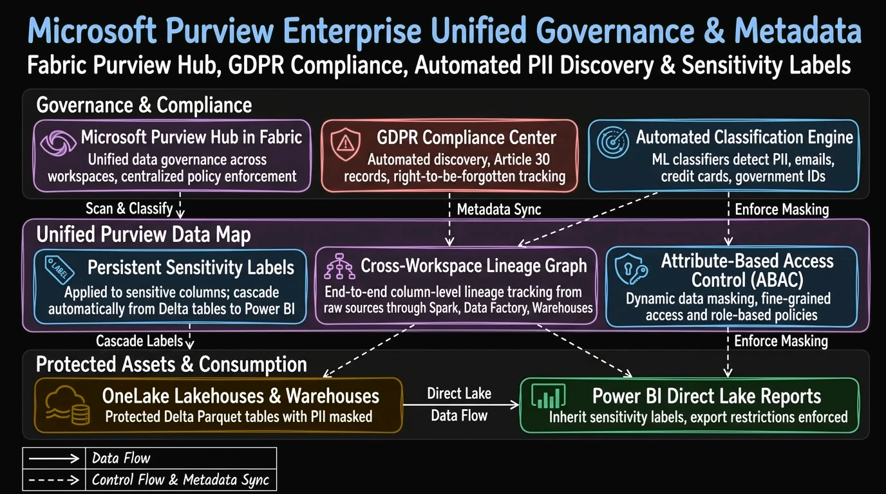
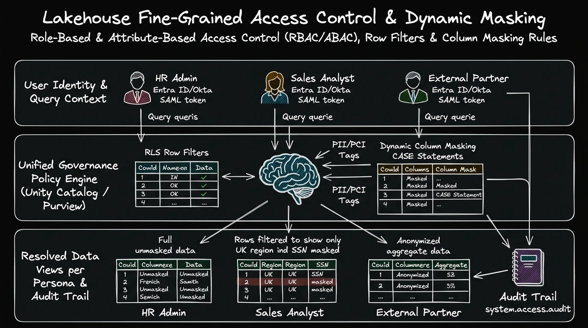

# Governance & Security — Architecture Whiteboard Blueprints

> **Domain**: `Governance & Security` | **Blueprints**: 4 | [← Back to Whiteboards Index](index.md)

---

## Governance & Security
*4 Architecture Blueprints in this domain*

### 📐 Governance & Security — Visual Blueprints Grid (2x2)

<table>
  <tr>
    <td width="50%" valign="top">
      
       <strong><a href="#unity-catalog-governance">Unity Catalog Unified Governance & 3-Level Namespace</a></strong> 
      <em>Centralized Metastore, 3-Level Namespace, Dynamic Row/Column Masking, and Delta Sharing</em> 
      <small>`Unity Catalog` · `Data Governance` · `3-Level Namespace` · `Row Filters`</small> 
      <a href="#unity-catalog-governance">🔍 Inspect Deep Dive & Architecture →</a>
    </td>
    <td width="50%" valign="top">
      
       <strong><a href="#purview-governance-catalog">Microsoft Purview Enterprise Governance Architecture</a></strong> 
      <em>Unified Multi-Cloud Data Map, Automated Scanning, Business Glossary, and End-to-End Lineage</em> 
      <small>`Microsoft Purview` · `Data Governance` · `Data Map` · `Data Lineage`</small> 
      <a href="#purview-governance-catalog">🔍 Inspect Deep Dive & Architecture →</a>
    </td>
  </tr>
  <tr>
    <td width="50%" valign="top">
      
       <strong><a href="#data-quality-wap-quarantine">Data Quality Observability & Write-Audit-Publish (WAP) Circuit Breaker Flow</a></strong> 
      <em>Data Contracts, Automated Validation Gates, Zero-Downtime Fast-Forwarding & Quarantine</em> 
      <small>`Data Quality` · `Write-Audit-Publish` · `WAP Pattern` · `Data Contracts`</small> 
      <a href="#data-quality-wap-quarantine">🔍 Inspect Deep Dive & Architecture →</a>
    </td>
    <td width="50%" valign="top">
      
       <strong><a href="#lakehouse-access-masking-lifecycle">Lakehouse Fine-Grained Access Control, Dynamic Masking & Entra/ABAC Enforcement</a></strong> 
      <em>Role-Based & Attribute-Based Access Control (RBAC/ABAC), Row Filters & Column Masking Rules</em> 
      <small>`Access Control` · `Dynamic Masking` · `Row-Level Security` · `RLS`</small> 
      <a href="#lakehouse-access-masking-lifecycle">🔍 Inspect Deep Dive & Architecture →</a>
    </td>
  </tr>
</table>

---

### Unity Catalog Unified Governance & 3-Level Namespace
**Centralized Metastore, 3-Level Namespace, Dynamic Row/Column Masking, and Delta Sharing**

**Tags:** `Unity Catalog` · `Data Governance` · `3-Level Namespace` · `Row Filters` · `Column Masks` · `Delta Sharing` · `Audit Logging` · `System Tables` · `Lineage` · [📖 Official Docs](https://docs.databricks.com/en/data-governance/unity-catalog/index.html)

**Overview:** Comprehensive reference architecture of Databricks Unity Catalog, the enterprise unified governance layer for data, analytics, and AI. Illustrates the centralized metastore hierarchy (`catalog.schema.table_or_view`), fine-grained access control with dynamic Row Filters and Column Masks, automated runtime data lineage across SQL and Python, Unity Catalog Volumes for unstructured data, and open zero-copy data exchange with Delta Sharing.

**Key Architecture Points:**
- Account-Level Centralized Metastore: Exactly one Unity Catalog metastore per cloud region, shared seamlessly across all development, staging, and production workspaces.
- Unified 3-Level Namespace: Standardized object hierarchy (`catalog.schema.table_or_view_or_volume`), eliminating legacy workspace-scoped naming collisions.
- Dynamic Row-Level Filtering: Programmatic row filtering using SQL UDFs (`CREATE FUNCTION filter_fn(region) ...`) that dynamically restrict visible rows based on user group membership (`IS_ACCOUNT_GROUP_MEMBER`).
- Column-Level Data Masking: Native column masking rules that mask sensitive PII (Social Security Numbers, credit cards, emails) for non-privileged roles while preserving raw data for authorized personnel.
- Automated Runtime Lineage: Kernel-level query engine instrumentation captures column-level and table-level lineage in real time across Spark SQL, Python, Scala, and BI dashboards.
- Unity Catalog Volumes: Extends centralized governance beyond tabular Delta tables to unstructured and semi-structured files (PDFs, images, audio, CSVs) with POSIX path compatibility.
- Open Delta Sharing: Open-source protocol enabling secure, zero-copy, cross-platform data sharing with external partners running Snowflake, BigQuery, Excel, or Power BI without data egress duplication.

> **Architect Note:** Unity Catalog represents the single pane of glass for enterprise data security and governance across clouds. Crucially, Unity Catalog operates at the Account level, binding across multiple workspaces and cloud regions. Architects must deprecate legacy Hive metastores (single-workspace DBFS/IAM models) and enforce the 3-level namespace (`catalog.schema.table`). Storage Credentials and External Locations must be locked down to prevent direct object storage writes that bypass catalog auditing.

<strong>Multi-Persona Architectural Breakdown (Click to expand)</strong>

- **Enterprise Architect:** Designs multi-workspace catalog architecture; provisions storage credentials and external locations using cloud IAM roles; defines cross-cloud data sharing policies and metastore peering.
- **Senior Data Engineer:** Authors and tests dynamic SQL row filter and column mask functions; manages automated catalog provisioning via Terraform; resolves complex lineage dependencies.
- **Data Engineer:** Adopts the 3-level namespace across all ETL pipelines; mounts Unity Catalog Volumes for file-based model training and ingestion; grants object permissions via standard ANSI SQL `GRANT` statements.
- **Data Steward:** Defines enterprise classification taxonomies and tags; reviews automated column lineage graphs to evaluate downstream blast radiuses; audits data access using `system.access.audit`.
- **Business Analyst:** Discovers certified and verified enterprise datasets using Catalog Explorer; queries masked and filtered tables with complete confidence in regulatory compliance.

**Under-the-Hood Technical Mechanisms:**
- Account metastore gRPC control plane and credential vending protocol
- Abstract Syntax Tree (AST) dynamic query rewriting for row/column masks
- Kernel-level execution engine hooks extracting column-level data lineage
- Delta Sharing open REST protocol and bearer token verification
- Real-time audit telemetry streaming to system catalog delta tables

**Production Failure Modes & Incident Triage:**
- Permission Inheritance Confusion (Catalog vs Schema vs Table): User cannot read table despite table GRANT; verify user possesses `USE CATALOG` on parent catalog and `USE SCHEMA` on parent schema.
- High Latency on Filtered Queries: Dynamic row filter UDF performs expensive scalar lookup subqueries; rewrite filter function to evaluate simple `IS_ACCOUNT_GROUP_MEMBER()` checks without external joins.
- Lineage Missing for Custom Python Transformations: DataFrame written using arbitrary RDD or raw file APIs that bypass Spark logical plan; refactor transformations into standard DataFrame or Spark SQL operations to restore automated lineage tracking.

**Governance & Regulatory Compliance:**
- Comprehensive SOC 2, HIPAA, and GDPR compliance backed by immutable audit logs
- Automated right-to-be-forgotten deletion workflows tracked and verified across all downstream lineage tables
- Zero plain-text cloud storage access keys; all access mediated via short-lived temporary STS tokens
- Tag-based access control (ABAC) automatically applying security policies to newly created tables

[↑ Return to Governance & Security 2x2 Grid](#governance-security) · [Top of Catalog](index.md)

---

### Microsoft Purview Enterprise Governance Architecture
**Unified Multi-Cloud Data Map, Automated Scanning, Business Glossary, and End-to-End Lineage**

**Tags:** `Microsoft Purview` · `Data Governance` · `Data Map` · `Data Lineage` · `Data Catalog` · `Business Glossary` · `Automated Scanning` · `Classification` · `Sensitivity Labels` · [📖 Official Docs](https://learn.microsoft.com/en-us/purview/purview)

**Overview:** Enterprise multi-cloud governance and metadata management architecture using Microsoft Purview. Illustrates the centralized Data Map powered by an Apache Atlas graph engine, automated metadata and schema scanning across heterogeneous environments (Azure, AWS, SAP, on-prem SQL, Fabric, Power BI), enterprise business glossary mapping, automated PII classification rules, sensitivity labeling, and end-to-end data lineage visualization.

**Key Architecture Points:**
- Unified Multi-Cloud Data Map: Elastic graph metadata database built on Apache Atlas, scaling to millions of enterprise data assets across Azure, AWS, Google Cloud, and on-premises.
- Automated Ingestion Scanners: Scheduled, serverless metadata scanners extract schema definitions, data types, physical storage paths, and statistical distributions with zero impact on operational workloads.
- Built-in & Custom Classification: Over 200 out-of-the-box regex and dictionary classification rules detect PII (passport numbers, SSNs, credit cards, medical IDs) plus custom enterprise classification patterns.
- Enterprise Business Glossary: Hierarchical taxonomy of business terms (e.g. 'Customer Churn', 'Net ARR') linked directly to physical assets, bridging the gap between business terminology and technical schemas.
- End-to-End Automated Lineage: Visual lineage graphs automatically constructed by ingesting execution metadata from Azure Data Factory, Synapse pipelines, Databricks, Fabric, and Power BI datasets.
- Sensitivity Label Inheritance: Direct integration with Microsoft Information Protection ensures sensitivity labels applied at the storage or lakehouse layer automatically cascade into downstream Power BI visuals.
- Data Estate Insights & Quality: Executive dashboards reporting on asset curation health, classification coverage, sensitive data distribution, and compliance posture.

> **Architect Note:** Enterprise data estates span multiple clouds, legacy on-prem databases, and SaaS platforms. Microsoft Purview serves as the macro metadata control plane. Architects must configure Purview scanning through private endpoints within virtual networks to scan isolated data stores securely without opening public firewalls. Mandate integration with Microsoft 365 Purview Information Protection to synchronize sensitivity labels (e.g. 'Highly Confidential') automatically from source databases through Fabric Lakehouses into Power BI reports.

<strong>Multi-Persona Architectural Breakdown (Click to expand)</strong>

- **Enterprise Architect:** Designs enterprise metadata architecture across hybrid multi-cloud systems; configures private scanning endpoints and managed identity credentials; integrates Purview with corporate security SIEMs.
- **Senior Data Engineer:** Configures automated scanning schedules and scan rule sets; registers custom asset types and manually publishes pipeline lineage via the Apache Atlas REST API.
- **Data Engineer:** Ensures data pipeline tasks (ADF, Spark) publish lineage to Purview; annotates datasets with meaningful technical descriptions and metadata tags.
- **Data Steward:** Curates business glossary definitions and maps them to technical assets; manages data access approval workflows; audits classification results and investigates unclassified sensitive data.
- **Business Analyst:** Searches the Purview Data Catalog to discover certified, trusted data assets; views business glossary definitions to understand the exact calculation rules behind executive report metrics.

**Under-the-Hood Technical Mechanisms:**
- Apache Atlas graph metadata repository and entity relationship engine
- Serverless scanning engine executing within managed VNet private endpoints
- Kafka/Event Hubs streaming integration for real-time lineage event publishing
- Sensitivity label synchronization with Microsoft 365 Compliance Center
- Apache Atlas REST API v2 for custom asset, relationship, and lineage registration

**Production Failure Modes & Incident Triage:**
- Scanning Authentication Failure (HTTP 403 / Access Denied): Purview Managed Identity lacks `Storage Blob Data Reader` role on target storage account; assign proper RBAC role and verify network firewall allows Purview trusted service bypass.
- Missing Lineage from Spark / Databricks Jobs: Spark job not configured with OpenLineage / Purview connector; install the Purview Spark lineage agent and configure `spark.extraListeners` in cluster configuration.
- Asset Duplication in Catalog: Same physical asset scanned via both storage account endpoint and lakehouse shortcut; configure unified root collection hierarchy and deduplicate asset registration.

**Governance & Regulatory Compliance:**
- Comprehensive compliance mapping for GDPR, HIPAA, CCPA, and Basel III regulations
- End-to-end data provenance tracking supporting financial and regulatory audit requirements
- Automated data access workflow governance requiring steward approval before granting access
- Data minimization and retention tracking highlighting orphaned data assets past their retention limits

[↑ Return to Governance & Security 2x2 Grid](#governance-security) · [Top of Catalog](index.md)

---

### Data Quality Observability & Write-Audit-Publish (WAP) Circuit Breaker Flow
**Data Contracts, Automated Validation Gates, Zero-Downtime Fast-Forwarding & Quarantine**

**Tags:** `Data Quality` · `Write-Audit-Publish` · `WAP Pattern` · `Data Contracts` · `Circuit Breaker` · `Quarantine` · `Great Expectations` · `Soda Core` · `Delta Lake` · `Apache Iceberg` · `Observability` · [📖 Official Docs](https://docs.delta.io/latest/delta-constraints.html)

**Overview:** Production architecture for zero-downtime data quality enforcement using the Write-Audit-Publish (WAP) pattern and automated quarantine circuit breakers. New data is written into an isolated staging branch or partition, audited against formal Data Contracts using automated assertion engines (Great Expectations, Soda, Delta Constraints), and only published to downstream production consumers via zero-copy atomic fast-forwarding if all quality gates pass.

**Key Architecture Points:**
- Zero-Downtime Write-Audit-Publish: Decouples physical write operations from business data publication using Iceberg table branches or Delta transaction staging commits.
- Enforceable Data Contracts: Formal YAML-defined data contracts specifying strict schema types, nullability rules, valid value ranges, and foreign key referential integrity.
- Automated Multi-Layer Quality Gates: Executes row-level constraint checks, table-level statistical aggregations, and historical distribution anomaly drift detection.
- Zero-Copy Atomic Fast-Forward: Upon 100% audit validation success, production branch pointer updates atomically via metadata commit, making data live in milliseconds.
- Circuit Breaker & Quarantine Divert: When validation fails, circuit breaker prevents the publish step, alerts DataOps teams, and routes bad records to a quarantined triage table.
- Automated Drift & Anomaly Alerting: Uses statistical baselines (Z-score, IQR) to detect unexpected volume spikes, missing categories, or sudden column distribution shifts.
- Quality Scorecards & Lineage Integration: Publishes quality audit results and test pass/fail metrics directly to enterprise data catalogs (Unity Catalog, Microsoft Purview).

> **Architect Note:** The traditional anti-pattern of 'write directly to production, then run quality tests' inevitably leaks corrupt or malformed data to executive dashboards before pipelines can be stopped. The Write-Audit-Publish (WAP) pattern solves this by treating table commits like Git branches: writes land in an isolated staging snapshot or table branch. If audits pass, the production branch pointer fast-forwards instantly with zero data movement; if audits fail, the staging branch is purged or quarantined, and production consumers continue querying the pristine prior snapshot without disruption.

<strong>Multi-Persona Architectural Breakdown (Click to expand)</strong>

- **Enterprise Architect:** Establishes enterprise Data Contract specifications; determines SLA impact thresholds for WAP branching; mandates quality gate compliance for all Silver and Gold data tier publications.
- **Senior Data Engineer:** Implements WAP branching logic via Spark/Iceberg APIs or dbt pre-publish hooks; configures automated test runners and circuit breaker trip handlers.
- **Data Engineer:** Authors specific quality assertion tests (completeness, freshness, uniqueness); triages quarantined data records; fixes underlying ETL pipeline parsing errors.
- **Data Steward:** Reviews Data Contract compliance dashboards; monitors enterprise data quality health scores; resolves data governance discrepancies with source domain owners.
- **Business Analyst:** Enjoys 100% confidence in production reporting data, guaranteed free of partial loads, unexpected nulls, or duplicate keys; views quality audit certification badges on BI models.

**Under-the-Hood Technical Mechanisms:**
- Apache Iceberg / Delta Lake branch isolation (`CREATE BRANCH audit_branch_20261112`)
- Assertion evaluation engine executing SQL-based statistical checks against the isolated branch
- Metadata fast-forwarding via Iceberg `fastForwardBranch` or Delta catalog pointer update
- Automated transaction rollback and tombstone cleanup upon audit check assertion failure
- Webhook event dispatching to Slack / Microsoft Teams / PagerDuty with failure context payloads

**Production Failure Modes & Incident Triage:**
- Staging Branch Accumulation: Audit failures leave abandoned staging branches consuming storage; schedule automated cleanup jobs to drop unpromoted branches older than 48 hours.
- Overly Strict Validation False-Positive: Sudden business surge (e.g., Black Friday) triggers volume anomaly alerts, halting pipeline; adjust dynamic threshold bands to accommodate seasonal spikes.
- Long-Running Audit Check Delay: Complex statistical checks delay publication past morning SLA; optimize validation SQL by running checks on column summary statistics rather than full table scans.

**Governance & Regulatory Compliance:**
- 100% verifiable Data Contract compliance records attached to every published production snapshot
- Tamper-evident audit trail capturing who authored, tested, and published each data release
- Quarantine tables isolated with restricted access permissions to prevent unauthorized viewing of bad data
- Regulatory compliance with BCBS 239 and SOX financial reporting data accuracy mandates

[↑ Return to Governance & Security 2x2 Grid](#governance-security) · [Top of Catalog](index.md)

---

### Lakehouse Fine-Grained Access Control, Dynamic Masking & Entra/ABAC Enforcement
**Role-Based & Attribute-Based Access Control (RBAC/ABAC), Row Filters & Column Masking Rules**

**Tags:** `Access Control` · `Dynamic Masking` · `Row-Level Security` · `RLS` · `Column-Level Security` · `CLS` · `ABAC` · `RBAC` · `Unity Catalog` · `Microsoft Purview` · `Data Security` · `PII` · [📖 Official Docs](https://docs.databricks.com/en/data-governance/unity-catalog/row-column-filters.html)

**Overview:** Comprehensive security architecture for fine-grained data governance across enterprise lakehouses. Demonstrates how unified catalogs (Unity Catalog, Microsoft Purview) enforce Role-Based (RBAC) and Attribute-Based (ABAC) Access Control. Illustrates dynamic column masking (e.g. hashing SSNs or credit cards based on user group membership) and dynamic row-level security (RLS) filters applied at query runtime without duplicating physical data.

**Key Architecture Points:**
- Single-Copy Governed Lakehouse: Eliminates duplicate physical tables by dynamically transforming query plans to filter rows and mask sensitive columns at runtime.
- Dynamic Column Masking (CLS): Obfuscates sensitive fields (e.g. `CASE WHEN is_member('HR_Admin') THEN ssn ELSE 'XXX-XX-' || RIGHT(ssn, 4) END`) transparently during query compilation.
- Dynamic Row-Level Security (RLS): Injects row filter predicates (e.g. `WHERE region = current_user_region()`) into Catalyst query plans to restrict rows by user authorization.
- Attribute-Based Access Control (ABAC): Dynamically applies governance policies based on tag inheritance (e.g., all columns tagged `PII.Confidential` automatically receive hashing masks).
- Enterprise Identity Integration: Natively integrates with Microsoft Entra ID and Okta SAML tokens to resolve user identity, tenant attributes, and security group memberships.
- Zero-Transcode Performance: Push-down predicate optimization ensures row filters are evaluated directly at the Parquet scan level, maintaining sub-second query response times.
- Centralized Audit Lineage: Logs every query, user session, applied mask, and data access event into tamper-evident system audit tables (`system.access.audit`).

> **Architect Note:** Creating separate physical tables or sanitized database views for different regional or permission-tiered user groups is an expensive anti-pattern that leads to massive data duplication, high ETL compute costs, and inevitable permission drift. The gold standard is Single-Copy Governed Storage: persist one canonical Gold Delta table and enforce fine-grained access control dynamically at query compilation time using centralized catalog UDFs for row filtering and column masking based on the caller's Entra ID/Okta group context.

<strong>Multi-Persona Architectural Breakdown (Click to expand)</strong>

- **Enterprise Architect:** Designs enterprise zero-trust security framework; selects RBAC vs. ABAC policy models; establishes global data classification taxonomies (Public, Internal, Confidential, Restricted).
- **Senior Data Engineer:** Authors centralized row-filter and column-masking SQL UDFs; benchmarks query latency with active filters; ensures filter predicates push down cleanly into Parquet readers.
- **Data Engineer:** Attaches masking policies and row filters to target Gold tables and views; verifies masking logic in test environments; maps database objects to Unity Catalog tags.
- **Data Steward:** Monitors PII discovery scan results; applies governance classification tags to sensitive columns; reviews user access audit logs to verify compliance with GDPR and HIPAA.
- **Business Analyst:** Executes standard BI and SQL queries against authorized tables without needing special views; sees properly redacted or regionally scoped data according to their assigned role.

**Under-the-Hood Technical Mechanisms:**
- Catalyst Optimizer plan rewrites injecting UDF expressions into the logical query tree prior to physical planning
- Entra ID / Okta SAML OAuth2 token resolution via `is_account_group_member()` and `current_user()` functions
- Tag-based policy inheritance propagating column masks from semantic catalog models to physical Delta tables
- Pushdown predicate evaluation at the storage scan layer filtering row groups prior to decompression
- Continuous system audit table streaming capturing every data access attempt and credential context

**Production Failure Modes & Incident Triage:**
- Catastrophic Query Slowdown on Complex RLS: Inefficient row-filter UDF causes full table scans; optimize filter UDF to avoid cross-table subqueries and ensure filter keys align with table clustering keys.
- Access Denied on Valid User: User cannot view expected rows post-reorganization; verify user's Entra ID group membership sync and check role assignment in Unity Catalog / Purview.
- Masking Bypass in BI DirectQuery: DirectQuery report shows raw values due to cached credentials; enforce credential delegation and ensure semantic model uses user identity rather than fixed service principal.

**Governance & Regulatory Compliance:**
- Full compliance with GDPR Right to Privacy and HIPAA Safe Harbor de-identification rules
- Dynamic data pseudonymization protecting customer PII while enabling aggregate analytical modeling
- Tamper-evident audit logging in `system.access.audit` satisfying SOC 2 and ISO 27001 access control audits
- Automated periodic access review (PAR) workflows to certify privilege grants every 90 days

[↑ Return to Governance & Security 2x2 Grid](#governance-security) · [Top of Catalog](index.md)

---

