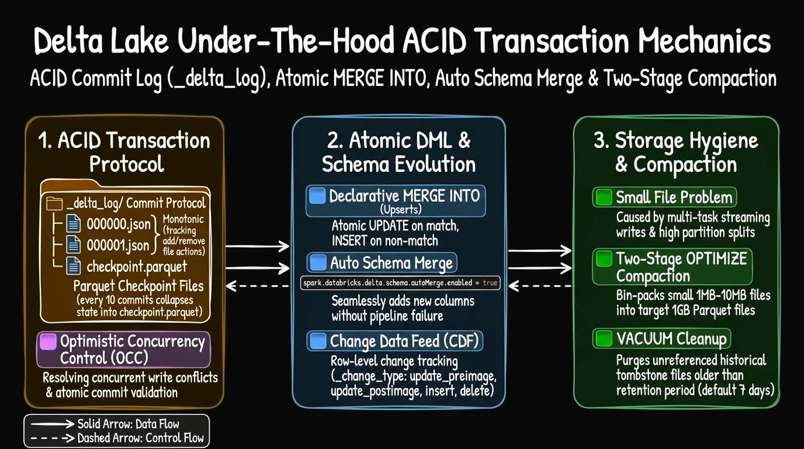
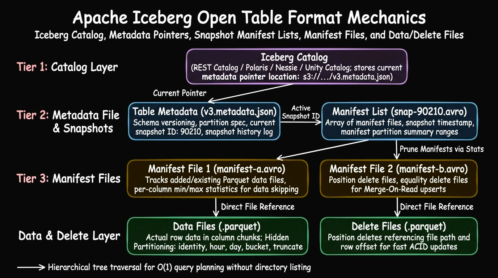
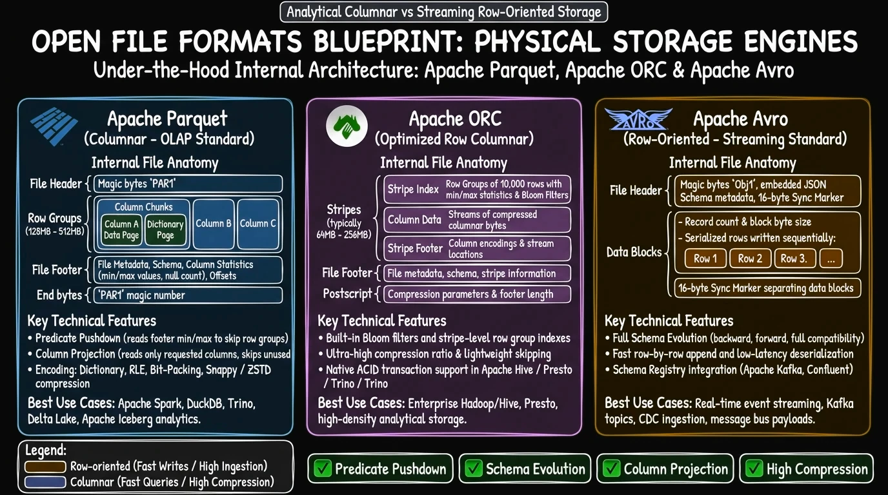
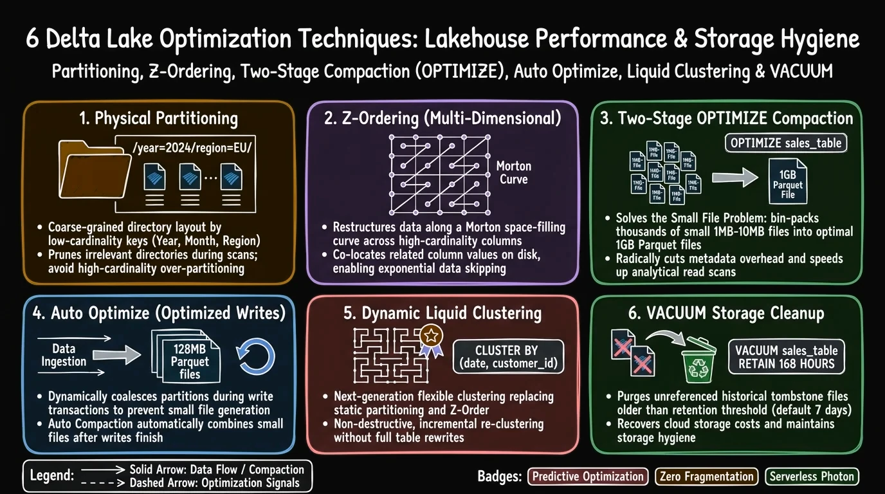
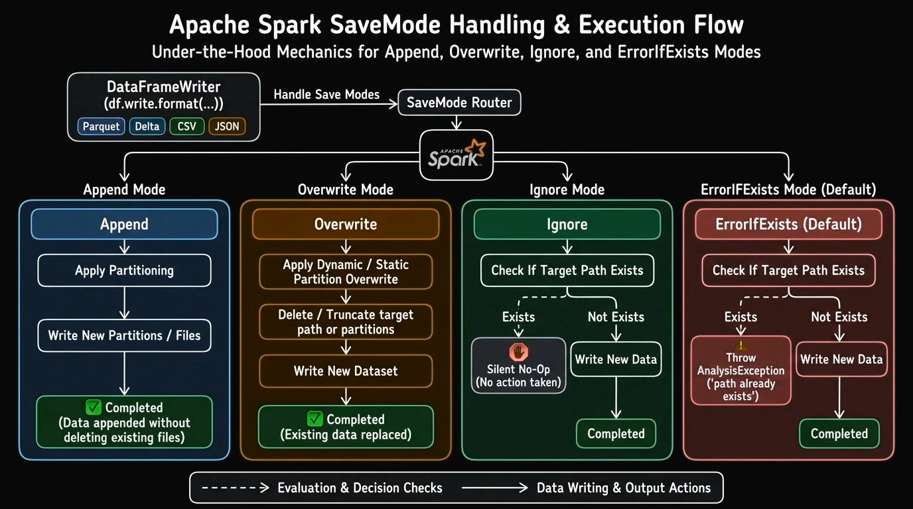
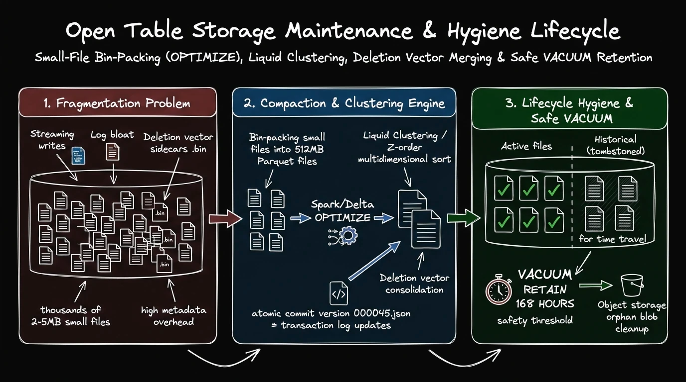

# Storage Engine — Architecture Whiteboard Blueprints

> **Domain**: `Storage Engine` | **Blueprints**: 9 | [← Back to Whiteboards Index](index.md)

---

## Storage Engine
*9 Architecture Blueprints in this domain*

### 📐 Storage Engine — Visual Blueprints Grid (2x2)

<table>
  <tr>
    <td width="50%" valign="top">
      
       <strong><a href="#delta-lake-under-the-hood">How Delta Lake Works Under the Hood</a></strong> 
      <em>Transaction Log Protocol (_delta_log/), Checkpoint Parquet Files, State Replay, and OCC</em> 
      <small>`Delta Lake` · `Storage Engine` · `_delta_log` · `ACID`</small> 
      <a href="#delta-lake-under-the-hood">🔍 Inspect Deep Dive & Architecture →</a>
    </td>
    <td width="50%" valign="top">
      
       <strong><a href="#apache-iceberg-open-table-format">Apache Iceberg Open Table Format Mechanics</a></strong> 
      <em>3-Level Metadata Tree, Manifest Lists, In-Place Partition Evolution, and Hidden Partitioning</em> 
      <small>`Apache Iceberg` · `Open Table Format` · `Manifest List` · `Manifest Files`</small> 
      <a href="#apache-iceberg-open-table-format">🔍 Inspect Deep Dive & Architecture →</a>
    </td>
  </tr>
  <tr>
    <td width="50%" valign="top">
      
       <strong><a href="#open-table-formats-lakehouse">Open Table Formats Blueprint: Lakehouse Storage Engines</a></strong> 
      <em>Comparative Technical Architecture: Delta Lake vs Apache Iceberg vs Apache Hudi</em> 
      <small>`Open Table Formats` · `Delta Lake` · `Apache Iceberg` · `Apache Hudi`</small> 
      <a href="#open-table-formats-lakehouse">🔍 Inspect Deep Dive & Architecture →</a>
    </td>
    <td width="50%" valign="top">
      
       <strong><a href="#open-file-formats-storage">Open File Formats Blueprint: Physical Storage Engines</a></strong> 
      <em>Columnar vs Row-Based: Parquet, ORC, and Avro Encoding, Compression, and Memory Layouts</em> 
      <small>`File Formats` · `Parquet` · `ORC` · `Avro`</small> 
      <a href="#open-file-formats-storage">🔍 Inspect Deep Dive & Architecture →</a>
    </td>
  </tr>
  <tr>
    <td width="50%" valign="top">
      
       <strong><a href="#databricks-optimization-techniques-architecture">6 Delta Lake Optimization Techniques: Lakehouse Performance & Storage Hygiene</a></strong> 
      <em>Compaction (OPTIMIZE), Z-Ordering, Liquid Clustering, VACUUM, Partitioning, and Deletion Vectors</em> 
      <small>`Delta Lake` · `Optimization` · `Compaction` · `Z-Order`</small> 
      <a href="#databricks-optimization-techniques-architecture">🔍 Inspect Deep Dive & Architecture →</a>
    </td>
    <td width="50%" valign="top">
      
       <strong><a href="#spark-savemode-architecture">Apache Spark SaveMode Handling & Storage Execution Architecture</a></strong> 
      <em>Append, Overwrite, ErrorIfExists, Ignore: File vs Partition vs Table Overwrite Mechanics</em> 
      <small>`Apache Spark` · `SaveMode` · `Append` · `Overwrite`</small> 
      <a href="#spark-savemode-architecture">🔍 Inspect Deep Dive & Architecture →</a>
    </td>
  </tr>
  <tr>
    <td width="50%" valign="top">
      
       <strong><a href="#delta-vs-iceberg-architecture">Delta Lake vs. Apache Iceberg Storage & Metadata Architecture</a></strong> 
      <em>Single-Directory Transaction Logs vs Hierarchical Snapshot Trees: Concurrency, Evolution & Interoperability</em> 
      <small>`Delta Lake` · `Apache Iceberg` · `Storage Architecture` · `UniForm`</small> 
      <a href="#delta-vs-iceberg-architecture">🔍 Inspect Deep Dive & Architecture →</a>
    </td>
    <td width="50%" valign="top">
      
       <strong><a href="#lakehouse-acid-concurrency">Lakehouse ACID Concurrency & Write Conflict Resolution Matrix</a></strong> 
      <em>Optimistic Concurrency Control (OCC), Conflict Scenarios, and Serializable vs WriteSerializable Isolation</em> 
      <small>`ACID` · `Concurrency Control` · `Optimistic Concurrency Control` · `OCC`</small> 
      <a href="#lakehouse-acid-concurrency">🔍 Inspect Deep Dive & Architecture →</a>
    </td>
  </tr>
  <tr>
    <td width="50%" valign="top">
      
       <strong><a href="#table-maintenance-compaction-vacuum">Open Table Maintenance Lifecycle: Bin-Packing, Liquid Clustering & Safe VACUUM</a></strong> 
      <em>Small-File Bin-Packing (OPTIMIZE), Liquid Clustering, Deletion Vector Merging & Safe VACUUM Retention</em> 
      <small>`Table Maintenance` · `Delta Lake` · `Compaction` · `Bin-Packing`</small> 
      <a href="#table-maintenance-compaction-vacuum">🔍 Inspect Deep Dive & Architecture →</a>
    </td>
    <td width="50%" valign="top"></td>
  </tr>
</table>

---

### How Delta Lake Works Under the Hood
**Transaction Log Protocol (_delta_log/), Checkpoint Parquet Files, State Replay, and OCC**

**Tags:** `Delta Lake` · `Storage Engine` · `_delta_log` · `ACID` · `Optimistic Concurrency Control` · `Checkpoints` · `Parquet` · `Atomic Commits` · `Time Travel` · `Log Compaction` · [📖 Official Docs](https://docs.delta.io/latest/delta-intro.html)

**Overview:** Deep under-the-hood architectural dissection of Delta Lake's ACID transaction protocol. Details the physical organization of the `_delta_log/` directory, monotonic JSON commit files (`000000.json`), checkpoint Parquet files (`000010.checkpoint.parquet`), log state reconstruction algorithms, cloud storage atomic commit primitives (`putIfAbsent`), Optimistic Concurrency Control (OCC), and metadata compaction.

**Key Architecture Points:**
- The _delta_log Directory: Immutable, append-only directory containing sequential JSON commits recording every state mutation (AddFile, RemoveFile, CommitInfo, SetTransaction).
- Atomic Commit Protocol: Commits rely on storage atomic primitives (Azure ADLS Gen2 atomic rename, S3 conditional `PutObject`/DynamoDB lock) to write `00000N.json` monotonically without write collisions.
- Checkpoint Parquet Files: Every 10 commits, the engine writes an aggregated snapshot checkpoint (`000010.checkpoint.parquet`) containing the complete consolidated table state, accelerating table load times.
- The _last_checkpoint Pointer: A lightweight JSON file pointing directly to the latest checkpoint file, allowing readers to avoid scanning thousands of historical JSON commits.
- Snapshot State Reconstruction: To read a table, the engine reads the latest checkpoint Parquet file and replays only the few subsequent JSON commits, building an in-memory view of active data files.
- Optimistic Concurrency Control (OCC): Assumes concurrent transactions will not conflict; checks file-level intersection between read sets and write sets before committing, retrying automatically on non-conflicting appends.
- Time Travel Mechanics: Readers can query exact historical states (`TIMESTAMP AS OF` or `VERSION AS OF`) by replaying the transaction log up to that specific commit version, enabling reliable auditability and rollback.

> **Architect Note:** Delta Lake brings transactional ACID guarantees to commodity cloud object storage. Crucially, object stores (S3, ADLS, GCS) lack multi-file transactional locking. Delta solves this by treating the transaction log as the single source of truth: data files in the directory that are not referenced by the latest log snapshot are considered non-existent. Architects must ensure automated checkpointing and periodic log cleanup (`delta.logRetentionDuration`) are maintained to prevent slow query planning caused by thousands of un-compacted JSON log files.

<strong>Multi-Persona Architectural Breakdown (Click to expand)</strong>

- **Enterprise Architect:** Establishes enterprise data storage standards; evaluates ACID transaction durability guarantees across AWS S3 and Azure ADLS; designs multi-engine write concurrency rules.
- **Senior Data Engineer:** Analyzes Delta log internals using `_delta_log/*.json` inspection; tunes checkpoint intervals and log retention properties (`delta.logRetentionDuration`, `delta.deletedFileRetentionDuration`); troubleshoots concurrent append conflicts.
- **Data Engineer:** Executes time travel queries for point-in-time analysis and data rollback; runs `DESCRIBE HISTORY` to audit table changes; schedules routine table maintenance tasks.
- **Data Steward:** Leverages immutable transaction logs to provide tamper-evident compliance audit trails for financial regulators; verifies GDPR physical data deletion following `VACUUM`.
- **Business Analyst:** Queries historical snapshots to generate exact reproducible month-end financial reports without being affected by ongoing ETL pipeline updates.

**Under-the-Hood Technical Mechanisms:**
- Monotonic commit sequence ID generation with cloud storage atomic write primitives
- State reconstruction algorithm reconciling AddFile and RemoveFile actions into active file arrays
- Optimistic Concurrency Control (OCC) conflict detection algorithm
- Checkpoint Parquet file consolidation and CRC32 integrity validation
- Tombstone metadata lifecycle management governing file physical deletion

**Production Failure Modes & Incident Triage:**
- Slow Query Planning Time (Metadata Latency): Reading table takes 30+ seconds before execution starts; table has thousands of uncheckpointed JSON commits; run a dummy append or checkpoint write to compact the transaction log.
- ConcurrentAppendException: Multiple streaming or batch jobs commit simultaneously to the same table; configure `spark.databricks.delta.concurrency.maxRetryCommitAttempts` or partition target table to eliminate conflict overlap.
- Corrupt Table State / Missing Files: Third-party process directly deleted Parquet files from object storage bypassing Delta log; run `FSCK REPAIR TABLE` to reconcile the transaction log with physical storage.

**Governance & Regulatory Compliance:**
- 100% immutable, tamper-evident audit history of all write, update, and delete actions
- Cryptographic CRC checksums verifying metadata integrity on every commit
- Complete point-in-time reproducible auditability for SOX and financial reporting
- Compliance with GDPR right-to-be-forgotten verified by checking RemoveFile tombstone expiration

[↑ Return to Storage Engine 2x2 Grid](#storage-engine) · [Top of Catalog](index.md)

---

### Apache Iceberg Open Table Format Mechanics
**3-Level Metadata Tree, Manifest Lists, In-Place Partition Evolution, and Hidden Partitioning**

**Tags:** `Apache Iceberg` · `Open Table Format` · `Manifest List` · `Manifest Files` · `Avro` · `Snapshot Isolation` · `Hidden Partitioning` · `Partition Evolution` · `Schema Evolution` · [📖 Official Docs](https://iceberg.apache.org/docs/latest/spec/)

**Overview:** Architectural breakdown of the Apache Iceberg open table format. Details the 3-level hierarchical metadata tree (Iceberg Catalog -> Snapshot metadata.json -> Manifest List Avro -> Manifest Files Avro -> Parquet Data Files). Covers snapshot isolation, hidden partitioning without directory-encoded values, in-place partition and schema evolution using immutable field IDs, and row-level delete strategies (Copy-on-Write vs Merge-on-Read).

**Key Architecture Points:**
- 3-Level Metadata Hierarchy: Iceberg Catalog points to current `metadata.json` -> references Manifest List (`snap-*.avro`) -> references Manifest Files (`*.avro`) -> points to physical Parquet Data Files.
- Snapshot Isolation: Every commit creates an immutable snapshot; queries read a specific snapshot tree, guaranteeing complete isolation from concurrent writers.
- Hidden Partitioning: Eliminates user-facing partition columns; users query raw timestamps (`event_time`), and Iceberg automatically applies partition transforms (e.g. `months(event_time)`, `bucket(16, id)`) transparently.
- In-Place Partition Evolution: Partition specs can change over time (e.g. moving from daily to hourly partitioning) without rewriting existing historical data files or restructuring directory paths.
- Reliable Schema Evolution: Columns are tracked by unique integer Field IDs rather than column names, making renames, reorders, and nested struct alterations completely safe and metadata-only.
- File-Level Column Statistics: Manifest files store upper/lower column bounds, null counts, and NaN counts, allowing query planners to skip entire manifest files and data files before scanning storage.
- Row-Level Delete Modes: Supports Copy-on-Write (rewriting entire Parquet files during updates/deletes) and Merge-on-Read (writing compact equality or positional delete files reconciled at query time).

> **Architect Note:** Apache Iceberg was engineered from scratch to overcome the physical directory limitations of the Apache Hive metastore model. By tracking individual data files within Avro manifest files rather than directory paths, Iceberg decouples logical partitioning from physical storage. Architects should choose Iceberg when building multi-engine data platforms (Spark, Trino, Flink, Snowflake, Dremio) requiring true vendor-neutral governance and zero lock-in.

<strong>Multi-Persona Architectural Breakdown (Click to expand)</strong>

- **Enterprise Architect:** Selects open table format standards for multi-engine platforms; designs Iceberg REST catalog topologies (Tabular, Polaris, Unity Catalog); establishes data retention and snapshot expiry policies.
- **Senior Data Engineer:** Analyzes manifest file pruning statistics; tunes compaction jobs (`rewrite_data_files`); benchmarks Merge-on-Read vs Copy-on-Write for high-frequency CDC workloads; manages catalog lock leases.
- **Data Engineer:** Configures table partition transforms (`days(ts)`, `identity(dept)`); runs maintenance procedures (`expire_snapshots`, `remove_orphan_files`); writes SQL transformations in Spark or Trino.
- **Data Steward:** Implements centralized access policies across multiple query engines; verifies data catalog synchronization across enterprise query engines; monitors compliance time travel audits.
- **Business Analyst:** Queries tables using standard SQL without needing to know physical partition schemes; experiences consistent query performance across both Trino and Snowflake.

**Under-the-Hood Technical Mechanisms:**
- Iceberg REST Catalog atomic pointer swap (compare-and-swap) commit protocol
- Avro manifest list partition summary evaluation for aggressive manifest pruning
- Column Field ID tracking preserving schema integrity across renames and drops
- Positional delete files and equality delete files reconciliation in Merge-on-Read
- Snapshot tree garbage collection and orphan data file reconciliation

**Production Failure Modes & Incident Triage:**
- Merge-on-Read Query Performance Degradation: High volume of small positional delete files forces readers to perform expensive in-memory hash joins; run `rewrite_data_files` to merge delete files back into base Parquet files.
- Catalog Commit Collision / Concurrent Commit Failure: High-frequency concurrent writes fail compare-and-swap on `metadata.json`; increase commit retry backoffs or batch streaming writes into larger micro-batches.
- Orphan Files Accumulating / Storage Bloat: Snapshots expired without physical file removal; execute `expire_snapshots` followed by `remove_orphan_files` maintenance procedures.

**Governance & Regulatory Compliance:**
- Open governance under the Apache Software Foundation guaranteeing vendor neutrality
- Centralized metadata access control via Iceberg REST Catalog standards
- Accurate time travel auditing across snapshots for legal discovery and financial compliance
- Complete data erasure verification for GDPR by purging historical snapshots and running vacuum procedures

[↑ Return to Storage Engine 2x2 Grid](#storage-engine) · [Top of Catalog](index.md)

---

### Open Table Formats Blueprint: Lakehouse Storage Engines
**Comparative Technical Architecture: Delta Lake vs Apache Iceberg vs Apache Hudi**

**Tags:** `Open Table Formats` · `Delta Lake` · `Apache Iceberg` · `Apache Hudi` · `Lakehouse` · `ACID` · `UniForm` · `Storage Architecture` · `CDC Ingestion` · [📖 Official Docs](https://iceberg.apache.org/docs/latest/spec/)

**Overview:** Comprehensive comparative architecture evaluating the Big Three open lakehouse table formats: Delta Lake, Apache Iceberg, and Apache Hudi. Details their underlying metadata designs, transaction log models, concurrency control mechanisms, file skipping efficiencies, row-level mutation strategies, multi-engine interoperability, and cross-format translation layers (Databricks UniForm, OneTable/XTable).

**Key Architecture Points:**
- Metadata Model Comparison: Delta uses a single-directory sequential JSON transaction log with checkpoint Parquet; Iceberg uses a hierarchical 3-level tree of Avro manifests; Hudi uses an active timeline log with index files.
- Concurrency Control: Delta Lake and Iceberg utilize Optimistic Concurrency Control (OCC); Hudi supports OCC alongside Multi-Version Concurrency Control (MVCC) tailored for high-frequency streaming.
- Delete & Update Mechanics: Delta employs Copy-on-Write and Deletion Vectors (Roaring Bitmaps); Iceberg utilizes Copy-on-Write and Merge-on-Read (positional/equality delete files); Hudi leverages record-level index keys with Merge-on-Read log files.
- File Skipping & Indexing: Delta stores column min/max statistics in log JSON/checkpoints; Iceberg evaluates upper/lower bounds in Avro manifests; Hudi maintains dedicated Bloom filter, HBase, and record-level indexes.
- Cross-Format Universal Translation: Databricks UniForm automatically generates Iceberg metadata from Delta writes with zero data copying, allowing Iceberg readers to query Delta tables natively.
- Ecosystem & Engine Support: Delta Lake is native to Databricks and Microsoft Fabric; Iceberg is native to Snowflake, AWS EMR, Trino, and Dremio; Hudi excels in high-throughput streaming CDC with Apache Flink.
- Partitioning Paradigms: Delta utilizes Hive-style physical directory partitioning or Liquid Clustering; Iceberg utilizes hidden partition transforms without directory constraints; Hudi utilizes directory partitioning with index keys.

> **Architect Note:** The 'format war' is rapidly converging toward universal interoperability. While Delta Lake leads in Spark and Fabric ecosystems, and Iceberg dominates multi-engine platforms (Snowflake, Trino, Flink), universal translation layers like Databricks UniForm write Delta transaction logs while generating Iceberg metadata asynchronously. Architects should adopt Delta Lake with UniForm or Iceberg with REST Catalog to achieve true multi-engine portability while avoiding physical data duplication.

<strong>Multi-Persona Architectural Breakdown (Click to expand)</strong>

- **Enterprise Architect:** Selects the optimal table format standard for enterprise data architectures; evaluates cross-format portability risks; implements universal metadata translation (UniForm) to prevent dual-storage duplication.
- **Senior Data Engineer:** Benchmarks query planning latencies and file skipping efficiency across formats; optimizes write commit concurrency; configures format-specific compaction and vacuum schedules.
- **Data Engineer:** Authors cross-format data pipelines; converts legacy Parquet tables to modern formats using `CONVERT TO DELTA` or Iceberg migration procedures; manages table properties.
- **Data Steward:** Ensures catalog federation and access control policies apply uniformly regardless of which query engine or table format is utilized by domain teams.
- **Business Analyst:** Enjoys transparent analytical access across all enterprise tables without needing to understand underlying storage format differences.

**Under-the-Hood Technical Mechanisms:**
- Delta Lake JSON transaction log sequence vs Iceberg Avro manifest tree traversal
- Hudi timeline state transition (Requested -> Inflight -> Completed) commit coordination
- Universal Format (UniForm) asynchronous metadata transpilation daemon
- Deletion Vectors (Roaring Bitmaps) vs Positional Delete Avro files byte comparison
- Optimistic Concurrency Control read-write intersection verification algorithms

**Production Failure Modes & Incident Triage:**
- Metadata Desynchronization in Multi-Format Engines: Third-party engine writes to Delta files without updating UniForm Iceberg metadata; configure external writes to trigger synchronous UniForm metadata generation.
- High Memory Overhead During Manifest Planning: Table with millions of tiny files causes Iceberg/Delta query planning to exhaust driver memory; compact files into 512MB-1GB target sizes and rewrite manifests.
- Write Amplification during CDC Updates: Copy-on-Write rewrites 100MB files for single-row updates; switch table to Merge-on-Read or enable Delta Deletion Vectors.

**Governance & Regulatory Compliance:**
- Open source format specifications preventing proprietary vendor storage lock-in
- Immutable audit logs capturing every table mutation across all three formats
- Point-in-time time travel auditability satisfying strict financial regulatory standards
- Cryptographic file integrity validation ensuring data durability on commodity object stores

[↑ Return to Storage Engine 2x2 Grid](#storage-engine) · [Top of Catalog](index.md)

---

### Open File Formats Blueprint: Physical Storage Engines
**Columnar vs Row-Based: Parquet, ORC, and Avro Encoding, Compression, and Memory Layouts**

**Tags:** `File Formats` · `Parquet` · `ORC` · `Avro` · `Columnar Storage` · `Dictionary Encoding` · `Snappy` · `ZSTD` · `Run Length Encoding` · `Bit Packing` · [📖 Official Docs](https://parquet.apache.org/docs/overview/)

**Overview:** Deep physical storage architecture comparing open data file formats: Apache Parquet, Apache ORC, and Apache Avro. Dissects internal byte layouts, columnar vs row-based storage paradigms, compression algorithms (Snappy, ZSTD, Gzip), encoding schemes (Dictionary, RLE, Bit-Packing), header/footer metadata structures, and memory-mapped file reading mechanics.

**Key Architecture Points:**
- Row-Based vs Columnar Storage: Avro stores entire records contiguously, ideal for row-level streaming writes (Kafka); Parquet and ORC store data transposed by column, ideal for analytical aggregations and filtering.
- Parquet File Physical Layout: Header ('PAR1') -> Row Groups (horizontal logical partitions) -> Column Chunks (data for a single column) -> Data Pages (compressed, encoded values) -> Footer with complete file metadata.
- Dictionary Encoding & Bit-Packing: Replaces repetitive string values with small integer pointers stored in a dictionary page, drastically reducing disk footprint and accelerating scan speeds.
- Footer Metadata & Pushdown: Parquet footers store column min/max statistics for every Row Group and Page, allowing query engines to skip entire row groups without reading raw data.
- Apache ORC Stripe Architecture: Similar to Parquet row groups, ORC organizes data into 250MB Stripes with built-in lightweight index streams, Stripe Footers, and native Bloom filters.
- Apache Avro Schema Evolution: Self-describing format embedding a JSON schema in the file header, supporting full forward and backward schema evolution for streaming architectures.
- Compression Algorithm Trade-offs: Snappy provides fast compression/decompression with minimal CPU overhead; ZSTD delivers superior compression ratios (20-30% smaller) with highly efficient decompression speeds.

> **Architect Note:** Choosing the correct physical file format is the single most critical decision impacting storage costs and analytical query performance. Row-based formats (Avro) are mandatory for streaming ingestion and message buses where individual records are written and read in their entirety. Columnar formats (Parquet, ORC) are mandatory for analytical queries (OLAP) where queries scan a subset of columns across millions of rows, reducing I/O and memory consumption by 80-90% through dictionary compression and projection pushdown.

<strong>Multi-Persona Architectural Breakdown (Click to expand)</strong>

- **Enterprise Architect:** Establishes enterprise storage standards across data lifecycle tiers; selects Avro for event streaming and Parquet for lakehouse analytics; defines compression and encryption guidelines.
- **Senior Data Engineer:** Tunes Parquet write parameters (`parquet.block.size=134217728`, `parquet.page.size=1048576`); analyzes dictionary page overflow; benchmarks decompression throughput across Snappy and ZSTD.
- **Data Engineer:** Configures DataFrameWriter file formats and compression codecs (`df.write.format('parquet').option('compression', 'zstd')`); inspects file footers using `parquet-tools` CLI.
- **Data Steward:** Verifies data archival formats meet long-term regulatory readability mandates; audits file-level encryption mechanisms.
- **Business Analyst:** Experiences lightning-fast dashboard response times as queries scan only requested columns, skipping un-queried historical row groups entirely.

**Under-the-Hood Technical Mechanisms:**
- Parquet Thrift file metadata serialization in file footer
- Dictionary encoding fallback to plain encoding when cardinality exceeds threshold
- Run-Length Encoding (RLE) and bit-packing compression algorithms
- Avro binary serialization with variable-length zig-zag integer encoding
- Page index and Bloom filter evaluation during predicate pushdown execution

**Production Failure Modes & Incident Triage:**
- Dictionary Page Overflow causing File Bloat: Column contains high-cardinality values (e.g. unique UUIDs); Parquet falls back to plain encoding, increasing file size; avoid dictionary encoding on high-cardinality ID columns.
- Tiny Row Groups causing High Metadata Overhead: Small batches written to Parquet create tiny row groups (<1MB); increase target row group size to 128MB-512MB to maximize compression and scan efficiency.
- Corrupt File Footer due to Incomplete Write: Network dropped before file footer was written; file is unreadable; inspect file using `parquet-tools` and re-write using atomic commit committer protocols.

**Governance & Regulatory Compliance:**
- Open standard formats readable by any modern analytical engine, preventing format lock-in
- Column-level encryption (Parquet Modular Encryption) securing sensitive columns with distinct KMS keys
- Long-term data preservation compliance backed by Apache open source project specifications
- Tamper detection through embedded CRC checksums on every Parquet data page

[↑ Return to Storage Engine 2x2 Grid](#storage-engine) · [Top of Catalog](index.md)

---

### 6 Delta Lake Optimization Techniques: Lakehouse Performance & Storage Hygiene
**Compaction (OPTIMIZE), Z-Ordering, Liquid Clustering, VACUUM, Partitioning, and Deletion Vectors**

**Tags:** `Delta Lake` · `Optimization` · `Compaction` · `Z-Order` · `Liquid Clustering` · `VACUUM` · `Deletion Vectors` · `Partitioning` · `Performance` · `FinOps` · [📖 Official Docs](https://docs.delta.io/latest/optimizations-oss.html)

**Overview:** Comprehensive technical blueprint of the 6 fundamental Delta Lake performance and storage hygiene levers: 1) File Compaction (OPTIMIZE), 2) Multi-Dimensional Z-Ordering, 3) Next-Generation Liquid Clustering (CLUSTER BY), 4) Storage Reclamation (VACUUM), 5) Strategic Partitioning, and 6) Low-Latency Deletion Vectors. Details their physical mechanisms, algorithmic implementations, and operational best practices.

**Key Architecture Points:**
- File Compaction (OPTIMIZE): Solves the small file problem by bin-packing small Parquet files (e.g. 5MB) into optimal 1GB target files, reducing file open overhead and metadata lookups.
- Multi-Dimensional Z-Ordering: Interleaves bits of multiple high-cardinality columns along a space-filling curve, enabling efficient multi-column data skipping during query filtering.
- Liquid Clustering (CLUSTER BY): Modern clustering engine utilizing Hilbert space-filling curves; supports incremental clustering without table rewrites and allows changing cluster keys in-place.
- Storage Reclamation (VACUUM): Permanently deletes tombstoned Parquet files that have fallen outside the retention threshold (default 7 days), reclaiming terabytes of obsolete cloud storage.
- Strategic Partitioning Guidelines: Recommended only for tables >1TB where partitions contain at least 1GB of data each; avoids over-partitioning and eliminates small file sprawl.
- Deletion Vectors: Soft-deletes rows by writing compact Roaring Bitmap index files rather than rewriting entire 100MB Parquet files during updates and deletes, accelerating CDC ingestion by 10x.
- Auto-Optimize & Auto-Compact: Built-in cluster configurations (`spark.databricks.delta.autoCompact.enabled=true`) that automatically compact files in small micro-batches during write operations.

> **Architect Note:** Legacy Hive partitioning is actively deprecated in modern lakehouses. Over-partitioning by dates or low-cardinality columns creates the catastrophic 'small file problem' (millions of 2KB files), degrading query planning and exhausting file system metadata. Next-generation Liquid Clustering (`CLUSTER BY`) replaces both rigid partitioning and static Z-Ordering, providing incremental, non-blocking multi-dimensional clustering that adapts dynamically to query patterns without full-table rewrites.

<strong>Multi-Persona Architectural Breakdown (Click to expand)</strong>

- **Enterprise Architect:** Establishes enterprise storage hygiene standards; mandates transition from Hive partitioning to Liquid Clustering; defines corporate VACUUM retention periods balancing time-travel needs against storage costs.
- **Senior Data Engineer:** Selects optimal clustering keys based on query filter access logs; tunes target file sizes (`delta.targetFileSize`); evaluates Deletion Vector performance impacts on downstream BI readers.
- **Data Engineer:** Schedules daily maintenance workflows running `OPTIMIZE` and `VACUUM`; investigates small file warnings in Spark UI; applies `CLUSTER BY` clauses to new Gold table DDLs.
- **Data Steward:** Verifies physical data erasure for GDPR compliance by confirming `VACUUM` has permanently deleted soft-deleted records from underlying object storage.
- **Business Analyst:** Experiences consistent sub-second query response times on dashboards filtering across multiple clustered business dimensions (e.g. Date, Customer, Region).

**Under-the-Hood Technical Mechanisms:**
- Bin-packing greedy algorithm aggregating files into 1GB targets
- Peano-Hilbert space-filling curve calculation for multi-dimensional data locality
- Roaring Bitmap serialization encoding deleted row indices in 2KB deletion vector files
- Delta transaction log AddFile and RemoveFile atomic commit reconciliation
- Tombstone metadata age evaluation against retention duration thresholds in VACUUM

**Production Failure Modes & Incident Triage:**
- Data Loss / FileNotFoundException after VACUUM: Running `VACUUM table RETAIN 0 HOURS` while long-running queries are reading old snapshots deletes active files; enforce default 7-day retention safety check.
- Small File Explosion from Streaming Writes: High-frequency streaming append generates 50,000 tiny files daily; enable Auto-Compact and schedule hourly `OPTIMIZE` runs.
- Z-Order Dilution / Slow Optimization Job: Z-Ordering across >4 high-cardinality columns dilutes data skipping effectiveness and takes hours to compute; limit Z-Order to 2-3 columns or migrate to Liquid Clustering.

**Governance & Regulatory Compliance:**
- Physical verification of GDPR 'Right to Erasure' compliance through coordinated DELETE and VACUUM execution
- Prevention of accidental data loss via built-in `spark.databricks.delta.vacuum.parallelDelete.enabled` safety checks
- FinOps audit tracking storage footprint reductions achieved via weekly hygiene jobs
- Tamper-evident transaction logs recording every optimization and vacuum maintenance event

[↑ Return to Storage Engine 2x2 Grid](#storage-engine) · [Top of Catalog](index.md)

---

### Apache Spark SaveMode Handling & Storage Execution Architecture
**Append, Overwrite, ErrorIfExists, Ignore: File vs Partition vs Table Overwrite Mechanics**

**Tags:** `Apache Spark` · `SaveMode` · `Append` · `Overwrite` · `Dynamic Partition Overwrite` · `Hadoop OutputCommitter` · `Delta Lake` · `ACID Overwrite` · `replaceWhere` · [📖 Official Docs](https://spark.apache.org/docs/latest/sql-data-sources-load-save-functions.html#save-modes)

**Overview:** Deep architectural analysis of Apache Spark SaveMode behaviors across classic distributed file systems and modern ACID Lakehouse engines. Details the mechanics of Append, Overwrite, ErrorIfExists, and Ignore. Dissects dangerous non-atomic full-table wipes in vanilla Parquet vs atomic partition swaps using Dynamic Partition Overwrites (`spark.sql.sources.partitionOverwriteMode=dynamic`) and safe predicate-based overwrites in Delta Lake (`replaceWhere`).

**Key Architecture Points:**
- The 4 Spark SaveModes: Append (adds new files), Overwrite (replaces existing data), ErrorIfExists (throws AnalysisException if target exists), and Ignore (silently skips write if target exists).
- Vanilla Parquet Static Overwrite Hazard: Default behavior deletes the entire destination directory, wiping all historical partitions even if the write DataFrame contains only a single partition.
- Dynamic Partition Overwrite: Configuring `spark.sql.sources.partitionOverwriteMode=dynamic` stages writes in `_temporary` and atomically swaps only the specific partitions present in the write DataFrame.
- Hadoop FileOutputCommitter Bottleneck: Legacy committer performs expensive sequential file renames in cloud storage, resulting in sluggish commits and leaving orphaned staging files on failure.
- Delta Lake Atomic Overwrite: Delta writes new files first and updates the transaction log atomically in a single JSON commit (`RemoveFile` + `AddFile`), ensuring zero downtime and zero risk of data loss.
- Selective Overwrite via replaceWhere: Delta Lake allows safe, predicate-based overwrites (`df.write.format('delta').mode('overwrite').option('replaceWhere', 'date = 2026-03-01').save()`), modifying only target subsets.
- Idempotent Pipeline Engineering: Combining Overwrite with deterministic partition keys guarantees pipeline tasks can be safely retried without creating duplicate records.

> **Architect Note:** In vanilla Spark writing to object storage (S3/ADLS), `SaveMode.Overwrite` is non-atomic and catastrophic: Spark deletes the entire target table directory before writing new data. If the write job fails halfway, the entire production table is deleted and permanently lost. Architects must mandate Delta Lake for all persistent storage: Delta executes overwrites atomically via transaction log commit pointers, guaranteeing that readers never see a partially overwritten table or empty directory during pipeline failures.

<strong>Multi-Persona Architectural Breakdown (Click to expand)</strong>

- **Enterprise Architect:** Establishes enterprise data writing standards; mandates Delta Lake to eliminate vanilla Parquet directory wipeout risks; defines pipeline idempotency and disaster recovery protocols.
- **Senior Data Engineer:** Configures Dynamic Partition Overwrite settings; optimizes `replaceWhere` predicates to avoid full-table lock contention; inspects committer performance in Spark UI stages.
- **Data Engineer:** Authors daily ETL DataFrame write statements; ensures production jobs use `replaceWhere` rather than blanket `mode('overwrite')`; handles idempotent reprocessing runs.
- **Data Steward:** Audits table overwrite histories in `DESCRIBE HISTORY` to verify data replacement operations comply with regulatory retention and change management procedures.
- **Business Analyst:** Never experiences 'zero-row' reporting glitches or missing historical partitions during daily ETL execution cycles.

**Under-the-Hood Technical Mechanisms:**
- Hadoop FileOutputCommitter v1 vs v2 staging and rename protocol
- Dynamic partition directory resolution and staging directory swap
- Delta transaction log atomic swap adding new files and tombstoning replaced files
- replaceWhere predicate evaluation against data file partition metadata
- Storage-level conditional write primitives preventing race conditions during concurrent appends

**Production Failure Modes & Incident Triage:**
- Accidental Full Table Wipeout with Vanilla Parquet: Engineer ran `mode('overwrite')` intending to update one day, but Spark deleted the entire table directory; restore from cloud storage backup or migrate to Delta Lake.
- replaceWhere Predicate Mismatch Error: DataFrame written contains records outside the `replaceWhere` filter condition (`AnalysisException`); ensure source DataFrame is pre-filtered to strictly match the predicate.
- Orphaned _temporary Staging Directories: Failed vanilla Spark jobs leave gigabytes of uncommitted staging files in cloud storage; schedule automated cloud bucket lifecycle cleanup rules.

**Governance & Regulatory Compliance:**
- Elimination of accidental data destruction through Delta ACID transaction logging
- Complete audit trail of all overwrite actions recording commit timestamps, user IDs, and replaced file lists
- Compliance with data immutability standards by enforcing Append-only modes on regulatory tables
- Deterministic reproducibility of past states using Delta time-travel rollback capabilities

[↑ Return to Storage Engine 2x2 Grid](#storage-engine) · [Top of Catalog](index.md)

---

### Delta Lake vs. Apache Iceberg Storage & Metadata Architecture
**Single-Directory Transaction Logs vs Hierarchical Snapshot Trees: Concurrency, Evolution & Interoperability**

**Tags:** `Delta Lake` · `Apache Iceberg` · `Storage Architecture` · `UniForm` · `Metadata Tree` · `Transaction Log` · `Snapshot Isolation` · `Partition Evolution` · `Lakehouse` · [📖 Official Docs](https://iceberg.apache.org/docs/latest/spec/)

**Overview:** Architectural head-to-head comparison between the two dominant modern open table formats: Delta Lake and Apache Iceberg. Examines their divergent metadata strategies (Delta's single-directory atomic transaction log with Parquet checkpoints vs Iceberg's 3-level hierarchical Avro manifest tree), partition evolution capabilities, concurrency handling under heavy multi-writer contention, and cross-format interoperability via Databricks UniForm.

**Key Architecture Points:**
- Metadata Model Disparity: Delta organizes metadata linearly in a single `_delta_log/` directory; Iceberg organizes metadata as a hierarchical tree of immutable Avro snapshots and manifest lists.
- Partition Evolution: Iceberg supports true in-place partition evolution (changing partition schemes without rewriting data); Delta historical data must be rewritten or migrated to Liquid Clustering.
- Schema Evolution: Both support full schema evolution, but Iceberg uses permanent integer Field IDs while Delta uses column mapping (`delta.columnMapping.mode=name`).
- File Skipping Efficiency: Delta evaluates min/max statistics stored in checkpoint Parquet files; Iceberg prunes files using upper/lower bounds stored directly in Avro manifest files.
- Row-Level Mutation Strategies: Delta utilizes Deletion Vectors (Roaring Bitmaps) and Copy-on-Write; Iceberg utilizes Positional/Equality Delete files (Merge-on-Read) and Copy-on-Write.
- UniForm Zero-Copy Bridge: Databricks Universal Format (UniForm) generates Iceberg metadata automatically from Delta writes, allowing Iceberg clients to read Delta tables without data copying.
- Ecosystem Alignment: Delta Lake is deeply optimized for Databricks, Microsoft Fabric, and Spark; Apache Iceberg is championed by Snowflake, AWS Glue, Tabular, Trino, and Dremio.

> **Architect Note:** Delta Lake and Apache Iceberg share identical goals—ACID transactions, time travel, and high performance on cloud object storage—but diverge in metadata topology. Delta's transaction log is lightweight and lightning-fast for single-engine Spark workloads, while Iceberg's hierarchical manifest tree provides superior file-pruning and in-place partition evolution across heterogeneous query engines (Snowflake, Trino, Flink). Architects should implement Databricks UniForm to capture the benefits of both: fast Delta writes with universal Iceberg reader compatibility.

<strong>Multi-Persona Architectural Breakdown (Click to expand)</strong>

- **Enterprise Architect:** Evaluates enterprise table format strategy; balances multi-engine flexibility against platform optimization; implements UniForm to enable Snowflake/Trino access to Databricks-managed data.
- **Senior Data Engineer:** Benchmarks query planning times between Delta log replay and Iceberg manifest pruning on billion-row tables; manages UniForm synchronization latency; tunes deletion vector mechanics.
- **Data Engineer:** Configures table properties across formats; writes unified Spark SQL queries; manages partition transforms and schema evolution across multi-engine pipelines.
- **Data Steward:** Maintains centralized access control policies across both formats; verifies automated lineage graphs resolve correctly regardless of reader format.
- **Business Analyst:** Queries business data seamlessly from either Power BI (via Delta Direct Lake) or Snowflake (via Iceberg REST Catalog) with 100% metric consistency.

**Under-the-Hood Technical Mechanisms:**
- Delta Log JSON commit replay vs Iceberg Avro manifest tree traversal
- UniForm metadata translation daemon parsing Delta actions into Iceberg snapshots
- Iceberg Field ID resolution mapping physical Parquet columns to logical names
- Delta Deletion Vector bitmask lookups during row group deserialization
- Optimistic Concurrency Control commit conflict arbitration across distributed engines

**Production Failure Modes & Incident Triage:**
- UniForm Metadata Generation Lag: Iceberg readers query stale data because asynchronous Iceberg metadata generation is queued; configure synchronous UniForm generation or tune trigger frequency.
- Iceberg Manifest List Fragmentation: High-frequency commits create thousands of tiny Avro manifest files; run `rewrite_manifests` maintenance procedure to consolidate manifest trees.
- Schema Rename Incompatibility in Legacy Readers: Column renamed in Delta without column mapping enabled breaks older Spark readers; enable `delta.columnMapping.mode = 'name'` before renaming columns.

**Governance & Regulatory Compliance:**
- Open specifications preventing vendor lock-in and guaranteeing long-term data accessibility
- Tamper-evident ACID commit logs providing complete financial and regulatory audit trails
- Cross-format time travel reproducibility ensuring regulatory compliance across both engines
- Granular access control enforced at the catalog layer (Unity Catalog / Iceberg REST Catalog)

[↑ Return to Storage Engine 2x2 Grid](#storage-engine) · [Top of Catalog](index.md)

---

### Lakehouse ACID Concurrency & Write Conflict Resolution Matrix
**Optimistic Concurrency Control (OCC), Conflict Scenarios, and Serializable vs WriteSerializable Isolation**

**Tags:** `ACID` · `Concurrency Control` · `Optimistic Concurrency Control` · `OCC` · `Write Conflicts` · `Serializable` · `WriteSerializable` · `Delta Lake` · `Isolation Levels` · [📖 Official Docs](https://docs.delta.io/latest/concurrency-control.html)

**Overview:** Exhaustive technical breakdown of Lakehouse ACID concurrency control and write conflict arbitration. Details the Optimistic Concurrency Control (OCC) conflict detection algorithm, conflict matrices across concurrent write operations (Append vs Append, Append vs Update, Update vs Delete, Concurrent Compaction), and the critical distinctions between WriteSerializable and Serializable isolation levels.

**Key Architecture Points:**
- Optimistic Concurrency Control (OCC) Flow: 1) Record Start Snapshot -> 2) Perform In-Memory Computations -> 3) Attempt Atomic Commit -> 4) Check for Conflicts -> 5) Retry on Non-Conflicting Changes.
- Conflict Detection Matrix: Concurrently appending data never conflicts with another concurrent append; an UPDATE or DELETE conflicting with files modified by another transaction triggers a `ConcurrentAppendException` or `ConcurrentModificationException`.
- WriteSerializable vs Serializable Isolation: WriteSerializable (default) allows readers to see concurrent appends and permits concurrent non-overlapping updates; Serializable enforces strict serial ordering, failing any transaction that reads data modified concurrently.
- Non-Blocking Maintenance (OPTIMIZE): Background compaction jobs rewrite physical files but preserve logical data content; modern Delta engines resolve concurrent appends against compaction automatically without failure.
- File-Level Conflict Checking: Delta checks whether the specific physical files read or modified by transaction A overlap with the files added or removed by concurrent transaction B.
- Deletion Vectors Eliminate Conflicts: By writing small deletion bitmap files instead of rewriting base Parquet files, Deletion Vectors drastically reduce file-level write conflicts during concurrent updates.
- Retry Mechanisms: Failed transactions automatically reload the latest snapshot and re-attempt commit up to `delta.maxRetryCommitAttempts` (default 10) before bubbling errors to the user.

> **Architect Note:** High-throughput data platforms frequently execute concurrent writes: streaming micro-batches appending raw data while scheduled batch jobs execute updates, deletes, and compactions. Optimistic Concurrency Control assumes writes will succeed without locking, verifying at commit time that no data files were modified concurrently. Architects must design write operations to avoid file-level conflict intersections by partitioning write targets, utilizing Deletion Vectors, and selecting the appropriate isolation level.

<strong>Multi-Persona Architectural Breakdown (Click to expand)</strong>

- **Enterprise Architect:** Establishes enterprise transactional isolation level standards (WriteSerializable vs Serializable); designs ingestion topologies to isolate streaming writers from batch mutation jobs.
- **Senior Data Engineer:** Investigates `ConcurrentAppendException` stack traces; tunes retry attempt parameters; designs partition schemes to eliminate file-level conflict overlap across concurrent pipelines.
- **Data Engineer:** Structures pipelines to handle idempotent retries gracefully; leverages Deletion Vectors to avoid write locks during concurrent CDC merges.
- **Data Steward:** Verifies that transactional isolation guarantees prevent dirty reads, non-repeatable reads, and phantom records in certified financial reporting tables.
- **Business Analyst:** Never experiences dirty reads or incomplete report calculations during active background data loading.

**Under-the-Hood Technical Mechanisms:**
- Read snapshot version pinning and commit timestamp validation
- File set intersection evaluation (`AddFile` / `RemoveFile` overlap algorithms)
- Cloud object storage conditional write primitives (`putIfAbsent`) preventing split-brain commits
- Automatic commit conflict retry loop with exponential backoff
- Logical data equivalence checks during concurrent compaction reconciliations

**Production Failure Modes & Incident Triage:**
- Chronic ConcurrentAppendException in Streaming Jobs: High-frequency streaming micro-batches colliding with concurrent batch jobs; increase streaming batch interval or partition the target table by date.
- ConcurrentModificationException during Simultaneous MERGE: Two ETL jobs updating identical customer records concurrently; serialize the merge jobs or use an intermediate staging table to deduplicate updates.
- Metadata Commit Timeout / S3 Lock Contention: High volume of concurrent writers overwhelming storage metadata committer; implement a messaging queue to serialize write requests to the target table.

**Governance & Regulatory Compliance:**
- Strict compliance with ACID transaction durability and isolation standards
- Tamper-evident transaction commit histories recording every commit attempt and conflict resolution
- Prevention of data corruption and partial data writes under all network failure conditions
- Auditability of all concurrent mutation events stored in transaction logs

[↑ Return to Storage Engine 2x2 Grid](#storage-engine) · [Top of Catalog](index.md)

---

### Open Table Maintenance Lifecycle: Bin-Packing, Liquid Clustering & Safe VACUUM
**Small-File Bin-Packing (OPTIMIZE), Liquid Clustering, Deletion Vector Merging & Safe VACUUM Retention**

**Tags:** `Table Maintenance` · `Delta Lake` · `Compaction` · `Bin-Packing` · `OPTIMIZE` · `VACUUM` · `Liquid Clustering` · `Deletion Vectors` · `Storage Hygiene` · `Apache Iceberg` · `FinOps` · [📖 Official Docs](https://docs.delta.io/latest/delta-utility.html#vacuum)

**Overview:** Exhaustive physical storage and lifecycle hygiene architecture for open table formats (Delta Lake, Apache Iceberg). Details the 3-phase maintenance cycle: resolving small-file fragmentation via `OPTIMIZE` bin-packing (consolidating 2-5MB files into 512MB-1GB targets), rewriting multi-dimensional sort keys via Liquid Clustering, consolidating Deletion Vector tombstones, and executing safe `VACUUM` operations that purge unreferenced data files while strictly respecting time-travel retention windows.

**Key Architecture Points:**
- Small-File Problem Resolution: Consolidates millions of fragmented streaming micro-batch files into optimal 128MB to 1GB columnar Parquet files via automated bin-packing.
- Liquid Clustering vs. Static Partitioning: Replaces brittle hive-style folder partitioning with flexible, multi-dimensional Liquid Clustering that adapts to changing query patterns without data rewriting.
- Deletion Vector Consolidation: Reconciles soft-deleted row markers (stored in sidecar `.bin` deletion vectors) into clean physical Parquet files during scheduled maintenance windows.
- Safe VACUUM Retention Windows: Enforces strict time-travel safety buffers (default 7 days / 168 hours) to prevent deleting files referenced by in-flight read queries or disaster recovery workflows.
- Transaction Log Checkpointing: Automatically consolidates Delta log JSON commits into compacted multi-part Parquet checkpoints every 10 commits, keeping metadata scans fast.
- Storage FinOps Cost Reduction: Frees petabytes of unreferenced storage and reduces cloud provider S3/ADLS LIST and GET API charges by up to 80%.
- Predictive Auto-Compaction: Evaluates write-time auto-compaction and optimized writes to mitigate fragmentation before files ever hit disk.

> **Architect Note:** The two greatest hazards in lakehouse table administration are small-file explosion and premature vacuuming. Streaming ingestion inevitably generates thousands of tiny files that degrade read performance by 10x to 100x due to object storage metadata overhead. However, running `VACUUM` with retention set to zero (`SET spark.databricks.delta.vacuum.parallelDelete.enabled = true; VACUUM table RETAIN 0 HOURS`) is catastrophic: it purges files currently being scanned by active reader queries, causing fatal FileNotFound exceptions. Enforce automated daily bin-packing and maintain a minimum 7-day (168 hour) VACUUM safety threshold.

<strong>Multi-Persona Architectural Breakdown (Click to expand)</strong>

- **Enterprise Architect:** Establishes enterprise storage hygiene SLAs; defines global retention policies (7 vs. 30 days) balancing time travel needs with cloud storage FinOps spend; approves clustering key selections.
- **Senior Data Engineer:** Authors automated maintenance DAGs scheduling off-peak `OPTIMIZE` and `VACUUM` runs; monitors table metrics using `DESCRIBE DETAIL` and `DESCRIBE HISTORY`; tunes target file sizes (`targetFileSize`).
- **Data Engineer:** Configures table properties (`delta.autoOptimize.optimizeWrite`, `delta.enableDeletionVectors`); troubleshoots slow query logs resulting from uncompacted partitions.
- **Data Steward:** Verifies that physical file deletions executed via `VACUUM` comply with GDPR/CCPA 'Right to be Forgotten' mandates following user erasure requests.
- **Business Analyst:** Enjoys consistently fast sub-second query performance on curated tables without experiencing query slowdowns caused by file system fragmentation.

**Under-the-Hood Technical Mechanisms:**
- Bin-packing algorithm grouping small files into optimal memory partitions prior to Parquet re-encoding
- Hilbert space-filling curve / Liquid Clustering key assignment ordering rows across multidimensional space
- Delta transaction log atomic commit declaring newly compacted files and soft-deleting fragmented predecessors
- Garbage collection scanner comparing physical storage objects against active transaction log commit references
- Object storage asynchronous bulk delete API invocations purging unreferenced tombstoned files

**Production Failure Modes & Incident Triage:**
- In-Flight Reader Crash via VACUUM 0: Running VACUUM with zero retention deletes files in-use by long-running queries; enforce safety checks preventing retention below 168 hours in production.
- Compaction Job Out-of-Memory (OOM): Running OPTIMIZE on a massive unpartitioned table exhausts driver memory; partition the OPTIMIZE command using `WHERE` clauses (e.g. `OPTIMIZE table WHERE date >= '2026-01-01'`).
- Write Concurrency Conflict on OPTIMIZE: Compaction conflicts with concurrent ETL stream; configure Delta Lake to enable optimistic conflict resolution or schedule OPTIMIZE during low-ingestion windows.

**Governance & Regulatory Compliance:**
- Guarantees permanent physical data destruction required by GDPR/CCPA following logical record deletion
- Audit logs record all `OPTIMIZE` and `VACUUM` operations including deleted file counts and reclaimed bytes
- Prevents compliance violations by ensuring historical table versions remain queryable throughout audit periods
- Automated policy enforcement through cloud storage lifecycle rules complementing table-level vacuuming

[↑ Return to Storage Engine 2x2 Grid](#storage-engine) · [Top of Catalog](index.md)

---

