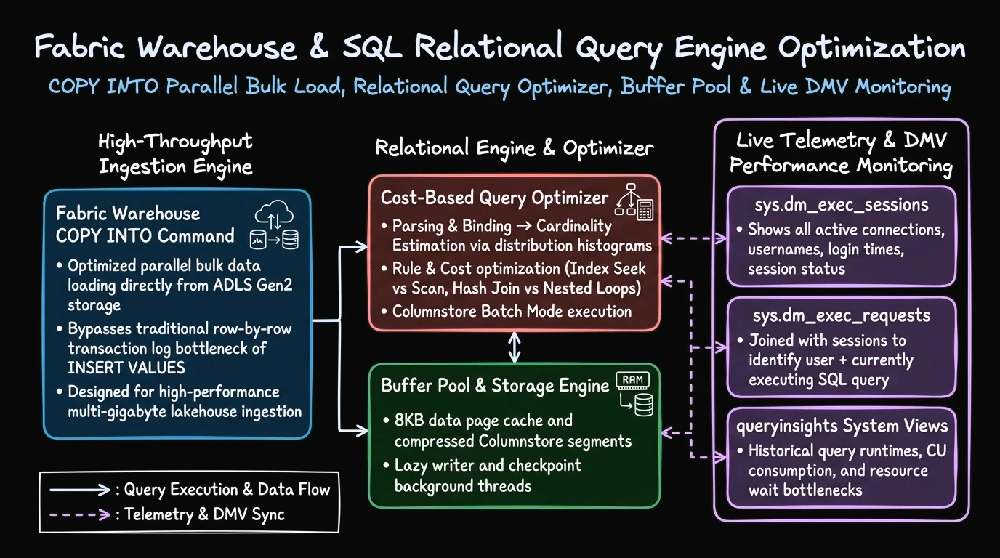
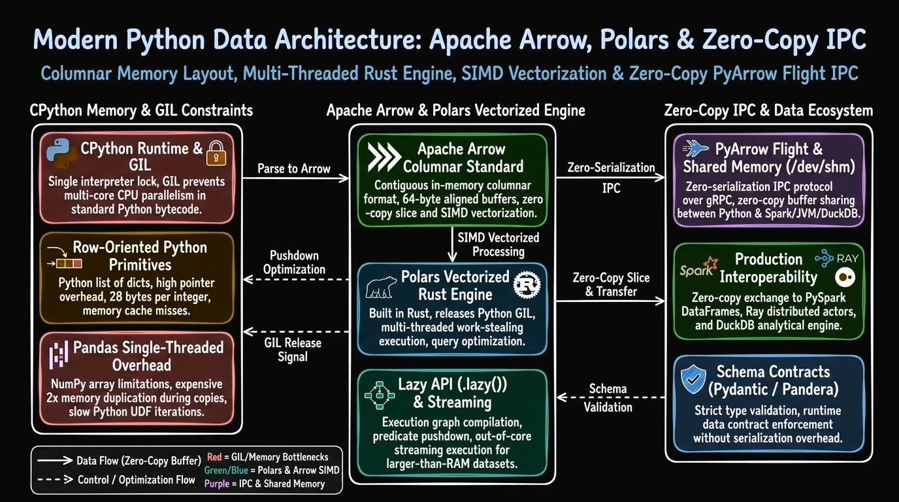
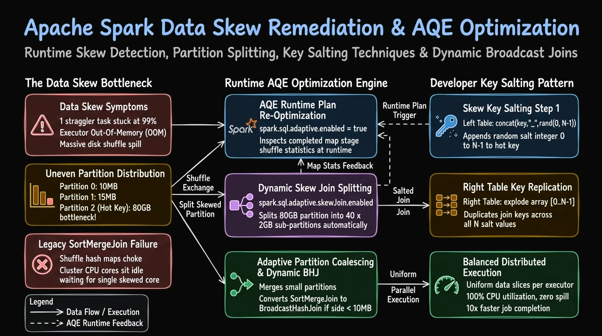
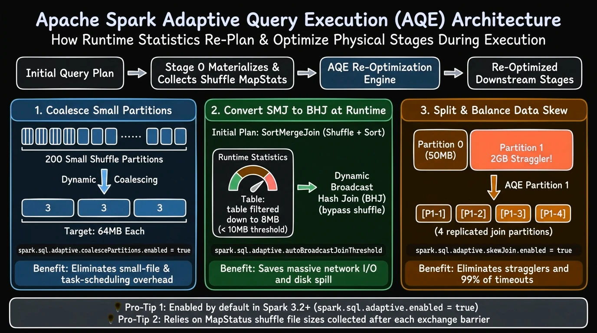
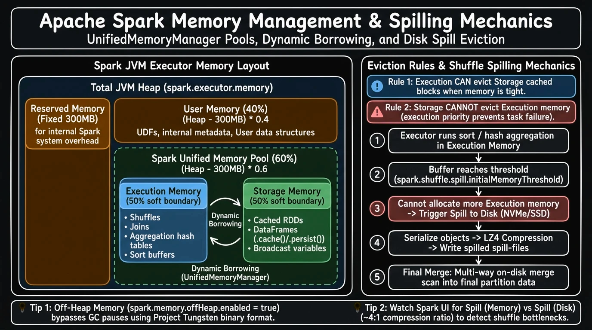
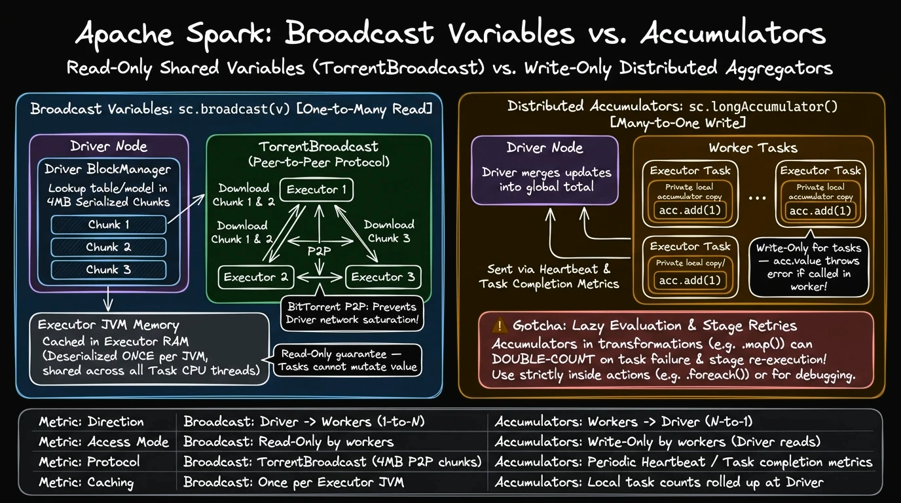

# Compute & Optimization — Architecture Whiteboard Blueprints

> **Domain**: `Compute & Optimization` | **Blueprints**: 11 | [← Back to Whiteboards Index](index.md)

---

## Compute & Optimization
*11 Architecture Blueprints in this domain*

### 📐 Compute & Optimization — Visual Blueprints Grid (2x2)

<table>
  <tr>
    <td width="50%" valign="top">
      
       <strong><a href="#spark-catalyst-photon-engine">Databricks Compute: Catalyst Optimizer, AQE & Photon</a></strong> 
      <em>4-Phase Catalyst Compilation, Whole-Stage CodeGen, and Native C++ Vectorized Photon Execution</em> 
      <small>`Apache Spark` · `Catalyst Optimizer` · `Photon` · `AQE`</small> 
      <a href="#spark-catalyst-photon-engine">🔍 Inspect Deep Dive & Architecture →</a>
    </td>
    <td width="50%" valign="top">
      
       <strong><a href="#spark-shuffle-memory-execution">Apache Spark Memory Architecture & Shuffle Mechanics</a></strong> 
      <em>JVM Heap Layout, Execution vs Storage Dynamic Borrowing, SortShuffleWriter, and Spilling</em> 
      <small>`Apache Spark` · `Memory Management` · `Shuffle` · `JVM Heap`</small> 
      <a href="#spark-shuffle-memory-execution">🔍 Inspect Deep Dive & Architecture →</a>
    </td>
  </tr>
  <tr>
    <td width="50%" valign="top">
      
       <strong><a href="#sql-server-query-engine-optimization">SQL Server & Relational Query Engine Architecture</a></strong> 
      <em>Relational Engine (CBO) vs Storage Engine (Buffer Pool), B-Tree Indexing, and Query Store</em> 
      <small>`SQL Server` · `Relational Engine` · `Storage Engine` · `Buffer Pool`</small> 
      <a href="#sql-server-query-engine-optimization">🔍 Inspect Deep Dive & Architecture →</a>
    </td>
    <td width="50%" valign="top">
      
       <strong><a href="#python-arrow-polars-architecture">Modern Python Data Architecture: Apache Arrow, Polars & Zero-Copy IPC</a></strong> 
      <em>Columnar Memory Layout, SIMD Vectorization, Polars Rust Engine, and Zero-Copy PyCapsule IPC</em> 
      <small>`Python` · `Apache Arrow` · `Polars` · `Rust`</small> 
      <a href="#python-arrow-polars-architecture">🔍 Inspect Deep Dive & Architecture →</a>
    </td>
  </tr>
  <tr>
    <td width="50%" valign="top">
      
       <strong><a href="#spark-data-skew-aqe-optimization">Apache Spark Data Skew Remediation & AQE Optimization</a></strong> 
      <em>Straggler Task Diagnosis, Salting Techniques, AQE Skew Join Splitting, and Broadcast Switching</em> 
      <small>`Apache Spark` · `Data Skew` · `AQE` · `Stragglers`</small> 
      <a href="#spark-data-skew-aqe-optimization">🔍 Inspect Deep Dive & Architecture →</a>
    </td>
    <td width="50%" valign="top">
      
       <strong><a href="#spark-join-decision-tree">Apache Spark Join Strategy Selection Decision Tree</a></strong> 
      <em>BHJ, SHJ, SMJ, BNLJ, and CPJ: Decision Flowchart, Memory Budgets, and Sort-Merge Optimization</em> 
      <small>`Apache Spark` · `Join Strategies` · `Broadcast Hash Join` · `Sort Merge Join`</small> 
      <a href="#spark-join-decision-tree">🔍 Inspect Deep Dive & Architecture →</a>
    </td>
  </tr>
  <tr>
    <td width="50%" valign="top">
      
       <strong><a href="#spark-aqe-dynamic-optimization">Apache Spark Adaptive Query Execution (AQE) Architecture</a></strong> 
      <em>Runtime Feedback Loop, Dynamic Shuffle Partition Coalescing, Join Switching, and Skew Splitting</em> 
      <small>`Apache Spark` · `AQE` · `Adaptive Query Execution` · `Dynamic Optimization`</small> 
      <a href="#spark-aqe-dynamic-optimization">🔍 Inspect Deep Dive & Architecture →</a>
    </td>
    <td width="50%" valign="top">
      
       <strong><a href="#spark-memory-management-spill">Apache Spark Memory Management & Shuffle Spilling Mechanics</a></strong> 
      <em>Execution vs Storage Dynamic Eviction, Memory Spill vs Disk Spill, and Off-Heap Tungsten Tuning</em> 
      <small>`Apache Spark` · `Memory Management` · `Shuffle Spill` · `Disk Spill`</small> 
      <a href="#spark-memory-management-spill">🔍 Inspect Deep Dive & Architecture →</a>
    </td>
  </tr>
  <tr>
    <td width="50%" valign="top">
      
       <strong><a href="#spark-streaming-state-store">Spark Structured Streaming State Store & Watermarking Mechanics</a></strong> 
      <em>HDFSBackedStateStore vs RocksDB, Stateful Streaming Aggregations, and Watermark State Eviction</em> 
      <small>`Spark Streaming` · `Structured Streaming` · `State Store` · `RocksDB`</small> 
      <a href="#spark-streaming-state-store">🔍 Inspect Deep Dive & Architecture →</a>
    </td>
    <td width="50%" valign="top">
      
       <strong><a href="#photon-engine-vs-jvm">Databricks Photon Native C++ Engine vs. Classic Spark JVM</a></strong> 
      <em>Instruction-Level Vectorization, CPU Cache Locality, SIMD Registers, and Zero-GC Memory Management</em> 
      <small>`Databricks Photon` · `Classic Spark JVM` · `C++ Engine` · `Vectorized Execution`</small> 
      <a href="#photon-engine-vs-jvm">🔍 Inspect Deep Dive & Architecture →</a>
    </td>
  </tr>
  <tr>
    <td width="50%" valign="top">
      
       <strong><a href="#spark-broadcast-accumulators">Apache Spark Broadcast Variables vs. Accumulators Architecture</a></strong> 
      <em>Distributed Shared Variables: Peer-to-Peer BitTorrent Broadcast vs Driver-Aggregated Counters</em> 
      <small>`Apache Spark` · `Broadcast Variables` · `Accumulators` · `Distributed Shared Memory`</small> 
      <a href="#spark-broadcast-accumulators">🔍 Inspect Deep Dive & Architecture →</a>
    </td>
    <td width="50%" valign="top"></td>
  </tr>
</table>

---

### Databricks Compute: Catalyst Optimizer, AQE & Photon
**4-Phase Catalyst Compilation, Whole-Stage CodeGen, and Native C++ Vectorized Photon Execution**

**Tags:** `Apache Spark` · `Catalyst Optimizer` · `Photon` · `AQE` · `Whole-Stage CodeGen` · `Physical Plan` · `Logical Plan` · `Janino` · `SIMD` · `C++ Engine` · [📖 Official Docs](https://docs.databricks.com/en/runtime/photon.html)

**Overview:** Comprehensive architectural blueprint of modern distributed query execution in Apache Spark and Databricks. Dissects the 4 phases of the Catalyst Optimizer (Analysis, Logical Optimization, Physical Planning, Code Generation) alongside Databricks Photon, the native C++ vectorized execution engine that bypasses the JVM entirely with SIMD instructions, hardware cache locality, and runtime adaptive tuning.

**Key Architecture Points:**
- 4 Phases of Catalyst: 1) Analysis (resolves attributes via Catalog) -> 2) Logical Optimization (predicate pushdown, projection pruning, constant folding) -> 3) Physical Planning (generates physical execution alternatives via CBO) -> 4) Code Generation (compiles query into bytecode).
- Rule-Based Optimization (RBO): Employs pattern matching over Abstract Syntax Trees (ASTs) to push filters down to storage layers and prune unreferenced columns before scanning.
- Cost-Based Optimization (CBO): Utilizes table statistics (row counts, column histograms) to select optimal physical operators (e.g. Broadcast Hash Join vs Sort Merge Join).
- Whole-Stage Code Generation: Collapses entire query pipelines across multiple operators into a single Java function compiled via Janino, eliminating virtual method invocations.
- Photon Native C++ Engine: Vectorized execution engine written from scratch in C++; processes data in column-oriented batches of 1024 values using hardware SIMD (AVX-512) register instructions.
- Zero JVM Garbage Collection Overhead: Photon manages execution memory explicitly using off-heap native memory allocators, eliminating JVM stop-the-world GC pauses.
- Seamless Operator Fallback: Query stages containing non-supported expressions (e.g. legacy Python UDFs) automatically and transparently fall back to standard JVM Spark execution.

> **Architect Note:** Understanding the boundary between Catalyst and Photon is critical for compute cost optimization. Catalyst performs logical query optimization, rule-based pushdowns, and cost-based join selection on the JVM. However, physical execution on CPU cores is handed over to Photon: a native C++ engine that replaces Janino Whole-Stage Code Generation with vectorized processing. Architects should deploy Photon for SQL warehouses and heavy ELT joins where CPU vectorization offsets the higher DBU rate, while sticking to standard runtimes for lightweight streaming.

<strong>Multi-Persona Architectural Breakdown (Click to expand)</strong>

- **Enterprise Architect:** Evaluates compute cost/performance trade-offs of enabling Photon across enterprise workloads; sizes cluster architectures to balance CPU clock speed with memory bandwidth.
- **Senior Data Engineer:** Analyzes `explain(extended)` execution plans; identifies Whole-Stage CodeGen 64KB bytecode compilation failures; eliminates non-sargable query patterns that block Catalyst pushdowns.
- **Data Engineer:** Authors declarative DataFrame and SQL queries; monitors query execution stages in Spark UI; utilizes join hints (`/*+ BROADCAST */`) when CBO statistics are absent.
- **Data Steward:** Verifies that Catalyst query plan optimization preserves row-level security filters and data masking UDFs without unintended bypasses.
- **Business Analyst:** Experiences instant, sub-second query performance on complex multi-table analytical joins in Databricks SQL.

**Under-the-Hood Technical Mechanisms:**
- Catalyst Tree transformation rules and TreeNode pattern matching
- Janino runtime Java bytecode compiler emitting optimized JVM loop code
- Photon vectorized columnar batch processing pipeline (1024 elements per vector)
- AVX-512 SIMD register execution accelerating aggregation and filter instructions
- Adaptive execution stage materialization and dynamic runtime plan rewriting

**Production Failure Modes & Incident Triage:**
- Catalyst Planning Timeout on Massive Queries: Complex queries with hundreds of UNIONs or nested joins exceed Catalyst optimization time limits; break queries into intermediate staging tables or materialize temporary views.
- Whole-Stage CodeGen Fallback to Interpreted Mode: Generated Java code exceeds JVM 64KB method bytecode limit (`64KB bytecode limit exceeded`); simplify complex CASE/WHEN statements or enable Photon.
- Unexpected Photon Fallback to JVM: Query uses unsupported third-party Java UDF or custom RDD operations; replace custom UDFs with native Spark SQL built-in functions to retain Photon acceleration.

**Governance & Regulatory Compliance:**
- Security filter rules automatically injected into Catalyst logical plans before optimization
- Consistent query semantics guaranteed across both JVM and Photon execution engines
- Comprehensive audit records of query execution plans captured in system tables
- Resource governance preventing single rogue queries from monopolizing cluster CPU resources

[↑ Return to Compute & Optimization 2x2 Grid](#compute-optimization) · [Top of Catalog](index.md)

---

### Apache Spark Memory Architecture & Shuffle Mechanics
**JVM Heap Layout, Execution vs Storage Dynamic Borrowing, SortShuffleWriter, and Spilling**

**Tags:** `Apache Spark` · `Memory Management` · `Shuffle` · `JVM Heap` · `Off-Heap` · `SortShuffleWriter` · `Spill` · `Tungsten` · `Netty` · `Executor Tuning` · [📖 Official Docs](https://spark.apache.org/docs/latest/tuning.html#memory-management-overview)

**Overview:** Exhaustive technical dissection of Apache Spark executor memory architecture and distributed shuffle mechanics. Details the JVM heap allocation (Reserved Memory 300MB, User Memory 25%, Spark Memory 75% dynamically shared between Execution and Storage), off-heap Tungsten memory, the complete shuffle lifecycle (Map Output Tracker, SortShuffleWriter, Netty network transport, ShuffleBlockFetcherIterator), and memory spilling triage.

**Key Architecture Points:**
- Executor Memory Heap Layout: Total Memory = Reserved Memory (fixed 300MB) + User Memory ((Heap - 300MB) * 0.25) + Spark Memory ((Heap - 300MB) * 0.75).
- Dynamic Execution & Storage Borrowing: Execution memory (joins, shuffles, aggregations) and Storage memory (cached DataFrames) dynamically borrow space from one another; Execution can evict Storage, but Storage cannot evict active Execution.
- Off-Heap Memory Architecture: Allocates memory outside the JVM heap (`spark.memory.offHeap.enabled=true`), bypassing JVM Garbage Collection entirely and eliminating GC pause overhead.
- SortShuffleWriter Mechanics: Map tasks buffer records in memory, sort them by partition and key, and spill compressed sorted files to local disk when memory buffers saturate.
- Index & Data File Generation: Spilled shuffle files are merged into a single consolidated data file accompanied by an `.index` file recording byte offsets for every partition.
- Asynchronous Netty Transport: Reduce tasks query the MapOutputTracker for block locations and fetch shuffle chunks asynchronously across the network using non-blocking Netty I/O.
- Shuffle Spill Triage: Memory Spill (deserialized in-memory footprint) vs Disk Spill (compressed serialized footprint on disk); excessive disk spill indicates severe memory starvation.

> **Architect Note:** Shuffle is the most expensive operation in distributed computing: it transforms in-memory partitions into serialized disk blocks, routes them across physical network switches, and merges them on downstream reducers. Shuffle bottlenecks represent over 70% of all Spark performance failures. Architects must size executor cores to 4-5 cores per node to balance HDFS/cloud I/O threads against GC pauses, allocate sufficient off-heap memory, and eliminate unnecessary wide transformations through smart data modeling.

<strong>Multi-Persona Architectural Breakdown (Click to expand)</strong>

- **Enterprise Architect:** Sizes cluster hardware configurations; balances core-to-memory ratios (typically 1 core per 4-8GB RAM); designs network topology to prevent top-of-rack switch saturation during heavy shuffles.
- **Senior Data Engineer:** Tunes shuffle memory parameters (`spark.sql.shuffle.partitions`, `spark.shuffle.file.buffer`, `spark.reducer.maxSizeInFlight`); eliminates shuffle spill in Spark UI; diagnoses ExecutorLost / FetchFailed exceptions.
- **Data Engineer:** Structures DataFrame queries to minimize wide transformations (`groupByKey` -> `reduceByKey`); unpersists cached DataFrames when no longer needed; uses broadcast joins for small lookup tables.
- **Data Steward:** Monitors multi-tenant cluster memory allocations to prevent single domain workloads from exhausting shared executor pools.
- **Business Analyst:** Understands that queries requiring massive cross-table grouping and sorting take longer due to distributed shuffle operations.

**Under-the-Hood Technical Mechanisms:**
- UnifiedMemoryManager dynamic memory pool boundary arbitration
- Tungsten binary in-memory row representation with 64-bit word pointers
- SortShuffleWriter memory buffer threshold evaluation and LZ4 block compression
- Netty epoll non-blocking event-driven socket network data transfer
- ShuffleBlockFetcherIterator asynchronous chunk pre-fetching and buffering

**Production Failure Modes & Incident Triage:**
- FetchFailedException / ExecutorLostFailure: NodeManager killed executor due to exceeding physical memory limits during shuffle fetch; increase `spark.executor.memoryOverhead` or reduce `spark.sql.shuffle.partitions` size.
- Massive Shuffle Spill (Disk Spill > 50GB): High per-partition data volume saturates execution memory; increase `spark.sql.shuffle.partitions` (e.g. from 200 to 2000) or scale cluster worker nodes.
- Garbage Collection Pause Timeout: Stop-the-world GC pause exceeds heartbeat timeout (default 120s), causing driver to declare executor dead; configure G1GC (`-XX:+UseG1GC`) and allocate off-heap memory.

**Governance & Regulatory Compliance:**
- Cluster policy guardrails enforcing maximum core and memory allocations per developer
- Encryption of all shuffle data in transit using TLS and at rest using local disk encryption
- Audit logging capturing resource usage anomalies and cluster memory saturation
- Compliance with data residency policies by ensuring shuffle disk spill remains within approved local disks

[↑ Return to Compute & Optimization 2x2 Grid](#compute-optimization) · [Top of Catalog](index.md)

---

### SQL Server & Relational Query Engine Architecture
**Relational Engine (CBO) vs Storage Engine (Buffer Pool), B-Tree Indexing, and Query Store**

**Tags:** `SQL Server` · `Relational Engine` · `Storage Engine` · `Buffer Pool` · `Query Store` · `B-Tree` · `Execution Plans` · `Parameter Sniffing` · `TempDB` · `Index Optimization` · [📖 Official Docs](https://learn.microsoft.com/en-us/sql/relational-databases/performance/execution-plans)

**Overview:** Architectural breakdown of classic relational database engine mechanics, focusing on Microsoft SQL Server and Azure SQL DB. Explores the dual-engine separation between the Relational Engine (Parser, Algebrizer, Cost-Based Optimizer) and the Storage Engine (Buffer Pool, Access Methods, Transaction Manager, WAL log). Covers B-tree clustered/non-clustered index mechanics, Query Store plan regression diagnostics, parameter sniffing triage, and TempDB contention.

**Key Architecture Points:**
- Relational vs Storage Engine: Relational Engine parses SQL, normalizes queries, and generates physical execution plans; Storage Engine manages physical data pages, B-tree indexes, locking, and the Buffer Pool.
- Buffer Pool & Page Management: In-memory cache holding 8KB data and index pages; minimizes disk I/O using LRU/clock-sweep page replacement algorithms and read-ahead background threads.
- B-Tree Index Architecture: Balanced tree structures (Root, Intermediate, Leaf levels); Clustered Indexes store actual row data at leaf pages; Non-Clustered Indexes store indexed keys with bookmark pointers.
- Cost-Based Optimizer (CBO): Enumerates candidate execution plans, estimates CPU and I/O costs using column statistics and histograms, and selects the lowest-cost plan within optimization timeouts.
- Query Store Flight Recorder: Automatically captures query texts, execution plans, runtime performance statistics, and plan changes over time, persisted directly inside the database.
- Parameter Sniffing Mechanics: Engine compiles execution plans optimized for the specific parameter values passed on the first run; subsequent runs with divergent parameter values can trigger catastrophic table scans.
- TempDB Architecture & Contention: Shared global resource for temporary tables, table variables, sorting spills, and row versioning; susceptible to PAGELATCH allocation bottlenecks on PFS/GAM pages.

> **Architect Note:** Relational database engines excel at low-latency transaction processing (OLTP) and operational reporting. When integrating RDBMS into modern lakehouses, architects must optimize connection pooling, read replicas, and indexing to prevent analytical queries from exhausting the database Buffer Pool. Implementing Query Store is mandatory: it acts as a flight data recorder, allowing DBAs to freeze and force execution plans when parameter sniffing causes unexpected plan regressions.

<strong>Multi-Persona Architectural Breakdown (Click to expand)</strong>

- **Enterprise Architect:** Designs hybrid transactional/analytical processing (HTAP) topologies; determines read replica offloading strategies; designs index maintenance and database partitioning standards.
- **Senior Data Engineer:** Analyzes execution plans in SQL Sentry / SSMS; resolves parameter sniffing using `OPTIMIZE FOR` or `RECOMPILE` hints; troubleshoots TempDB latch contention and index fragmentation.
- **Data Engineer:** Writes sargable T-SQL queries; designs covering indexes with `INCLUDE` clauses; ensures ETL pipelines utilize bulk copy (`bcp` / `SqlBulkCopy`) for high-throughput loading.
- **Data Steward:** Implements Transparent Data Encryption (TDE), Dynamic Data Masking, and SQL Server Audit policies; manages database role permissions (Least Privilege).
- **Business Analyst:** Executes operational reports against read-only replicas without locking active transactional tables or experiencing query timeouts.

**Under-the-Hood Technical Mechanisms:**
- 8KB data page allocation and Buffer Pool clock-sweep replacement algorithm
- B-tree index traversal and page split handling during row insertions
- Cardinality Estimation (CE) mathematical models evaluating column histograms
- Query Store runtime statistics aggregation and plan forcing via `sp_query_store_force_plan`
- Write-Ahead Logging (WAL) and checkpoint log flush synchronization

**Production Failure Modes & Incident Triage:**
- Parameter Sniffing Plan Regression: Query runs in 50ms for tenant A, but takes 45 seconds for tenant B; identify plan variation in Query Store and force a stable plan or add `OPTION (RECOMPILE)`.
- TempDB Allocation Contention (PAGELATCH_UP): Heavy concurrent temporary table creation causes latch bottlenecks on page free space (PFS) pages; configure multiple TempDB data files (1 per vCPU up to 8).
- Index Fragmentation causing Massive I/O: High volume of mid-page updates causes page splits and out-of-order pages; run `ALTER INDEX ... REBUILD` or `REORGANIZE` on fragmented indexes.

**Governance & Regulatory Compliance:**
- Transparent Data Encryption (TDE) protecting database files and backups at rest
- Dynamic Data Masking obfuscating sensitive fields for non-privileged SQL users
- SQL Server Audit logging every authentication, DDL modification, and privileged query
- Role-based security adhering to strict database principle of least privilege

[↑ Return to Compute & Optimization 2x2 Grid](#compute-optimization) · [Top of Catalog](index.md)

---

### Modern Python Data Architecture: Apache Arrow, Polars & Zero-Copy IPC
**Columnar Memory Layout, SIMD Vectorization, Polars Rust Engine, and Zero-Copy PyCapsule IPC**

**Tags:** `Python` · `Apache Arrow` · `Polars` · `Rust` · `Zero-Copy` · `SIMD` · `DuckDB` · `Columnar Memory` · `PyCapsule` · `High Performance` · [📖 Official Docs](https://pola.rs/)

**Overview:** State-of-the-art modern Python data engineering architecture moving beyond legacy single-threaded Pandas. Details the Apache Arrow in-memory columnar format, validity bitmaps, SIMD hardware acceleration, zero-copy inter-process communication (PyCapsule / Arrow C Data Interface), and the Polars query engine written in Rust featuring multithreaded work-stealing execution, lazy expression optimization, and streaming larger-than-RAM processing.

**Key Architecture Points:**
- Universal Arrow Memory Format: Standardized columnar in-memory representation with continuous memory buffers, separate null validity bitmaps, and contiguous array offsets.
- Zero-Copy Inter-Process Communication (IPC): Systems (Polars, DuckDB, PyArrow, PyTorch) share memory directly via the Arrow C Data Interface / PyCapsule protocol without serialization overhead.
- Polars Rust Execution Engine: Built from scratch in Rust; bypasses the Python GIL entirely; utilizes Rayon work-stealing thread pools to parallelize execution across all available CPU cores.
- Lazy Evaluation & Query Optimization: Polars `LazyFrame` compiles expression graphs, executing predicate pushdown, projection pushdown, slice pushdown, and common subplan elimination before execution.
- Streaming Engine for Larger-Than-RAM Data: Polars streaming mode processes data in memory-capped streaming batches, allowing single 16GB laptops to process 100GB+ Parquet datasets without OOM crashes.
- SIMD Vector Acceleration: Columnar memory alignment allows modern CPUs to execute single-instruction multiple-data (AVX-512) operations, filtering millions of values per clock cycle.
- DuckDB In-Process Analytical SQL: Embedded analytical database that executes vectorized SQL directly against Arrow buffers and Parquet files with zero external server dependencies.

> **Architect Note:** Legacy Python data pipelines built on Pandas are plagued by single-core CPU bottlenecks, excessive memory duplication (often 5-10x data size), and the Python Global Interpreter Lock (GIL). Modern Python data architecture is standardized on Apache Arrow as the universal in-memory data plane. Polars leverages Arrow memory and Rust multithreading to achieve 10-50x speedups over Pandas on a single multi-core VM, allowing data engineers to replace expensive Spark clusters with lightweight, single-node Python workers for datasets up to hundreds of gigabytes.

<strong>Multi-Persona Architectural Breakdown (Click to expand)</strong>

- **Enterprise Architect:** Modernizes Python data architecture; evaluates serverless single-node Python workers (Polars/DuckDB) vs distributed Spark clusters, achieving up to 80% compute cost savings.
- **Senior Data Engineer:** Designs high-performance Python libraries utilizing the Arrow C Data Interface; benchmarks Polars lazy plans; optimizes Rust parallel memory allocations and streaming batch thresholds.
- **Data Engineer:** Replaces legacy Pandas `.apply()` and loops with vectorized Polars expressions; builds efficient local development pipelines reading directly from cloud Parquet storage.
- **Data Steward:** Ensures local Python execution environments adhere to enterprise data protection policies and enforce secure in-memory processing without leaving unencrypted temporary files on disk.
- **Business Analyst:** Runs instant analytical exploratory queries on local machines over multi-million row datasets in seconds without waiting for cloud compute cluster provisioning.

**Under-the-Hood Technical Mechanisms:**
- Arrow Buffer physical memory alignment and validity bitmask evaluation
- Arrow C Data Interface (PyCapsule) pointer exchange enabling zero-copy memory transfers
- Polars LogicalPlan expression optimization and physical query compilation in Rust
- Rayon parallel work-stealing iterator execution across CPU hardware threads
- SIMD AVX vector register instruction pipelining for numeric calculations

**Production Failure Modes & Incident Triage:**
- Polars Memory Exhaustion on Unpartitioned Input: Reading massive CSV or uncompressed file in eager mode (`read_csv`) causes memory crash; switch to lazy scanning (`scan_parquet` / `scan_csv`) and enable streaming mode (`collect(streaming=True)`).
- Arrow Type Schema Incompatibility during IPC: Incompatible timestamp precision (microseconds vs nanoseconds) during zero-copy transfer; explicitly cast column schemas before passing memory pointers.
- Python GIL Contention in Mixed Code: Invoking custom Python functions inside Polars expressions forces the engine to acquire the Python GIL, destroying parallelism; rewrite logic using native Polars expressions.

**Governance & Regulatory Compliance:**
- Data processed entirely in-memory with zero unencrypted disk cache leakage
- Standardized schema validation enforced at the Arrow data frame level
- Integration with enterprise corporate artifact repositories for vetted Python packages
- Auditability of Python pipeline execution logs and data processing metrics

[↑ Return to Compute & Optimization 2x2 Grid](#compute-optimization) · [Top of Catalog](index.md)

---

### Apache Spark Data Skew Remediation & AQE Optimization
**Straggler Task Diagnosis, Salting Techniques, AQE Skew Join Splitting, and Broadcast Switching**

**Tags:** `Apache Spark` · `Data Skew` · `AQE` · `Stragglers` · `Salting` · `Adaptive Query Execution` · `Skew Join` · `Broadcast Join` · `Partition Tuning` · [📖 Official Docs](https://spark.apache.org/docs/latest/sql-performance-tuning.html#adaptive-query-execution)

**Overview:** Comprehensive engineering guide to diagnosing and mitigating data skew in Apache Spark distributed jobs. Details the symptoms of data skew (99% completed stage stuck on 1 straggler task, executor OOMs), manual mitigation patterns (Salting with random prefixes and replication), and native Adaptive Query Execution (AQE) automatic skew join detection and partition splitting.

**Key Architecture Points:**
- The Data Skew Phenomenon: Non-uniform data distribution across partitions causes a small number of 'straggler' tasks to process orders of magnitude more data than peer tasks.
- Diagnosis via Spark UI: Identified on the Stages tab when the 75th percentile / Max task duration and shuffle read size diverge wildly (e.g. median 5MB vs max 10GB).
- AQE Automatic Skew Join Splitting: Spark dynamically inspects runtime shuffle partition sizes; if a partition exceeds `skewedPartitionThresholdInBytes` (default 64MB) and `skewedPartitionFactor` (default 5x median), it is automatically split into smaller sub-partitions.
- The Salting Technique: Manual remediation strategy: append a random integer prefix (`0-N`) to the skewed key on the large table, and replicate the matching lookup table keys N times, spreading the skewed key evenly across N partitions.
- Broadcast Join Switching: If one side of the join is small enough, switching to a Broadcast Hash Join (`/*+ BROADCAST */`) bypasses the shuffle entirely, completely eliminating shuffle-based data skew.
- Custom Repartitioning with Expressions: Using `repartition(n, col1, hash(col2))` or composite keys to prevent hash collisions that map multiple dense keys to the same partition.
- Filtering Unassigned/Null Keys: Separating `NULL` or unassigned keys into a separate processing branch, processing them without joins, and `UNION`-ing results back together.

> **Architect Note:** Data skew is the primary killer of distributed query performance. In a 200-partition stage, if a single partition key (e.g. `customer_id = NULL` or a major retailer ID) contains 80% of total rows, 199 tasks finish in seconds while a single executor core grinds for hours on the skewed partition, rendering the entire cluster's parallel compute useless. Architects must enforce automated AQE skew join rules and establish engineering standards for salting skewed join keys.

<strong>Multi-Persona Architectural Breakdown (Click to expand)</strong>

- **Enterprise Architect:** Establishes enterprise join modeling guidelines; enables global AQE configurations across all cluster policies; audits pipeline SLA breaches caused by data skew.
- **Senior Data Engineer:** Analyzes Spark UI task distribution metrics (Task Timeline, Event Timeline); configures AQE skew thresholds; writes reusable PySpark salting decorator functions.
- **Data Engineer:** Identifies skewed keys using `.groupBy('key').count().orderBy(desc('count'))`; applies join hints; tests salting implementations in development pipelines.
- **Data Steward:** Monitors compute costs and cluster resource waste caused by straggler tasks holding clusters active past schedule.
- **Business Analyst:** Receives scheduled reports on time without random delays caused by single-task cluster bottlenecks.

**Under-the-Hood Technical Mechanisms:**
- Spark MapStageSubmitted runtime partition statistics inspection
- Dynamic partition splitting algorithm generating sub-partition shuffle chunk descriptors
- Salting hash key multiplication and Cartesian expansion on lookup dimensions
- Adaptive execution physical plan rewriting replacing SortMergeJoin with skewed join stages
- Broadcast exchange memory verification and threshold evaluation

**Production Failure Modes & Incident Triage:**
- Straggler Task Stuck at 99% for 2 Hours: Single task processing millions of skewed records; verify AQE is enabled (`spark.sql.adaptive.enabled=true`, `spark.sql.adaptive.skewJoin.enabled=true`) and lower `skewedPartitionFactor` to 3.
- Executor OOM during Skewed Aggregation: Memory spill exhaustion on executor processing the skewed key; apply salting to the aggregation key (`groupBy(salt, key)`) followed by a secondary aggregation.
- Driver OOM when Broadcasting Lookup Table: Attempting to broadcast a table that exceeds driver memory; increase driver memory or rely on AQE skew join splitting instead of broadcast.

**Governance & Regulatory Compliance:**
- Standardized coding standards preventing anti-pattern Cartesian joins and unhandled skew
- Monitoring compute efficiency to ensure cloud budget commitments are maintained
- Audit trails tracking job runtimes and automated remediation events
- Predictable SLA compliance for regulatory and financial reporting pipelines

[↑ Return to Compute & Optimization 2x2 Grid](#compute-optimization) · [Top of Catalog](index.md)

---

### Apache Spark Join Strategy Selection Decision Tree
**BHJ, SHJ, SMJ, BNLJ, and CPJ: Decision Flowchart, Memory Budgets, and Sort-Merge Optimization**

**Tags:** `Apache Spark` · `Join Strategies` · `Broadcast Hash Join` · `Sort Merge Join` · `Shuffle Hash Join` · `Cartesian Product` · `Join Decision Tree` · `Tuning` · [📖 Official Docs](https://spark.apache.org/docs/latest/sql-performance-tuning.html#join-strategy-hints)

**Overview:** Comprehensive decision tree and engineering guide for distributed join strategy selection in Apache Spark. Compares the 5 distributed join algorithms: 1) Broadcast Hash Join (BHJ), 2) Shuffle Hash Join (SHJ), 3) Sort Merge Join (SMJ), 4) Broadcast Nested Loop Join (BNLJ), and 5) Cartesian Product Join (CPJ). Details the exact decision criteria based on join conditions (equi vs non-equi), table sizes, sortability, memory budgets, and join hints.

**Key Architecture Points:**
- The 5 Join Strategies: Broadcast Hash Join (fastest, no shuffle), Shuffle Hash Join (fast for medium tables, builds hash table), Sort Merge Join (standard workhorse for large tables, highly scalable), Broadcast Nested Loop Join (handles non-equi joins), and Cartesian Product (catastrophic fallback).
- Decision Tree Criterion 1 - Equi-Join vs Non-Equi-Join: If join condition contains equality (`=`), Spark evaluates BHJ, SHJ, and SMJ; if non-equi (`<`, `>`, `!=`), Spark is forced into BNLJ or Cartesian Product.
- Decision Tree Criterion 2 - Table Size Threshold: If one side is smaller than `spark.sql.autoBroadcastJoinThreshold` (or has `/*+ BROADCAST */` hint), Spark selects Broadcast Hash Join.
- Decision Tree Criterion 3 - Sortability & Memory: For large equi-joins, if join keys are sortable, Spark defaults to Sort Merge Join (SMJ); if sorting is disabled and building a hash table fits in memory, Shuffle Hash Join (SHJ) is selected.
- Sort Merge Join Mechanics: 1) Shuffle phase hashes keys across partitions -> 2) Sort phase sorts keys within each partition -> 3) Merge phase scans pointers down both sorted streams, matching keys with minimal memory overhead.
- Shuffle Hash Join Performance Advantage: Avoids expensive disk-sorting when building in-memory hash tables for skewed or unsortable keys, outperforming SMJ when individual partitions fit in memory.
- Cartesian Product Hazard: Cross-joins without join conditions multiply rows ($M \times N$); requires explicit cross-join authorization (`spark.sql.crossJoin.enabled=true`).

> **Architect Note:** Choosing the wrong join strategy can turn a 2-minute pipeline into a 4-hour disaster or an immediate Out-Of-Memory (OOM) crash. Broadcast Hash Join is the fastest join strategy because it eliminates network shuffle entirely by broadcasting the small table to every executor. However, if the broadcast table exceeds driver or executor memory, it crashes the cluster. Architects must establish strict join hint policies and tune `spark.sql.autoBroadcastJoinThreshold` (default 10MB) to optimize cluster stability.

<strong>Multi-Persona Architectural Breakdown (Click to expand)</strong>

- **Enterprise Architect:** Establishes distributed data modeling patterns (star schemas vs pre-joined tables); sets global broadcast thresholds and cross-join safety guardrails across the platform.
- **Senior Data Engineer:** Analyzes query physical execution plans (`explain()`); evaluates when to force Shuffle Hash Join over Sort Merge Join; resolves BNLJ bottlenecks by rewriting non-equi joins into range lookups.
- **Data Engineer:** Applies join hints (`/*+ BROADCAST(dim) */`, `/*+ MERGE(fact) */`) responsibly; ensures join keys have identical data types to avoid implicit casting that disables broadcast optimization.
- **Data Steward:** Monitors query performance impacts of row-level security join predicates; ensures sensitive lookup tables are broadcast securely.
- **Business Analyst:** Understands that joining massive multi-billion row tables without equality filters causes extreme query slowdowns.

**Under-the-Hood Technical Mechanisms:**
- Broadcast exchange BitTorrent P2P block distribution across executors
- In-memory hash table construction and probe phase in BHJ and SHJ
- Sort-merge dual-pointer sliding window iteration algorithm
- Cartesian product nested loop execution generating NxM record combinations
- Catalyst Cost-Based Optimizer physical join operator replacement rules

**Production Failure Modes & Incident Triage:**
- Driver OOM on Broadcast Join: Broadcasted table exceeds driver heap memory; verify table size before broadcasting, increase `spark.driver.memory`, or remove broadcast hint to allow Sort Merge Join.
- Cartesian Product Join Triggered Inadvertently: Typo in join condition or non-equi filter causes Spark to default to Cartesian Product; inspect `explain()` for `CartesianProductExec` and fix join predicates.
- Executor Spill during Sort Merge Join: Large unsorted partitions spill to disk during the sort phase; increase `spark.sql.shuffle.partitions` or evaluate Shuffle Hash Join.

**Governance & Regulatory Compliance:**
- Strict platform controls blocking accidental Cartesian product execution in production
- Audit trails tracking query execution plans and join operator selection
- Resource governance preventing memory-intensive join spills from starving peer workloads
- Data protection verification ensuring broadcasted lookup datasets do not expose restricted data

[↑ Return to Compute & Optimization 2x2 Grid](#compute-optimization) · [Top of Catalog](index.md)

---

### Apache Spark Adaptive Query Execution (AQE) Architecture
**Runtime Feedback Loop, Dynamic Shuffle Partition Coalescing, Join Switching, and Skew Splitting**

**Tags:** `Apache Spark` · `AQE` · `Adaptive Query Execution` · `Dynamic Optimization` · `Shuffle Coalescing` · `Join Switching` · `Skew Join` · `Runtime Statistics` · [📖 Official Docs](https://spark.apache.org/docs/latest/sql-performance-tuning.html#adaptive-query-execution)

**Overview:** Deep architectural blueprint of Adaptive Query Execution (AQE) in Apache Spark. Details the runtime feedback loop where query stages are executed incrementally, materializing shuffle partition statistics, and dynamically re-optimizing the remaining physical execution plan. Covers the 3 core AQE optimizations: dynamic shuffle partition coalescing, runtime join strategy switching (SortMergeJoin to BroadcastHashJoin), and dynamic skew join mitigation.

**Key Architecture Points:**
- The Runtime Feedback Loop: Physical plans are divided into query stages (`QueryStageExec`); when upstream stages complete, Spark collects exact runtime partition statistics and dynamically re-optimizes downstream stages.
- Dynamic Shuffle Partition Coalescing: Solves the `spark.sql.shuffle.partitions=200` dilemma: starts with a high partition count and automatically merges small adjacent shuffle partitions into optimal target sizes (default 64MB).
- Dynamic Join Strategy Switching: If filtering in early stages reduces a large table below the broadcast threshold (`autoBroadcastJoinThreshold`), AQE dynamically switches a planned SortMergeJoin to a lightning-fast BroadcastHashJoin at runtime.
- Dynamic Skew Join Remediation: Identifies oversized skewed partitions at runtime and splits them into smaller sub-partitions, reading corresponding partitions from the other table multiple times without data corruption.
- Handling Empty Partitions: Automatically prunes and eliminates empty partitions resulting from selective filters, preventing empty task overhead and scheduling delays.
- Eliminating Manual Tuning: Eliminates the need for data engineers to hardcode partition counts for every job; workloads automatically adapt whether processing 10MB or 10TB of data.
- Photon Native Synergy: AQE coordinates seamlessly with the Databricks Photon engine, passing dynamically coalesced partition boundaries directly to vectorized C++ execution kernels.

> **Architect Note:** Static query optimization in distributed systems suffers from the 'blind planner problem': before execution, Catalyst must guess data sizes after filters and aggregations using stale table statistics. AQE revolutionizes Spark by turning query execution into an adaptive feedback loop: Spark executes a stage, inspects the actual materialized shuffle file sizes on disk, and rewrites the remaining physical plan dynamically. Architects must mandate AQE (`spark.sql.adaptive.enabled=true`) globally across all production clusters.

<strong>Multi-Persona Architectural Breakdown (Click to expand)</strong>

- **Enterprise Architect:** Establishes global cluster policy templates with AQE enabled; monitors platform-wide compute efficiency improvements; eliminates manual partition tuning standards.
- **Senior Data Engineer:** Tunes AQE threshold parameters (`advisoryPartitionSizeInBytes`, `coalescePartitions.initialPartitionNum`); analyzes AQE runtime physical plan adaptations in Spark UI.
- **Data Engineer:** Focuses on writing business logic without agonizing over manual partition counts; verifies AQE optimizations in Spark UI execution DAGs.
- **Data Steward:** Monitors cost savings and runtime predictability across enterprise pipelines resulting from automated partition coalescing.
- **Business Analyst:** Enjoys consistently fast query execution times regardless of whether querying narrow date ranges or full multi-year histories.

**Under-the-Hood Technical Mechanisms:**
- QueryStageExec boundary tracking and MapStatus metadata collection
- CustomShuffleReaderExec runtime partition remapping and coalescing algorithm
- AdaptiveSparkPlanExec runtime rule application and physical plan replacement
- Dynamic partition splitting algorithm calculating sub-range byte offsets
- Adaptive join selection interceptor evaluating materialized broadcast byte sizes

**Production Failure Modes & Incident Triage:**
- AQE Disabled Causing Small File Sprawl: Jobs writing data after a shuffle generate hundreds of tiny files; verify `spark.sql.adaptive.enabled=true` and `spark.sql.adaptive.coalescePartitions.enabled=true` are active.
- Cached DataFrames Blocking AQE Adaptations: Pre-caching intermediate DataFrames (`df.cache()`) can prevent AQE from dynamically optimizing downstream stages across cache boundaries; remove unneeded caching.
- Initial Partition Count Too Low: If `coalescePartitions.initialPartitionNum` is lower than data scale requires, AQE cannot increase partition count; set initial partition count high (e.g. 1000-2000) and let AQE coalesce downwards.

**Governance & Regulatory Compliance:**
- Standardized enterprise compute efficiency reducing unneeded cloud carbon footprints and costs
- Predictable, reproducible execution metrics recorded in Spark event logs for SLA compliance
- Auditability of all dynamic plan rewrites captured in query history telemetry
- Platform-wide resilience preventing un-tuned developer queries from destabilizing shared clusters

[↑ Return to Compute & Optimization 2x2 Grid](#compute-optimization) · [Top of Catalog](index.md)

---

### Apache Spark Memory Management & Shuffle Spilling Mechanics
**Execution vs Storage Dynamic Eviction, Memory Spill vs Disk Spill, and Off-Heap Tungsten Tuning**

**Tags:** `Apache Spark` · `Memory Management` · `Shuffle Spill` · `Disk Spill` · `Memory Spill` · `Tungsten` · `Off-Heap` · `LZ4 Compression` · `Executor Tuning` · `OOM Triage` · [📖 Official Docs](https://spark.apache.org/docs/latest/tuning.html#memory-management-overview)

**Overview:** Deep-dive technical investigation into Apache Spark memory management and shuffle spilling mechanics. Explores the internal memory pools (Execution vs Storage), dynamic memory eviction rules, Tungsten off-heap unrolled page allocation, the mathematical difference between Memory Spill and Disk Spill, and step-by-step triage playbooks for eliminating performance-killing disk thrashing and Out-Of-Memory (OOM) errors.

**Key Architecture Points:**
- Memory Pool Dynamics: Execution Memory (sorts, shuffles, joins) and Storage Memory (cached DataFrames) share a single pool; Execution can forcibly evict Storage, but Storage cannot evict active Execution.
- Memory Spill vs Disk Spill: Spill (Memory) represents the deserialized, uncompressed size of data in RAM before spilling; Spill (Disk) represents the compressed, serialized size written to physical disk.
- The Spill Ratio: The ratio of Memory Spill to Disk Spill (typically 3:1 to 8:1) reflects serialization and compression efficiency (LZ4/Snappy).
- AppendOnlyMap & PartitionedAppendOnlyMap: In-memory data structures used during aggregations and shuffles; when memory tracking detects 70% threshold saturation, spilling is triggered.
- Tungsten Off-Heap Memory: Bypasses the JVM garbage collector by allocating memory pages directly via `sun.misc.Unsafe`, storing data in custom 64-bit binary formats without object header overhead.
- Impact of Core Allocation on Memory: Running 8 cores on an executor splits execution memory into 8 competing slices; reducing cores to 4 or 5 doubles the available memory per active task.
- Spill Elimination Levers: 1) Increase `spark.sql.shuffle.partitions` to reduce data per task; 2) Increase executor memory; 3) Lower executor cores; 4) Enable off-heap memory (`spark.memory.offHeap.size`).

> **Architect Note:** Shuffle spilling is the silent killer of Spark pipeline SLAs: when memory buffers fill up, Spark serializes data, compresses it, and writes it to executor local disks, and then reads it back during the reduce phase. This can slow down a stage by 10x to 50x. Architects must monitor 'Spill (Memory)' and 'Spill (Disk)' metrics across enterprise jobs. Eliminating spill requires right-sizing executor cores, increasing shuffle partition counts, and allocating dedicated off-heap memory.

<strong>Multi-Persona Architectural Breakdown (Click to expand)</strong>

- **Enterprise Architect:** Defines enterprise VM node type standards (memory-optimized vs storage-optimized NVMe SSDs); establishes cluster policy guidelines restricting excessive cores per executor.
- **Senior Data Engineer:** Analyzes stage metrics in Spark UI to diagnose spill root causes; tunes `spark.memory.fraction` and `spark.memory.storageFraction`; configures G1GC and off-heap allocations.
- **Data Engineer:** Monitors daily pipeline runtimes for sudden spill degradation; unpersists unused cached DataFrames; increases shuffle partition counts for growing datasets.
- **Data Steward:** Audits compute resource efficiency; identifies expensive spilled jobs that consume excessive DBU/cloud compute budgets.
- **Business Analyst:** Understands that sudden pipeline delays on high-volume days are often caused by disk spilling during heavy data aggregation stages.

**Under-the-Hood Technical Mechanisms:**
- MemoryConsumer grant request loop and MemoryManager allocation accounting
- AppendOnlyMap in-memory hash table expansion and spill threshold trigger
- BlockManager disk writer serialization and LZ4 block compression streaming
- Tungsten 64-bit memory address encoding: 32-bit page index + 32-bit byte offset
- Dynamic Storage memory cache eviction protocol triggered by Execution demands

**Production Failure Modes & Incident Triage:**
- Executor Local Disk Full during Massive Spill: High-volume join spills hundreds of gigabytes, exhausting worker local SSD storage; increase shuffle partition count by 5x and eliminate wide join skew.
- Driver OutOfMemoryError during `collect()`: Developer executes `df.collect()` on a multi-million row DataFrame, overwhelming driver heap; replace with `.take(100)` or write results directly to storage.
- Executor Container Killed by YARN/K8s (OOM-killer): Physical memory usage exceeded `spark.executor.memory` + `memoryOverhead`; increase `spark.executor.memoryOverhead` to 15-20% of executor memory.

**Governance & Regulatory Compliance:**
- Encrypted local disk storage protecting spilled shuffle blocks containing sensitive data
- Automated FinOps alerting flagging jobs with high spill-to-execution ratios
- Cluster policy guardrails enforcing memory-to-core ratios across developer environments
- Predictable pipeline execution times ensuring compliance with data delivery SLAs

[↑ Return to Compute & Optimization 2x2 Grid](#compute-optimization) · [Top of Catalog](index.md)

---

### Spark Structured Streaming State Store & Watermarking Mechanics
**HDFSBackedStateStore vs RocksDB, Stateful Streaming Aggregations, and Watermark State Eviction**

**Tags:** `Spark Streaming` · `Structured Streaming` · `State Store` · `RocksDB` · `Watermarking` · `Stateful Processing` · `Event Time` · `Deduplication` · `Checkpoints` · [📖 Official Docs](https://spark.apache.org/docs/latest/structured-streaming-programming-guide.html#watermarking)

**Overview:** Architectural breakdown of stateful stream processing in Apache Spark Structured Streaming. Compares in-memory JVM heap state storage (HDFSBackedStateStore) against native off-heap embedded key-value storage (RocksDBStateStore). Details stateful stream-stream joins, event-time watermarking (`withWatermark`), late-arriving data handling, state snapshotting to cloud storage checkpoints, and bounded state eviction.

**Key Architecture Points:**
- Stateful Streaming Operations: Required for windowed aggregations (`groupBy(window(ts, '1 hour'))`), stream-stream joins, streaming deduplication (`dropDuplicates`), and arbitrary stateful operations (`flatMapGroupsWithState`).
- HDFSBackedStateStore (Default): Stores state rows directly on the JVM heap in Java HashMaps; checkpoints state to delta files on cloud storage; limited by JVM heap size and vulnerable to massive GC pauses.
- RocksDBStateStore Provider: Native C++ embedded Log-Structured Merge (LSM) key-value store; keeps active working state in off-heap memory and local SSDs, scaling to tens of millions of keys per node.
- Event-Time Watermarking: Declares an allowed lateness threshold (`withWatermark('timestamp', '2 hours')`); tells the engine when historical time windows can be finalized and evicted from state memory.
- Bounded State Growth: Without an explicit watermark, state accumulates indefinitely, guaranteeing an eventual cluster Out-Of-Memory crash.
- Asynchronous State Snapshotting: RocksDB flushes immutable SST files and uploads state snapshot deltas asynchronously to the cloud storage checkpoint directory without blocking micro-batch execution.
- Stream-Stream Join Mechanics: Buffers unmatched rows from stream A and stream B in the state store until either a matching record arrives or the watermark window expires.

> **Architect Note:** Stateful stream processing creates persistent state that must survive executor crashes and grow predictably over time. Relying on default JVM-based HDFSBackedStateStore for multi-day window aggregations or stream-stream joins leads to catastrophic JVM Garbage Collection pauses and OOM crashes as state sizes exceed heap limits. Architects must standardize on RocksDBStateStore (`spark.sql.streaming.stateStore.providerClass = RocksDBStateStoreProvider`) for all production stateful streaming workloads.

<strong>Multi-Persona Architectural Breakdown (Click to expand)</strong>

- **Enterprise Architect:** Establishes enterprise streaming architecture standards; mandates RocksDB state provider adoption; sizes checkpoint storage and disaster recovery failover regions.
- **Senior Data Engineer:** Tunes RocksDB memory configurations (`writeBufferSize`, `maxWriteBufferNumber`, `blockCacheSize`); diagnoses state store memory leaks; monitors watermark advancement metrics in streaming query listeners.
- **Data Engineer:** Authors stateful streaming pipelines; defines appropriate watermark delays balancing data lateness against memory consumption; manages streaming checkpoint lifecycles.
- **Data Steward:** Verifies that state store retention limits comply with regulatory data minimization mandates and GDPR erasure timelines.
- **Business Analyst:** Understands the trade-off between report latency and data completeness: longer watermark delays capture late-arriving mobile events but delay final reporting metrics.

**Under-the-Hood Technical Mechanisms:**
- RocksDB Log-Structured Merge-Tree (LSM) memtable write buffer and SST file compaction
- RocksDBStateStoreProvider asynchronous checkpoint upload daemon
- Event-time watermark calculation based on max event time observed minus delay threshold
- Streaming query execution plan stateful operator injection (`StateStoreSaveExec` / `StateStoreRestoreExec`)
- Stream-stream join symmetric hash state matching algorithm

**Production Failure Modes & Incident Triage:**
- State Store OOM Crash after Days of Execution: Missing or overly generous watermark causes state to grow unbounded until executor disk/memory exhausts; define strict `withWatermark()` and monitor `numRowsTotal` in streaming metrics.
- Late Data Dropped Silently: Mobile clients transmit telemetry hours after occurrence, but watermark delay is set too short (e.g. 10 minutes); analyze event-time distribution and increase watermark delay to match business realities.
- Checkpoint Incompatibility after Code Change: Modifying stateful transformation logic (e.g. changing schema or join keys) breaks existing state checkpoint deserialization; deploy new streaming pipeline version with a clean checkpoint directory.

**Governance & Regulatory Compliance:**
- Enforced data minimization via automated watermark state eviction
- Encrypted checkpoint storage protecting persistent state data at rest
- Complete auditability of streaming pipeline progress via structured event listeners
- Disaster recovery resilience ensuring zero data loss through continuous checkpoint replication

[↑ Return to Compute & Optimization 2x2 Grid](#compute-optimization) · [Top of Catalog](index.md)

---

### Databricks Photon Native C++ Engine vs. Classic Spark JVM
**Instruction-Level Vectorization, CPU Cache Locality, SIMD Registers, and Zero-GC Memory Management**

**Tags:** `Databricks Photon` · `Classic Spark JVM` · `C++ Engine` · `Vectorized Execution` · `SIMD` · `AVX-512` · `Garbage Collection` · `Tungsten` · `CPU Cache Locality` · [📖 Official Docs](https://docs.databricks.com/en/runtime/photon.html)

**Overview:** Architectural shootout between the Databricks native C++ Photon execution engine and classic Apache Spark JVM execution. Explores instruction-level vectorization, CPU L1/L2 cache line alignment, SIMD register pipelining, explicit off-heap C++ memory allocation vs JVM Garbage Collection overhead, and operator-level performance benchmarking across analytical SQL, heavy joins, and aggregations.

**Key Architecture Points:**
- Vectorized vs Iterator Execution: Classic Spark evaluates rows using the Volcano iterator model (`next()`) wrapped in Whole-Stage CodeGen; Photon processes column vectors of 1024 values in tightly unrolled C++ loops.
- Hardware SIMD Utilization: Photon leverages modern CPU vector registers (AVX-2, AVX-512) to execute single-instruction arithmetic, filtering, and hashing across multiple data values simultaneously.
- CPU Cache Line Alignment: Data in Photon vector batches is arranged contiguously in memory, fitting perfectly into CPU L1/L2/L3 cache lines and eliminating CPU pipeline stalls caused by cache misses.
- Zero JVM Garbage Collection: Photon manages all execution memory explicitly using custom C++ allocators, completely eliminating JVM stop-the-world GC pauses.
- Elimination of Janino Bytecode Limits: Bypasses the JVM 64KB method bytecode compilation limit that frequently forces classic Spark to drop out of Whole-Stage CodeGen into interpreted mode.
- High-Speed String & Decimal Processing: Replaces inefficient Java UTF-16 string representations and arbitrary-precision BigDecimal objects with custom, memory-aligned C++ string and 128-bit decimal structures.
- Dynamic Operator Fallback: Queries are transparently hybrid: supported operators execute in native Photon C++, while unsupported custom UDFs execute seamlessly in classic JVM Spark.

> **Architect Note:** Classic Spark pushed JVM execution to its theoretical limits using Tungsten binary formats and Janino Whole-Stage CodeGen. However, the JVM remains fundamentally hindered by virtual method dispatches, object boxing, unpredictable Garbage Collection pauses, and inability to exploit modern CPU vector instructions. Photon rewrites the execution layer in native C++, processing 1024 elements per vector batch with zero GC overhead. Architects should deploy Photon for data warehousing, heavy BI, and large ELT transformations where query speedups of 2x-5x easily offset the modest DBU price premium.

<strong>Multi-Persona Architectural Breakdown (Click to expand)</strong>

- **Enterprise Architect:** Evaluates platform-wide FinOps impact of Photon; designates workloads that benefit from Photon vs standard runtimes; designs cluster policy templates for business units.
- **Senior Data Engineer:** Inspects query DAGs in the Spark UI to verify `PhotonGroupingAgg`, `PhotonHashJoin`, and `PhotonScan` operators are active; profiles query speedups using CPU performance counters.
- **Data Engineer:** Enables Photon with a single toggle in cluster configuration; refactors legacy Python/Java UDFs into native Spark SQL expressions to prevent Photon fallback penalties.
- **Data Steward:** Verifies that Photon enforces identical security filtering, row-level masking, and data precision semantics as the classic JVM runtime.
- **Business Analyst:** Experiences transformative sub-second query response times on complex, multi-join BI dashboards in Databricks SQL.

**Under-the-Hood Technical Mechanisms:**
- Columnar batch vector processing executing 1024 elements per vector cycle
- Hardware AVX-512 SIMD vector register instruction compilation
- Custom C++ memory allocator utilizing POSIX memalign for CPU cache line alignment
- Dynamic execution bridge marshalling data between C++ Photon and JVM Spark memory
- High-speed native C++ hash table and bloom filter implementations

**Production Failure Modes & Incident Triage:**
- Higher DBU Consumption without Performance Gain: Workload is heavily I/O bound or network bound (e.g. streaming file ingestion without aggregations) where Photon CPU speedups don't offset the DBU cost; disable Photon on pure I/O streaming pipelines.
- Frequent Fallback Transitions: Query contains custom Java/Scala UDFs, forcing data to be constantly serialized between C++ and JVM memory; rewrite UDFs as native Spark SQL functions to keep execution entirely within Photon.
- Memory Allocation Pressure on Small VMs: Photon requires dedicated off-heap native memory; running on VMs with low memory-to-core ratios can cause allocation failures; select VM instances with at least 4GB RAM per core.

**Governance & Regulatory Compliance:**
- Identical mathematical and logical precision guarantees between Photon and classic Spark
- Centralized governance via Unity Catalog enforced transparently by the Photon scan engine
- Audit telemetry recording Photon execution metrics in system billing and query history tables
- Zero plain-text memory leakage ensured through strict memory zeroing protocols

[↑ Return to Compute & Optimization 2x2 Grid](#compute-optimization) · [Top of Catalog](index.md)

---

### Apache Spark Broadcast Variables vs. Accumulators Architecture
**Distributed Shared Variables: Peer-to-Peer BitTorrent Broadcast vs Driver-Aggregated Counters**

**Tags:** `Apache Spark` · `Broadcast Variables` · `Accumulators` · `Distributed Shared Memory` · `BitTorrent Protocol` · `Driver Memory` · `Task Execution` · `Performance Tuning` · [📖 Official Docs](https://spark.apache.org/docs/latest/rdd-programming-guide.html#broadcast-variables)

**Overview:** Architectural comparison of Apache Spark's two fundamental distributed shared variable abstractions: Broadcast Variables (read-only cached data distributed across executors via peer-to-peer BitTorrent protocols) and Accumulators (write-only distributed counters aggregated on the Driver). Details their physical memory lifecycle, network transmission protocols, executor caching, and operational pitfalls.

**Key Architecture Points:**
- Broadcast Variables (Read-Only Shared Memory): Caches a read-only dataset (e.g. lookup table, machine learning model) on every executor node once, avoiding re-transmitting it with every task closure.
- BitTorrent P2P Distribution: Instead of the Driver sending data to hundreds of executors sequentially, executors act as peer seeds, sharing downloaded chunks with peer executors, dramatically reducing Driver network bottlenecks.
- Accumulators (Write-Only Distributed Counters): Distributed variables that tasks can write to (add values) but cannot read; values are transmitted back to the Driver via heartbeat/completion RPCs and aggregated centrally.
- The Closure Serialization Hazard: Referencing a normal driver variable inside a transformation (`rdd.map(x => x + largeList)`) copies the variable into every task payload; wrapping it in `sc.broadcast(largeList)` caches it once per worker.
- Accumulator Re-execution Pitfall: Accumulators inside transformations (e.g. `.map()`) can double-count if a stage fails and tasks are retried; reliable accumulators must be executed strictly within actions (`.foreach()`).
- Broadcast Memory Management & Destruction: Broadcast data resides in executor memory; invoking `.unpersist()` frees executor memory while allowing re-broadcast; invoking `.destroy()` permanently removes data from all nodes.
- Collection-Level vs Native Accumulators: Built-in LongAccumulator, DoubleAccumulator, and CollectionAccumulator provide thread-safe, lock-free distributed metrics collection for pipeline observability.

> **Architect Note:** In distributed computing, passing large lookup datasets or metrics inside task closures is an architectural anti-pattern: Spark serializes the object and re-transmits it across the network for EVERY task, saturating network bandwidth and triggering Driver OOMs. Broadcast Variables solve this by distributing the data exactly once per executor node using a peer-to-peer BitTorrent protocol. However, architects must caution developers against using accumulators inside non-terminal transformations, as task retries will re-execute the accumulator, producing duplicate counts.

<strong>Multi-Persona Architectural Breakdown (Click to expand)</strong>

- **Enterprise Architect:** Establishes enterprise guidelines for distributed variable usage; sets broadcast size limits to protect driver memory; designs telemetry frameworks utilizing custom accumulators.
- **Senior Data Engineer:** Implements custom thread-safe AccumulatorV2 classes; manages broadcast lifecycle to prevent memory leaks; tunes TorrentBroadcast block sizes (`spark.broadcast.blockSize=4m`).
- **Data Engineer:** Uses `sc.broadcast()` to distribute dimension lookup maps inside UDFs; utilizes accumulators to count malformed records and pipeline anomalies without stopping execution.
- **Data Steward:** Verifies that broadcast variables do not distribute unencrypted sensitive PII or credential keys to shared worker nodes.
- **Business Analyst:** Relies on pipeline validation metrics (total rows processed, invalid records skipped) generated accurately via Spark accumulators.

**Under-the-Hood Technical Mechanisms:**
- TorrentBroadcast peer-to-peer block chunking (4MB chunks) and distribution protocol
- BlockManager in-memory storage and deserialized caching of broadcast blocks
- AccumulatorV2 serialization and Driver TaskCompletion RPC aggregation mechanism
- ClosureCleaner bytecode inspection identifying and serializing referenced task variables
- Driver memory guardrails evaluating broadcast candidate size against available heap

**Production Failure Modes & Incident Triage:**
- Driver OOM when Creating Broadcast Variable: Attempting to broadcast a DataFrame that exceeds Driver memory; filter lookup dataset to required columns/rows or increase `spark.driver.memory`.
- Accumulator Double-Counting / Inaccurate Metrics: Accumulator placed inside a `.map()` or `.filter()` that was recomputed when downstream stage failed; move accumulator updates into `.foreach()` actions or cache intermediate DataFrame.
- Executor Memory Leak from Abandoned Broadcasts: Repeatedly creating broadcast variables in a loop without destroying them; invoke `broadcastVar.destroy()` when the loop iteration completes.

**Governance & Regulatory Compliance:**
- Security validation ensuring broadcast variables do not cache sensitive data in plaintext on unencrypted disks
- Accurate financial and regulatory audit metrics captured through idempotent accumulator counters
- Cluster resource governance preventing massive broadcast distributions from monopolizing network bandwidth
- Immutable audit logs tracking custom metric collection events across all production pipeline runs

[↑ Return to Compute & Optimization 2x2 Grid](#compute-optimization) · [Top of Catalog](index.md)

---

