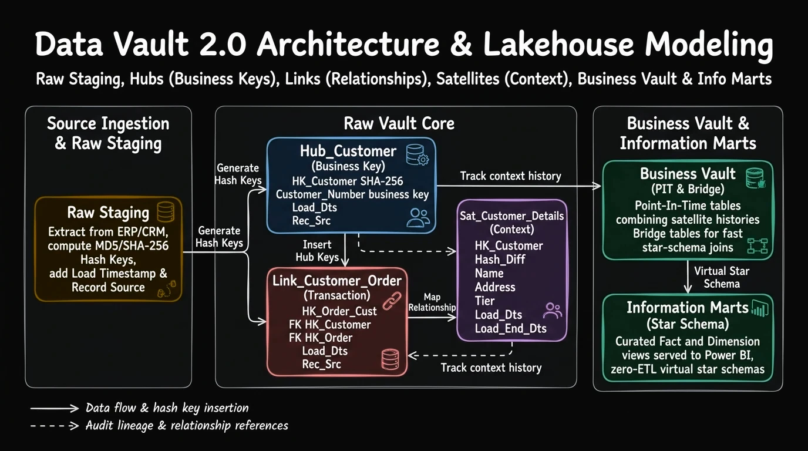
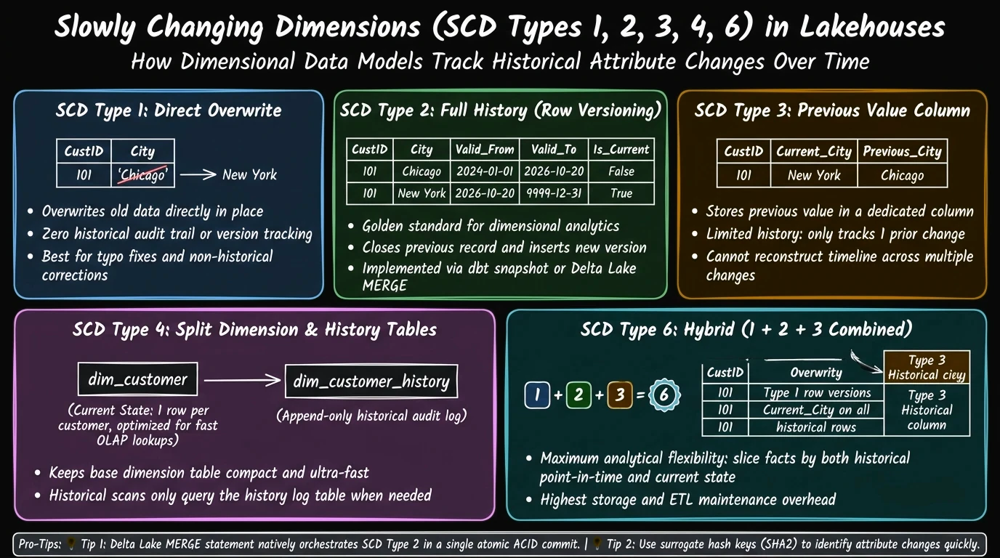

# Data Modeling & Architecture — Architecture Whiteboard Blueprints

> **Domain**: `Data Modeling & Architecture` | **Blueprints**: 4 | [← Back to Whiteboards Index](index.md)

---

## Data Modeling & Architecture
*4 Architecture Blueprints in this domain*

### 📐 Data Modeling & Architecture — Visual Blueprints Grid (2x2)

<table>
  <tr>
    <td width="50%" valign="top">
      
       <strong><a href="#kimball-dimensional-star-schema">Kimball Dimensional Modeling & Enterprise Star Schema</a></strong> 
      <em>Bus Matrix, Conformed Dimensions, Fact Grain Definition, and Columnar Lakehouse Optimization</em> 
      <small>`Kimball` · `Dimensional Modeling` · `Star Schema` · `Fact Tables`</small> 
      <a href="#kimball-dimensional-star-schema">🔍 Inspect Deep Dive & Architecture →</a>
    </td>
    <td width="50%" valign="top">
      
       <strong><a href="#data-vault-enterprise-architecture">Data Vault 2.0 Architecture & Lakehouse Modeling</a></strong> 
      <em>Hubs, Links, Satellites: Scalable Raw Vault, Business Vault, and Information Marts</em> 
      <small>`Data Vault 2.0` · `Hubs` · `Links` · `Satellites`</small> 
      <a href="#data-vault-enterprise-architecture">🔍 Inspect Deep Dive & Architecture →</a>
    </td>
  </tr>
  <tr>
    <td width="50%" valign="top">
      
       <strong><a href="#data-mesh-enterprise-architecture">Enterprise Data Mesh: Decentralized Domains & Data Products</a></strong> 
      <em>The 4 Core Principles: Domain Ownership, Data as a Product, Self-Serve Platform, and Federated Governance</em> 
      <small>`Data Mesh` · `Data Products` · `Domain-Driven Design` · `Self-Serve Platform`</small> 
      <a href="#data-mesh-enterprise-architecture">🔍 Inspect Deep Dive & Architecture →</a>
    </td>
    <td width="50%" valign="top">
      
       <strong><a href="#scd-types-lakehouse">Slowly Changing Dimensions (SCD Types 1, 2, 3, 4, 6) in Modern Lakehouses</a></strong> 
      <em>Complete SCD Taxonomy, HashDiff Change Detection, Non-Overlapping Intervals, and DLT apply_changes</em> 
      <small>`Slowly Changing Dimensions` · `SCD` · `SCD Type 2` · `Delta Lake`</small> 
      <a href="#scd-types-lakehouse">🔍 Inspect Deep Dive & Architecture →</a>
    </td>
  </tr>
</table>

---

### Kimball Dimensional Modeling & Enterprise Star Schema
**Bus Matrix, Conformed Dimensions, Fact Grain Definition, and Columnar Lakehouse Optimization**

**Tags:** `Kimball` · `Dimensional Modeling` · `Star Schema` · `Fact Tables` · `Dimensions` · `Bus Matrix` · `Conformed Dimensions` · `Surrogate Keys` · `Lakehouse Modeling` · [📖 Official Docs](https://www.kimballgroup.com/data-warehouse-business-intelligence-resources/kimball-techniques/dimensional-modeling-techniques/)

**Overview:** Enterprise-grade dimensional modeling blueprint based on the Kimball methodology, adapted for modern cloud lakehouses. Details the Enterprise Data Warehouse Bus Matrix, fact table grains (transaction, periodic snapshot, accumulating snapshot), dimension types (conformed, degenerate, role-playing, outrigger), surrogate keys vs deterministic hash keys, and star-join query optimization over columnar storage engines.

**Key Architecture Points:**
- The Kimball 4-Step Design Process: 1) Select Business Process -> 2) Declare the Grain -> 3) Identify Dimensions -> 4) Identify Numeric Facts.
- The Enterprise Bus Matrix: Master architectural grid mapping business processes (rows) against conformed dimensions (columns), ensuring enterprise metric consistency across independent data marts.
- The 3 Fact Table Archetypes: 1) Transaction Fact (one row per discrete transaction event at lowest grain); 2) Periodic Snapshot (captures state over uniform time intervals); 3) Accumulating Snapshot (tracks progress through a finite lifecycle with multiple milestone dates).
- Conformed Dimensions: Standardized, shared dimensional entities (Customer, Product, Date) with identical keys and attributes, enabling drill-across analysis across disparate business processes.
- Surrogate Keys in Modern Lakehouses: Replaces auto-incrementing integer sequences with deterministic cryptographic hashes (`sha2(concat_ws('||', business_key), 256)`) to enable parallel, idempotent ELT ingestion without database locks.
- Degenerate Dimensions: Transaction identifier keys (Order Number, Invoice ID) stored directly in the fact table without a corresponding dimension table, useful for drill-through and grouping.
- Columnar Engine Star-Join Acceleration: Modern lakehouse query engines execute Bloom filter pushdowns on small dimension filters, pruning up to 90% of massive fact table Parquet row groups before joining.

> **Architect Note:** Despite the rise of wide flat tables in data lakes, Kimball dimensional modeling remains the gold standard for enterprise analytics. In a modern lakehouse, star schemas offer dual superpowers: business users navigate intuitive, standardized relationships in BI tools (Power BI, Tableau), while columnar storage engines (Delta Lake, Parquet) achieve maximum compression ratios and sub-second star-join performance through dictionary encoding and bloom filter pushdown. Never mix grains in a single fact table.

<strong>Multi-Persona Architectural Breakdown (Click to expand)</strong>

- **Enterprise Architect:** Designs the enterprise Data Warehouse Bus Matrix; enforces grain declaration discipline; balances star schema dimensional designs against wide denormalized tables for machine learning.
- **Senior Data Engineer:** Implements deterministic surrogate key hashing algorithms; optimizes fact table partition keys and Liquid Clustering; designs star-join execution hints in Spark and SQL engines.
- **Data Engineer:** Builds ELT pipelines loading dimensional tables; handles late-arriving dimensions by inserting placeholder 'Unknown' dimension records; writes robust fact table merge statements.
- **Data Steward:** Governs conformed dimension definitions; resolves attribute discrepancies across source business units; maintains enterprise data dictionary mappings.
- **Business Analyst:** Builds intuitive self-service reports in Power BI; drag-and-drops dimensional attributes without writing complex multi-table SQL joins; trusts that business metrics calculate consistently.

**Under-the-Hood Technical Mechanisms:**
- Enterprise Bus Matrix architectural mapping aligning business processes to conformed dimensions
- Deterministic cryptographic surrogate key generation (`SHA256` / `MD5`)
- Bloom filter pushdown and star-join transformation in query execution engines
- Parquet dictionary encoding optimization on repetitive low-cardinality dimension keys
- Liquid clustering alignment over foreign key dimensional join columns

**Production Failure Modes & Incident Triage:**
- Grain Mixing / Duplication in Fact Tables: Storing header-level totals and line-item details in the same fact table causes sums to be duplicated; strictly enforce one single grain per fact table and separate headers into an accumulating snapshot.
- Snowflaking Anti-Pattern: Normalizing dimensions into multiple hierarchical sub-tables (Product -> SubCategory -> Category); collapses star-join performance; denormalize dimensional attributes back into a single flat dimension table.
- Late-Arriving Dimensions causing Orphan Fact Records: Fact transaction arrives before source CRM customer record is created; insert an 'Unknown / Pending' placeholder dimension row and update it when the dimension arrives.

**Governance & Regulatory Compliance:**
- Conformed dimensions establish a single source of truth across enterprise departments
- Auditability of all business metric calculations backed by atomic, un-aggregated fact grains
- Consistent access control policies inherited across shared dimensional data marts
- Compliance with financial accounting standards through immutable transaction fact records

[↑ Return to Data Modeling & Architecture 2x2 Grid](#data-modeling-architecture) · [Top of Catalog](index.md)

---

### Data Vault 2.0 Architecture & Lakehouse Modeling
**Hubs, Links, Satellites: Scalable Raw Vault, Business Vault, and Information Marts**

**Tags:** `Data Vault 2.0` · `Hubs` · `Links` · `Satellites` · `Raw Vault` · `Business Vault` · `Information Marts` · `Hash Keys` · `PIT Tables` · `Bridge Tables` · [📖 Official Docs](https://datavaultalliance.com/)

**Overview:** Comprehensive reference architecture of Data Vault 2.0 designed for modern enterprise lakehouses. Details the 3 core structural components: Hubs (core business concepts), Links (relationships and transactions), and Satellites (descriptive context and historical tracking). Explores the complete journey from Raw Vault ingestion through Business Vault enrichment (Point-in-Time PIT tables, Bridge tables) to consumer-facing Information Marts (star schemas).

**Key Architecture Points:**
- The 3 Core Structural Components: Hubs (unique business keys), Links (unit of work relationships/transactions between Hubs), and Satellites (temporal descriptive attributes).
- Zero Business Rules in Raw Vault: Raw Vault captures raw data exactly as emitted by source systems, maintaining 100% auditability and source system fidelity.
- Deterministic Hash Keys: Primary and foreign keys are generated using deterministic cryptographic hashes (SHA-256) of business keys, enabling fully parallel ingestion without database sequence locks.
- HashDiff Attribute Change Detection: Satellites compute a cryptographic hash of all descriptive attributes (`HashDiff`); new satellite records are inserted only when the HashDiff changes.
- Business Vault Layer: Applies enterprise business logic, calculations, and deduplication rules; includes Point-in-Time (PIT) snapshot tables and Bridge tables to optimize join performance.
- Information Marts (Consumer Layer): Star schemas and dimensional views generated directly from the Business Vault, providing business users with familiar, fast reporting structures.
- 100% Auditability & Lineage: Every table includes `LoadDate` and `RecordSource` metadata columns, establishing complete legal traceability from source database to executive report.

> **Architect Note:** Data Vault 2.0 solves the agile dilemma of traditional data warehousing: how to absorb constant source system changes without breaking existing downstream pipelines. By decoupling business keys (Hubs), relationships (Links), and context (Satellites), Data Vault allows engineers to ingest new source systems in parallel with zero dependency bottlenecks. However, raw Data Vault tables are NOT designed for direct end-user reporting. Architects must mandate an Information Mart layer (star schemas) powered by Point-in-Time (PIT) tables to provide sub-second analytical performance.

<strong>Multi-Persona Architectural Breakdown (Click to expand)</strong>

- **Enterprise Architect:** Designs enterprise Data Vault standards; selects hashing algorithms; defines integration boundaries across dozens of disparate enterprise source systems; designs PIT table refresh strategies.
- **Senior Data Engineer:** Authors automated Data Vault code generation macros (using dbtvault / AutomateDV); optimizes HashDiff calculations; tunes multi-satellite joins in Point-in-Time tables.
- **Data Engineer:** Builds parallel ingestion pipelines loading Hubs, Links, and Satellites simultaneously; manages schema evolution when new source attributes are introduced by creating new Satellites.
- **Data Steward:** Relies on the 100% auditable Raw Vault ledger to trace every historical data attribute back to its exact source system, timestamp, and load batch.
- **Business Analyst:** Queries business-friendly Information Marts without needing to navigate the complex multi-table joins of the underlying Raw Vault.

**Under-the-Hood Technical Mechanisms:**
- Deterministic SHA-256 hash key generation over concatenated business keys
- HashDiff delta detection algorithm identifying modified satellite records
- Point-in-Time (PIT) snapshot table construction resolving historical effective dates
- Bridge table optimization pre-joining complex multi-link relationship structures
- Parallel ingestion orchestration loading Hubs and Links concurrently

**Production Failure Modes & Incident Triage:**
- High Join Overhead in BI Queries: Analysts attempting to write queries directly against Raw Vault, joining 15 Satellites; enforce Information Mart layer and build Point-in-Time (PIT) tables to pre-resolve temporal joins.
- Hash Collision Hazard: Using legacy MD5 or short hashes with billions of records; mandate SHA-256 with standard string normalization (`TRIM(UPPER(key))`) to eliminate collision risks.
- Storage Explosion from Rapid Satellite Inserts: Source system sends frequent updates with unchanged data; verify HashDiff logic excludes volatile timestamps and system metadata columns.

**Governance & Regulatory Compliance:**
- 100% immutable, non-destructive audit history of all enterprise source system data
- Complete legal traceability backed by mandatory LoadDate and RecordSource metadata
- Compliance with strict financial and banking regulations (BCBS 239, Basel III)
- Auditable right-to-be-forgotten deletion workflows managed via specialized GDPR satellite masking

[↑ Return to Data Modeling & Architecture 2x2 Grid](#data-modeling-architecture) · [Top of Catalog](index.md)

---

### Enterprise Data Mesh: Decentralized Domains & Data Products
**The 4 Core Principles: Domain Ownership, Data as a Product, Self-Serve Platform, and Federated Governance**

**Tags:** `Data Mesh` · `Data Products` · `Domain-Driven Design` · `Self-Serve Platform` · `Federated Governance` · `Data Contracts` · `Decentralization` · `Enterprise Architecture` · [📖 Official Docs](https://martinfowler.com/articles/data-mesh-principles.html)

**Overview:** Organizational and technical architecture of Enterprise Data Mesh, moving away from centralized monolithic data teams. Visualizes the 4 Core Principles formulated by Zhamak Dehghani: 1) Domain-Oriented Decentralized Data Ownership, 2) Data as a Product, 3) Self-Serve Data Infrastructure as a Platform, and 4) Federated Computational Governance. Details data product archetypes, output ports, and automated data contracts.

**Key Architecture Points:**
- The 4 Core Principles: 1) Domain-Oriented Data Ownership; 2) Data as a Product; 3) Self-Serve Data Platform; 4) Federated Computational Governance.
- Domain-Driven Design (DDD) Alignment: Data architectures mirror business domain boundaries and bounded contexts rather than technical pipeline stages (ingestion vs transformation vs presentation).
- Data as a Product (DaaP): Domains treat data as a commercial product with external consumers, providing formal SLAs, comprehensive documentation, discoverability, and data quality guarantees.
- Data Product Architectural Anatomy: A self-contained architectural unit comprising: Polyglot Storage (Delta tables, vector indexes), Transformation Code, Metadata/Contracts, and Output Ports (SQL, REST, Streaming).
- Self-Serve Data Infrastructure Platform: Central team provides automated, declarative infrastructure templates (via DABs / Terraform), allowing domain teams to spin up secured lakehouse workspaces in minutes.
- Federated Computational Governance: Automated policy enforcement embedded directly into the platform (automated RBAC, PII masking, lineage tracking, contract verification) rather than manual gatekeeping.
- Automated Data Contracts: Formal JSON/YAML interface agreements between data producers and consumers defining schemas, SLA commitments, freshness thresholds, and breaking change protocols.

> **Architect Note:** Data Mesh is an socio-technical operating model shift, not a piece of software. In large enterprises, central data teams become suffocating bottlenecks as data consumers and producers scale. Data Mesh decentralizes analytical data ownership to cross-functional domain teams (e.g. Checkout, Logistics, Marketing) who own their data as a product. The central platform team shifts from writing pipelines to building self-serve platform infrastructure (automated workspace provisioning, CI/CD templates, cataloging) that domain teams consume independently.

<strong>Multi-Persona Architectural Breakdown (Click to expand)</strong>

- **Enterprise Architect:** Establishes enterprise Data Mesh operating model; defines domain boundaries using Bounded Contexts; designs self-serve platform APIs and automated compliance policies.
- **Senior Data Engineer:** Builds reusable domain data product templates; implements automated data contract testing in CI/CD pipelines; designs cross-domain secure data sharing protocols.
- **Data Engineer:** Embedded directly within a domain team (e.g. Supply Chain); builds and maintains domain-specific data products and output ports; adheres to platform standards.
- **Data Steward:** Participates in the Federated Governance Council; defines global classification standards that the platform automatically enforces across all autonomous domains.
- **Business Analyst:** Discovers and consumes trusted, certified data products across multiple business domains via the enterprise catalog with guaranteed data quality SLAs.

**Under-the-Hood Technical Mechanisms:**
- Data Contract schema validation and breaking change detection in CI/CD pipelines
- Cross-domain zero-copy data sharing via Delta Sharing and Unity Catalog federation
- Automated self-serve infrastructure provisioning via Terraform and Databricks Asset Bundles
- Centralized metadata harvesting publishing domain output ports to enterprise catalogs
- Federated identity and dynamic attribute-based access control (ABAC) policy enforcement

**Production Failure Modes & Incident Triage:**
- Decentralized Data Silos / Chaos: Domain teams build isolated pipelines using incompatible tools, recreating legacy data silos; central platform team must mandate golden infrastructure templates and shared catalog standards.
- Data Contract Breaking Change: Upstream domain team alters column schema without warning, breaking downstream analytical models; implement automated pre-deployment contract checks that fail CI builds on unversioned schema alterations.
- Lack of Domain Engineering Skills: Business domain teams lack experienced data engineers to maintain data products; establish center-of-excellence rotational programs and simplify self-serve platform tooling.

**Governance & Regulatory Compliance:**
- Federated Governance Council establishing global interoperability and security policies
- Automated computational policy enforcement running within CI/CD and runtime engines
- Clear ownership attribution and accountability for data quality and regulatory compliance
- Cross-domain audit trails tracking every data product consumption event and SLA metric

[↑ Return to Data Modeling & Architecture 2x2 Grid](#data-modeling-architecture) · [Top of Catalog](index.md)

---

### Slowly Changing Dimensions (SCD Types 1, 2, 3, 4, 6) in Modern Lakehouses
**Complete SCD Taxonomy, HashDiff Change Detection, Non-Overlapping Intervals, and DLT apply_changes**

**Tags:** `Slowly Changing Dimensions` · `SCD` · `SCD Type 2` · `Delta Lake` · `MERGE INTO` · `apply_changes` · `HashDiff` · `Time Travel` · `Data Modeling` · `Effective Dates` · [📖 Official Docs](https://docs.delta.io/latest/delta-update.html#slowly-changing-data-scd-type-2-with-delta-lake)

**Overview:** Comprehensive taxonomy and lakehouse implementation blueprint for Slowly Changing Dimensions (SCD Types 0, 1, 2, 3, 4, and 6). Focuses on modern lakehouse SCD Type 2 mechanics: deterministic HashDiff change detection, non-overlapping validity date intervals (effective_date, end_date, is_current), atomic Delta Lake MERGE INTO statements, and automated orchestration via Delta Live Tables (apply_changes_into).

**Key Architecture Points:**
- SCD Type 0 (Retain Original): Attributes never change; historical values are fixed forever (e.g. Original Date of Birth, First Registration Country).
- SCD Type 1 (Overwrite): Updates replace existing values with zero historical tracking; simple and lightweight, but permanently destroys past attribute state.
- SCD Type 2 (Add New Row): Tracks full historical change; inserts a new row with new attribute values while expiring the previous row by updating `end_date` and setting `is_current = false`.
- SCD Type 3 (Add New Attribute): Tracks a limited history by adding a 'Previous Value' column directly to the existing row; captures only the immediate prior state.
- SCD Type 4 (Historical Table / Mini-Dimension): Retains current state in the primary dimension table while routing all historical updates to a dedicated history table.
- SCD Type 6 (Hybrid 1 + 2 + 3): Combines Types 1, 2, and 3: writes a new historical row (Type 2), while updating the 'Current Value' attribute across all historical rows (Type 1).
- Delta Live Tables (DLT) Native Orchestration: Native `dlt.apply_changes()` handles out-of-order sequence keys, deduplication, row expiration, and SCD2 insertion with zero hand-written merge SQL.

> **Architect Note:** SCD Type 2 is the cornerstone of regulatory historical auditability in enterprise data warehouses. In traditional relational databases, updating historical rows while inserting new ones required complex transactional locks. In Delta Lake, SCD Type 2 is achieved via a single atomic `MERGE INTO` statement. Architects must enforce two strict rules: 1) validity date ranges must be non-overlapping (`start_date <= target_date < end_date`), and 2) target fact tables must join against the SCD2 dimension using point-in-time date range filters rather than simple foreign key equality.

<strong>Multi-Persona Architectural Breakdown (Click to expand)</strong>

- **Enterprise Architect:** Defines enterprise SCD policy per business entity; balances historical auditability against storage footprint; establishes point-in-time analytical modeling standards.
- **Senior Data Engineer:** Optimizes atomic `MERGE INTO` queries using partition pruning; implements deterministic HashDiff calculations; troubleshoots timestamp collision edge cases.
- **Data Engineer:** Builds daily dimensional ETL pipelines; implements DLT `apply_changes_into` statements; validates that active rows have `is_current = true` and `end_date IS NULL`.
- **Data Steward:** Verifies historical regulatory reporting accuracy; ensures retroactive GDPR erasure requests successfully locate and purge all historical SCD2 customer records.
- **Business Analyst:** Authors point-in-time historical queries using `WHERE target_date >= effective_date AND target_date < end_date` to calculate accurate historical metrics as they appeared on that date.

**Under-the-Hood Technical Mechanisms:**
- Deterministic HashDiff hashing over concatenated tracked business attributes
- Two-stage atomic Delta Lake MERGE INTO executing update and insert branches
- DLT apply_changes_into sequencing engine reconciling out-of-order CDC streams
- Non-overlapping date interval validation logic (`end_date = current_timestamp`)
- Surrogate key generation combining business key with effective start timestamp

**Production Failure Modes & Incident Triage:**
- Overlapping Active Date Intervals (`is_current = true` duplicated): Pipeline failure caused by concurrent merges; identify duplicate active keys (`groupBy('id').filter('count(is_current = true) > 1')`) and expire the older record.
- Full Table Scan on Massive Dimension Merge: `MERGE INTO` lacks partition pruning or clustering predicates; cluster target dimension table by business key and ensure merge condition references clustering keys.
- Microsecond Timestamp Collision: Rapid updates within the same microsecond produce identical timestamps; implement sequential sequence numbers or increment end_date by 1 millisecond.

**Governance & Regulatory Compliance:**
- Mandatory compliance with financial and regulatory requirements for non-repudiation and historical tracking
- Accurate point-in-time tax and accounting auditability across historical tax years
- Standardized procedures for GDPR 'Right to be Forgotten' across all historical SCD2 rows
- Immutable audit records capturing who modified each attribute and at what exact timestamp

[↑ Return to Data Modeling & Architecture 2x2 Grid](#data-modeling-architecture) · [Top of Catalog](index.md)

---
