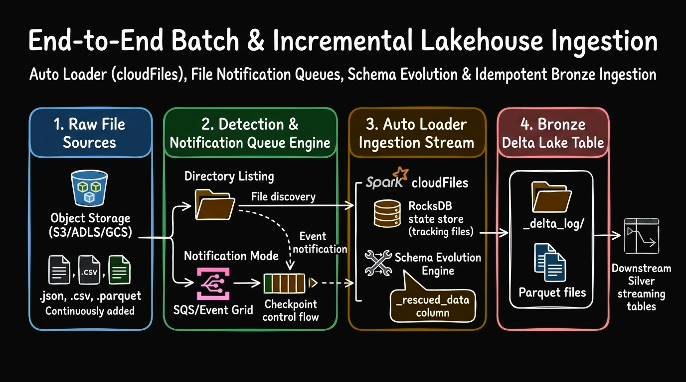

# 🚨 Production Runbook 04: Auto Loader Schema Drift & Poison Pill Quarantine Forensics

> **Incident Severity**: SEV-2 (Ingestion Pipeline Degradation / Poison Pill Alert)  
> **Target Systems**: Databricks Auto Loader (`cloudFiles`), Schema Evolution, Dead Letter Queue (DLQ)  
> **Recovery Objective**: Isolate malformed upstream files, extract unparseable records to quarantine, and resume streaming ingestion within 10 minutes.

---

## 1. Emergency Decision Tree

```
               [Auto Loader Alert: Ingestion Halted / Poison Pill Crash]
                                           │
                           Check Stream Failure Signature
                                           │
             ┌─────────────────────────────┴─────────────────────────────┐
             ▼                                                           ▼
 [Schema Evolution Halt]                                     [Malformed / Corrupted File]
 (SchemaEvolutionException)                                  (Malformed JSON / Bad Delimiter)
             │                                                           │
 Did upstream add a new column?                              Is rescuedDataColumn active?
             │                                                           │
     ┌───────┴───────┐                                           ┌───────┴───────┐
     ▼               ▼                                           ▼               ▼
   [YES]           [NO]                                        [YES]           [NO]
 Set addNew      Type Collision:                             Query           Enable
 Columns mode;   Inspect _rescued_data                       _rescued_data;  rescuedDataColumn;
 Restart Stream  and route to DLQ                            Route to DLQ    re-run file
```

### 📐 Visual Architectural Blueprint: Lakehouse Auto Loader Ingestion


### 📐 Visual Architectural Blueprint: Data Quality WAP & Quarantine Architecture


---

## 2. Forensic Investigation Queries

When Auto Loader detects unparseable columns or data type mismatches, the unparseable fields are captured in the JSON `_rescued_data` column. Execute this query to inspect quarantined payloads:

```sql
-- 1. Identify poison pill records and failure reasons
SELECT 
    _metadata.file_path AS source_file,
    _metadata.file_modification_time AS file_time,
    _rescued_data,
    COUNT(*) AS corrupted_row_count
FROM prod_catalog.bronze.raw_events
WHERE _rescued_data IS NOT NULL
GROUP BY _metadata.file_path, _metadata.file_modification_time, _rescued_data
ORDER BY file_time DESC
LIMIT 20;

-- 2. Inspect the inferred schema history at the schema location
SELECT * FROM text.`/Volumes/prod_catalog/metadata/schemas/events/_schemas/0`;
```

---

## 3. Surgical Remediation & DLQ Routing

### 3.1 Extracting Poison Pills to Dedicated DLQ Table
Execute this script to quarantine corrupted payloads and clean the downstream Bronze dataset:

```python
from pyspark.sql import functions as F

# 1. Read records where parsing failed into a quarantine table
df_raw = spark.table("prod_catalog.bronze.raw_events")
df_poison = df_raw.filter(F.col("_rescued_data").isNotNull())

(
    df_poison.write.format("delta")
    .mode("append")
    .option("mergeSchema", "true")
    .saveAsTable("prod_catalog.quarantine.ingestion_poison_pills")
)

# 2. Delete poison records from Bronze table so Silver pipeline can proceed safely
spark.sql("DELETE FROM prod_catalog.bronze.raw_events WHERE _rescued_data IS NOT NULL")
```

### 3.2 Safe Schema Ingestion Configuration
Enforce resilient Auto Loader options in the streaming ingestion pipeline:

```python
df_stream = (
    spark.readStream.format("cloudFiles")
    .option("cloudFiles.format", "json")
    .option("cloudFiles.schemaLocation", "/Volumes/prod_catalog/metadata/schemas/events")
    .option("cloudFiles.schemaEvolutionMode", "addNewColumns")
    .option("cloudFiles.inferColumnTypes", "true")
    .option("rescuedDataColumn", "_rescued_data")
    .load("abfss://landing@storage.dfs.core.windows.net/events/")
)
```

---

## 4. Permanent Architectural Prevention

1. **Mandate `_rescued_data`**: All Auto Loader ingestion streams must specify `option("rescuedDataColumn", "_rescued_data")`.
2. **Automated DLQ Monitoring**: Create a Databricks SQL Alert scheduled hourly that notifies engineering via Slack if `COUNT(*)` in `prod_catalog.quarantine.ingestion_poison_pills` exceeds 0.
3. **Producer Contracts**: Enforce JSON schema contracts upstream at API gateways or Kafka schema registries to catch data corruption before cloud storage landing.
